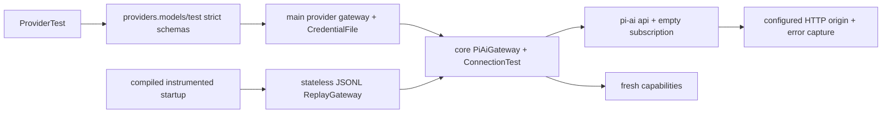

<!--
Copyright (c) 2026 DDP Engineering
This software is licensed under the PolyForm Noncommercial License 1.0.0.
Commercial use requires a separate commercial license.
See the LICENSE.txt in the .agentic folder for full license details.
SPDX-License-Identifier: LicenseRef-PolyForm-Noncommercial-1.0.0
-->

# TASK-77e6f562 - WP-09 LLM gateway, connection test, replay provider

stage: done
type: feature
path: full
interaction: autopilot
requirements: REQ-FUNC-05ee1ae5, REQ-FUNC-f3e5db81, REQ-FUNC-5f2220ee, REQ-FUNC-762c3864, REQ-FUNC-29854976, REQ-SEC-647da472, REQ-TEST-38b20a35, REQ-TEST-771b99be, REQ-TEST-c986438f, REQ-UX-53628854, REQ-DATA-f69eaef6, REQ-FUNC-103979aa, REQ-DATA-4a030001, REQ-DATA-4a030002, REQ-DATA-87619ef8
parent:
branch: master
base: 36a1a06b94cd2c44aa01f8f8460f10e1b28385ed
opened: 2026-10-11

## Done checklist (current stage)

- [x] validated candidate confirmed unchanged
- [x] validation evidence, exact diff inventory, exclusions and outcome prepared for handback
- [x] delivery confirmed by the human: existing RULING001 authorizes coordinator local commit only
- [x] journal and report included in the delivery commit
- [x] agreed local-commit outcome delivered by coordinator
- [x] close-out carried by coordinator delivery commit

## Frame

Problem: STATED WP09 needs a single core model gateway and deterministic replay.
Desired outcome: STATED catalog/capabilities, four-step connection test, safe errors and localized Providers Test UI.
Actors: OS-account engineer; main credentials/settings host; core gateway; sandboxed renderer; future runtime.
Primary scenario: Test configured provider -> gateway probes catalog and model/tool/stream behavior -> strict per-step safe results displayed.
Examples: STATED scripted echo model passes; a model without tools fails that step; smaller selected model provides smaller next-request budget.
Counterexamples: automated checks must never use real models; release contains no replay registration seam; provider messages must never disclose credentials.
In scope: M1 WP09 entirety, exact pi-ai pin, api/subscription collections, model references, budgets, catalogs, error mapping, replay, live smoke, network guard, IPC/UI/mock/i18n and current docs.
Out of scope: WP10 runtime/context reduction, WP21 OAuth, sessions/tools, other WPs, commits/staging/publication, issue/cycle/automation mutation.
Constraints: STATED master/base36a1a06b94cd2c44aa01f8f8460f10e1b28385ed, one implementation chat; Electron44.7.0/Node24.21.0 baseline; main-only secrets and all WP08 protections; protected unrelated optional-companions SHA2562a69f5b335a53e498b1f8e30fa5adb8096e870e7a12bbc05b0727a03cee72c6b.
Success signals: all five WP09 acceptance groups; two independent read-only verdicts on same complete candidate; strict/full E2E Windows and Ubuntu parity.
Evidence: OBSERVED plan M1 WP09 and tea issue9 agree; architecture04 sections1-4,7,8,08 sections3,4,01 laws/import boundaries,03 budget,ADR0002/0011. OBSERVED WP08 complete at HEAD with credential registry and schema3. OBSERVED pi-ai1.1.0 tarball inspected (models/types/openai/completions); fetch injection exposes HTTP failures even when provider flattens errors.
Assumptions: INFERRED configured custom budgets apply to catalog-listed model IDs because /models does not report capabilities; no invented catalog models. subscription collection stays empty.
Unknowns: UNKNOWN real configured OpenAI/Ollama availability and manual smoke; inspected later, never substituted by replay. BMAD auxiliary render missing; user explicitly allows AEGIS continuation.
Decision-blocking questions: none for independent implementation.
Proposed behaviors: exact linked spec and requirement inventory; guarded automated loopback/replay, manual live outside guard.
Path and reason: full. Quick criteria: new observable behavior=no; no new interface=no; no dependency=no; existing complete coverage=no; unchanged security handling=no. No implementation children; independent reviewers only.

## Requirement coverage

Behavior inventory and coverage (each row is independently observable; verification includes setup, trigger, positive and failure oracle).

| Frame outcome / atomic behavior | Requirement | Positive/boundary/failure verification | Design |
|---|---|---|---|
| Create configured model collections | REQ-FUNC-05ee1ae5 | Inspect collection IDs, injected credential resolution and captured conservative custom HTTP payloads; unknown provider/model returns NOT_FOUND. | Gateway/IPC/host seams in linked spec |
| Resolve model selection precedence | REQ-FUNC-f3e5db81 | Supply all three references, omit each in turn, and assert the chosen exact reference; invalid or missing selection is INVALID. | Gateway/IPC/host seams in linked spec |
| Expose fresh model budgets | REQ-FUNC-5f2220ee | Inspect capabilities before any stream; switch from larger to smaller custom model and observe smaller budget; invalid or exhausted custom windows fail before network. | Gateway/IPC/host seams in linked spec |
| Return safe provider catalogs | REQ-FUNC-762c3864 | Scripted loopback catalog returns discovered IDs with configured capabilities; 404/405/501 falls back to configured model; auth/network/malformed results report safe errors. | Gateway/IPC/host seams in linked spec |
| Report connection test steps | REQ-FUNC-29854976 | Replay and loopback scripted tool model pass all steps; non-tool model fails tool step, unsupported listing is skipped; failure leaves actionable per-step structured errors. | Gateway/IPC/host seams in linked spec |
| Scrub mapped provider failures | REQ-SEC-647da472 | Loopback HTTP 401/403/429/context/500 and refused connection assert codes/reasons and absence of known credentials throughout result JSON; retained replaced secrets and hostile metadata are scrubbed. | Gateway/IPC/host seams in linked spec |
| Replay scripted model transcripts | REQ-TEST-38b20a35 | Temporary JSONL scripts select by name or regex, repeated same transcript reproduces events, completed assistant advances step, artifact bindings substitute; abort yields no completed response. | Gateway/IPC/host seams in linked spec |
| Compile replay registration only into test builds | REQ-TEST-771b99be | Build both actual modes and inspect all emitted main JavaScript; instrumented native IPC uses replay and release contains neither environment marker nor replay module code. | Gateway/IPC/host seams in linked spec |
| Reject automated outbound network | REQ-TEST-c986438f | Core guard self-test rejects fetch/socket to example.invalid before traffic and permits temporary loopback server; E2E asserts no outbound attempts. | Gateway/IPC/host seams in linked spec |
| Display localized provider test results | REQ-UX-53628854 | Native replay and browser mock acceptance use translated controls, live status and four result rows, keyboard operation and failed tool result; response observation contains no key. | Gateway/IPC/host seams in linked spec |
| Migrate model-reference settings | REQ-DATA-f69eaef6 | Temporary version3 with provider/extensions migrates with exact backup; valid model reference persists; malformed reference rejects and future bytes stay unchanged. | Gateway/IPC/host seams in linked spec |
| Run manual real-provider smoke | REQ-FUNC-103979aa | Manual: run against a real OpenAI credential or user-selected real OpenAI-compatible provider, inspect all four steps and actual exit; unavailable configuration remains unfulfilled. | Gateway/IPC/host seams in linked spec |

## Design

Requirements coverage: collections/catalog/capabilities (REQ-FUNC-05ee1ae5/5f2220ee/762c3864); precedence (FUNC-f3e5db81); connection steps (FUNC-29854976); safe errors (SEC-647da472); replay/build/network (TEST-38b20a35/remaining test IDs); UI (UX-53628854); schema migration and live smoke (linked requirements). Exact details in linked spec; every inventory row maps to named test seam.
Component responsibilities: core gateway over pi-ai, shared strict IPC/projected schemas, main supplies current settings/store/scrub/Clock; renderer invokes saved provider IDs, no credential arguments.
Interfaces: providers.models/test strict schemas; fresh target snapshot for each request, no stale custom collection mutation shared across concurrent requests. api base OpenAI static catalog with store-only API auth; subscription empty. Per-request custom provider collection prevents crossed endpoints/credentials.
State: existing supportsTools optional persisted field updated only through provider queue if tested config unchanged and writable. No new credential format; settings4 migration needed because app default was null-only in schema3 (OBSERVED shared settings.ts); version3 retains providers and backups.
Flow: resolve ref/capabilities before stream; injected fetch records safe HTTP outcome and enforces configured origin; pi-ai maps assistant/usage/tool deltas; connection test separately probes four properties.
Failure/recovery: maxRetries0,30s timeout, structured safe errors, abort propagation and cleanup; catalog unsupported limited to404/405/501. No runtime context-reduction implementation. Stream consumers receive safe partial message.
Security: credentials read only in main core host; all provider-controlled output/error strings scrubbed over retained WP08 registry; OpenAI credential resolver suppresses ambient env fallback. Replay lazy import is within compile-time block; release emission proves seam removal. Network guard loaded before Node test modules.
Concurrency: per-request target snapshot, provider-config persistence serialized; no mutable replay cursor. Main drains accepted tests before closing credentials/settings.
Compatibility: exact pi-ai1.1.0 inspected package; conservative custom flags. Schema4 protects3 readers, backup migration0-3, newer read-only unchanged. No changed workbench format.
Observability: actual subprocess receipts/raw SHA/manifests in ignored02_Tools/cache/wp09; root anchor/evolution retained. Existing mirror snapshotted before reconciliation; all Git-visible nonjournal files hash parity before/after perOS verification.
Test seams: temporary loopback HTTP/SSE + replay, fake credentials Clock/scrub, settings real temp ports, native test-build registration, mock UI, actual release emissions and outbound guard self-tests. Manual smoke uses ordinary Electron host/store, configured endpoint only; no automated live invocation.
Alternatives/tradeoffs: upstream flattened error strings lose retry metadata, so injected fetch captures status safely; static context budget from custom config is authoritative for discovered IDs. Gateway preflight exposes metadata; WP10 owns counting/reduction.
Expected files: llm gateway/providers/errors/connection/replay and tests, shared provider IPC/settings, migration tests, main provider gateway/startup/service, renderer Test UI/locales/mock, scripts smoke, test guard/config/build-mode/E2E, current docs and knowledge.
Risks: actual provider may fail streaming/tools; report failures truthfully. Real endpoint availability UNKNOWN; mandatory live criterion remains incomplete if absent. No blocking design decision.

### Proposed architecture - TASK-77e6f562

## Log

- 2026-10-11 frame: <scope agreed, exclusions, chosen path and why>

- 2026-10-11T10:55:20.227172+00:00 frame: Full scope accepted under delegated autopilot; master/HEAD/base confirmed, no existing WP09 journal. AEGIS authoritative; auxiliary BMAD render missing, no installation. Issue9 and source plan agree. Frame audited; no blocking product decision.

- 2026-10-11T10:56:27.364903+00:00 frame: Full scope accepted under delegated autopilot; master/HEAD/base confirmed, no existing WP09 journal. AEGIS authoritative; auxiliary BMAD render missing, no installation. Issue9 and source plan agree. Frame audited; no blocking product decision.

- 2026-10-11T10:56:29.901972+00:00 specify: Twelve atomic requirements and shared exact gateway spec cover the full behavior inventory including failures, release seam, network, migration and mandatory live smoke; no unresolved independent implementation decision. Requirements audited against frame.

- 2026-10-11T10:57:02.341444+00:00 design: Gateway boundary, current-config concurrency, scrub/HTTP error capture, release seam, settings4 migration and focused verification designed and audited; proposed diagram remains task-owned. Read build step before implementation.

- 2026-10-11T10:58:09.587343+00:00 build red REQ-FUNC-05ee1ae5/f3e5db81/5f2220ee/762c3864/29854976 and REQ-SEC-647da472: python ../02_Tools/npmw.py npx vitest run packages/core/src/llm/gateway.test.ts, actual child exit1; configured gateway existence assertion fails before import, expected missing behavior. Original windows-gateway-red log/receipt retained.

- 2026-10-11T11:01:17.731550+00:00 build green gateway: Windows10tests actualexit0; precedence, fresh budgets, loopback catalog/tool/stream, 401/403/429/context/500/refused and retry0 covered, original windows-gateway-green2 receipts. Narrow pi-ai models subpath avoids root barrel import startup cost without changing timeout.

- 2026-10-11T11:01:38.856876+00:00 build red REQ-DATA-f69eaef6: python ../02_Tools/npmw.py npx vitest run packages/core/src/settings/service.test.ts -t "migrates schema3 model", actualexit1 expected4 observed3; original windows-settings4-red receipts. Migration retains old3 semantics in dedicated parser.

- 2026-10-11T11:02:45.864818+00:00 build green REQ-DATA-f69eaef6 and existing migrated-default contracts: Windows25settings tests actualexit0, original windows-settings4-green2 receipts; old0/1/2/3 parsers preserve previous inputs and exact backups, current4 oracles updated. Replay red REQ-TEST-38b20a35: python ../02_Tools/npmw.py npx vitest run packages/core/src/llm/replay.test.ts actualexit1 missing replay implementation assertion before import; original windows-replay-red receipts.

- 2026-10-11T11:03:21.716950+00:00 build green replay:2tests actualexit0 original windows-replay-green; stateless transcript/regex/artifact/abort and four connection steps covered. build red REQ-TEST-c986438f: python ../02_Tools/npmw.py npx vitest run tests/tooling/network-guard.test.ts actualexit1 expected missing core egress guard assertion; original windows-network-red.

- 2026-10-11T11:04:20.629204+00:00 build network green13tests3files actualexit0; automatic fetch/socket guard applies before core/desktop/tooling tests. build red REQ-TEST-771b99be: python ../02_Tools/npmw.py npx vitest run tests/tooling/build-mode.test.ts actualexit1 missing instrumented VERA_REPLAY_DIR marker, original windows-build-replay-red.

- 2026-10-11T11:07:30.746963+00:00 build red UI REQ-UX-53628854: VERA_TEST=1 python ../02_Tools/npmw.py npm run test:e2e -- provider-test.spec.ts actualexit1 at missing Test control after native replay four-step success; original windows-provider-ui-red-corrected. Earlier missing VERA_TEST invocation is corrected prerequisite error, not red evidence. Build-mode instrumented/release1test actualexit0 original windows-build-replay-green.

- 2026-10-11T11:08:38.602167+00:00 build mock red REQ-UX-53628854/catalog/test parity: python ../02_Tools/npmw.py npx vitest run apps/desktop/src/renderer/mocks/mockApi.test.ts -t "mock catalogs" actualexit1 INTERNAL because catalog handler absent; original windows-mock-gateway-red. Mock gateway behavior now passes new oracle; existing default-version assertion reconciled to4. Native UI fourpass result observed; ambiguous role assertion repaired by translation-key locator, no timeout/oracle weakening.

- 2026-10-11T11:10:16.559665+00:00 build privacy/catalog regression red REQ-SEC-647da472/FUNC-762c3864: python ../02_Tools/npmw.py npx vitest run packages/core/src/llm/gateway.test.ts -t staticOpenAI/spanning text, actualexit1; static catalog attempted prohibited network and guard blocked before egress, split text disclosed full fictional secret. Original windows-stream-catalog-red. Corrected with offline pi catalog and overlap-safe raw-tail redaction using main retained registry; measured source delta count preserves streaming probe semantics.

- 2026-10-11T11:11:53.134044+00:00 build green privacy/catalog/mock:18tests2files actualexit0, original windows-gateway-privacy-green2; static pi catalog available without traffic and source-stream split credential redacted. Pin catalog includes old windows with maximal output, effective OpenAI reserve capped16384 and context-margin-1; custom configured reserve remains exact and validated. Locale/collision fixture encoding repaired without changing privacy oracle.

- 2026-10-11T11:19:30.585355+00:00 build red collection completeness REQ-FUNC-05ee1ae5: focused "keeps subscription" gateway test actualexit1, API IDs lacked custom:local; original windows-custom-collection-red receipt/raw log retained. build red release seam REQ-TEST-771b99be: actual two-mode build test actualexit1, release emitted registerReplay; original windows-release-registration-red retained. Corrective implementations follow these observed negative tests.

- 2026-10-11T11:23:42.856364+00:00 build consolidated green: actual two-mode release/instrumented build and configured API collection tests13passed2files exit0 windows-collections-registration-green; host/injected gateway scrub red REQ-SEC-647da472 actualexit1 exposed fictional key in testConnection failure params windows-connection-host-scrub-red, corrected by explicit main scrub injection, focused gateway/mock19tests2files exit0 windows-connection-host-scrub-green. Native UI prior1test exit0 windows-provider-ui-green2. Windows typecheck exit0 windows-focused-types. Current requirements/spec/context/knowledge and README reconciled to schema4, static catalog, output cap, overlap scrub, generic injection and manual smoke contract. Live requirement implementation active; mandatory real-provider observation remains unmet, never reported complete.

- 2026-10-11T11:24:42.295223+00:00 build complete for implemented behaviors: focused native/browser Test acceptance2tests exit0 windows-ui-expanded-green, including en/ro/de keyboard and four rows. Current formatting and typecheck exit0 windows-format-ready/windows-type-ready. All changed paths inventoried; traceability check errors0 warnings0 manual note1. Layout catalog now names existing tooling tests and root Vitest configuration; configured verification commands unchanged. Manual availability inspection records no stored Windows real configuration/ambient key or reachable local Ollama/LMStudio endpoint; live-availability.json is availability evidence only, never successful smoke. Required real-provider observation remains pending external configuration.

- 2026-10-11T11:28:53.906758+00:00 validate review round1: original independent spec and quality verdicts changes_required on identical73path candidateSHA3d8b1cff42f7259190eadb26eb15e10c1d910ea707813ca6ff0c640a4f671ace, both manifest checks unchanged. SPEC-1 mock pre-auth offline catalog; SPEC-2 injected Clock; QUALITY-1 complete assistant metadata scrubbing P1; QUALITY-2 invalid discovered IDs; QUALITY-3 strict echo args; QUALITY-4 mock catalog/auth/model override parity. Original JSON artifacts retain authors/UTC/native evidence. Returning to build to fix only recorded findings, both approvals cleared. Replay terminal tool calls match reference, dedicated tool deltas not required. Live gap remains external acceptance blocker. Linux readiness0 and focused16tests0 observed, mirror prior snapshot retained; manual unconfigured smoke actualexit1 expected reach/authfail+skips, not live success; no real configuration/endpoints on either host.

- 2026-10-11T11:30:11.678613+00:00 build red round2 SPEC-2/QUALITY-01 REQ-SEC-647da472: python ../02_Tools/npmw.py npx vitest run packages/core/src/llm/gateway.test.ts -t "assistant metadata|host Clock", actualexit1 four failures; done/partial responseId/responseModel/thinkingSignature/rawStopReason contained current/retained fictional secrets and both success/error timestamps ignored injected0. Original windows-round2-metadata-clock-red receipt/log retained; corrective implementation follows.

- 2026-10-11T11:30:52.091636+00:00 build green SPEC-2/QUALITY-01: focused four done/partial metadata/Clock regressions exit0 windows-round2-metadata-clock-green. build red QUALITY-02 REQ-FUNC-762c3864: python ../02_Tools/npmw.py npx vitest run packages/core/src/llm/gateway.test.ts -t "malformed discovered", exit1 two malformed IDs resolved catalog instead of PROVIDER; original windows-round2-model-id-red. Validate IDs against model-reference schema before publishing/probing catalog.

- 2026-10-11T11:31:27.491860+00:00 build green QUALITY-02 malformed model ID two regressions exit0 windows-round2-model-id-green. build red QUALITY-03 REQ-FUNC-29854976: python ../02_Tools/npmw.py npx vitest run packages/core/src/llm/replay.test.ts -t "strict schema", actualexit1, echo with extra argument incorrectly passed; original windows-round2-echo-red retained.

- 2026-10-11T11:32:22.930227+00:00 build green QUALITY-03 strict echo probe3replaytests exit0 windows-round2-echo-green. build red SPEC-1/QUALITY-04 REQ-UX-53628854: python ../02_Tools/npmw.py npx vitest run apps/desktop/src/renderer/mocks/mockApi.test.ts -t "offline before auth|custom override", exit1; catalog wrongly required auth and alternate model test wrongly persisted current-model capability/event; original windows-round2-mock-red retained. Correct catalog/auth/model selection parity with a small non-secret fixture, no renderer model dependency.

- 2026-10-11T11:33:39.852856+00:00 build fix cycle1 complete: all six recorded source findings corrected with preceding focused negatives; exact greens metadata/Clock4tests, malformed IDs2tests, strict echo3tests, mock8tests. Consolidated gateway/replay/mock30tests3files exit0 windows-round2-focused; formatting/typecheck exit0 windows-round2-format/windows-round2-types. Specs/knowledge/README and links reconciled before re-review. No acceptance scope weakened; replay terminal tool calls retained per reference. Manual Windows empty-store smoke exited1 with explicit auth/model failures; no successful real smoke and Linux availability likewise absent.

- 2026-10-11T11:36:27.242772+00:00 validate round2 independent originals spec-round2.original.json and quality-round2.original.json both approved for source/specification and implementation quality on identical73path candidateSHA76b256184fe600ffab7b7dc5f674b9bbcde3a14f3d63399c26c64bdd63779a4d. Authors unchanged /root/wp09_spec_review and /root/wp09_quality_review, full manifests rechecked unchanged; all union findings resolved. Both explicitly preserve missing real-provider acceptance and pending full proof. Linux focused30tests exit0 linux-round2-focused after source alignment. AEGIS secret-in-diff is a verified fictional fixture false positive: regex matches apiKey: fixtureCredential bare identifier, declared fake-mock-key-private-123; no real secret, no scan/promotion rule weakened. Begin final serial exact configured strict commands and full acceptance; do not modify candidate.

- 2026-10-11T11:36:27.265570+00:00 Evidence administration: AEGIS originally fingerprints every Git-visible path, including the user-protected unrelated file. The local anchor inventory is an explicitly derived exclusion-filtered record (original tool SHA stored, original timestamp/id retained), honoring the user exclusion. Source/candidate/protected bytes unchanged; evolution reports and final candidate/full-source manifests exclude that path. No AEGIS configuration-ignore or Git ignore entry added.

- 2026-10-11T11:46:43.887313+00:00 validate final automated proof complete on unchanged round2 candidate. Serial actual child exit0: Windows then native Ubuntu python .agentic/aegis.py check --task TASK-77e6f562 --strict --run, each executing configured python ../02_Tools/npmw.py npm test and npm run verify from 05_Software; then Windows/Ubuntu python ../02_Tools/npmw.py npm run test:e2e, all15tests passed on each OS; then Windows/Ubuntu python ../02_Tools/npmw.py npx vitest run tests/tooling/build-mode.test.ts tests/tooling/network-guard.test.ts packages/core/src/llm/gateway.test.ts packages/core/src/llm/replay.test.ts, all24tests4files passed on each OS. Original six final receipts/raw stdout and exact UTC/cwd/argv/exit/SHA256 retained in 02_Tools/cache/wp09/handback-evidence.json, with byte-identical native originals. Strict errors0 warnings2 notes1 each: lexical fictional-fixture secret-in-diff warnings in test and journal, independently reviewed as false positives; manual-verification note remains. AEGIS successful-child stdout is not persisted by the checker, so strict evidence asserts exact configured command success, not unrecorded test counts. All534Git-visible nonjournal source hashes before/after every proof are identical SHAcd4400b1fc2effa0d7ff667855d854afab114d96eee873ee467d99aec84224aa; reviewed73path candidate remains SHA76b256184fe600ffab7b7dc5f674b9bbcde3a14f3d63399c26c64bdd63779a4d. Prior native snapshot archive/hash rechecked unchanged; source parity/dependency readiness/provenance records retained. Protected unrelated bytes unchanged/excluded, master/base/HEAD unchanged, index empty, no commit/publication/issue/cycle/automation mutation. No candidate edits after approved review; journal-only evidence administration follows proof.

- 2026-10-11T11:46:43.901259+00:00 validate external acceptance blocker: REQ-FUNC-103979aa and WP09 acceptance item5 still lack a successful manual smoke against a configured real OpenAI or local Ollama. Windows and Ubuntu recorded availability checks found no normal credential/settings store, ambient OpenAI key or available local endpoint; ordinary empty-store smoke actualexit1 is failure/configuration-path evidence only. Earlier async availability request remains unanswered; no fabricated credential/provider success, no replay or scripted endpoint substitution. Hand back implemented and automatically verified candidate without marking WP09 complete or advancing to deliver. Coordinator may resume real smoke with existing endpoint/model or configured VERA directory, retain/fix actual results and repeat reviews/full proof only if candidate changes; coordinator alone owns authorized local commit.

- 2026-10-11T15:59:37.963361+00:00 validate resume: Human supplied real LM Studio/model/context via coordinator, endpoint catalog HTTP200 and exact ID observed by coordinator (availability only). DEVIATION validate: real LM Studio replaces original OpenAI/Ollama examples under explicit human selection; all ordinary release/main/provider.test stages and required success remain intact. RULING-004 records authority. REQ-FUNC-103979aa manual verification examples reconciled; executable behavior/tests/docs unchanged. Prior final evidence preserved as handback-evidence.before-live.json. Requirement edit invalidates both review bindings until same reviewers round3; then repeat mandatory Windows/Ubuntu serial final proof.

- 2026-10-11T16:01:04.273423+00:00 validate real smoke windows-live-lmstudio actualexit1: reachability/authentication/tools pass, streaming fails. Main ordinary release observed exact configured model; result is not successful acceptance. Streaming prompt Reply with OK can yield one actual text chunk; diagnose/fix in-scope connection probe while retaining multiple-source-delta criterion. Both approvals already cleared for candidate change; return to build.

- 2026-10-11T16:01:17.454472+00:00 build red REQ-FUNC-29854976: python ../02_Tools/npmw.py npx vitest run packages/core/src/llm/gateway.test.ts -t single-token_OK (actual selector single-token OK), actualexit1; long streamed-response oracle receives streaming fail because probe requests one-token OK; paired coalesced-text negative passes. Original windows-live-stream-red retained.

- 2026-10-11T16:02:14.839030+00:00 build green REQ-FUNC-29854976: focused single-token OK selector two regressions actualexit0 windows-live-stream-green; streaming now requests a multiword sentence, authentication remains short OK, actual source-delta threshold unchanged and coalesced text still fails. Spec/knowledge/requirement verification reconciled. New after-red anchor retained timestamp/id with explicit protected-file derived exclusion/original tool SHA; prior anchor/evolution preserved in ignored cache. No timeout or retry change.

- 2026-10-11T16:03:24.559169+00:00 build correction validated: windows-live-focused32tests3files actualexit0; ordinary windows-live-lmstudio-fixed real smoke allfoursteps pass actualexit0. Actual isolated provider has no configured/stored key; public custom optional-key mechanism used. Human-selected endpoint/model/context unchanged. Evolution refreshed after final source edits, two corrected source/test paths since new anchor; derived inventory excludes protected unrelated path with original tool SHA, prior evidence retained. Transition to validate, no further candidate changes intended.

- 2026-10-11T16:04:31.577250+00:00 validate manual real-provider fulfilled on Windows and native Ubuntu, serial ordinary release smoke:live via main ProviderGateway.test, configured custom:lm-studio endpoint http://192.168.1.13:1234/v1, exact qwen/qwen3.8-27b, context32768. windows-live-lmstudio-fixed and linux-live-lmstudio actualexit0 with reachability/authentication/tools/streaming allpass. Isolated userData recorded in live-config.json/native-live-config.json; no personal configuration writes, no created API credential, existing public optional-key mechanism. Native original logs/receipts retained and copied byte-identically; live observation is independent from automated guard/replay. Original failed smoke retained as diagnosis of corrected single-token probe. Windows personal store existence/hashes unchanged; candidate/source fingerprints stable. Both source reviews pending round3 on complete73path candidateSHA0900c2bd58a8afb95c80d97d2e51ac701d6eae7c14e5d5cc1a45c8e7727d1469.

- 2026-10-11T16:06:34.220207+00:00 validate round3 both independent originals approved on identical complete73path candidateSHA0900c2bd58a8afb95c80d97d2e51ac701d6eae7c14e5d5cc1a45c8e7727d1469; same reviewer identities, no findings. Actual ordinary real smoke allfourpass0 Windows/native Ubuntu; Linux repeated with durable isolated evidence directory after initial /tmp data was unavailable in a later WSL invocation, preserved original observation and second linux-live-lmstudio-durable0. Personal store existence/hashes unchanged on both OS; neither isolated run created credentials.json. Final source remains SHA6c2c12c977d73a9ba918b99b7b5e1ac0783836bf3dbac1cfbd36b60205c6baaa. Begin fresh mandatory serial exact strict/full E2E/WP09 release-network checks; prior final proof remains historical.

- 2026-10-11T16:10:29.216585+00:00 Evidence administration: appended valid canonical RULING005 for the same already-authorized human provider choice; malformed RULING004 source label retained append-only rather than rewriting history. Its journal-header warning is historical syntax, not changed authority or product behavior; no scan/promotion policy weakened. Focused workbench lost-token regression passes actualexit0 windows-workbench-diagnose without changes; investigate/repeat required exact proof rather than accepting failed validation. No source changes or approval invalidation.

- 2026-10-11T16:11:03.247738+00:00 DEVIATION validate: final full verification uses VITEST_MAX_WORKERS=1 (supported by pinned local Vitest config resolver) to reduce cross-file resource contention. All configured commands, test files/oracles, internal feature concurrency tests, guard and timeout limits unchanged; no filtered/skipped test selection or source/config changes. Windows and native Ubuntu final receipts record this resource setting. Original failed strict receipt retained, not reported passed; isolated workbench lost-token test actualexit0 without changes. Repeat fresh exact proof under explicit resource limit.

- 2026-10-11T16:24:33.817829+00:00 validate final round3 proof complete on unchanged candidate: serial Windows/native Ubuntu python .agentic/aegis.py check --task TASK-77e6f562 --strict --run actualexit0 on both, exact configured npm test and npm run verify each succeed. Full npm run test:e2e passes15tests on each OS; explicit npx vitest run tests/tooling/build-mode.test.ts tests/tooling/network-guard.test.ts packages/core/src/llm/gateway.test.ts packages/core/src/llm/replay.test.ts passes26tests4files on each OS. Six fresh final receipts record argv/cwd/UTC/exit/raw stdout SHA256 and VITEST_MAX_WORKERS=1. Source534files SHA6c2c12c977d73a9ba918b99b7b5e1ac0783836bf3dbac1cfbd36b60205c6baaa unchanged before/after all six serial commands; reviewed73path candidate SHA0900c2bd58a8afb95c80d97d2e51ac701d6eae7c14e5d5cc1a45c8e7727d1469 unchanged, both independent original round3 verdicts approved. Original first failed strict retained; isolated workbench diagnostic and fresh complete final proof passed, no remaining accepted test failure. AEGIS does not preserve full successful child stdout, so no unrecorded full-suite counts claimed. Strict on each OS errors0 warnings3 notes1: two independently reviewed fictional-fixture lexical false positives plus historical malformed RULING004 source label retained append-only, canonical human authority in valid RULING005; no scanner policy weakened. Manual verification note is advisory: REQ-FUNC-103979aa fulfilled separately by ordinary release/main real LM Studio reachability/authentication/tools/streaming allpass actualexit0 on Windows and native Ubuntu, durable native repeat also allpass0. Personal settings/credential store hashes/existence unchanged, no credentials file created in isolated data. Exact raw proof, original review hashes, native prior snapshot SHA/head, dependency readiness, source parity and derived anchor/evolution provenance in ignored handback-evidence.json. master/base/HEAD unchanged, index empty, protected unrelated optional-companions bytes unchanged/excluded. Only journal administration follows proof; no staging/commit/publication or issue/cycle/automation changes.

- 2026-10-11T16:24:33.891871+00:00 deliver handback prepared under existing human RULING001 authorization: exact inventory43modified30added source/evidence paths plus newly added task journal =74delivery paths, no removals. Protected unrelated 00_Planning/optional-companions.md explicitly excluded. Intent is coordinator-only authorized local commit on master, no remote publication. Acceptance complete including real smoke; delivery/close-out remain pending coordinator commit. This implementation chat does not stage or commit. Repeat notifications in final handback: real user-selected LM Studio provider example substitution, and full proof resource limit VITEST_MAX_WORKERS=1; no new approval requested because authorization already recorded.

- 2026-10-11T16:25:12.450801+00:00 deliver report-time advisory read: errors0 warnings4 notes1. The fourth warning unticked-deliver truthfully reflects three coordinator-owned pending commit/close-out checklist items, not a validation failure; final strict proof remains errors0 warnings3 notes1. Raw report diff75 includes protected unrelated untracked optional-companions; authoritative explicit exclusion-filtered delivery manifest is74paths (43modified31added including journal), zero removals. No protected bytes or scanner rules changed. Existing report preserved as fresh report-time observation, not replacement for runtime proof.

- 2026-10-11T16:45:48.145267+00:00 coordinator validation: Read complete journal, all linked requirements, current specs/knowledge/context, WP09 five acceptance groups and architecture; reviewed complete73file nonjournal candidate hunk-by-hunk, plus full journal. No blocking source findings. Both original round3 independent source verdicts approved on candidateSHA0900c2bd58a8afb95c80d97d2e51ac701d6eae7c14e5d5cc1a45c8e7727d1469; original authored hashes and two reviewer histories/provenance verified. Read-only evidence audit /root/wp09_coordinator_evidence verified all74raw handoff hashes, native534file parity, six original final receipts/logs and three real-provider receipts/logs, byte-identical native copies and504file prior archive SHA9980c74e3fb331d79213b3c07d8422114633e7734ac9d3f6a5853453d59f8a77. Real LM Studio ordinary release/main smoke allfourpass exit0 Windows and native Ubuntu; isolated stores preserve personal bytes/existence and create no credentials. Durable native record describes the repeat, not vanished first temporary directory. Earlier failed smoke/strict retained. Resource-contention cause is an inference, not a demonstrated root cause. No accepted remaining runtime failure.

- 2026-10-11T16:45:48.145267+00:00 coordinator final proof: Fresh serial focused npx vitest run tests/tooling/build-mode.test.ts tests/tooling/network-guard.test.ts packages/core/src/llm/gateway.test.ts packages/core/src/llm/replay.test.ts exit0,26tests4files eachOS; complete npm run test:e2e exit0,15tests eachOS; finally python .agentic/aegis.py check --task TASK-77e6f562 --strict --run exit0 eachOS, configured npm test and npm run verify actual successes. All six source534file fingerprints before/after SHA6c2c12c977d73a9ba918b99b7b5e1ac0783836bf3dbac1cfbd36b60205c6baaa with native parity. VITEST_MAX_WORKERS=1 only changes worker resource count; no filtering, guard/timeouts/internal concurrency changes. Raw argv/cwd/UTC/returncode/stdoutSHA in ignored02_Tools/cache/wp09/*-coordinator-final.execution.json and logs. Strict eachOS errors0 warnings4 notes1: historical malformed RULING004 source label canonically followed by RULING005, two reviewed fictional-token lexical matches, pending-delivery checklist. Manual note fulfilled separately; no invented successful full-suite counts. Rollup upstream zod comment annotation and color-environment warnings are build diagnostics, no failed gate. Scanner/promotion configuration unchanged.

- 2026-10-11T16:45:48.145267+00:00 coordinator deliver presentation and standing authority: Concrete validated candidate, all evidence, warnings, original failures, two deviations (human-selected LM Studio and workers1), exact43modified31added74path inventory, no removals, protected optional-companions exclusion and local-commit-only outcome presented in coordinating chat. Explicit human cycle/AGENTS authorization and RULING001 authorize coordinator local commit without another permission request; no push, PR, publication or issue closure. Clean/offline Windows and CRT final WP30/WP33/release obligation retained. Only journal administration follows exact proof; source/tests/requirements/specs/knowledge remain unchanged.

- 2026-10-11T16:46:48.537993+00:00 coordinator local close-out: Deliver report read; fresh advisory errors0 warnings4 notes1, fourth is open close-out. Intermediate report with malformed evidence resulted from a corrected journal-only Stage report result spelling; original report retained, current valid approved fields and authored reviews unchanged. Report diff75 includes excluded unrelated user file; authorized delivery74paths exact. AEGIS deliver step7 permits stage done/6of6 close-out before the single commit when that commit is the whole outcome. Current journal/report included; actual Git success and SHA will be recorded atomically in cycle state after commit returns. No source/requirement/spec/knowledge changes after six fresh successful coordinator proofs.

## Rulings

- RULING-001 | date=2026-10-11 | decision=Autopilot on master; user authorized cycle and local commit; coordinator alone verifies/commits, this chat hands back without staging/commit/publication | reason=Explicit delegation and AGENTS | source=user | supersedes=none
- RULING-002 | date=2026-10-11 | decision=Protected unrelated file excluded byte-identically; independent native dependencies; preserve Ubuntu previous snapshot before alignment; final serial checks | reason=Explicit delegation | source=user | supersedes=none
- RULING-003 | date=2026-10-11 | decision=Current Windows validation accepted; clean/offline and CRT remain WP30/WP33/finalrelease obligations | reason=Explicit user decision | source=user | supersedes=none

- RULING-004 | date=2026-10-11 | decision=Use the user-selected real LM Studio OpenAI-compatible endpoint http://192.168.1.13:1234/v1, exact model qwen/qwen3.8-27b, context32768 for mandatory smoke; temporary isolated userData and ordinary release/main/providers.test, all four steps and actual exit required | reason=Human explicitly replied "lmstudio 192.168.1.13, model qwen3.8-27B, context 32K qwen/qwen3.8-27b", relayed by coordinator; provider example substitution authorized, no weakening or impersonation of Ollama/OpenAI | source=user via coordinator delegation | supersedes=none

- RULING-005 | date=2026-10-11 | decision=Use the human-selected real LM Studio endpoint/model/context from the documented reply, preserving ordinary release/main smoke and all four required passing steps | reason=Canonical record of RULING004 authority; original source label user via coordinator delegation is outside parser enum and retained append-only, human source is user | source=user | supersedes=none

## Handoff

current: done
status: ready
next: Same authorized local delivery commit carries close-out; coordinator records actual SHA and starts eligible WP10
must_read: .agentic/tasks/TASK-77e6f562.md, 02_Tools/cache/wp09/handback-evidence.json
blockers: none

## Stage report

stage: deliver
result: completed
current: done
changed: WP09 complete74path candidate independently reviewed; journal-only coordinator delivery records
evidence: Fresh coordinator strict0; E2E15 and focused26 each Windows/Ubuntu; real LM Studio fourpass0 both; round3 approved
issues: Historical ruling label and fictional-token warnings explained; no blocking implementation issue
next: Record actual single local commit SHA, then start WP10
needs_user: no
spec_compliance: approved
implementation_quality: approved
review_round: 3

## Delivery report (2026-10-11)

- stage: deliver; type: feature; path: full; branch: master
- requirements:
  - REQ-FUNC-05ee1ae5 - Create configured model collections
  - REQ-FUNC-f3e5db81 - Resolve model selection precedence
  - REQ-FUNC-5f2220ee - Expose fresh model budgets
  - REQ-FUNC-762c3864 - Return safe provider catalogs
  - REQ-FUNC-29854976 - Report connection test steps
  - REQ-SEC-647da472 - Scrub mapped provider failures
  - REQ-TEST-38b20a35 - Replay scripted model transcripts
  - REQ-TEST-771b99be - Compile replay registration only into test builds
  - REQ-TEST-c986438f - Reject automated outbound network
  - REQ-UX-53628854 - Display localized provider test results
  - REQ-DATA-f69eaef6 - Migrate model-reference settings
  - REQ-FUNC-103979aa - Run manual real-provider smoke
  - REQ-DATA-4a030001 - Create versioned application settings
  - REQ-DATA-4a030002 - Migrate settings with a preserved backup
  - REQ-DATA-87619ef8 - Provider settings format migration
- deviations: 2 recorded
  - validate: real LM Studio replaces original OpenAI/Ollama examples under explicit human selection; all ordinary release/main/provider.test stages and required success remain intact. RULING-004 records authority. REQ-FUNC-103979aa manual verification examples reconciled; executable behavior/tests/docs unchanged. Prior final evidence preserved as handback-evidence.before-live.json. Requirement edit invalidates both review bindings until same reviewers round3; then repeat mandatory Windows/Ubuntu serial final proof.
  - validate: final full verification uses VITEST_MAX_WORKERS=1 (supported by pinned local Vitest config resolver) to reduce cross-file resource contention. All configured commands, test files/oracles, internal feature concurrency tests, guard and timeout limits unchanged; no filtered/skipped test selection or source/config changes. Windows and native Ubuntu final receipts record this resource setting. Original failed strict receipt retained, not reported passed; isolated workbench lost-token test actualexit0 without changes. Repeat fresh exact proof under explicit resource limit.
- explicit review: enabled; spec_compliance=approved; implementation_quality=approved; review_round=3
- diff vs task base 36a1a06: 75 file(s) changed, 3821 line(s) added
- checks: errors=0 warnings=4 notes=1
- checklist: 3/6 done; open: journal and report included in the delivery commit; agreed local-commit outcome delivered by coordinator; close-out carried by coordinator delivery commit

## Delivery report (2026-10-11)

- stage: deliver; type: feature; path: full; branch: master
- requirements:
  - REQ-FUNC-05ee1ae5 - Create configured model collections
  - REQ-FUNC-f3e5db81 - Resolve model selection precedence
  - REQ-FUNC-5f2220ee - Expose fresh model budgets
  - REQ-FUNC-762c3864 - Return safe provider catalogs
  - REQ-FUNC-29854976 - Report connection test steps
  - REQ-SEC-647da472 - Scrub mapped provider failures
  - REQ-TEST-38b20a35 - Replay scripted model transcripts
  - REQ-TEST-771b99be - Compile replay registration only into test builds
  - REQ-TEST-c986438f - Reject automated outbound network
  - REQ-UX-53628854 - Display localized provider test results
  - REQ-DATA-f69eaef6 - Migrate model-reference settings
  - REQ-FUNC-103979aa - Run manual real-provider smoke
  - REQ-DATA-4a030001 - Create versioned application settings
  - REQ-DATA-4a030002 - Migrate settings with a preserved backup
  - REQ-DATA-87619ef8 - Provider settings format migration
- deviations: 2 recorded
  - validate: real LM Studio replaces original OpenAI/Ollama examples under explicit human selection; all ordinary release/main/provider.test stages and required success remain intact. RULING-004 records authority. REQ-FUNC-103979aa manual verification examples reconciled; executable behavior/tests/docs unchanged. Prior final evidence preserved as handback-evidence.before-live.json. Requirement edit invalidates both review bindings until same reviewers round3; then repeat mandatory Windows/Ubuntu serial final proof.
  - validate: final full verification uses VITEST_MAX_WORKERS=1 (supported by pinned local Vitest config resolver) to reduce cross-file resource contention. All configured commands, test files/oracles, internal feature concurrency tests, guard and timeout limits unchanged; no filtered/skipped test selection or source/config changes. Windows and native Ubuntu final receipts record this resource setting. Original failed strict receipt retained, not reported passed; isolated workbench lost-token test actualexit0 without changes. Repeat fresh exact proof under explicit resource limit.
- explicit review: enabled; evidence=malformed verdict evidence; read journal
- diff vs task base 36a1a06: 75 file(s) changed, 3856 line(s) added
- checks: errors=0 warnings=5 notes=1
- checklist: 5/6 done; open: close-out carried by coordinator delivery commit

## Delivery report (2026-10-11)

- stage: deliver; type: feature; path: full; branch: master
- requirements:
  - REQ-FUNC-05ee1ae5 - Create configured model collections
  - REQ-FUNC-f3e5db81 - Resolve model selection precedence
  - REQ-FUNC-5f2220ee - Expose fresh model budgets
  - REQ-FUNC-762c3864 - Return safe provider catalogs
  - REQ-FUNC-29854976 - Report connection test steps
  - REQ-SEC-647da472 - Scrub mapped provider failures
  - REQ-TEST-38b20a35 - Replay scripted model transcripts
  - REQ-TEST-771b99be - Compile replay registration only into test builds
  - REQ-TEST-c986438f - Reject automated outbound network
  - REQ-UX-53628854 - Display localized provider test results
  - REQ-DATA-f69eaef6 - Migrate model-reference settings
  - REQ-FUNC-103979aa - Run manual real-provider smoke
  - REQ-DATA-4a030001 - Create versioned application settings
  - REQ-DATA-4a030002 - Migrate settings with a preserved backup
  - REQ-DATA-87619ef8 - Provider settings format migration
- deviations: 2 recorded
  - validate: real LM Studio replaces original OpenAI/Ollama examples under explicit human selection; all ordinary release/main/provider.test stages and required success remain intact. RULING-004 records authority. REQ-FUNC-103979aa manual verification examples reconciled; executable behavior/tests/docs unchanged. Prior final evidence preserved as handback-evidence.before-live.json. Requirement edit invalidates both review bindings until same reviewers round3; then repeat mandatory Windows/Ubuntu serial final proof.
  - validate: final full verification uses VITEST_MAX_WORKERS=1 (supported by pinned local Vitest config resolver) to reduce cross-file resource contention. All configured commands, test files/oracles, internal feature concurrency tests, guard and timeout limits unchanged; no filtered/skipped test selection or source/config changes. Windows and native Ubuntu final receipts record this resource setting. Original failed strict receipt retained, not reported passed; isolated workbench lost-token test actualexit0 without changes. Repeat fresh exact proof under explicit resource limit.
- explicit review: enabled; spec_compliance=approved; implementation_quality=approved; review_round=3
- diff vs task base 36a1a06: 75 file(s) changed, 3883 line(s) added
- checks: errors=0 warnings=4 notes=1
- checklist: 5/6 done; open: close-out carried by coordinator delivery commit
