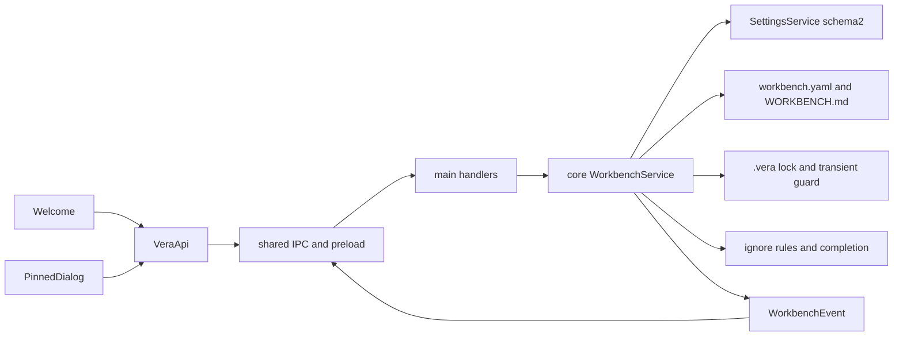

<!--
Copyright (c) 2026 DDP Engineering
This software is licensed under the PolyForm Noncommercial License 1.0.0.
Commercial use requires a separate commercial license.
See the LICENSE.txt in the .agentic folder for full license details.
SPDX-License-Identifier: LicenseRef-PolyForm-Noncommercial-1.0.0
-->

# TASK-793d5786 - WP-06 Workbench format, create and open, Welcome screen

stage: done
type: feature
path: full
interaction: autopilot
requirements: REQ-DATA-4a030001, REQ-DATA-4a030002, REQ-UX-1d6c940b, REQ-UX-9e7529d5, REQ-DATA-85139c56, REQ-FUNC-adf92ecb, REQ-REL-bcb6fb23, REQ-DATA-d7ced6a1, REQ-FUNC-bfd14725, REQ-DATA-dfbfac7c, REQ-UX-8622cdbe, REQ-TEST-6a6c266d
parent:
branch: master
base: 153ed32b7f173a000e42b4aba8ee15777e76725c
opened: 2026-10-11

## Done checklist (current stage)

- [x] validated candidate confirmed unchanged; otherwise returned to validate
- [x] validation evidence, diff, exclusions, and outcome presented
- [x] delivery confirmed by the human
- [x] journal and report included in the delivery commit
- [x] agreed outcome delivered, normally a PR
- [x] close-out committed after the outcome succeeded, or carried by the
      delivery commit where nothing could fail after it

## Frame

Problem: OBSERVED: the foundation Welcome exposes placeholders and core has settings but no workbench lifecycle.
Desired outcome: STATED: WP-06 / issue #6 creates, validates, locks and remembers plain workbench folders.
Actors: STATED: local embedded engineer; main host; core service; renderer through shared IPC.
Primary scenario: STATED: choose folder and name -> create valid files -> open with lock -> restart -> reopen recent.
Examples: STATED: fictional VERA-DEMO-01; stale pid permits takeover; live pid gives read-only.
Counterexamples: STATED: format 2 is refused; invalid YAML reports line; existing workbench/content is preserved.
In scope: STATED: schema/extensions/warnings; create/open/close/config/pinned/files/recent; ignore/UNC; Welcome/editor; instrumented picker; fixtures and tests; affected current documentation.
Out of scope: STATED: WP07 database, agent/providers/tools; other WPs; tracker, automations/chats, staging/commit/publication/Gitea changes; optional-companions.md.
Constraints: STATED: master/base 153ed32, autopilot, one active implementer, coordinator alone commits; Electron44.7.0/Node24.21; L1-L11/sandbox/CSP/exact renderer authorization; native Windows/Ubuntu serial E2E.
Success signals: STATED: all six plan Done when and proportionate safety/IPC/ignore/editor/read-only/migration coverage; two independent final verdicts and unchanged full strict proof.
Evidence: OBSERVED: AGENTS/full AEGIS/config/context/five knowledge pages, plan README/M1, architecture01/02/06/08, ADR0004, tea issue6 open/no comments, exact current source/tests and BenchPilot load/content/NewTestbenchPage/OverviewTab. Git status only unrelated optional-companions; zero open tasks, no WP06 prior journal; WP01..05 committed.
Assumptions: INFERRED: extending persisted recent schema requires schema2 migration from baseline0/1 with backups and stable installation UUID (L10).
Unknowns: native verification outcomes pending; no unresolved product decision.
Decision-blocking questions: none.
Proposed behaviors: exact plan scope, code-only workbench management, explicit user saves, localized warnings; future catalogs supplied by optional host seam.
Path and reason: full. New behavior=no quick; new interface/format=no quick; dependency=no quick; existing requirement coverage=no quick; data/security unchanged=no quick. Tightly coupled lifecycle stays one task.

## Requirement coverage

| Frame outcome / inventory | Actor and trigger | Atomic response / requirement | Positive case | Boundary / failure | Observable verification | Design seam |
|---|---|---|---|---|---|---|
| Versioned workbench configuration | engineer / lifecycle request | REQ-DATA-85139c56 | Open valid, unknown-key, malformed and format2 fixtures | Open valid, unknown-key, malformed and format2 fixtures; assert schema output, warning paths, error line, and unchanged bytes/runtime absence. | automated packages/core/src/workbench/service.test.ts | packages/shared/src/workbench.ts |
| Create workbench without overwriting content | engineer / lifecycle request | REQ-FUNC-adf92ecb | Create then open a temporary folder | Create then open a temporary folder; parse YAML and template; seed existing files and assert bytes preserved; duplicate create conflicts. | automated packages/core/src/workbench/service.test.ts | packages/core/src/workbench/service.ts |
| Workbench lock lifecycle | engineer / lifecycle request | REQ-REL-bcb6fb23 | Inject process liveness | Inject process liveness; exercise stale/live/concurrent opens, denied writes, close ownership and failed-switch cleanup. | automated packages/core/src/workbench/service.test.ts | packages/core/src/workbench/service.ts |
| Preserve workbench extensions on update | engineer / lifecycle request | REQ-DATA-d7ced6a1 | Save nested extensions, assert YAML unchanged extensions/id and event | Save nested extensions, assert YAML unchanged extensions/id and event; denied read-only saves and simulated write failure retain previous bytes/state. | automated packages/core/src/workbench/service.test.ts | packages/core/src/workbench/service.ts |
| Confined workbench path completion | engineer / lifecycle request | REQ-FUNC-bfd14725 | Seed files and ignored roots, negated patterns and outside symlinks | Seed files and ignored roots, negated patterns and outside symlinks; assert sorted query matches/cap and no escaping paths; UNC warning separately verified with host path detector. | automated packages/core/src/workbench/service.test.ts | packages/core/src/workbench/ignore.ts |
| Persist ten recent workbenches | engineer / lifecycle request | REQ-DATA-dfbfac7c | Open eleven folders/reopen | Open eleven folders/reopen; restart settings and assert order/ten; delete folder/remove recent; migrate v1 including extensions; future schema bytes remain untouched. | automated packages/core/src/workbench/service.test.ts | packages/core/src/workbench/service.ts |
| Welcome workbench lifecycle and pinned editor | engineer / lifecycle request | REQ-UX-8622cdbe | Native Electron create/restart/reopen and deleted-recent removal | Native Electron create/restart/reopen and deleted-recent removal; IPC config/pinned lifecycle; browser mock screens and keyboard editor with all locale catalogs. | automated e2e/workbench.spec.ts | apps/desktop/src/renderer/components/workbench.tsx |
| Compile out folder picker test override | engineer / lifecycle request | REQ-TEST-6a6c266d | Build both modes | Build both modes; assert instrumented marker and release absence; actual instrumented Electron picker returns temporary path; retained build identity regression. | automated tests/tooling/build-mode.test.ts | apps/desktop/src/main/index.ts |

| Pinned editor | engineer / Edit context | REQ-UX-1d6c940b | full content explicit save | readonly, Cancel/Escape, >16KB warning | native/browser editor and focus | PinnedEditor |
| Missing recent UI | engineer / recent retrieval | REQ-UX-9e7529d5 | folder missing badge | Open disabled; explicit removal | native deleted folder and mock | Workbench recent list |
| Settings defaults | first load | REQ-DATA-4a030001 | persisted schema2 UUID | defaults and restart | settings service tests | schema2 |
| Settings migration | load old0/1 | REQ-DATA-4a030002 | stable UUID/preferences/extensions | exclusive backups and future readonly | v0/v1 fixtures and service tests | SettingsService initialize |

## Design

- REQ-UX-1d6c940b / REQ-UX-9e7529d5 split the already-scoped independently observable editor and missing-state UI outcomes; no behavior or scope addition. REQ-DATA-4a030001/4a030002 carry authorized current-schema defaults/migration contracts; recent requirement owns only recent lifecycle.

- REQ-DATA-85139c56: shared zod passthrough at all configuration levels; core yaml parser supplies line/path errors and unknown warnings. yaml2.9.1 exact pinned in core, following L1/shared boundaries.
- REQ-FUNC-adf92ecb: validate existing absolute canonical folder and reserved layout before exclusive config creation; retain user pinned/runtime-ignore content; ulid3.0.2 supplies identity. Duplicate create conflicts without overwrites.
- REQ-REL-bcb6fb23: core filesystem with liveness/atomic-file/clock/event host seams; exclusive transient mkdir guard serializes stale lock takeover/publication. Contention or abandoned guard opens read-only with warning conservatively. Lock token reread protects saves/close. Switch acquires new ownership before releasing previous. No database or agent behavior.
- REQ-DATA-d7ced6a1: serialized lifecycle/write queue; config re-reads disk and merges nested known patches, preserving extensions/id/format; host atomic writes retain Windows retry. Confirmed save publishes events; observer errors cannot undo committed save. Pinned UTF8 bytes above16384 warns, full content saved.
- REQ-FUNC-bfd14725: ignore7.0.12 common helper applies permanent excluded path segments before root .veraignore; deterministic bounded traversal excludes symlinks. This is a completion seam, not WP11 tool guard.
- REQ-DATA-dfbfac7c: schema2 passthrough settings; explicit0/1->2 migration with numbered original backup and stable UUID/extensions. Newer schema stays unchanged/read-only, suppresses remembering/removing. Missing state derived each request; recent order/dedupe/cap uses settings queue.
- REQ-UX-8622cdbe: main owns one core service and validated handlers; shared workbench subscription overload preserves app subscription. React Query lifecycle, Welcome/active management and keyboard HTML pinned dialog with focus restoration; all labels/errors/warnings en/ro/de. Mock owns in-memory folders/config/pinned/recents/events. Existing shell/CSP/URL and preference controls preserved; future sessions stay their own WP.
- REQ-TEST-6a6c266d: app.chooseFolder main compile-time __VERA_TEST__ branch; release runs Electron dialog. Both actual emitted builds checked, runtime flags ineffective; instrumented E2E explicitly sets build flag.
- Expected files: shared workbench/settings/ipc/events/index; core workbench/service/ignore/ports/index/settings and tests; core manifest/lock; desktop main/bridge/API/mock/Welcome/editor/locales/styles/tests; demo fixtures; workbench E2E and build regression; README; AEGIS artifacts, context, named component pages and new workbench page.
- Risks/test seams: competing takeover, symlink escape, external/newer YAML, settings persistence failure on switch, read-only write denial and release hook leaks all have focused tests. Linux sources mirrored without deleting platform dependencies. No unresolved product decisions.
- Alternatives: lock unlink without serialization risks competing stale takeover; guard coordinates it. Renderer filesystem breaks L2. Whole nested replacement loses extensions. Persistent missing state becomes stale; derive it instead.

### Proposed architecture - TASK-793d5786

## Log

- 2026-10-11 build keyboard correction: windows-ui-focused2 exit1; all3native WP06 tests pass (including real live tester-pid lock/read-only/copied demo preservation). Browser now confirms visible-control traversal but Escape closes dialog without returning focus because parent focus ran while modal was still open. Close modal synchronously before parent focus restoration; retain focus assertions. Inner-loop hash mismatch reflects requirement/test refinements and is not final validation evidence.

- 2026-10-11 build browser regression finding: windows-ui-focused real exit1; native WP06 cases pass, browser keyboard traversal counted hidden Welcome controls after preserved memory-route mounting and reached document body. Fix count to all visible enabled controls (including input/textarea) while retaining every focus-ring/unique-control assertion. Candidate changed during this inner-loop run; metadata explicitly marks hash mismatch and this run is not final proof. JSON/scenario focused green16tests exit0 covers safe extension rejection and seeded read-only/missing/warnings with denied mock writes.

- 2026-10-11 build mirror readiness: protected all native mirror tracked/untracked source bytes in /home/dpasare/.cache/vera-wp06-backup-TASK-793d5786 before nondestructive base/index reconciliation to153ed32; source overlay459files SHA256 parity0mismatches; separate native deps restored by canonical setup, system Electron/Xvfb and Node24.21 ready. Original structured wsl argv/exit in mirror.execution.json. Mock state red `python ../02_Tools/npmw.py npx vitest run apps/desktop/src/renderer/mocks/mockApi.test.ts -t "fixtures expose"` exit1 expected seeded recent/read-only/warnings states absent.

- 2026-10-11 build safety focused green: windows-unit-focused execution exit0,47tests/6files, unchanged candidate hashes; external newer format blocks pinned saves and redirected runtime close rejects before writes. JSON-extension red command=`python ../02_Tools/npmw.py npx vitest run packages/core/src/workbench/service.test.ts -t "non-JSON"` exit1; observed Infinity accepted by YAML, which cannot roundtrip through JSON IPC. Rejecting non-JSON extensions preserves source bytes rather than losing values on save.

- 2026-10-11 build native Welcome green: real child `VERA_TEST=1 python ../02_Tools/npmw.py npm run test:e2e -- e2e/workbench.spec.ts` exit0,2passed7.1s; creates/edits/config-event/close/restart/recent reopen and deleted-folder missing/removal with empty egress. Original argv/returncode/before-after hash/log SHA are windows-e2e-focused.execution.json; display encoding corrected after metadata capture. Safety extension red `python ../02_Tools/npmw.py npx vitest run packages/core/src/workbench/service.test.ts -t "failed recent|refuses external"` exit1; failed-recent cleanup/future settings already pass, expected pinned save incorrectly accepts externally newer format. Fixing established L10/confinement boundary before full proof.

- 2026-10-11 build IPC/picker green: selected bridge plus both actual build-mode tests exit0,2tests; scoped workbench event validation/cleanup, strict config/completion requests, instrumented marker and release absence/runtime identity retained. Mock red command=`python ../02_Tools/npmw.py npx vitest run apps/desktop/src/renderer/mocks/mockApi.test.ts -t "mock workbench"` exit1 expected unimplemented new channel INTERNAL; green exit0,1selected test validates full mocked lifecycle. Welcome REQ-UX-8622cdbe red command=`VERA_TEST=1 python ../02_Tools/npmw.py npm run test:e2e -- e2e/workbench.spec.ts` (PowerShell env set) exit1,2native tests timed out on absent choose-create controls; built app/first window and placeholder screenshot contexts confirm missing UI behavior.

- 2026-10-11 build recent/migration green: targeted schema1 migration/recent command exit0,2selected tests; schema2 preserves UUID/nested extensions, original backup and restart; ten unique order, missing-folder/removal proved. REQ-UX-8622cdbe IPC and REQ-TEST-6a6c266d red command=`python ../02_Tools/npmw.py npx vitest run apps/desktop/src/preload/bridge.test.ts tests/tooling/build-mode.test.ts -t "workbench subscriptions|compiles the test"` exit1,2failures; expected workbench subscription INVALID and instrumented output lacks picker marker.

- 2026-10-11 build completion green: core service8tests exit0; cap50, query, ignore negation/permanent dirs, outside junction exclusion and redirected runtime create rejection. REQ-DATA-dfbfac7c red command=`python ../02_Tools/npmw.py npx vitest run packages/core/src/workbench/service.test.ts packages/core/src/settings/service.test.ts -t "migrates schema1|persists ten"` exit1; expected schema1 extensions rejected/no migration and recent method absent.

- 2026-10-11 build config/pinned green: core service focused command exit0,6tests; deep extensions/id survive save, confirmed event, >16KB UTF8 warning with full content, denied read-only/lost-owner saves, failed write and failed switch retention. REQ-FUNC-bfd14725 completion red command=`python ../02_Tools/npmw.py npx vitest run packages/core/src/workbench/service.test.ts -t "completion|redirected"` exit1; expected files method absent; preexisting layout protection and UNC detector pass.

- 2026-10-11 build lock green: core focused service command exit0,4tests; dead/live locks, one writer across5concurrent opens, ownership-preserving close, malformed lock conflict and conservative guard warning covered. REQ-DATA-d7ced6a1/REQ-UX-8622cdbe save seam red command=`python ../02_Tools/npmw.py npx vitest run packages/core/src/workbench/service.test.ts -t "updates config|read-only and"` exit1; expected updateConfig/updatePinned absent.

- 2026-10-11 build create/parse green: command=`python ../02_Tools/npmw.py npx vitest run packages/core/src/workbench/service.test.ts packages/shared/src/workbench.test.ts` exit0,3tests; roundtrip written YAML/template/dirs/content protection, malformed YAML line3 and format2 unchanged/runtime absent proved. Lock increment red REQ-REL-bcb6fb23 command=`python ../02_Tools/npmw.py npx vitest run packages/core/src/workbench/service.test.ts -t "lock|concurrent"` exit1, expected dead pid retained and5writable opens instead of1.

- 2026-10-11 build red: REQ-DATA-85139c56/REQ-FUNC-adf92ecb command=`python ../02_Tools/npmw.py npx vitest run packages/core/src/workbench/service.test.ts` exit1; expected lifecycle service missing, for YAML/create/open/template/no-overwrite acceptance. Registry observed exact yaml2.9.1/ulid3.0.2/ignore7.0.12 pins.

- 2026-10-11 build schema red/green: REQ-DATA-85139c56 command=`python ../02_Tools/npmw.py npx vitest run packages/shared/src/workbench.test.ts` (05_Software), red exit1 expected workbench schema absent, green exit0 1test defaults/format/id/nested extension warning. Anchor359files at base153ed32 recorded2026-10-11T07:47:19.569860Z. Red observed before implementation; consolidated log entered after green.

- 2026-10-11 frame: Scope accepted in explicit autopilot; full path selected and shared master/base/status/history confirmed. Frame audited with no decision-blocking unknowns. Coordinator owns authorized local commit; implementation leaves index untouched.
- 2026-10-11 specify: Behavior inventory/coverage audited; eight new draft requirements, no revisions/retirements; shared exact contract spec added. Existing security and preference requirements retained.
- 2026-10-11 specify completed: Eight draft atomic requirements and exact lifecycle/schema/IPC/migration spec audited; advisory errors0, expected new source paths pending build.
- 2026-10-11 design completed: requirement-driven responsibilities, state/errors/ownership/security/concurrency/migration and test seams audited; historical proposal retained; no open decisions.
- 2026-10-11 build completed: requirements split into independent already-scoped editor/missing UI outcomes and defaults/migration revised for authorized L10 schema2. Browser fixture import corrected after observed404; windows-ui-focused4 exit0, whole browser matrix/editor/scenarios passes; all3 native WP06 cases green in windows-ui-focused2. Linux focused exit0,46tests5files on identical mirrored sources. Source/requirement/context/knowledge/evolution audited; advisory errors0 warnings0; diff --check exit0.
- 2026-10-11 validate ROUND1 changes_required: both independent reviewers bound to unchanged f17201a5e3bef7f355cbc5ab2d4c7f0474eaf2f065da8739fe667710096c8641 (68files verified). Spec findings: abandoned persistent guard violates dead takeover, case-sensitive permanent ignores, same-folder ownership not reassessed. Quality adds dropped recent extensions, non-JSON Set/Map/Buffer YAML accepted and cached/refetched pinned draft replacement. Return to build for these six bounded corrections; both verdicts cleared while editing, next round2. Native Ubuntu focused E2E original candidate exit0 3tests, unchanged hash. Guard implementation will use short-lived OS-owned local IPC name, smoke Windows/Linux duplicate listeners EADDRINUSE; no stale unlink race or native dependency.

- 2026-10-11 build review corrections red: REQ-REL-bcb6fb23,REQ-FUNC-bfd14725,REQ-DATA-dfbfac7c,REQ-DATA-85139c56 command=python ../02_Tools/npmw.py npx vitest run packages/core/src/workbench/service.test.ts -t concurrent-opens/reassesses/permanent-ignores/tagged-non-JSON (exact argv in windows-review-red.execution.json) exit1,4 expected failures: persistent orphan guard readonly, reader fails takeover, casing exclusion false and Set accepted. Green windows-review-green exit0,15tests after corrections. Entry consolidated after green; red was observed before source edits. REQ-UX-1d6c940b editor red command=VERA_TEST=1 python ../02_Tools/npmw.py npm run test:e2e -- e2e/mock.spec.ts exit1: second delayed load exposes enabled cached textarea instead of disabled fresh-load state; windows-editor-red.log holds observed assertion. Guard cross-process crash/exclusivity green exit0,1test.
- 2026-10-11 DEVIATION design: transient filesystem mkdir guard replaced by process-owned local IPC guard - independent review found crash residue violated dead-pid takeover; Windows named pipe/Linux abstract Unix socket releases automatically, preserves exclusive serialization and adds no TCP or native dependency. Historical design proposal retained; current knowledge/spec updated before ROUND2.

- 2026-10-11 build review corrections: mock metadata regression command=python ../02_Tools/npmw.py npx vitest run apps/desktop/src/renderer/mocks/mockApi.test.ts -t "mock workbench" exit1 expected vendor metadata dropped; same recorded quality finding corrected in mock parity. windows-core-review2 exit0,17tests includes real child process guard/crash/stale-lock recovery; windows-editor-green exit0 delayed fresh load and no focus-refresh draft overwrite, browser matrix retained. Candidate changed by concurrent test additions during inner browser run, explicitly not final proof. Current spec/knowledge/architecture reconciled to OS guard; original Design remains historical.
- 2026-10-11 build ROUND2 corrections complete: six recorded findings fixed; new OS-owned local IPC guard, every-open ownership reassessment, case-insensitive permanent exclusions, recent extension preservation in core/mock, strict plain JSON YAML values and per-dialog fresh/draft-isolated query. Focused Windows core17/17 and browser delayed-load/focus regression exit0; mock4/4 exit0; format/typecheck exit0. Current requirement/spec/context/knowledge and diagrams reconciled; historical design preserved with announced deviation. Evolution48changedpaths reviewed; no unrequested work.

- 2026-10-11 validate ROUND2 independent verdicts approved: specification=/root/wp06_spec_review; implementation-quality=/root/wp06_quality_review; each re-read full journal/12requirements/2specs/current knowledge/complete candidate and verified all70raw hashes, aggregate772b4faf596d1447a82915c565a655ee7697d87ce4743bbe6ab06372dcebce4d. ROUND1changes_required onf172... retained; one bounded fix cycle of5used. No child implementation journals; reviewers read-only. Final semantic hunk/inventory review confirms scope, errors, portability, security, exclusions; current diagrams match built code with announced guard deviation, original proposal retained. All verification automated; no manual substitution. Native Linux guard/core/mock21tests passed; source parity464files0mismatches. Final strict test+verify and full E2E scheduled after verdicts, without further candidate edits.

- 2026-10-11 validate final proof completed after both ROUND2 approvals on unchanged70file SHA256 772b4faf596d1447a82915c565a655ee7697d87ce4743bbe6ab06372dcebce4d. Exact configured `python .agentic/aegis.py check --task TASK-793d5786 --strict --run` exit0 on Windows and native Ubuntu; both configured test and verify exit0. Full E2E Windows12/12 and Ubuntu12/12 exit0, serial on shared5173, sandbox enabled, network/security assertions retained. Actual native pre/post fingerprints equal Windows; no LD_LIBRARY_PATH override. Original stdout, exact argv/cwd/UTC/exit and log SHA256 are recorded in final execution files summarized below; no inferred unit total because AEGIS suppresses successful child stdout. No skipped/weakened checks or accepted test failures.
- 2026-10-11 validate warnings: Windows strict errors0/warnings0/notes0; Ubuntu errors0/warnings0/notes1 (descriptive repo-evolution missing ignored anchor sidecar in separate mirror). Primary final evolution48paths at2026-10-11T08:21:06.705672Z was inspected; source parity464files0mismatches and final actual native hashes prove candidate identity. Rollup strips upstream Zod comment annotations; NO_COLOR/FORCE_COLOR and Git CRLF normalization notices do not change passing results. Visual QA inspected Welcome recent and missing screenshots for clear controls/Unicode paths/no clipping, supplementing automated viewport/theme/language/text-scale/keyboard checks.
- 2026-10-11 validate -> deliver: all six WP06 Done when have positive and failure evidence; final diff/inventory reviewed, scope/context/knowledge/diagrams/12requirements/2specs reconciled before both approvals and proof. No child implementation journals. Index empty/master/base153ed32 preserved; 71delivery paths (42modified,29added including journal), unrelated optional-companions excluded; tracker untouched. Reviewer verdicts remain approved/approved ROUND2; one of5fixcycles used, no outstanding findings.
- 2026-10-11 deliver authorization and handback: explicit user delegation and RULING-001 authorize preparing/reporting this validated candidate and handing it back without staging/commit. Coordinator alone verifies and performs already-authorized local commit, then close-out; publication approval remains separate. No new confirmation is required for this authorized handback. Header remains deliver; implementation chat ends idle. Repeated design deviation: disk mkdir guard replaced by OS-owned local IPC guard to restore crash takeover/exclusivity; Windows named pipe and Linux abstract Unix socket release automatically, as proven by real process crash tests. WP05 clean/offline Windows and VC++ independence remain deferred mandatory WP30/WP33 obligations and are not claimed passed here.

- 2026-10-11 deliver report appended and read: fresh advisory errors0/warnings1/notes0; sole `unticked-deliver` warning is the three coordinator-owned commit/outcome/close-out items intentionally pending. Report raw Git diff counts72paths including unrelated optional-companions; authorized delivery inventory remains71paths excluding that untouched file. Final git diff --check exit0; branchmaster/HEAD153ed32/index0 and all70raw hashes772b4faf unchanged after journal-only report. No staging, commit or remote mutation performed; handback ready.

- 2026-10-11 coordinator validation: complete 71-path candidate reviewed against base153ed32, all12 requirements/two specs/full journal/current knowledge/architecture and all6Done-when. Both independent ROUND2 approvals verified from original review chats (spec01a12a05-6a28-7151-a67f-dd6a991b1fb7 turn01a12a0d-a81f-73b2-91b9-1adaa6a27a3a; quality01a12a05-858f-76b2-9841-0eb1a2d9eaf6 turn01a12a0d-c2ea-74d2-8a2e-32a5e8d29bd2). Additional readonly coordinator evidence review approved with no findings. All70raw hashes and aggregate772b4faf verified, current native Ubuntu matches; index empty, implementer idle. Fresh strict0 perOS executes configured test+verify; serial full E2E12/12 perOS exit0 on exact unchanged candidate. Original subprocess argv/cwd/UTC/returncodes/log digests/native pre/post proofs are linked below. Windows unticked-deliver warning records pending close-out only; Ubuntu missing ignored anchor is descriptive and candidate parity verified. No accepted failed test or verification substitution. User authorizes this coordinator-owned local commit through automated-cycle instruction and rootAGENTS/RULING001; no further confirmation needed. Excluded optional-companions.md untouched (SHA256 2a69f5b335a53e498b1f8e30fa5adb8096e870e7a12bbc05b0727a03cee72c6b); no remote publication. Design guard deviation and WP05 clean/offline Windows/CRT final-release obligations retained.

- 2026-10-11 coordinator deliver: exact71path diff, fresh strict/E2E results, both reviewer approvals, warnings, design deviation, exclusions and local-only outcome presented. Existing explicit human commit authorization covers this prepared result; no new permission stop. Journal/report will be carried by the single authorized local commit; close-out remains pending until report audit.

- 2026-10-11 coordinator close-out: report read (advisory0errors/1expected pending-closeout warning,5/6); raw report72paths includes unrelated excluded user file while authorized inventory is71. Local commit is the entire approved outcome, so close-out prepared before that same commit per6_deliver step7; no second close-out commit or publication. All six checklist items and Stage report/Handoff are closed on unchanged70file772b4faf; actual commit SHA/result is recorded by coordinator after Git confirms. If commit fails, restore deliver and record failure.

## Rulings

- RULING-001 | date=2026-10-11 | decision=Implement on shared master in autopilot; user authorized one local commit after coordinator verification; this implementation chat hands back without staging/commit | reason=Explicit delegation and AGENTS automated cycle | source=user | supersedes=none
- RULING-002 | date=2026-10-11 | decision=Exclude unrelated 00_Planning/optional-companions.md and tracker; preserve WP05 deferred clean/offline Windows and CRT final-release obligation | reason=Explicit delegation | source=user | supersedes=none

## Handoff

current: done
status: ready
next: Coordinator starts next eligible WP07 after verifying the single local delivery commit
must_read: .agentic/tasks/TASK-793d5786.md, 00_Planning/plan/M1-read-only-agent.md
blockers: none

## Stage report

stage: done
result: completed
current: done
changed: WP06 lifecycle/Welcome/editor plus tests and documentation; 71 files (42 modified,29 added)
evidence: Fresh coordinator Windows/Ubuntu strict exit0 and E2E12/12 each; ROUND2 approved/approved; unchanged70file772b4faf
issues: no implementation findings; guard deviation/Ubuntu anchor note explained; WP05 release obligations preserved
next: Verify local delivery commit and start eligible WP07
needs_user: no
spec_compliance: approved
implementation_quality: approved
review_round: 2

## Final verification and delivery evidence

Candidate: base `153ed32b7f173a000e42b4aba8ee15777e76725c`, shared `master`; 70 raw-byte-reviewed files SHA256 `772b4faf596d1447a82915c565a655ee7697d87ce4743bbe6ab06372dcebce4d`. The journal is the 71st delivery file and excluded only from the fingerprint so report-only records can be appended. Both independent ROUND2 verdicts and all four final runs bind this same unchanged fingerprint, including actual native Ubuntu before/after snapshots.

Strict command on both platforms: `python .agentic/aegis.py check --task TASK-793d5786 --strict --run`. Configured child commands unchanged: `python ../02_Tools/npmw.py npm test` and `python ../02_Tools/npmw.py npm run verify` from `05_Software`, each exit0 on both platforms. E2E command from `05_Software`: `VERA_TEST=1 python ../02_Tools/npmw.py npm run test:e2e`, 12/12 per platform. Native Ubuntu uses its separate canonical mirror, `env -u LD_LIBRARY_PATH` and normal Python PATH; Electron sandbox remains enabled. Full exact outer argv and cwd are preserved in the linked execution JSON.

| Platform/check | UTC start -> finish | Result | Original stdout log SHA256 |
|---|---|---|---|
| windows-strict-final | 2026-10-11T08:23:34.439229+00:00 -> 2026-10-11T08:25:08.325000+00:00 | exit0; test+verify green | `479df58d9bd57c9854f6c1fbcdd3fef46525c5d70182a01da8089c57c1caf185` |
| linux-strict-final | 2026-10-11T08:23:34.795472+00:00 -> 2026-10-11T08:25:11.133767+00:00 | exit0; test+verify green | `ec02e3a28811502e63f048a0e5f4161e82dd704397441586cd02a1e7355259de` |
| windows-e2e-final | 2026-10-11T08:25:22.292869+00:00 -> 2026-10-11T08:27:02.786702+00:00 | exit0; 12/12 | `61945a1968ec7a794900694f198c27f0e93da9cc6c6961b206b7af6a849da9d7` |
| linux-e2e-final | 2026-10-11T08:27:21.684687+00:00 -> 2026-10-11T08:28:41.622516+00:00 | exit0; 12/12 | `c73a2b1716b6abc176cb182f998c27982f0b2ed65b5911cce8659dbd9a044337` |

Original log/argv metadata pairs under `02_Tools/cache/wp06/`: `windows-strict-final.log` / `windows-strict-final.execution.json`, `linux-strict-final.log` / `linux-strict-final.execution.json`, `windows-e2e-final.log` / `windows-e2e-final.execution.json`, `linux-e2e-final.log` / `linux-e2e-final.execution.json`. Native strict/E2E also retain their `.native-before.json` and `.native-after.json` source fingerprints. Consolidation: `verification-summary.json`; per-path manifest: `candidate.json`; delivery paths: `delivery-inventory.json`. These ignored local proof files supplement this committed journal. No accepted failing test, no skipped required proof, no source edit after proof.

| WP06 Done when | Confirmed evidence |
|---|---|
| Create -> open round trip and valid YAML | core service create/roundtrip tests, full configured test on both OS |
| Invalid YAML line and newer format refused | core parse/future-format unchanged-byte tests on both OS |
| Stale takeover and live lock read-only | core injected and real child-process crash/guard tests; native copied-demo E2E on both OS |
| Unknown keys survive config.update | core deep-merge/config/event tests and native IPC E2E on both OS |
| Welcome create/restart/reopen recent | full native E2E workbench scenario on both OS |
| Deleted recent missing/removal | full native E2E missing-folder scenario on both OS |

## Delivery candidate

Exact inventory relative to recorded base: 71 files, 42 modified and 29 added; zero staged. Includes requirement/spec/context/knowledge/architecture updates belonging to this implementation and this journal. Intended outcome is coordinator-owned local commit only. Exclusions: untouched `00_Planning/optional-companions.md`; ignored tool caches/proof artifacts; tracker. WP05 release smoke obligations preserved for WP30/WP33.

| Status | Repository-relative path |
|---|---|
| modified | `.agentic/context/environment.md` |
| modified | `.agentic/context/project.md` |
| modified | `.agentic/knowledge/app-data.md` |
| modified | `.agentic/knowledge/desktop-shell.md` |
| modified | `.agentic/knowledge/ipc-boundary.md` |
| modified | `.agentic/knowledge/renderer-foundation.md` |
| modified | `.agentic/knowledge/software-tooling.md` |
| added | `.agentic/knowledge/workbench.md` |
| modified | `.agentic/requirements/data/REQ-DATA-4a030001.toml` |
| modified | `.agentic/requirements/data/REQ-DATA-4a030002.toml` |
| added | `.agentic/requirements/data/REQ-DATA-85139c56.toml` |
| added | `.agentic/requirements/data/REQ-DATA-d7ced6a1.toml` |
| added | `.agentic/requirements/data/REQ-DATA-dfbfac7c.toml` |
| added | `.agentic/requirements/functional/REQ-FUNC-adf92ecb.toml` |
| added | `.agentic/requirements/functional/REQ-FUNC-bfd14725.toml` |
| added | `.agentic/requirements/reliability/REQ-REL-bcb6fb23.toml` |
| added | `.agentic/requirements/test/REQ-TEST-6a6c266d.toml` |
| added | `.agentic/requirements/ux/REQ-UX-1d6c940b.toml` |
| added | `.agentic/requirements/ux/REQ-UX-8622cdbe.toml` |
| added | `.agentic/requirements/ux/REQ-UX-9e7529d5.toml` |
| modified | `.agentic/specs/REQ-DATA-4a030001.md` |
| added | `.agentic/specs/REQ-DATA-85139c56.md` |
| added | `.agentic/tasks/TASK-793d5786.md` |
| modified | `00_Planning/architecture/01-system.md` |
| modified | `00_Planning/architecture/02-workbench.md` |
| modified | `00_Planning/architecture/06-ui.md` |
| modified | `00_Planning/architecture/08-quality.md` |
| modified | `05_Software/README.md` |
| modified | `05_Software/apps/desktop/src/main/index.ts` |
| modified | `05_Software/apps/desktop/src/main/ipc-router.test.ts` |
| modified | `05_Software/apps/desktop/src/preload/bridge.test.ts` |
| modified | `05_Software/apps/desktop/src/preload/bridge.ts` |
| modified | `05_Software/apps/desktop/src/renderer/App.tsx` |
| modified | `05_Software/apps/desktop/src/renderer/api/ipc.test.ts` |
| modified | `05_Software/apps/desktop/src/renderer/api/ipc.ts` |
| added | `05_Software/apps/desktop/src/renderer/api/subscriptions.ts` |
| modified | `05_Software/apps/desktop/src/renderer/components/error-message.tsx` |
| added | `05_Software/apps/desktop/src/renderer/components/workbench.tsx` |
| modified | `05_Software/apps/desktop/src/renderer/locales/de.json` |
| modified | `05_Software/apps/desktop/src/renderer/locales/en.json` |
| modified | `05_Software/apps/desktop/src/renderer/locales/ro.json` |
| modified | `05_Software/apps/desktop/src/renderer/mocks/mockApi.test.ts` |
| modified | `05_Software/apps/desktop/src/renderer/mocks/mockApi.ts` |
| modified | `05_Software/apps/desktop/src/renderer/styles.css` |
| modified | `05_Software/e2e/mock.spec.ts` |
| modified | `05_Software/e2e/shell.spec.ts` |
| added | `05_Software/e2e/workbench.spec.ts` |
| added | `05_Software/fixtures/settings/version-1.json` |
| added | `05_Software/fixtures/workbenches/demo-board/WORKBENCH.md` |
| added | `05_Software/fixtures/workbenches/demo-board/docs/notes/bringup.md` |
| added | `05_Software/fixtures/workbenches/demo-board/docs/pinout.csv` |
| added | `05_Software/fixtures/workbenches/demo-board/logs/boot-0412.log` |
| added | `05_Software/fixtures/workbenches/demo-board/workbench.yaml` |
| modified | `05_Software/package-lock.json` |
| modified | `05_Software/packages/core/package.json` |
| modified | `05_Software/packages/core/src/index.ts` |
| modified | `05_Software/packages/core/src/ports.ts` |
| modified | `05_Software/packages/core/src/settings/service.test.ts` |
| modified | `05_Software/packages/core/src/settings/service.ts` |
| added | `05_Software/packages/core/src/workbench/guard.test.ts` |
| added | `05_Software/packages/core/src/workbench/guard.ts` |
| added | `05_Software/packages/core/src/workbench/ignore.ts` |
| added | `05_Software/packages/core/src/workbench/service.test.ts` |
| added | `05_Software/packages/core/src/workbench/service.ts` |
| modified | `05_Software/packages/shared/src/events.ts` |
| modified | `05_Software/packages/shared/src/index.ts` |
| modified | `05_Software/packages/shared/src/ipc.ts` |
| modified | `05_Software/packages/shared/src/settings.ts` |
| added | `05_Software/packages/shared/src/workbench.test.ts` |
| added | `05_Software/packages/shared/src/workbench.ts` |
| modified | `05_Software/tests/tooling/build-mode.test.ts` |

## Delivery report (2026-10-11)

- stage: deliver; type: feature; path: full; branch: master
- requirements:
  - REQ-DATA-4a030001 - Create versioned application settings
  - REQ-DATA-4a030002 - Migrate settings with a preserved backup
  - REQ-UX-1d6c940b - Edit pinned context through dialog
  - REQ-UX-9e7529d5 - Display and remove missing recent entries
  - REQ-DATA-85139c56 - Versioned workbench configuration
  - REQ-FUNC-adf92ecb - Create workbench without overwriting content
  - REQ-REL-bcb6fb23 - Workbench lock lifecycle
  - REQ-DATA-d7ced6a1 - Preserve workbench extensions on update
  - REQ-FUNC-bfd14725 - Confined workbench path completion
  - REQ-DATA-dfbfac7c - Persist ten recent workbenches
  - REQ-UX-8622cdbe - Welcome workbench lifecycle and pinned editor
  - REQ-TEST-6a6c266d - Compile out folder picker test override
- deviations: 1 recorded
  - design: transient filesystem mkdir guard replaced by process-owned local IPC guard - independent review found crash residue violated dead-pid takeover; Windows named pipe/Linux abstract Unix socket releases automatically, preserves exclusive serialization and adds no TCP or native dependency. Historical design proposal retained; current knowledge/spec updated before ROUND2.
- explicit review: enabled; spec_compliance=approved; implementation_quality=approved; review_round=2
- diff vs task base 153ed32: 72 file(s) changed, 3336 line(s) added
- checks: errors=0 warnings=1 notes=0
- checklist: 3/6 done; open: journal and report included in the delivery commit; agreed outcome delivered, normally a PR; close-out committed after the outcome succeeded, or carried by the delivery commit where nothing could fail after it

## Coordinator final verification (2026-10-11)

Candidate SHA256 `772b4faf596d1447a82915c565a655ee7697d87ce4743bbe6ab06372dcebce4d`; all70 non-journal raw paths unchanged on Windows and native Ubuntu. Journal-only close-out follows this proof. Strict command executes unchanged configured test and verify; E2E runs instrumented VERA_TEST=1 with sandbox retained. Original local logs and structured execution metadata: `02_Tools/cache/wp06/<mode>-coordinator-final.log` and `.execution.json`; native modes also retain `.native-before.json` and `.native-after.json`.

| Mode | UTC start -> finish | Exit / result | Original stdout SHA256 |
|---|---|---|---|
| windows-strict | 2026-10-11T08:40:32.552493+00:00 -> 2026-10-11T08:41:43.852624+00:00 | 0 / configured test+verify green | `8a4ab8852f666ee403a0e04a58442bdfbd67ed335eaf404ee4d5f096c68c66ed` |
| linux-strict | 2026-10-11T08:40:50.062704+00:00 -> 2026-10-11T08:41:51.364257+00:00 | 0 / configured test+verify green | `281ca7d99568062868eeb7e420b26c541f21b9af6c9b56c9ca96caab50958c4b` |
| windows-e2e | 2026-10-11T08:42:09.643478+00:00 -> 2026-10-11T08:43:30.848825+00:00 | 0 / 12/12 | `b9c93f55cbf440d275460ed1e730181e469ca72841e4ceeeaa1182305040d2a5` |
| linux-e2e | 2026-10-11T08:43:52.890398+00:00 -> 2026-10-11T08:44:54.838112+00:00 | 0 / 12/12 | `b31d9737b59966767a1b717321a93b8c1f67adae46405055a4defa75cdff80d1` |

## Delivery report (2026-10-11)

- stage: deliver; type: feature; path: full; branch: master
- requirements:
  - REQ-DATA-4a030001 - Create versioned application settings
  - REQ-DATA-4a030002 - Migrate settings with a preserved backup
  - REQ-UX-1d6c940b - Edit pinned context through dialog
  - REQ-UX-9e7529d5 - Display and remove missing recent entries
  - REQ-DATA-85139c56 - Versioned workbench configuration
  - REQ-FUNC-adf92ecb - Create workbench without overwriting content
  - REQ-REL-bcb6fb23 - Workbench lock lifecycle
  - REQ-DATA-d7ced6a1 - Preserve workbench extensions on update
  - REQ-FUNC-bfd14725 - Confined workbench path completion
  - REQ-DATA-dfbfac7c - Persist ten recent workbenches
  - REQ-UX-8622cdbe - Welcome workbench lifecycle and pinned editor
  - REQ-TEST-6a6c266d - Compile out folder picker test override
- deviations: 1 recorded
  - design: transient filesystem mkdir guard replaced by process-owned local IPC guard - independent review found crash residue violated dead-pid takeover; Windows named pipe/Linux abstract Unix socket releases automatically, preserves exclusive serialization and adds no TCP or native dependency. Historical design proposal retained; current knowledge/spec updated before ROUND2.
- explicit review: enabled; spec_compliance=approved; implementation_quality=approved; review_round=2
- diff vs task base 153ed32: 72 file(s) changed, 3376 line(s) added
- checks: errors=0 warnings=1 notes=0
- checklist: 5/6 done; open: close-out committed after the outcome succeeded, or carried by the delivery commit where nothing could fail after it

## Delivery report (2026-10-11)

- stage: done; type: feature; path: full; branch: master
- requirements:
  - REQ-DATA-4a030001 - Create versioned application settings
  - REQ-DATA-4a030002 - Migrate settings with a preserved backup
  - REQ-UX-1d6c940b - Edit pinned context through dialog
  - REQ-UX-9e7529d5 - Display and remove missing recent entries
  - REQ-DATA-85139c56 - Versioned workbench configuration
  - REQ-FUNC-adf92ecb - Create workbench without overwriting content
  - REQ-REL-bcb6fb23 - Workbench lock lifecycle
  - REQ-DATA-d7ced6a1 - Preserve workbench extensions on update
  - REQ-FUNC-bfd14725 - Confined workbench path completion
  - REQ-DATA-dfbfac7c - Persist ten recent workbenches
  - REQ-UX-8622cdbe - Welcome workbench lifecycle and pinned editor
  - REQ-TEST-6a6c266d - Compile out folder picker test override
- deviations: 1 recorded
  - design: transient filesystem mkdir guard replaced by process-owned local IPC guard - independent review found crash residue violated dead-pid takeover; Windows named pipe/Linux abstract Unix socket releases automatically, preserves exclusive serialization and adds no TCP or native dependency. Historical design proposal retained; current knowledge/spec updated before ROUND2.
- explicit review: enabled; spec_compliance=approved; implementation_quality=approved; review_round=2
- diff vs task base 153ed32: 72 file(s) changed, 3401 line(s) added
- checks: errors=0 warnings=1 notes=0
- checklist: 6/6 done

## Delivery report (2026-10-11)

- stage: done; type: feature; path: full; branch: master
- requirements:
  - REQ-DATA-4a030001 - Create versioned application settings
  - REQ-DATA-4a030002 - Migrate settings with a preserved backup
  - REQ-UX-1d6c940b - Edit pinned context through dialog
  - REQ-UX-9e7529d5 - Display and remove missing recent entries
  - REQ-DATA-85139c56 - Versioned workbench configuration
  - REQ-FUNC-adf92ecb - Create workbench without overwriting content
  - REQ-REL-bcb6fb23 - Workbench lock lifecycle
  - REQ-DATA-d7ced6a1 - Preserve workbench extensions on update
  - REQ-FUNC-bfd14725 - Confined workbench path completion
  - REQ-DATA-dfbfac7c - Persist ten recent workbenches
  - REQ-UX-8622cdbe - Welcome workbench lifecycle and pinned editor
  - REQ-TEST-6a6c266d - Compile out folder picker test override
- deviations: 1 recorded
  - design: transient filesystem mkdir guard replaced by process-owned local IPC guard - independent review found crash residue violated dead-pid takeover; Windows named pipe/Linux abstract Unix socket releases automatically, preserves exclusive serialization and adds no TCP or native dependency. Historical design proposal retained; current knowledge/spec updated before ROUND2.
- explicit review: enabled; spec_compliance=approved; implementation_quality=approved; review_round=2
- diff vs task base 153ed32: 72 file(s) changed, 3424 line(s) added
- checks: errors=0 warnings=0 notes=0
- checklist: 6/6 done
