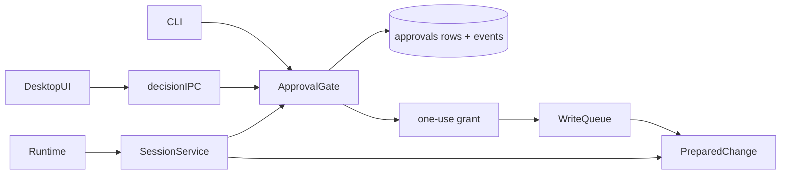

<!--
Copyright (c) 2026 DDP Engineering
This software is licensed under the PolyForm Noncommercial License 1.0.0.
Commercial use requires a separate commercial license.
See the LICENSE.txt in the .agentic folder for full license details.
SPDX-License-Identifier: LicenseRef-PolyForm-Noncommercial-1.0.0
-->

# TASK-80851789 - WP-17 Permission modes and approvals

stage: done
type: feature
path: full
interaction: autopilot
requirements: REQ-SEC-bded1701, REQ-FUNC-bded1702, REQ-DATA-bded1703, REQ-SEC-bded1704, REQ-FUNC-bded1705, REQ-REL-bded1706, REQ-FUNC-bded1707, REQ-REL-bded1708, REQ-FUNC-bded1709, REQ-UX-bded1710, REQ-UX-bded1711, REQ-FUNC-bded1712, REQ-SEC-5a7ef5e4
parent:
branch: master
base: 4bacfd9169d28defd29bf0a81c8fe2be310a57aa
opened: 2026-10-12

## Done checklist (current stage)

- [x] validated candidate confirmed unchanged
- [x] coordinator validation, exact56path diff, exclusions and local outcome presented
- [x] standing user authorization: coordinator commits validated WP17 on master
- [x] journal and report included in selected56path delivery candidate
- [x] authorized local commit prepared by coordinator
- [x] close-out carried by the single local delivery commit

## Frame

Problem: STATED — WP17 gives users control of confined agent writes.
Desired outcome: STATED — read-only/ask/auto-edit, canonical protection, immutable approvals, recovery, UI and CLI decisions.
Actors: user, model/runtime, SessionService, workbench queue, desktop bridge/renderer, CLI.
Primary scenario: read -> prepare immutable bytes and deterministic digest -> persist approval/event -> await user without queue admission -> decide exact active request once -> queue rechecks authority/hash -> apply.
Examples: ask approve applies; deny returns tool error and turn end; auto-edit ordinary notes writes by mode; WORKBENCH.md still asks.
Counterexamples: digest mismatch/duplicate/stale turn/read-only/fabricated write/conflicting file cannot apply.
In scope: issue17-original.json and plan WP17; mode engine/approval rows+events/IPC/recovery/cards+keys/composer+badge+picker/default/CLI flags+TTY/scripts/tests/current knowledge.
Out of scope: WP18 Changes panel, other work packages, visual retouches, remote/Gitea mutations, commit/staging, setup BMAD, cycle LIVE state and preview.
Constraints: shared master base 4bacfd9169d28defd29bf0a81c8fe2be310a57aa; retain WP16 immutable bytes/shared queue; approval waits outside queue; core independent Electron; current sandbox/vera origin/guards/compile seams; preserve historical bytes and protected human hash 2a69f5b335a53e498b1f8e30fa5adb8096e870e7a12bbc05b0727a03cee72c6b.
Success signals: ten issue Done items plus focused/native strict full commands/CLI subprocess/native e2e; two independent reviews on same final candidate.
Evidence: OBSERVED — sessions/service.ts has prepared change and injectable PermissionEngine; changes.ts has canonical protection and immutable closure; schema1 approvals includes consumed_at; shared reducer already has approval projection; session.mode.set exists. STATED — architecture03 sections1/6/8,06 sections3/7,02 section2,ADR0007 and delegation.
Assumptions: INFERRED — implement pending lifecycle in core permission module with SessionService-owned persistence/event callbacks; no migration needed.
Unknowns: exact CLI TTY interaction and dynamic midturn catalog refresh resolved in design from existing host seams. IPC01-system.md filename absent; IPC contracts live under architecture/contracts discovered next.
Decision-blocking questions: none; scope and authority explicit.
Proposed behaviors: exact issue scope above.
Path and reason: full, new observable state/IPC/security behavior.
Quick criteria | yes/no | evidence
No new behavior | no | approvals
No new interface | no | decision channel
No new dependency | yes | existing crypto/zod/diff
Existing requirement covers all | no | full lifecycle added
No security/data change | no | authorization and approval storage
Children: no implementation children; required independent review agents at validate.

## Requirement coverage

| Frame outcome | Atomic behavior | Requirement | Positive case | Boundary or failure | Verification | Design decision or no impact |
|---|---|---|---|---|---|---|
| User controlled writes | Enforce read-only mode | REQ-SEC-bded1701 | Capture gateway tools and fabricate calls with a permissive injected host; neither file nor changes rows change. | conflict/abort/read-only | Native focused and acceptance tests | See Design: Enforce read-only mode |
| User controlled writes | Select automatic or explicit approval | REQ-FUNC-bded1702 | Real FS/SQLite replay: notes writes automatically; protected instructions wait including Windows aliases. | conflict/abort/read-only | Native focused and acceptance tests | See Design: Select automatic or explicit approval |
| User controlled writes | Bind approval to immutable request | REQ-DATA-bded1703 | Compare stored JSON and event digest with prepared metadata; nested key order hashes identically, differing bytes/hash/path changes digest. | conflict/abort/read-only | Native focused and acceptance tests | See Design: Bind approval to immutable request |
| User controlled writes | Validate single-use decisions | REQ-SEC-bded1704 | Attempt wrong session/digest, duplicate and stale/recovered decisions; valid decision applies once and consumes_at records the attempt. | conflict/abort/read-only | Native focused and acceptance tests | See Design: Validate single-use decisions |
| User controlled writes | Continue after denial | REQ-FUNC-bded1705 | Deny real replay edit; assert unchanged file, denied tool result, approvals row/user event and terminal end. | conflict/abort/read-only | Native focused and acceptance tests | See Design: Continue after denial |
| User controlled writes | Abort waiting changes | REQ-REL-bded1706 | Stop and mode-set during wait leave bytes untouched and old request CONFLICT; mode remains set. | conflict/abort/read-only | Native focused and acceptance tests | See Design: Abort waiting changes |
| User controlled writes | Switch mode with approval | REQ-FUNC-bded1707 | Approve switch and assert session mode plus persisted event; invalid denied switch has no mutation. | conflict/abort/read-only | Native focused and acceptance tests | See Design: Switch mode with approval |
| User controlled writes | Recover interrupted approvals | REQ-REL-bded1708 | Seed real DB midwait then reopen with new service; request aborted and unusable, unanswered call paired, idempotent second recovery. | conflict/abort/read-only | Native focused and acceptance tests | See Design: Recover interrupted approvals |
| User controlled writes | Expose strict approval IPC | REQ-FUNC-bded1709 | Router/bridge tests reject invalid values; real Electron calls accept pending decisions and conflict invalid/duplicates. | conflict/abort/read-only | Native focused and acceptance tests | See Design: Expose strict approval IPC |
| User controlled writes | Present inline approval decisions | REQ-UX-bded1710 | Component/native/browser tests operate buttons and A/D, assert digest-bound requests and disabled repeated decisions with visible status/error. | conflict/abort/read-only | Native focused and acceptance tests | See Design: Present inline approval decisions |
| User controlled writes | Control session permission mode | REQ-UX-bded1711 | Component/native tests set modes, hold approval and navigate/reload; input locked, badge visible, new session inherits config. | conflict/abort/read-only | Native focused and acceptance tests | See Design: Control session permission mode |
| User controlled writes | Decide CLI approvals | REQ-FUNC-bded1712 | Real CLI processes all/none (denial end exit0), nonTTY default safe denial, invalid flag usage2; TTY prompt test observes choice and abort cleanup. | conflict/abort/read-only | Native focused and acceptance tests | See Design: Decide CLI approvals |

### Behavior inventory

| Frame outcome | Actor/system | Trigger or state | Response | Positive case | Boundary or failure | Observable result |
|---|---|---|---|---|---|---|
| User controlled writes | core/host/user | Enforce read-only mode | While a session is read-only, core shall omit write and edit from every model catalog and reject their execution even for fabricated calls. | Capture gateway tools and fabricate calls with a permissive injected host; neither file nor changes rows change. | conflict/abort/read-only | observable file/event/row/UI/process |
| User controlled writes | core/host/user | Select automatic or explicit approval | Before applying a prepared file change, core shall request user approval in ask mode and for canonical protected paths in auto-edit, and approve ordinary auto-edit changes with decided_by mode. | Real FS/SQLite replay: notes writes automatically; protected instructions wait including Windows aliases. | conflict/abort/read-only | observable file/event/row/UI/process |
| User controlled writes | core/host/user | Bind approval to immutable request | Core shall persist approvals and their requested events with SHA256 over sorted-key deterministic JSON of the exact immutable prepared change including identity, path, arguments, before/after hashes, diff and bytes. | Compare stored JSON and event digest with prepared metadata; nested key order hashes identically, differing bytes/hash/path changes digest. | conflict/abort/read-only | observable file/event/row/UI/process |
| User controlled writes | core/host/user | Validate single-use decisions | When a decision targets a pending approval of an active turn, core shall accept its matching session and request digest once and return CONFLICT for mismatched, duplicate, ended or recovered decisions. | Attempt wrong session/digest, duplicate and stale/recovered decisions; valid decision applies once and consumes_at records the attempt. | conflict/abort/read-only | observable file/event/row/UI/process |
| User controlled writes | core/host/user | Continue after denial | When the user denies a prepared change, core shall leave file bytes unchanged and return The user denied this change. to the model while the turn can finish end. | Deny real replay edit; assert unchanged file, denied tool result, approvals row/user event and terminal end. | conflict/abort/read-only | observable file/event/row/UI/process |
| User controlled writes | core/host/user | Abort waiting changes | When Stop or read-only mode interrupts an approval wait, core shall resolve the pending request as aborted without applying the change. | Stop and mode-set during wait leave bytes untouched and old request CONFLICT; mode remains set. | conflict/abort/read-only | observable file/event/row/UI/process |
| User controlled writes | core/host/user | Switch mode with approval | When an active matching approval is approved with switchToAutoEdit, core shall record the user decision and change that session to auto-edit with session.updated. | Approve switch and assert session mode plus persisted event; invalid denied switch has no mutation. | conflict/abort/read-only | observable file/event/row/UI/process |
| User controlled writes | core/host/user | Recover interrupted approvals | On writable startup core shall abort undecided approvals and close running and awaiting_approval sessions to idle with interrupted tool results and terminal events. | Seed real DB midwait then reopen with new service; request aborted and unusable, unanswered call paired, idempotent second recovery. | conflict/abort/read-only | observable file/event/row/UI/process |
| User controlled writes | core/host/user | Expose strict approval IPC | The session IPC boundary shall validate session.approval.decide identity/digest/decision/optional switch and session.mode.set through shared strict schemas and authorized main handlers. | Router/bridge tests reject invalid values; real Electron calls accept pending decisions and conflict invalid/duplicates. | conflict/abort/read-only | observable file/event/row/UI/process |
| User controlled writes | core/host/user | Present inline approval decisions | While an approval waits, the UI shall show an inline keyboard-focusable card with tool/path/unified coloured diff/bytes, Approve/Deny/Approve and switch buttons, and focused A/D decisions. | Component/native/browser tests operate buttons and A/D, assert digest-bound requests and disabled repeated decisions with visible status/error. | conflict/abort/read-only | observable file/event/row/UI/process |
| User controlled writes | core/host/user | Control session permission mode | The session workspace shall expose a confirmed permission-mode picker, disable the composer while approval waits, show awaiting-approval sidebar status, and use workbench defaults for new sessions. | Component/native tests set modes, hold approval and navigate/reload; input locked, badge visible, new session inherits config. | conflict/abort/read-only | observable file/event/row/UI/process |
| User controlled writes | core/host/user | Decide CLI approvals | The CLI shall decide ask/protected requests according to --approve all or none and prompt for a decision on an interactive TTY when the flag is absent. | Real CLI processes all/none (denial end exit0), nonTTY default safe denial, invalid flag usage2; TTY prompt test observes choice and abort cleanup. | conflict/abort/read-only | observable file/event/row/UI/process |

## Design

Requirements coverage: read-only (SEC-bded1701) enforced at catalog and execution; selection (FUNC-bded1702), immutable digest (DATA-bded1703), single use (SEC-bded1704), denial (FUNC-bded1705), abort (REL-bded1706), switch (FUNC-bded1707), recovery (REL-bded1708), IPC (FUNC-bded1709), UI (UX-bded1710/1711), CLI (FUNC-bded1712) and revised SEC-5a7ef5e4 use protocol spec REQ-FUNC-bded1702.md.
Component responsibilities: new core agent/approvals.ts owns sorted-key hash, pending map and transactional approvals/events through injected SessionService callbacks; SessionService owns current modes/active turns and persistent status; WP16 changes.ts retains immutable application and shared admission. Runtime unchanged and still supplies denied error/continuation. Main only binds strict channel; renderer uses shared projection; CLI listens same requested events.
Interfaces/contracts: ApprovalGate.request(prepared,signal), decide(identity,digest,decision,switch), consume(identity), abort(session,by). Persistence+status event callbacks publish only after transaction; gate installed before publication. Default core permission engine becomes gate; existing injected PermissionEngine retains its test/custom seam, all execution retains core mode check. No production test permission seam required.
Data state: schema1 rows already fit; pending->approved/denied/aborted and consumed timestamp per one attempt; active map and AbortSignal prove live turn. Event + status + switch share DB transaction; listeners cannot alter exact request.
Execution: prepare after durable barrier; allow outside queue; approved grant consumed once immediately before prepared apply; authority callback on each queue/hash check proves approved identity and current mode. Catalog re-filters current mode on every provider dispatch. Started in read-only stays restricted until next turn after expansion; restrictions apply immediately.
Recovery: pending approvals aborted even if session status idle/error; both active statuses closed by existing repair with proper interrupted result. Idempotent and never rewrites source files.
Security: core/renderer/preload boundaries, secret scrubber and canonical path protection retained; exact raw request persisted only after user fields scrubbed by existing gateway; digest identity fields stay raw; no shell/process tool/network.
Concurrency: one pending write per sequential runtime per session; multiple sessions may wait independently; pending decisions persist synchronously, resolve promise after event publication; app and other-session saves admitted freely while waiting. Mode read-only invalidates any preexisting approved grant via queued checks.
Compatibility: no dependency, migration or schema version change; strict additive IPC; prior injected-policy tests remain focused seams while default-policy test changes to explicit read-only contract.
Observability: raw process/command bytes and actual executed bundle hashes in exclusive receipts; pre-operation diagnostics archives and immutable historical hash baseline; native real Git bundle/base checkout, raw source parity including journal.
Test seams: real FS/SQLite core sessions/approvals.test.ts; deterministic serialization tests there; bridge/router/type validation; jsdom approval-card tests and workspace mode mock; CLI subprocess tests plus prompt adapter tests; Electron/browser approvals.spec.ts and unchanged baseline acceptance; release seam tests remain.
Alternatives: embedding state in app would duplicate CLI behavior; recalculating after approval violates immutable bytes; queue before wait blocks independent writes. Use core gate and original prepared closure.
Expected files: core agent/approvals.ts, sessions/service.ts+approvals.test.ts, permissions.ts/index.ts; shared ipc.ts; desktop main/index.ts; renderer session approval-card/transcript/workspace/composer, mocks/sessions, locales/styles; CLI args/run/approval-prompt.ts; fixtures edit-approve/edit-deny/edit-protected; CLI/renderer/e2e tests; affected requirements/spec/knowledge/README.
Risks: reentrant subscriber decision, abort race during persistence, mode change after approval/before rename, async TTY prompt cancellation, secret diff projection; tests pin exact boundary behavior. Open decisions: none.
### Proposed architecture

## Log

- 2026-10-12 frame: scope accepted from delegation; full path; actual master/HEAD/status/16 completed journals and protected human hash confirmed; no existing WP17 journal.

- 2026-10-12T06:23:43.426676+00:00 specify: 12 atomic requirements created; one existing permission seam revised for authorized WP17 expansion; coverage/inventory and exact protocol spec audited. IPC filename absent; authoritative catalogue observed at 01-system.md section3.

- 2026-10-12T06:24:37.713331+00:00 design: core gate/shared request protocol and immutable WP16 queue integration designed; concurrency/abort/recovery/trust boundaries audited; no dependency/migration; check format errors zero, historical journal warnings unchanged.

- 2026-10-12T06:27:51.443053+00:00 build red: requirements bded1701-1708; command=python ../02_Tools/npmw.py npx vitest run packages/core/src/sessions/approvals.test.ts; exit=1; 7 missing-behavior failures: default engine produces no approvals and no auto edit; read-only baseline passes. Original core-red.log and execution.json retained.

- 2026-10-12T06:29:48.091946+00:00 build red: REQ-FUNC-bded1702/SEC-bded1704 queued mode revocation; command=python ../02_Tools/npmw.py npx vitest run packages/core/src/sessions/approvals.test.ts; exit=1; automatic grant incorrectly survives mode switch to ask; 10 other cases pass; core-race-red original receipts.

- 2026-10-12T06:32:25.598650+00:00 build green: core lifecycle and race proof exit0, 49 tests in 5 focused files; core-green-2 receipts. build red: REQ-FUNC-bded1709/UX-bded1710/1711; command=python ../02_Tools/npmw.py npx vitest run packages/shared/src/approval-ipc.test.ts apps/desktop/src/renderer/components/session/workspace.test.ts; exit=1; 3 expected failures: missing channel/picker/card, 10 baseline tests pass; boundary-ui-red receipts.

- 2026-10-12T06:35:55.679828+00:00 build red: REQ-FUNC-bded1712; command=python ../02_Tools/npmw.py npx vitest run tests/tooling/cli.test.ts -t CLI--approve (actual argv in cli-red.execution.json); exit=1; both all/none return usage2 because flag absent; raw subprocess evidence retained.

- 2026-10-12T06:43:33.781273+00:00 build red: credential-bound exact request; command=python ../02_Tools/npmw.py npx vitest run packages/core/src/sessions/approvals.test.ts -t credential-data (exact argv credential-diff-red.execution.json); exit=1; known credential appears in prepared diff and would persist. DEVIATION build: reject a request containing known credentials rather than redact its exact immutable diff; L7 forces no secret persistence and exact approval forbids redacted-byte authorization; human edit required for these files.

- 2026-10-12T06:59:50.378699+00:00 build red/green: REQ-REL-bded1706/1708 mock close preserved no approval decision (mock-close-red exit1); fixed original-workbench aborted event before draining; mock-close-green exit0 3 tests. CLI acceptance expanded with non-TTY and real Linux PTY A/D/Ctrl+C, original stream/bundle receipts retained.

- 2026-10-12T06:59:50.392045+00:00 build reconciliation: requirements active with complete source/test links; protocol states credential refusal and revocation; old permission seam/spec, current sessions/file-tools/IPC/chat/CLI knowledge, project/environment and README reconciled. Semantic diff audit covers exact immutable request, live gate, transaction/publication, queue authority, recovery, main authorization, renderer focus and CLI cancellation. No schema/dependency/preview/human file changes.

- 2026-10-12T07:07:29.151972+00:00 build consolidated proof: Windows focused 8 files exit0 63 passed/4 Linux-only skips; lint/typecheck/i18n exit0 with 5 pre-existing lint warnings and 1 info. Native real master/new dependencies setup --check exit0; first CLI focused run exposed missing harness .cache parent, corrected; all 28 native CLI processes now pass including actual PTY A/D/Ctrl+C. Native other 7 focused files passed 39 tests. Electron focused 6 tests exit0, complete actual-spawn output + main/preload byte provenance. Requirements active; evolution33 paths reviewed. AEGIS advisory errors0 with only 8 immutable historical journal warnings and WP09 live-smoke note. Pin audits both exit0 with zero required missing/version mismatch; npm audit retained separately, original lock unchanged.

- 2026-10-12T07:15:07.727306+00:00 validate round1: independent /root/wp17_spec_review and /root/wp17_quality_review changes_required on identical frozen55 semantic/56 complete files, raw733 hashes verified before/after; original verdict JSON retained. P1 cancellation after ownership/persistence failure throws uncaught and strands wait, probe confirms settled=false/decision=null. P2 touched active session spec still declares mode.set BUSY. DEVIATION validate: return build for these demonstrated error-path/spec corrections, then both reviews repeat; max_fix_cycles5 preserved, round2 next. Previous verdicts invalidated while correcting.

- 2026-10-12T07:16:41.691058+00:00 build round2 red: REQ-REL-bded1706; exact selector settles a cancelled gate via round2-abort-red.execution.json; exit1, both ownership and SQLite transaction failures leave pending rather than rejected. Implemented controlled rejection/entry+listener cleanup at cancellation; signal callback nonthrowing, explicit abort preserves failure for caller; durable undecided rows preserved for authorized recovery. Split active mode/model spec contract and reconciled current cancellation knowledge/protocol.

- 2026-10-12T07:18:40.095944+00:00 build round2 green: Windows round2-core-green and native round2-linux-core-green exit0, 19 tests each including ownership/SQLite cancellation and actual SessionService.close after lock loss; no uncaught/hang/file/unauthorized durable mutation. round2-typecheck exit0; formatting exit0; active mode spec reconciled. Final evolution33 paths refreshed after preserving original round1 bytes; no added scope. Both old verdicts remain changes_required historical evidence, next reviews round2.

- 2026-10-12T07:23:07.713512+00:00 validate round2: independent /root/wp17_spec_review and /root/wp17_quality_review approved the same55 semantic/56 complete files; raw733 before/after hashes verified. Original isolated reproducer rerun yields uncaught=[]/settled=true/decision=null. Verdicts bound to c504682be8cac2dc9b7ee33ec31d32ee53a2f7d91dde11800a2694f14a8d32da; original JSON retained. Semantic/protocol/current knowledge/architecture/requirements and all33 evolution paths reviewed; no WP17 manual substitutes or children. Journal-only review/proof administration below preserves that approved semantic candidate. Final Windows then nativeUbuntu proof serial, exact configured literals plus full CLI and native/browser baseline; raw diagnostics/source+Git archives before/after operations, increased npm log retention and originals restored alongside new.

- 2026-10-12T07:52:36.235113+00:00 validate final: same reviewed55 semantic files unchanged, both round2 verdicts approved. Serial Windows then fresh real Git/native Ubuntu focused command exit0 with41 tests/6files each; exact configured check --task TASK-80851789 --strict --run --json exit0 on both, each executing python ../02_Tools/npmw.py npm test and python ../02_Tools/npmw.py npm run verify exit0. Each complete Windows suite60files/417passed/6platform skips; each final Ubuntu suite60files/421passed/2Windows-only skips. Both npm run test:e2e exit0 with28 tests including all baseline and6 WP17. final-evidence-audit.json verifies6 gates against the same733 raw-source bytes including current/all journals, actual full AEGIS TemporaryFile child output,64 Windows/72 native CLI launches with actual executed bundles and original stdout/stderr,5 uninjected WP17 native Electron launches plus2 WP16 restart main/preload receipts and47 full E2E original-spawn process captures per OS, all members of83 archived source+Git/diagnostics/source transfers. No separate full test before strict. First native strict attempt remains exit1 evidence with3 existing aggregate5000ms CLI timeouts; its unchanged verify passed, then the full unchanged strict rerun passed both commands without timeout/config changes. Warnings remain8 immutable historical journal warnings,1 out-of-scope WP09 live-smoke note,5 existing lint warnings/1info and dependency annotation build notices; strict promoted0/errors0. npm audit original exits1 on both with8moderate/0high/0critical, unchanged lock/dependencies, not claimed clean. Pin audits exit0 with required missing0/mismatches0; optional foreign-platform omissions normal. final.preservation.json verifies all11536 historically present WP01-WP16 bytes unchanged and protected human SHA256 unchanged, historical WP11 lost10aux acknowledged, master/base unchanged and index empty. Inspection against scope/requirements/design/security/portability/current knowledge/architecture and all33 evolution paths completed; no manual substitution or implementation child. Validate complete; only journal-only delivery administration follows.

- 2026-10-12T07:53:39.965498+00:00 deliver presentation: validated unchanged candidate56files (32modified/24added including current journal), intended WP17 permission/approval UI+CLI behavior, full Windows/nativeUbuntu commands and observations, accepted unchanged advisories, credential refusal and completed round1-to-round2 correction deviations presented. No implementation children. Excludes protected human file, WP18, preview, BMAD setup, dependencies/schema, staging/commit and remote/Gitea/cycle LIVE mutations. User authorized the local commit in AGENTS.md and delegated its execution exclusively to coordinator per RULING-001; this implementer returns the complete candidate without staging or committing. Existing authority retained, no new publication consent inferred from reviewers. Report records advisory only; coordinator verifies candidate and closes the local-commit outcome.

- 2026-10-12T07:55:02.018720+00:00 deliver report: aegis report TASK-80851789 appended and read; report-time advisory errors0/warnings9/notes1, ninth warning is the three intentionally unticked coordinator commit/close-out items, not a failed validation. Generic report counts57 Git-visible paths because it includes the pre-existing untracked protected human document; actual WP17 candidate excludes that unchanged document and contains56 files (32modified/24new). Only this journal changed after final proof; no source/test/requirement/spec/knowledge edits. Final handoff manifest binds the reviewed semantic candidate, complete current journal and raw-source parity to immutable review/proof/preservation receipts. Master remains at recorded base with empty index; authorized local commit and local-only close-out remain exclusively coordinator work.

- 2026-10-12T08:29:36.822707+00:00 coordinator semantic/evidence acceptance: Whole journal and complete56path candidate (32modified24new), all13 active requirements, relevant architecture03 sections1/6/8,06 sections3/7,02 section2,01 L7/IPC and ADR0007, ten WP17 Done criteria and affected contexts/knowledge inspected. Exact grants/current ownership/mode/hash queued checks, transactional persistence/publication, cancellation rejection/drain, recovery, protected Windows aliases, trusted IPC, renderer keys/locking and CLI flags/real PTY conform. Both original round2 independent verdicts approve unchanged55semantic hash c504682be8cac2dc9b7ee33ec31d32ee53a2f7d91dde11800a2694f14a8d32da. No implementation children. Independently audited2611 original evidence files,11536 historical files,86 handoff archives and actual child-output/bundle/main/preload hashes. Credential refusal deviation accepted: L7 forbids database/event credentials; redaction would misbind immutable approval; such edits remain human work. Round1 error/spec findings corrected before approved round2. Baseline sandbox/vera://app, import boundaries, dependencies and schema preserved.

- 2026-10-12T08:29:36.832063+00:00 coordinator fresh final proof: Six SERIAL exact unchanged-source gates exit0: focused41/6files perOS; strict configured python .agentic/aegis.py check --task TASK-80851789 --strict --run --json on Windows and native Ubuntu, both literal configured npm test and npm run verify successful; Windows417passed6platformskips and Ubuntu421passed2Windowsskip per full command. Full native/browser E2E28 each. Strict child original TemporaryFile bytes, CLI actual index/worker bundles/stdout/stderr, uninjected native approval main/preload and full E2E spawn captures bound to same733raw-source manifest including every journal. coordinator-final-proof.json independently audits gates, source before/after and diagnostic archives; all2611 indexed originals/11536 historical bytes/human unchanged afterward. Implementer original Linux strict exit1 (three pre-existing aggregate5000ms CLI timeouts) remains failure evidence; unchanged complete retry passed. Existing warnings8historical headers, pending delivery metadata, unrelated WP09 live smoke,5lint warnings/1info/build annotations accepted; npm audit8moderate/0high/0critical unchanged dependencies is not claimed clean. WP11 prior10 auxiliary loss acknowledged. Connected Windows proof does not discharge WP05 clean/offline/VC++ obligations atWP30/WP33/final.

- 2026-10-12T08:29:36.842613+00:00 coordinator delivery/standing user authority: Present exact56ticketpaths, approved behavior, successful commands, existing warnings/deviations and exclusions; selected candidate includes requirements/spec/knowledge/tests/journal only. Human optional-companions.md, preview, ignored original evidence/runtime/generated files, cycle state and pending policy patch excluded. User rootAGENTS/cycle/RULING001 already authorizes one local validated master commit WP17/#17/TASK80851789 by coordinator; no renewed permission needed and no remote outcome authorized. Local commit is the complete outcome. WP17 retains old full policy; pending three-file test-policy patch will activate only after actual verified commit, included in WP18. Visual retouches remain deferred until implementation completes.

- 2026-10-12T08:29:56.170914+00:00 coordinator report read/local close-out: Fresh report-time advisory and full journal read. Generic Git-visible57path report includes excluded unchanged human file; exact ticket56paths remain authoritative. Both bound round2 verdicts, all six coordinator gates and complete semantic candidate unchanged. Only journal delivery/report/Handoff/Stage report administration differs after proof; original native proof journal retained before final source binding. The local delivery commit itself is the approved whole outcome, so deliver7 carries done/close-out in that same single commit. Actual SHA/path/blob/index/human result will be recorded atomically after success; no remote publication claimed. Commit failure leaves delivery open.

## Rulings

- RULING-001 | date=2026-10-12 | decision=Autopilot on shared master; implementer prepares without staging/commit; coordinator alone makes authorized local commit | reason=explicit delegation and AGENTS.md | source=user | supersedes=none
- RULING-002 | date=2026-10-12 | decision=Use AEGIS directly without BMAD setup | reason=renderer and sibling setup skill absent; explicit requested workflow and setup scope exclusion | source=user | supersedes=none
- RULING-003 | date=2026-10-12 | decision=Historical WP11 lost10aux remains documented; Windows clean/offline/VC++ independence deferred WP30/WP33 | reason=existing user authorization preserved | source=user | supersedes=none

- RULING-004 | date=2026-10-12 | decision=Refuse known credential-bearing prepared requests before persistence and leave them for human edits | reason=L7 prohibits stored credentials; redacting exact immutable patches would misbind approval | source=technical | supersedes=none

## Handoff

current: done
status: ready
next: Record actual local commit, activate approved policy and start next eligible ticket
must_read: .agentic/tasks/TASK-80851789.md, .agentic/steps/6_deliver.md, 02_Tools/cache/wp17/coordinator-final-proof.json
blockers: none

## Stage report

stage: deliver
result: completed
current: done
changed: Exact permission/approval modes and UI/CLI;56ticketpaths
evidence: Six coordinator gates0;strict Win417/Ubuntu421 both commands;focused41/E2E28each;round2approved
issues:8historical headers;WP09 live-smoke note;8moderate audit baseline;WP11 prior10aux loss;clean/offline Windows/VC++ deferred
next: Record actual local commit, activate approved policy and start next eligible ticket
needs_user: no
spec_compliance: approved
implementation_quality: approved
review_round: 2

## Delivery report (2026-10-12)

- stage: deliver; type: feature; path: full; branch: master
- requirements:
  - REQ-SEC-bded1701 - Enforce read-only mode
  - REQ-FUNC-bded1702 - Select automatic or explicit approval
  - REQ-DATA-bded1703 - Bind approval to immutable request
  - REQ-SEC-bded1704 - Validate single-use decisions
  - REQ-FUNC-bded1705 - Continue after denial
  - REQ-REL-bded1706 - Abort waiting changes
  - REQ-FUNC-bded1707 - Switch mode with approval
  - REQ-REL-bded1708 - Recover interrupted approvals
  - REQ-FUNC-bded1709 - Expose strict approval IPC
  - REQ-UX-bded1710 - Present inline approval decisions
  - REQ-UX-bded1711 - Control session permission mode
  - REQ-FUNC-bded1712 - Decide CLI approvals
  - REQ-SEC-5a7ef5e4 - Enforce tools through permission policy
- deviations: 2 recorded
  - build: reject a request containing known credentials rather than redact its exact immutable diff; L7 forces no secret persistence and exact approval forbids redacted-byte authorization; human edit required for these files.
  - validate: return build for these demonstrated error-path/spec corrections, then both reviews repeat; max_fix_cycles5 preserved, round2 next. Previous verdicts invalidated while correcting.
- explicit review: enabled; spec_compliance=approved; implementation_quality=approved; review_round=2
- diff vs task base 4bacfd9: 57 file(s) changed, 2456 line(s) added
- checks: errors=0 warnings=9 notes=1
- checklist: 3/6 done; open: journal and report included in the delivery commit; agreed outcome delivered (coordinator local commit; no remote publication authorized here); close-out committed after the outcome succeeded, or carried by the delivery commit where nothing could fail after it

## Delivery report (2026-10-12)

- stage: deliver; type: feature; path: full; branch: master
- requirements:
  - REQ-SEC-bded1701 - Enforce read-only mode
  - REQ-FUNC-bded1702 - Select automatic or explicit approval
  - REQ-DATA-bded1703 - Bind approval to immutable request
  - REQ-SEC-bded1704 - Validate single-use decisions
  - REQ-FUNC-bded1705 - Continue after denial
  - REQ-REL-bded1706 - Abort waiting changes
  - REQ-FUNC-bded1707 - Switch mode with approval
  - REQ-REL-bded1708 - Recover interrupted approvals
  - REQ-FUNC-bded1709 - Expose strict approval IPC
  - REQ-UX-bded1710 - Present inline approval decisions
  - REQ-UX-bded1711 - Control session permission mode
  - REQ-FUNC-bded1712 - Decide CLI approvals
  - REQ-SEC-5a7ef5e4 - Enforce tools through permission policy
- deviations: 2 recorded
  - build: reject a request containing known credentials rather than redact its exact immutable diff; L7 forces no secret persistence and exact approval forbids redacted-byte authorization; human edit required for these files.
  - validate: return build for these demonstrated error-path/spec corrections, then both reviews repeat; max_fix_cycles5 preserved, round2 next. Previous verdicts invalidated while correcting.
- explicit review: enabled; spec_compliance=approved; implementation_quality=approved; review_round=2
- diff vs task base 4bacfd9: 57 file(s) changed, 2488 line(s) added
- checks: errors=0 warnings=9 notes=1
- checklist: 5/6 done; open: close-out carried by the single local delivery commit
