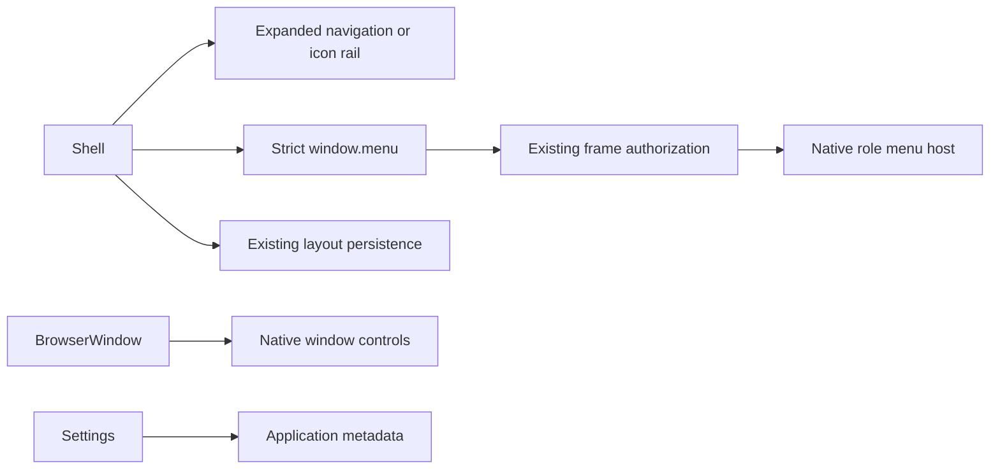

# TASK-82ff615b — Compact unified title bar and collapsible navigation

stage: done
type: change
path: full
interaction: autopilot
requirements: REQ-UX-d87fc848, REQ-UX-d797d594, REQ-UX-5e8e2eba, REQ-UX-4a040001
parent:
branch: master
base: 1d016b0bfad5256fb93cf3e2451e23f7186e21d9
opened: 2026-10-26

## Done checklist (current stage)

- [x] validated candidate unchanged; both reviews approved round2
- [x] evidence, candidate scope and exclusions presented
- [x] local delivery authorized by repository AGENTS
- [x] journal/report included and local commit delivered
- [x] close-out carried by delivery commit

## Frame

Problem: STATED - branding/header and native menu rows consume too much vertical space.
Desired outcome: STATED - implement displayed concept 1 with the collapsible navigation from concept 3.
Actors: VERA desktop user, keyboard user, application native window host.
Primary scenario: launch -> use unified menu/title row -> collapse sidebar to rail -> navigate projects/settings -> reopen with saved layout.
Examples: single compact File/Edit/View/Help row, native minimize/maximize/close; Home and Settings remain in sidebar/rail; information belongs to Settings About.
Counterexamples: no browser/site scaffold, new branding, credential handling changes, project-data migration or extra build labels.
In scope: native chrome/menu IPC, renderer shell/navigation, Home/About placement, localization, current tests/docs.
Out of scope: historical journals, optional-companions.md, unrelated product redesign, project data, remote publication.
Constraints: master and authorized local commits from AGENTS; configured autopilot; focused validation and both review verdicts; Windows and Linux; preserve sandbox/ownership/settings behavior.
Success signals: one compact top row; rail never loses navigation; persisted collapse; safe native controls and menus; metadata absent from Home, present in About; no clipping at supported scales.
Evidence: OBSERVED - components/shell.tsx has tall branding/navigation header and removes sidebar entirely when collapsed; main/index.ts uses native default chrome; App.tsx duplicates Metadata on Home and Settings. lib/layout.ts already persists collapse flags. STATED - selected two supplied visual references and explicit AEGIS/historical preservation.
Assumptions: reuse existing colors/icons and layout storage, keep project/session behavior, About already exists; native controls use Electron overlay. Native menus retain OS role semantics.
Unknowns: none decision-blocking; native menu and control rendering verified on both hosts.
Decision-blocking questions: none; visual composition explicitly selected.
Proposed behaviors: compact title/menu row, expanded/sidebar rail toggle with saved state, Home/Settings rail actions and project expansion, About-only metadata.
Path and reason: full - observable UI and new typed menu IPC; no dependency or data-format migration. Quick criteria: observable change=no; no interface change=no; dependency unchanged=yes; existing requirement suffices=no; boundary unchanged=no.

## Requirement coverage

| Outcome | Atomic behavior | Requirement | Positive | Failure/boundary | Verification | Decision |
|---|---|---|---|---|---|---|
| Compact chrome | native title/menu row | REQ-UX-d87fc848 | drag/native controls/menus | denied IPC, minimum size, themes/scales | schema/host/native tests | hidden titlebar + native overlay and bounded role menus |
| Useful collapsed navigation | saved icon rail | REQ-UX-d797d594 | collapse/expand/navigation/restart | keyboard focus, read-only storage, narrow view | shell/preferences/native/browser | reuse boolean persistence; always-mounted aside with hidden detail |
| More Home space | metadata in About | REQ-UX-5e8e2eba | Home project actions; About metadata | info unavailable and collapsed navigation | component/native tests | remove duplicate Metadata from Home |

## Design

- REQ-UX-d87fc848: use Electron titleBarStyle hidden and native titleBarOverlay, default40px height; CSS uses titlebar safe-area env values and drag/no-drag regions. Native minimize/maximize/close remain host-owned. Native controls follow nativeTheme palette; renderer controls retain supported scales without clipping.
- Main owns native menu construction from fixed role templates. New window.menu request accepts only file/edit/view/help and bounded integer local coordinates; router retains exact top-frame authorization. No renderer-supplied actions, URLs, templates or executable code. Native popup uses current window; mock API acknowledges platform-only request.
- REQ-UX-d797d594: reuse layout version1 boolean and storage guards. Aside remains mounted with compact width when collapsed; detail navigation and resizer hidden. Brand/Home/project expansion and bottom Settings are semantic labeled buttons. Existing project/session navigation stays in expanded details; right panel remains independent.
- REQ-UX-5e8e2eba: remove Home metadata and retain Settings About; remove placeholder prose from the populated About section.
- Current visual target: first displayed image exec-8e2d03a7-b8f7-469c-a8af-829410c5a22b.png (unified row) plus third exec-a5f0c0d9-bb04-488f-9f10-64c304cf8473.png (collapsed rail). User's composite selection authorizes adapting the existing production app directly. Actual config remains .vera/workbench.yaml.
- Interfaces/lifecycle: no data-format migration or new dependency. Native close still runs update/geometry/drain behavior. Layout read-only/storage errors retain existing safe behavior. Rail controls stay outside draggable row; titlebar controls are no-drag.
- Accessibility: keyboard-focusable controls, aria-label/expanded/controls, visible focus and tooltips; native role menus own their menu keyboard interactions. Collapse does not remove the focused top toggle. Icons reuse existing Lucide dependency and Activity brand.
- Tests: new shell behavior test first, typed menu request test first, focused existing preferences/IPC/preload/settings consumers; actual native geometry/security/restart and browser language/theme/scale matrix; inspect live desktop.
- Expected paths: main/index/window-chrome; shared IPC; renderer shell/App/settings/styles/locales/mock; focused tests; current shell/foundation/IPC knowledge and architecture docs. No historical task edits or other working-tree changes.
- Risks: native control overlap, menu drag regions, stored rail preference, settings navigation and minimum-size text scaling. Dedicated tests target each. Native popup labels follow host role semantics.
- Alternatives: custom-drawn window controls and extra chrome rows rejected in favor of native controls and selected space-saving layout. No open decision.

### Proposed architecture - TASK-82ff615b

## Log

- 2026-10-26 frame: full path, user-selected composition accepted; configured autopilot; master retained by repository rule. Only unrelated untracked optional-companions.md pre-exists. Historical journals remain untouched. Local commit authorization comes from AGENTS; remote publication not authorized.
- 2026-10-26 specify: three draft atomic UI requirements and bounded native-menu contract recorded; existing layout persistence reused without migration. Positive/boundary oracles and source ownership mapped above.
- 2026-10-26 design: implementation constrained by selected images and existing production component boundaries. Official Electron titlebar docs and pinned local typings verify overlay/drag/safe-area mechanisms; native host/browser proofs planned.

- 2026-10-26 build red: shell rail test fails because collapsing removes #sidebar; typed native menu test fails because window.menu is undefined. Both observed before production edits. Initial anchor follows now.

- 2026-10-26 build: fixed native role-menu bridge, compact safe-area titlebar, persistent rail, Home/About placement and localized controls. Windows focused 8 files/60 tests passed; additional window-state/chrome/rail tests 3 files/11 passed; import-boundary and updated focus checks 13 passed; TypeScript corrected typed test environment. Default chrome40px, native controls host-owned.
- 2026-10-26 build: actual Windows Electron exposed DPI-dependent hidden-frame size growth. Bounded restoration compensation passes native geometry restart and window-state unit tests; native fractional panel widths use0.01px comparison precision. Stale About-ready selectors, HMR test cwd and outdated translated/accessibility test labels corrected in immediate consumers. No product-data or historical journal changes.
- 2026-10-26 build: Windows native/browser acceptance: compact rail/restart/security/preferences/egress/foreign-frame/settings/window geometry/HMR and mock UI checks pass after focused oracle corrections; language/theme/scale matrix covers30 combinations at1024x640. Ubuntu focused9files/69tests passed; current-source native acceptance continuing.

- 2026-10-26 build complete: Ubuntu native compact/security/browser matrix passed; real JWM in owned Xvfb scratch resolves WSLg's absent maximize/position semantics, and compact maximize/restore plus geometry restart both pass (2 tests,6.9s). Windows selected acceptance covers11 scenarios with focused successful reruns. Manual real dev window confirms File popup/Escape, rail and native maximize/Restore controls. Design QA: specs/REQ-UX-d87fc848-design-qa.md, passed.
- 2026-10-26 validation preparation: catalog audit exposed dynamic menu translation lookup and unused former Home metadata heading. Replaced with explicit translated labels and removed unused key in all three catalogs. Shell focused regression passes; catalog audit passes. No behavior or scope departure. Build checklist complete; no full suite rerun under verification policy.

- 2026-10-26 validate reviews, round1: separate specification-compliance pass approved the final combined composition against all four active requirements/specs, exclusions and retained design. Separate implementation-quality pass approved native role-only IPC, exact-frame authorization, DPI restoration, focus/persistence/read-only paths, portability, localization and immediate-consumer tests. Both are independent review passes by the coordinating agent, not external reviewers or spawned agents; same final candidate. Final evolution21 paths reviewed; unrelated optional-companions excluded, historical journals unchanged. Context/knowledge diagrams match code.

- 2026-10-26 validate correction: first strict proof found only three locale line-ending formatting errors (lint), with typecheck/i18n passing. Biome normalized those files; requirement affected_paths now explicitly includes six changed tests that the source heuristic also classifies as source. Separate specification and implementation review passes repeated on unchanged behavior and corrected formatting/traceability, both approved round2. Final strict rerun follows; no test rerun needed for line endings and traceability prose.

- 2026-10-26 final validation: python .agentic/aegis.py check --task TASK-82ff615b --strict --run --json exits0; lint/typecheck/i18n all pass,0 errors/25 advisory warnings/3 notes. Warnings are existing obsolete demo/evidence paths, empty old test links, ticket naming and historical journal syntax; these unrelated historical records are preserved. Biome also reports existing25 warnings/9 infos with exit0; no new accepted runtime failure. Full test intentionally not in configured run, per verification-policy.md; focused Windows/Ubuntu and native/browser proof above supplies test coverage. git diff --check passes. Both current review verdicts approved round2; no children.
- 2026-10-26 deliver: presented compact chrome/rail/About candidate, focused verification, strict results and exclusions. Existing AGENTS human authorization covers this local-only commit on master, so no repeated approval needed. No push/PR/deployment. Only current task journal is added; historical journals unchanged; optional-companions.md excluded.

- 2026-10-26 delivery housekeeping: automated approval review rejected the combined Windows/Linux owned-scratch deletion command as blocked by policy; no cleanup retry or bypass. Scratch remains outside the repository. QA wording corrected to reflect retained captures. Prose-only correction reviewed independently for specification/quality, both approved round3; source/tests unchanged and existing runtime proof reused. Final static proof refreshed before local delivery. Report-time26th warning is the expected unticked delivery checklist, not a new candidate warning.

- 2026-10-26 final proof after QA prose correction: strict exit0, lint/typecheck/i18n all pass;27 advisory warnings include two transitional current-journal stage/checklist warnings in addition to25 pre-existing warnings. Current close-out below resolves transitional journal warnings. No source/test/config change after proof. Local-only commit is the complete authorized outcome; this record is carried by that commit. App remains running; owned external scratch retained after cleanup policy rejection.

## Rulings

- RULING-001 | date=2026-10-26 | decision=Use existing production app and selected combined visual target; preserve historical journals and project data | reason=Explicit user instruction | source=user | supersedes=none
- RULING-002 | date=2026-10-26 | decision=Use master, autopilot and authorized local-only delivery commit | reason=Repository AGENTS and configured interaction mode | source=repository | supersedes=none

## Handoff

current: done
status: ready
next: User checks the running compact VERA interface
must_read: .agentic/tasks/TASK-82ff615b.md
blockers: none

## Stage report

stage: deliver
result: completed
current: done
changed: Compact chrome, persistent rail, About-only metadata, tests and current documentation
evidence: Windows/Ubuntu focused and native/browser checks; final strict lint/typecheck/i18n exit0; QA passed
issues: 25 pre-existing advisory warnings; external scratch cleanup blocked by automatic policy
next: Iterative UI feedback in running VERA
needs_user: no
spec_compliance: approved
implementation_quality: approved
review_round: 3

## Delivery report (2026-10-26)

- stage: deliver; type: change; path: full; branch: master
- requirements:
  - REQ-UX-d87fc848 - Unify desktop chrome into a compact title bar
  - REQ-UX-d797d594 - Keep navigation available in a collapsible icon rail
  - REQ-UX-5e8e2eba - Keep application information in About
  - REQ-UX-4a040001 - Render the foundation shell
- deviations: none recorded
- explicit review: enabled; spec_compliance=approved; implementation_quality=approved; review_round=2
- diff vs task base 1d016b0: 36 file(s) changed, 1137 line(s) added
- checks: errors=0 warnings=26 notes=3
- checklist: 3/5 done; open: journal/report included and local commit delivered; close-out carried by delivery commit
