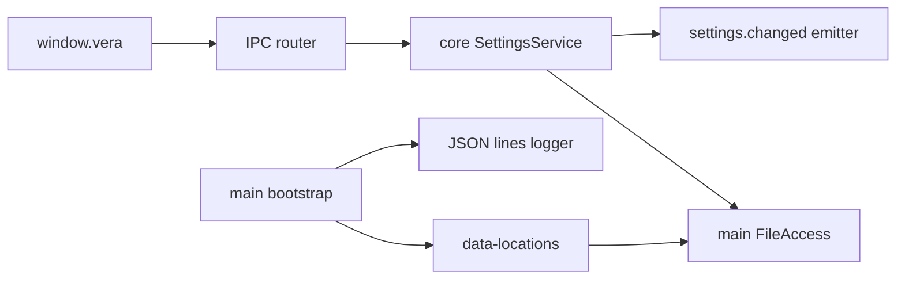

# TASK-8e23185a - WP-03 App data locations, settings and logging

stage: done
type: feature
path: full
interaction: autopilot
requirements: REQ-DATA-4a030001, REQ-DATA-4a030002, REQ-REL-4a030003, REQ-DATA-4a030004, REQ-FUNC-4a030005, REQ-FUNC-4a030006, REQ-PLAT-4a030007, REQ-FUNC-4a030008, REQ-SEC-4a030009
parent:
branch: master
base: 3cf43c472a3ccfc059fbc30fec27e028a27f5cd7
opened: 2026-10-10

## Done checklist (current stage)

- [x] validated candidate confirmed unchanged
- [x] validation evidence, complete diff, exclusions and coordinator outcome presented
- [x] user authorized local delivery commit; coordinator performs it
- [x] journal and report included in coordinator delivery commit
- [x] authorized local commit outcome delivered by coordinator
- [x] close-out recorded by coordinator in the local delivery commit

## Frame

Problem: OBSERVED WP-02 supplies bridge/events but no settings (desktop main/index.ts).
Desired outcome: STATED WP-03/issue #3 persisted settings, portable paths, host ports and redacting logs.
Actors: desktop user, renderer, preload, main, core service, host adapters and tests.
Primary scenario: launch -> settings load -> validated patch -> atomic save -> event -> restart retains patch.
Examples: STATED dark theme persists; v0 migrates with backup; newer schema remains unchanged.
Counterexamples: failed rename leaves previous settings/event state; secret/immutable keys rejected.
In scope: shared schema/IPC/API/mock, core settings/ports, main adapters/portable/logger, tests and affected docs.
Out of scope: WP-04 controls, WP-08 credentials, other WPs, branch/worktree, cycle tracker, staging/commit/publication/Gitea mutations.
Constraints: STATED master, autopilot, explicit WP-02 base, full candidate, Windows/Ubuntu native; preserved security, WP-02 metadata, exact pins.
Success signals: seven issue criteria plus concurrency/error/shutdown paths.
Evidence: STATED delegation; OBSERVED clean HEAD 3cf43c4, issue #3, M0 WP-03, 01 L7/L10/section6, 07 sections4/6, ADR-0009, current source and WP-02 journal.
Assumptions: INFERRED version1; v0 known preference subset; readOnly API snapshot enables future banner; reserved fields empty as stated.
Unknowns: future populated providers/models/recents outside scope.
Decision-blocking questions: none.
Proposed behaviors: linked data/API/recovery spec; all mapped below.
Path and reason: full; quick criteria no new behavior=no; no new interface=no; no new dependency=yes; existing requirement coverage=no; no data/security changes=no. Coupled task, no children.

## Requirement coverage

| Frame outcome | Atomic behavior | Requirement | Positive case | Boundary or failure | Verification | Design decision |
|---|---|---|---|---|---|---|
| Create versioned application settings | When the settings file is absent, VERA shall persist schema-version-1 defaults with a newly generated installation UUID. | REQ-DATA-4a030001 | Load two empty directories | see linked verification | 05_Software/packages/core/src/settings/service.test.ts | linked spec |
| Migrate settings with a preserved backup | When version-0 settings are loaded, VERA shall persist migrated version-1 settings after preserving the original bytes in settings.json.bak-<n>. | REQ-DATA-4a030002 | Load the version-0 fixture | see linked verification | 05_Software/packages/core/src/settings/service.test.ts | linked spec |
| Preserve settings on interrupted atomic saves | When a settings save fails before rename, VERA shall retain the preceding valid file and in-memory settings. | REQ-REL-4a030003 | Inject rename failure after temporary write | see linked verification | 05_Software/apps/desktop/src/main/file-access.test.ts | linked spec |
| Protect newer settings formats | While stored schemaVersion exceeds the supported version, VERA shall expose read-only defaults and preserve the stored file bytes. | REQ-DATA-4a030004 | Load version 99, read readOnly=true, attempt update and assert DENIED with unchanged bytes. | see linked verification | 05_Software/packages/core/src/settings/service.test.ts | linked spec |
| Validate and serialize partial settings updates | When a valid mutable settings patch is received, VERA shall persist the merged settings before emitting settings.changed. | REQ-FUNC-4a030005 | Concurrent distinct patches both survive | see linked verification | 05_Software/packages/core/src/settings/service.test.ts | linked spec |
| Expose settings through the validated application API | When an authorized renderer invokes app.settings.get or app.settings.update, VERA shall return the settings snapshot and read-only state through the shared validated bridge. | REQ-FUNC-4a030006 | Exercise schemas/router/preload/API/mock | see linked verification | 05_Software/e2e/shell.spec.ts | linked spec |
| Select portable application data before readiness | When vera.portable exists beside the executable, VERA shall select the adjacent data directory before app readiness. | REQ-PLAT-4a030007 | Host-independent path test verifies marker and startup call ordering, default and explicit isolation path behavior. | see linked verification | 05_Software/apps/desktop/src/main/data-locations.test.ts | linked spec |
| Retain seven daily structured log files | When the host records a log entry, VERA shall append a timestamped level-tagged JSON line to its UTC daily log and retain the seven newest daily files. | REQ-FUNC-4a030008 | Record all levels across nine days | see linked verification | 05_Software/apps/desktop/src/main/logger.test.ts | linked spec |
| Redact registered secrets from log lines | When a registered secret occurs in a log entry, VERA shall replace every occurrence in the persisted JSON line with a redaction marker. | REQ-SEC-4a030009 | Register plain and JSON-escaped secrets | see linked verification | 05_Software/apps/desktop/src/main/logger.test.ts | linked spec |

## Design

Requirements coverage: all nine requirements map to linked spec and seams; DATA first-run/migrate/future and FUNC updates use the core service; REL atomic writes uses host adapter; FUNC IPC uses shared/router/API/mock; PLAT uses pure path selection and main bootstrap; FUNC/SEC logging uses host logger.
Responsibilities: shared strict schemas; core ports and serialized settings service; main filesystem/clock/paths/logger; generic existing bridge transports channels; renderer API/mock only.
State: load once before window, cloned snapshots, commit in-memory state after successful atomic rename; event after commit; dispose drains pending work and denies new work.
Failures: preserve malformed/newer files; migration exclusive backup before write; retry transient rename errors asynchronously; cleanup temporary files; keep queue usable after rejection; safe coded IPC errors and category-only host errors.
Trust: immutable installationId/schemaVersion; strict nested validation keeps secret provider fields out; no raw errors in host logs.
Concurrency: one settings operation queue and one logger queue. Lifecycle drains both before quit.
Compatibility: current version1 and version0 subset with missing defaults; future version read-only; no dependency/pin changes.
Tests: dynamic module existence assertion gives meaningful red before imports; temporary directories/fake ports and clocks plus real native restart acceptance.
Alternatives: core direct fs would bypass host port; synchronous Windows wait would block main; overwrite-in-place risks corrupt JSON. Ports, asynchronous retry and same-directory rename preserve contracts.
Expected files: shared settings/ipc/index; core ports/index/settings service/test and vitest; main data-locations/file-access/host-ports/logger/tests/index/app-info; API/mock/tests; e2e; Vite aliases; fixture and knowledge/context.
Risks: rename/scanner transient failures; log I/O and shutdown ordering; both handled by bounded retries/queues/drain.
Open decisions: none within scope.
### Proposed architecture - TASK-8e23185a

## Log

- 2026-10-10 frame: full path accepted in explicit autopilot; clean master/HEAD confirmed. Scope and exclusions captured in Frame.
- 2026-10-10 specify: nine atomic draft requirements created; no revised/retired requirements. Inventory, coverage and exact contract audited.
- 2026-10-10 design: note and diagram audited against nine requirements; no format errors; planned missing source paths resolve in build.
- 2026-10-10 tooling: BMAD renderer absent; explicit user AEGIS workflow takes precedence over unrelated plugin setup.

- 2026-10-10 build red: REQ-DATA-4a030001/002/004 and REQ-FUNC-4a030005; command=`python ../02_Tools/npmw.py npx vitest run packages/core/src/settings/service.test.ts` (05_Software); exit=1; expected missing behavior=settings persistence service exists assertion false before dynamic import.

- 2026-10-10 build green: core settings focused command exit=0; 19 tests cover defaults, migration, newer formats, strict patches, serialization and shutdown.
- 2026-10-10 build red: REQ-REL-4a030003, REQ-PLAT-4a030007, REQ-FUNC-4a030008, REQ-SEC-4a030009; command=`python ../02_Tools/npmw.py npx vitest run apps/desktop/src/main/file-access.test.ts apps/desktop/src/main/data-locations.test.ts apps/desktop/src/main/logger.test.ts`; exit=1; expected missing behavior=atomic file, portable logic and redacting logger assertions false before imports.

- 2026-10-10 build green: host focused command exit=0; ten tests cover atomic interruption/retry/exhaustion, portable selection/order, seven daily logs and registered-secret redaction.
- 2026-10-10 build red: REQ-FUNC-4a030006; mockApi.test.ts focused command exit=1 (NOT_FOUND settings channel); native `npm run test:e2e -- --grep "validated settings update"` exit=1, first settings get rejected through existing bridge because settings channel is absent.

- 2026-10-10 build integration green: five focused settings/bridge/router/API/mock files, 43 tests, exit=0; Windows native settings restart exit=0, 1 passed; strict typecheck exit=0 after mapped dispatch dependency fix. Anchor is TASK-8e23185a.anchor.json (282 files, base 3cf43c4).
- 2026-10-10 build red: REQ-DATA-4a030002 and REQ-SEC-4a030009; command=`python ../02_Tools/npmw.py npx vitest run packages/core/src/settings/service.test.ts apps/desktop/src/main/logger.test.ts`; exit=1; nested v0 missing defaults returns INVALID and a secret containing JSON delimiters breaks serialized JSON. Semantic lifecycle review also requires log drain after window close. Fix within agreed recovery/log contract.

- 2026-10-10 build final focused green: Windows eight impacted files/60 tests exit=0; typecheck exit=0. v0 nested defaults validated before migration; redaction preserves JSON syntax; shutdown drains settings before closing windows and logs after close. All nine requirements active with links. Evolution contains only planned product/test paths; fixture included in complete base-relative candidate. Advance to validate.

- 2026-10-10 validate reconciliation: complete source/test/spec/requirement and base-relative diff reviewed; all new/untracked paths expected. App-data knowledge added and shell/IPC/tooling/context/README reconciled. Nine active requirements have true paths/tests; no Manual substitutes. JSON-content redaction preserves syntax, migration backup collision contract aligned, and existing security/pins preserved.

- 2026-10-10 validate explicit review round 1, specification compliance: approved. Separate pass checked issue/M0 scope, all nine requirements and exact defaults/ports/migration/readonly/IPC/log contract, exclusions, proposed/current diagrams and retained WP-02 metadata/mock/security. Same 46-file non-journal candidate digest 098f1e1014817846c9a1709447c811fecdd3ba81f12d1161d27735091c5c95e5; no outstanding scope/spec findings.
- 2026-10-10 validate explicit review round 1, implementation quality: approved. Independent evaluation axis checked entire tracked/untracked candidate, strict nested validation/immutable identity, atomic cleanup and Windows retries, queue recovery/drain, redaction JSON validity, log rotation, native lifecycle, source-build aliases, portability, tests and unrequested work. Agent-authored separate passes, not external reviewers. Same candidate digest; no outstanding findings. Final native/full proof pending.
- 2026-10-10 platform readiness: Windows and Ubuntu setup --check exit=0. Ubuntu 24.04.4 WSL2 has native libraries and Xvfb; existing mirror preserves separate Linux Node 24.21.0/node_modules, lockfile unchanged and npm packages ready, so npm ci is unnecessary. Sources-only archive includes Git-visible current sources; base bundle supplies only baseline Git objects for mirror diff checks.

- 2026-10-10 validate final proof: Windows `python .agentic/aegis.py check --task TASK-8e23185a --strict --run` exit=0, configured test 38.5s and lint/npm verify 33.2s; errors=0/warnings=0/notes=0. Ubuntu 24.04.4 WSL2 same strict command via python3 exit=0, configured test 24.9s and verify 28.0s, errors=0/warnings=0/notes=0. Mirror supplies a local .git/vera-python/python symlink to system python3 in PATH for unchanged configured commands; separate pinned Linux Node/native npm dependencies retained. Exact 350 non-journal Git-visible file digests verified; 292 non-AEGIS source aggregate SHA-256 cf8922c1295fe330e15870266644d4970a840832712aac01409b6355c10f5e5b.
- 2026-10-10 validate native acceptance: Windows `python ../02_Tools/npmw.py npm run test:e2e` (05_Software) exit=0, 8 passed/33.1s; Ubuntu `python3 ../02_Tools/npmw.py npm run test:e2e` exit=0, 8 passed/56.9s. Both include builds, real settings restart/id/event, newer-schema byte preservation/DENIED, browser mock and all retained WP-01/02 security/egress/subscription/geometry/dev behavior. Ubuntu uses native system Xvfb with empty LD_LIBRARY_PATH and Chromium sandbox enabled. No extracted libraries or --no-sandbox.
- 2026-10-10 validate close: 47-path complete base-relative candidate reviewed, including 25 new/untracked paths; 46 non-journal content hashes unchanged from both approved round-1 verdicts and final proof. No source/test/spec/requirement/knowledge edits after final proof. Full configured unit suite covers 13 files; focused observed suite is 60 tests/8 files. `git diff --check` and explicit new-file whitespace/blank-EOF audit exit=0. master/HEAD still 3cf43c472a3ccfc059fbc30fec27e028a27f5cd7; index empty. No unresolved findings, deviations, skipped/weak checks or preexisting failures. Harmless upstream zod Rollup annotation and Windows NO_COLOR/FORCE_COLOR messages remain. Advance to deliver for coordinator verification and authorized local commit; implementer performs no staging/commit/publication.

- 2026-10-10 deliver prepared: final report appended; advisory errors=0/warnings=1/notes=0 is only the unfinished delivery checklist while coordinator commit is pending. Runtime proof logs: ignored 02_Tools/cache/wp03-windows-strict.log, wp03-ubuntu-strict.log, wp03-windows-e2e.log and wp03-ubuntu-e2e.log. Source/candidate manifests and sources-only sync script/archive are beside them. No stage/index/commit/publication or cycle-tracker mutation performed.

- 2026-10-10 coordinator review finding: portable first launch selects an absent data directory before mkdir. Installed Electron setPath contract (electron.d.ts lines 1801-1803) requires directory existence; permissive fake host masked the failure. Return deliver -> build for this recorded finding only; prior round-1 verdicts and proof are superseded for the corrected candidate. Clear both current verdicts and prepare bounded re-review round 2; base/master and complete unstaged scope reconfirmed unchanged.

- 2026-10-10 build round-2 red: REQ-PLAT-4a030007; command=`python ../02_Tools/npmw.py npx vitest run apps/desktop/src/main/data-locations.test.ts` (05_Software); exit=1, three expected failures. Faithful setPath rejects initially absent portable data and absent override; creation-error test receives host rejection instead of real filesystem error. Existing data/sentinel passes. Original anchor archived to ignored 02_Tools/cache/wp03-round1.anchor.json before round-2 anchor refresh.

- 2026-10-10 build round-2 focused green: Windows exact data-locations selector exit=0, 4 tests passed; Biome check exit=0. mkdirSync(recursive) prepares portable/explicit overrides before setPath; existing content and installed path resolution preserved; real EEXIST/ENOTDIR errors propagate without host.setPath or fallback. Source/test links retained in REQ-PLAT-4a030007 and verification/spec/knowledge reconciled. Native runtime/common executable markers untouched. Return to validate for complete round-2 review and final platform proof.

- 2026-10-10 validate round-2 specification compliance: approved. Complete 47-path candidate rechecked against nine requirements, issue scope, specs/design and retained boundaries. Correction establishes existing Electron directory precondition while preserving marker precedence, overrides, installed resolution and failure propagation; no scope expansion. Same 46-file non-journal candidate SHA-256 b20a0556e73b4449bb73c65bb8cca829d25567b56bc64d0dea99a2d8676bd6c4.
- 2026-10-10 validate round-2 implementation quality: approved in a separate agent-authored evaluation axis. Faithful host verifies filesystem existence at setPath call, temporary markers isolate real runtime, recursive creation is idempotent and errors prevent selection/fallback. Reviewed all eight changed paths relative to prior candidate; remaining content unchanged, full base-relative inventory/whitespace audit clean. Source aggregate 292 files SHA-256 02c944a85ac331d1504886b77332e7de2c707e5130df3ed59adaee14807be65e. Current proposed/knowledge diagrams and port/security/data contracts agree. No outstanding findings; both verdicts apply to same corrected candidate. Final native/full proof pending.

- 2026-10-10 validate round-2 final proof: Windows `python .agentic/aegis.py check --task TASK-8e23185a --strict --run` exit=0, configured test 19.8s and lint/npm verify 37.8s; Ubuntu 24.04.4 WSL2 same command via python3 exit=0, test 24.4s and verify 36.3s. Each errors=0/warnings=0/notes=0, strict=ok. Both native tool/dependency setup checks also passed; exact 350 non-journal Git-visible file hashes matched the Linux mirror before proof.
- 2026-10-10 validate round-2 native acceptance: Windows `python ../02_Tools/npmw.py npm run test:e2e` (05_Software) exit=0, 8 passed/29.3s; Ubuntu `python3 ../02_Tools/npmw.py npm run test:e2e` exit=0, 8 passed/27.8s. Native restart/readonly/IPC and retained WP-01/02 security/mock/geometry/dev acceptance all pass. Ubuntu uses separate native Linux dependencies, system Xvfb, empty LD_LIBRARY_PATH and enabled Chromium sandbox. Exit codes also preserved in ignored round-2 e2e .exit.txt sidecars.
- 2026-10-10 validate round-2 close: complete 47-path candidate remains 22 modified/25 new; all 46 non-journal hashes unchanged from both approved verdicts and final proof. Candidate SHA-256 b20a0556e73b4449bb73c65bb8cca829d25567b56bc64d0dea99a2d8676bd6c4; 292 non-AEGIS sources SHA-256 02c944a85ac331d1504886b77332e7de2c707e5130df3ed59adaee14807be65e. Whitespace/blank-EOF audit and git diff --check pass, index empty, master/HEAD/base unchanged. No outstanding findings, deviations or skipped/weakened checks. Harmless upstream zod annotation and Windows color-environment messages persist. Corrected PLAT criterion has four faithful-host tests for absent portable/override directories, existing-content preservation, creation failure/no fallback and precedence/startup order on both OS. Advance to deliver without staging or committing; coordinator owns authorized local delivery.

- 2026-10-10 coordinator round-3 finding: desktop-shell.md and app-data.md contain U+00E2 U+20AC U+201D instead of U+2014. Return deliver -> validate for knowledge-only encoding repair; both current verdicts invalidated and bounded review round advances to 3. Coordinator requests explicit UTF-8 reads/writes and complete candidate scan, no global conversion or product changes; native round-2 evidence may be retained only after executable/test hashes match.

- 2026-10-10 validate round-3 encoding correction and scan: explicit UTF-8 read_text/write_text replaced exactly 20 U+00E2 U+20AC U+201D sequences with U+2014 in each of app-data.md and desktop-shell.md. Byte-level comparison proves no other bytes changed in either page. Complete 47-path candidate scan finds no remaining suspicious encoding except 05_Software/README.md: three em dashes, one en dash and four section signs corrupted relative to base; all eight are introduced, not preexisting. README left untouched because coordinator explicitly limited correction to the two knowledge pages. Scope clarification requested before accepting this relevant finding or expanding the repair.
- 2026-10-10 validate round-3 retained native proof: SHA-256 comparison confirms all 85 Git-visible executable sources/tests/config/fixtures/tools under 05_Software and 02_Tools identical to round-2 manifest. Nine active requirements and all affected/linked-test paths remain true, reviewed knowledge diagrams/contracts preserve current behavior, git diff --check passes, base/master and empty index unchanged. Round-2 e2e remains applicable (exit=0, eight tests per OS); no runtime rerun needed for prose encoding repair. Current verdicts remain invalidated pending README scope decision; final strict --run has not yet been run for round 3 and will follow final documentation reconciliation and both reviews.

- 2026-10-10 coordinator scope clarification: exact repair of the eight README sequences authorized after coordinator baseline inspection. This restores preexisting text and completes the encoding correction without changing product scope. Continue same task/master/autopilot; no additional user decision, source edits, staging, commit or remote publication.

- 2026-10-10 validate round-3 reconciliation complete: README explicit UTF-8 repair changed exactly three em dashes, one en dash and four section signs; byte comparison confirms all other bytes retained. Along with the two knowledge-page repairs, complete 47-path scan is clean for introduced mojibake/replacement characters. Baseline diffs now preserve the otherwise unchanged UTF-8 lines. Requirements/spec/design/component diagrams and project/environment context retain the same contract; all nine requirements remain active and paths/tests true. Evolution refreshed after final README edit, two expected paths relative to round-2 build anchor: data-locations.ts and README.md. Full base-relative inventory stays 47 paths (22 modified, 25 new).
- 2026-10-10 validate round-3 specification compliance: approved. Separate pass reviewed corrected complete candidate against Frame scope/exclusions, nine requirements, exact data/API/recovery/log spec and Design/knowledge diagrams. Prose changes restore intended characters only; product behavior, acceptance, security and later-package exclusions remain unchanged. All prior content except the three repaired prose pages is hash-identical to round 2. Bound 46-file non-journal candidate SHA-256 (sorted JSON UTF-8 manifest) badc19f0298826a034a251904a34c3d5612d896196c2183837789bfb5bf6f418; no outstanding specification findings.
- 2026-10-10 validate round-3 implementation quality: approved in a separate agent-authored evaluation axis, not external reviewers. Exact byte substitutions, baseline preservation, UTF-8 round-trip, complete encoding/whitespace checks and unchanged executable fingerprints verify correction correctness and bounded scope. Existing failure, concurrency, migration, portability, secret handling, host startup/shutdown and bridge contracts reviewed with retained round-2 implementation evidence. Same corrected candidate digest as specification pass; no unresolved findings. All 85 native source/test/config/fixture/tool file hashes match round 2, aggregate SHA-256 (sorted JSON UTF-8) 6b02b162d21a847d5f01d4bcb0d45d87fb270797bffcd8a57932e466777745be; round-2 native e2e eight tests/exit 0 per OS remains applicable because runtime inputs are unchanged. Final strict proof pending.

- 2026-10-10 validate round-3 final proof: after all documentation reconciliation and both approved reviews, Windows `python .agentic/aegis.py check --task TASK-8e23185a --strict --run` exit=0; configured test 50.1s, lint/npm verify 30.7s, errors=0/warnings=0/notes=0, strict=ok. Ubuntu 24.04.4 WSL2 same strict command via python3 exit=0; configured test 46.2s, verify 28.2s, errors=0/warnings=0/notes=0, strict=ok. The native Linux mirror matched all 351 Git-visible file hashes before final proof; separate Linux Node/npm/native dependencies retained. Logs and explicit exit-code sidecars are ignored 02_Tools/cache/wp03-round3-{windows,ubuntu}-strict.*.
- 2026-10-10 validate round-3 close: 46 non-journal candidate hashes remain identical to both round-3 verdicts and final proof; all 85 native source/test/config/fixture/tool hashes remain identical to round 2, so retained e2e evidence covers the same runtime on both OS (eight passed, exit 0 each). No e2e repeat for exact prose-only character repair, as coordinator explicitly directed; required final configured full/strict proof freshly passed. Non-AEGIS 292-file aggregate SHA-256 (sorted JSON UTF-8) 21902f6f5c34ed0c9c35f6544191481443cdd594a4e10323f3da4a523472b6d6. Complete candidate remains 47 paths, 22 modified/25 new; master/HEAD/base 3cf43c472a3ccfc059fbc30fec27e028a27f5cd7, index empty, whitespace/blank-EOF clean. No outstanding findings, deviations, preexisting failures or weakened required verification. Advance deliver for coordinator verification and authorized local commit, without implementation staging/commit/publication.

- 2026-10-10 coordinator final review and proof: full journal, current round-3 bound verdicts, nine active requirements/spec, seven Done-when criteria, architecture/import/secret boundaries and complete 47-path staged/unstaged/untracked base-relative candidate reviewed; specification and implementation quality approved for unchanged candidate. Both recorded coordinator findings (portable first-launch directory prerequisite and UTF-8 prose corruption) are corrected. All 46 non-journal hashes equal approved round-3 manifest; 350 Git-visible non-journal files match native Ubuntu mirror. No children, outstanding findings, scope deviations, omitted checks or user files outside scope.
- 2026-10-10 coordinator final platform proof: Windows strict --run exit=0 (configured test 20.6s, verify 30.7s); Ubuntu 24.04.4 WSL2 strict --run exit=0 (test 24.4s, verify 40.8s), with native pinned runtimes/dependencies and readiness checks passed. Each strict catalog has errors=0/notes=0 and only one unticked-deliver warning for the three pending delivery checklist entries; it is administration to close in the authorized local commit, not a product finding. Fresh full native e2e including build exit=0 on Windows (8 passed/34.9s) and Ubuntu (8 passed/20.1s), covering restart identity/persistence, future-schema byte preservation, IPC sender/subscription/security/egress, geometry, mock and dev/HMR. Linux uses native Xvfb, empty LD_LIBRARY_PATH and enabled sandbox. Existing harmless zod Rollup annotation and Windows color-environment notices retained. Logs and exit sidecars: ignored 02_Tools/cache/wp03-coordinator-{windows-strict,windows-e2e,ubuntu-proof}.*. Complete UTF-8/trailing-whitespace/new-file EOF audit and git diff --check pass; candidate remained byte-identical during proof.
- 2026-10-10 coordinator delivery authorization: user explicitly requested commit on master after validation and automatic WP-04 start; earlier cycle authorization and RULING-001 agree. Presentation covers the complete 47-file candidate (22 modified, 25 new), validation and harmless notices; outcome is one repository-local WP-03 commit including journal/report/close-out. No remote publication, issue mutation or additional implementation scope. User approval already applies; no new confirmation required.

- 2026-10-10 coordinator local-only close-out: validated candidate and all delivery records ready for the single authorized master commit; stage done and close-out are carried by that outcome as required by deliver step 7. Git success and real SHA will be verified in the ignored cycle tracker; a failed commit restores deliver. No push, PR, release or remote issue update.

## Rulings

- RULING-001 | date=2026-10-10 | decision=User authorized local commits after validation; coordinator commits; implementation chat hands back without staging or committing, on master at the explicit base | reason=Explicit automated cycle | source=user | supersedes=none

## Acceptance evidence

| Issue criterion | Direct evidence | Result |
|---|---|---|
| First run/new installationId | core service.test.ts defaults, two UUIDs, reload and persistence | passed |
| v0 migration/backup | version-0.json fixture, byte backup/collision, nested defaults, failed backup | passed |
| Interrupted write/rename | file-access.test.ts observes temporary JSON then throws before rename, old target valid; queue recovery | passed |
| Newer schema/read-only | core unit and native IPC/shutdown: readOnly, DENIED, identical source bytes | passed on both OS |
| Portable marker | faithful-host data-locations.test.ts: absent portable/override directory creation before setPath, existing-content preservation, real creation error/no fallback, regular marker/default/priority/bootstrap order; temporary fixtures leave runtime untouched | four tests passed on both OS |
| Registered-secret redaction | logger.test.ts all levels/nested keys/values/repetition/escaping and JSON integrity | passed |
| Settings update survives restart | native settings update-to-dark, event once, same UUID and persisted snapshot | 8-test acceptance passed on both OS |
| Additional lifecycle/error coverage | serial patches, detached snapshots, no-op/undefined patches, failed writes/backup/observer, shutdown, retry/exhaustion/log recovery | passed |

## Candidate inventory

Complete 47 paths relative to repository root; index is empty and all candidate changes remain unstaged.

- M .agentic/context/environment.md
- M .agentic/context/project.md
- A .agentic/knowledge/app-data.md
- M .agentic/knowledge/desktop-shell.md
- M .agentic/knowledge/ipc-boundary.md
- M .agentic/knowledge/software-tooling.md
- A .agentic/requirements/data/REQ-DATA-4a030001.toml
- A .agentic/requirements/data/REQ-DATA-4a030002.toml
- A .agentic/requirements/data/REQ-DATA-4a030004.toml
- A .agentic/requirements/functional/REQ-FUNC-4a030005.toml
- A .agentic/requirements/functional/REQ-FUNC-4a030006.toml
- A .agentic/requirements/functional/REQ-FUNC-4a030008.toml
- A .agentic/requirements/platform/REQ-PLAT-4a030007.toml
- A .agentic/requirements/reliability/REQ-REL-4a030003.toml
- A .agentic/requirements/security/REQ-SEC-4a030009.toml
- A .agentic/specs/REQ-DATA-4a030001.md
- A .agentic/tasks/TASK-8e23185a.md
- M 05_Software/README.md
- M 05_Software/apps/desktop/electron.vite.config.ts
- M 05_Software/apps/desktop/src/main/app-info.ts
- A 05_Software/apps/desktop/src/main/data-locations.test.ts
- A 05_Software/apps/desktop/src/main/data-locations.ts
- A 05_Software/apps/desktop/src/main/file-access.test.ts
- A 05_Software/apps/desktop/src/main/file-access.ts
- A 05_Software/apps/desktop/src/main/host-ports.ts
- M 05_Software/apps/desktop/src/main/index.ts
- M 05_Software/apps/desktop/src/main/ipc-router.test.ts
- M 05_Software/apps/desktop/src/main/ipc-router.ts
- A 05_Software/apps/desktop/src/main/logger.test.ts
- A 05_Software/apps/desktop/src/main/logger.ts
- M 05_Software/apps/desktop/src/preload/bridge.test.ts
- M 05_Software/apps/desktop/src/renderer/api/client.ts
- M 05_Software/apps/desktop/src/renderer/api/ipc.test.ts
- M 05_Software/apps/desktop/src/renderer/api/ipc.ts
- M 05_Software/apps/desktop/src/renderer/mocks/mockApi.test.ts
- M 05_Software/apps/desktop/src/renderer/mocks/mockApi.ts
- M 05_Software/apps/desktop/vitest.config.ts
- M 05_Software/e2e/shell.spec.ts
- A 05_Software/fixtures/settings/version-0.json
- M 05_Software/packages/core/src/index.ts
- A 05_Software/packages/core/src/ports.ts
- A 05_Software/packages/core/src/settings/service.test.ts
- A 05_Software/packages/core/src/settings/service.ts
- A 05_Software/packages/core/vitest.config.ts
- M 05_Software/packages/shared/src/index.ts
- M 05_Software/packages/shared/src/ipc.ts
- A 05_Software/packages/shared/src/settings.ts

## Handoff

current: done
status: ready
next: coordinator verifies delivery commit and starts eligible WP-04
must_read: .agentic/tasks/TASK-8e23185a.md
blockers: none

## Stage report

stage: deliver
result: completed
current: done
changed: WP-03 settings, migrations, portable paths, redacting logs, tests and documentation; 47 files
evidence: coordinator strict --run and fresh eight e2e passed on Windows and Ubuntu; exact unchanged candidate
issues: none; local-only close-out carried by delivery commit
next: verify commit SHA and start WP-04
needs_user: no
spec_compliance: approved
implementation_quality: approved
review_round: 3

## Delivery report (2026-10-10)

- stage: deliver; type: feature; path: full; branch: master
- requirements:
  - REQ-DATA-4a030001 - Create versioned application settings
  - REQ-DATA-4a030002 - Migrate settings with a preserved backup
  - REQ-REL-4a030003 - Preserve settings on interrupted atomic saves
  - REQ-DATA-4a030004 - Protect newer settings formats
  - REQ-FUNC-4a030005 - Validate and serialize partial settings updates
  - REQ-FUNC-4a030006 - Expose settings through the validated application API
  - REQ-PLAT-4a030007 - Select portable application data before readiness
  - REQ-FUNC-4a030008 - Retain seven daily structured log files
  - REQ-SEC-4a030009 - Redact registered secrets from log lines
- deviations: none recorded
- explicit review: enabled; spec_compliance=approved; implementation_quality=approved; review_round=1
- diff vs task base 3cf43c4: 47 file(s) changed, 1661 line(s) added
- checks: errors=0 warnings=1 notes=0
- checklist: 3/6 done; open: journal and report included in coordinator delivery commit; authorized local commit outcome delivered by coordinator; close-out recorded by coordinator after successful local outcome

## Delivery report (2026-10-10)

- stage: deliver; type: feature; path: full; branch: master
- requirements:
  - REQ-DATA-4a030001 - Create versioned application settings
  - REQ-DATA-4a030002 - Migrate settings with a preserved backup
  - REQ-REL-4a030003 - Preserve settings on interrupted atomic saves
  - REQ-DATA-4a030004 - Protect newer settings formats
  - REQ-FUNC-4a030005 - Validate and serialize partial settings updates
  - REQ-FUNC-4a030006 - Expose settings through the validated application API
  - REQ-PLAT-4a030007 - Select portable application data before readiness
  - REQ-FUNC-4a030008 - Retain seven daily structured log files
  - REQ-SEC-4a030009 - Redact registered secrets from log lines
- deviations: none recorded
- explicit review: enabled; spec_compliance=approved; implementation_quality=approved; review_round=2
- diff vs task base 3cf43c4: 47 file(s) changed, 1798 line(s) added
- checks: errors=0 warnings=1 notes=0
- checklist: 3/6 done; open: journal and report included in coordinator delivery commit; authorized local commit outcome delivered by coordinator; close-out recorded by coordinator in the local delivery commit

## Delivery report (2026-10-10)

- stage: deliver; type: feature; path: full; branch: master
- requirements:
  - REQ-DATA-4a030001 - Create versioned application settings
  - REQ-DATA-4a030002 - Migrate settings with a preserved backup
  - REQ-REL-4a030003 - Preserve settings on interrupted atomic saves
  - REQ-DATA-4a030004 - Protect newer settings formats
  - REQ-FUNC-4a030005 - Validate and serialize partial settings updates
  - REQ-FUNC-4a030006 - Expose settings through the validated application API
  - REQ-PLAT-4a030007 - Select portable application data before readiness
  - REQ-FUNC-4a030008 - Retain seven daily structured log files
  - REQ-SEC-4a030009 - Redact registered secrets from log lines
- deviations: none recorded
- explicit review: enabled; spec_compliance=approved; implementation_quality=approved; review_round=3
- diff vs task base 3cf43c4: 47 file(s) changed, 1806 line(s) added
- checks: errors=0 warnings=1 notes=0
- checklist: 3/6 done; open: journal and report included in coordinator delivery commit; authorized local commit outcome delivered by coordinator; close-out recorded by coordinator in the local delivery commit

## Delivery report (2026-10-10)

- stage: deliver; type: feature; path: full; branch: master
- requirements:
  - REQ-DATA-4a030001 - Create versioned application settings
  - REQ-DATA-4a030002 - Migrate settings with a preserved backup
  - REQ-REL-4a030003 - Preserve settings on interrupted atomic saves
  - REQ-DATA-4a030004 - Protect newer settings formats
  - REQ-FUNC-4a030005 - Validate and serialize partial settings updates
  - REQ-FUNC-4a030006 - Expose settings through the validated application API
  - REQ-PLAT-4a030007 - Select portable application data before readiness
  - REQ-FUNC-4a030008 - Retain seven daily structured log files
  - REQ-SEC-4a030009 - Redact registered secrets from log lines
- deviations: none recorded
- explicit review: enabled; spec_compliance=approved; implementation_quality=approved; review_round=3
- diff vs task base 3cf43c4: 47 file(s) changed, 1829 line(s) added
- checks: errors=0 warnings=1 notes=0
- checklist: 5/6 done; open: close-out recorded by coordinator in the local delivery commit
