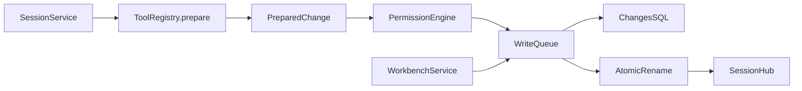

<!--
Copyright (c) 2026 DDP Engineering
This software is licensed under the PolyForm Noncommercial License 1.0.0.
Commercial use requires a separate commercial license.
See the LICENSE.txt in the .agentic folder for full license details.
SPDX-License-Identifier: LicenseRef-PolyForm-Noncommercial-1.0.0
-->

# TASK-8f715d24 - WP-16 Write and edit tools

stage: done
type: feature
path: full
interaction: autopilot
requirements: REQ-FUNC-9aa789af, REQ-DATA-8c71b990, REQ-FUNC-d5b5be90, REQ-DATA-cf979c63, REQ-REL-d2437b70, REQ-DATA-f44069c2, REQ-DATA-60e025f4, REQ-REL-50217071, REQ-SEC-294dcab2
parent:
branch: master
base: cc3d1a6a9f92fde5824347234b150a3b5b36f266
opened: 2026-10-12

## Done checklist (current stage)

- [x] validated candidate confirmed unchanged
- [x] coordinator validation, exact43path diff, exclusions and local outcome presented
- [x] standing user authorization: coordinator alone commits validated WP16 on master
- [x] journal and report included in selected43path delivery candidate
- [x] authorized local commit prepared by coordinator
- [x] close-out carried by the single local delivery commit

## Frame

Problem: STATED — WP16 needs confined, durable write/edit tools.
Desired outcome: STATED — prepared changes apply atomically after fresh read/version checks, with recorded diffs.
Actors: sessions, ToolRegistry, WorkbenchService/app saves, host permission port, SQLite.
Primary scenario: read -> prepare immutable edit -> permission host -> shared queue rechecks hash -> pending/temp/rename/applied -> event and fingerprint.
Examples: two sessions read v1; first applies v2; second receives conflict. CRLF+BOM stays intact.
Counterexamples: unread overwrite, ambiguous oldString, ignored/outside path, changed hash never writes.
In scope: issue16-original.json/plan WP16, host queue integration, recovery, tests and affected current knowledge.
Out of scope: WP17 approval engine/UI/CLI flags, WP18 panel, other tickets, remote publication.
Constraints: master at recorded base; no staging/commit by implementer; existing Electron/worker/session boundaries, guards and assertions preserved; protect optional-companions SHA256 2a69f5b335a53e498b1f8e30fa5adb8096e870e7a12bbc05b0727a03cee72c6b; preserve originals.
Success signals: all eight Done items plus focused/strict/acceptance on Windows and fresh native Ubuntu mirror.
Evidence: OBSERVED — tools/context.ts,registry.ts/read.ts; sessions/service.ts currently offers only reads; WorkbenchService owns app saves; schema1 already has changes table. STATED — issue16 and 03 sections4/5/6,02 section9,ADR0007.
Assumptions: INFERRED — injectable permission port can exercise writes while default read permission remains until WP17.
Unknowns: exact host seam and diff dependency pin resolved in design; BMAD renderer/setup absent, AEGIS requested workflow used directly.
Decision-blocking questions: none; scope explicitly authorized.
Proposed behaviors: confined write/create; guarded overwrite; exact edit; immutable preparation; shared admission; atomic record; recovery; encoding preservation; protected metadata.
Path and reason: full; new interfaces/dependency, persistence and data handling.
Quick criteria | yes/no | evidence
No new behavior | no | write/edit
No new interface | no | prepared write
No new dependency | no | diff
Existing requirement covers all | no | new scope
No security/data change | no | writes/recovery
Children: none; tightly coupled implementation; independent review agents at validate.

## Requirement coverage

| Frame outcome | Atomic behavior | Requirement | Positive case | Boundary or failure | Verification | Design decision or no impact |
|---|---|---|---|---|---|---|
| WP16 Create workbench text files | When write targets a missing confined workbench file, the tool shall create its parent folders and UTF-8 content and return canonical path, byte size and created=true. | REQ-FUNC-9aa789af | Create a Unicode nested path through the registry; inspect exact bytes and created; reject .vera and escaping paths. | errors preserve bytes | tools/write-edit.test.ts | prepared change + shared queue |
| WP16 Require fresh session reads before overwrite | When write targets an existing file or edit targets a file, the tool shall require the session last-read SHA-256 to equal the current bytes, returning "Read the file before overwriting it." for an unread overwrite and a read-again conflict for stale content. | REQ-DATA-8c71b990 | Seed file and two contexts; unread overwrite errors; read succeeds; external mutation errors and preserves bytes. | errors preserve bytes | tools/write-edit.test.ts | prepared change + shared queue |
| WP16 Replace exact text with line counts | When edit is requested, the tool shall replace exactly one nonempty oldString match, or all non-overlapping matches with replaceAll, reporting replacements and unified-diff added/removed line counts; zero or ambiguous matches return actionable errors. | REQ-FUNC-d5b5be90 | Read text; exercise zero/one/multiple/all matches and count resulting diff lines. | errors preserve bytes | tools/write-edit.test.ts | prepared change + shared queue |
| WP16 Preserve edit line endings and BOM | When edit modifies UTF-8 text, the tool shall preserve its BOM and CRLF convention, converting LF oldString/newString to CRLF before matching a CRLF file. | REQ-DATA-cf979c63 | Edit a CRLF+BOM file with LF strings; compare raw bytes and BOM; reject binary input. | errors preserve bytes | tools/write-edit.test.ts | prepared change + shared queue |
| WP16 Apply immutable prepared versions through shared queue | When a prepared change reaches the workbench write queue, the system shall apply only its prepared output after rechecking path, authority and expected SHA-256/existence, returning conflict on changed content; all sessions and application saves share that queue and approval waits reserve no queue position. | REQ-REL-d2437b70 | Hold permission wait and queue; app save proceeds; release two prepared same-base edits and observe one apply/one conflict without recalculation. | errors preserve bytes | tools/write-edit.test.ts | prepared change + shared queue |
| WP16 Record atomic file changes | When an authorized prepared tool write applies, the system shall insert its pending changes row before writing an exclusive same-folder temporary file and renaming it over the target, then mark it applied with prepared before/after SHA-256 and full diff. | REQ-DATA-f44069c2 | Real SQLite records plus injected rename boundary; inspect pending/applied rows and temp cleanup on failure. | errors preserve bytes | tools/write-edit.test.ts | prepared change + shared queue |
| WP16 Publish recorded changes and refresh read version | After a tool change is applied, the system shall record change.recorded with its change ID, canonical path and added/removed counts and refresh that session fingerprint to the applied bytes. | REQ-DATA-60e025f4 | Run replay read/edit session; inspect changes/events and immediately perform a second edit from refreshed fingerprint. | errors preserve bytes | tools/write-edit.test.ts | prepared change + shared queue |
| WP16 Resolve pending changes without rewriting files | On writable workbench restart, the system shall resolve each pending change by current SHA-256: after hash marks applied, before hash removes the row, and any other state marks conflict, preserving file bytes. | REQ-REL-50217071 | Reopen real database with pending after/before/missing/unrelated paths; inspect statuses and byte identity; read-only recovery preserves rows. | errors preserve bytes | tools/write-edit.test.ts | prepared change + shared queue |
| WP16 Classify and mark prepared file writes | The registry shall classify write/edit as sequential write tools with protected metadata on canonical workbench.yaml, WORKBENCH.md, .veraignore and skills paths, retaining path confinement and execution-time permissions. | REQ-SEC-294dcab2 | Inspect catalog/classes; exercise canonical aliases/protected paths and permission denial with exact file preservation. | errors preserve bytes | tools/write-edit.test.ts | prepared change + shared queue |

## Design

Requirements coverage: nine coverage rows route to their named seam; prepared bytes/version owns DATA8c71b990/RELd2437b70; diff/match owns FUNCd5b5be90/DATAcf979c63; changes owns DATAf44069c2/DATA60e025f4/REL50217071; registry/host owns FUNC9aa789af/SEC294dcab2.
Component responsibilities: core tools/changes.ts owns immutable preparation and one-use application; WriteQueue serializes callbacks; WorkbenchService owns queue, exposes to SessionsHost/CLI; SessionService owns identities, permission waits, event persistence and startup recovery.
Interfaces: ToolDefinition optional prepare(ctx,args,signal) -> PreparedChange; registry adds write/edit and prepare entry. SessionService runtime approve prepares through registry, asks injected PermissionEngine with exact prepared metadata, then stores executable by call ID; execute uses that exact prepared change. Existing runtime remains unchanged; no duplicate runtime. Direct registry write executes using supplied write host.
Data/state: schema1 changes table reused. pending before exclusive temp/fsync/rename -> applied; prepared hashes/diff remain unchanged. Recovery asynchronously reads guarded files and gates send execution; read-only preserves rows.
Execution: prepare before permission wait; admit only approved execution into shared queue; inside queue recheck guard/hash, writable/abort before pending and before rename. Once renamed mark applied and persist event even if Stop fired; no undo. Cleanup temporary file on pre-rename failure. Permission metadata detached so observer mutation cannot change private bytes.
Security: canonical PathGuard protects metadata/path/root; protected case fold uses Windows identity. Existing runtime approval events continue; SessionService maps only established public events until WP17. Default readPermissions/catalog kept, injectable policy enables test/script integration; read-only remains hard denial.
Ordering/lifetime: per-turn ordering from existing ReferenceRuntime. Workbench-owned WriteQueue shared across app config/pinned and all contexts. Close drains turns and writes before DB disposal; no lifecycle work queued behind permission waits.
Compatibility/dependency: exact diff dependency and typings verified from npm registry; no migration or protocol schema change; core independent of Electron.
Observability: exclusive receipt/log names; original diagnostics archived and verified before commands, npm originals restored byte-for-byte; strict child stdout hook copies original temporary bytes before normal close; source/Git archives and fresh native mirror retain evidence.
Test seams: tools/write-edit.test.ts real FS/SQLite and queue/rename injection; sessions/write-edit.test.ts replay read/edit/two sessions/default denial; workbench existing config/pinned regressions plus shared queue assertion; native Electron replay read/edit with injected test-only policy compiled out of release; full Electron/browser acceptance.
Alternatives: queue inside each context rejected (cross-session race); recompute after approval rejected (wrong approved content); file writes in permission gate rejected (wait holds queue); changing existing SQL rejected (migration checksum).
Expected files: tools changes/write/edit/context/registry/write-edit tests; workbench queue/service/tests; sessions service/permissions/write-edit tests; core exports/manifests; desktop sessions/probe and native acceptance; CLI run queue injection; relevant knowledge/context.
Risks: filesystem external writers can race final check/rename; canonical parent identity is rechecked immediately before commit, external mutations produce conflict when observed; managed app/session writes serialize. Windows rename semantics tested native. Pending row is recovery authority after post-rename error.
Open decisions: none for WP16; WP17 supplies production approval decisions.

### Proposed architecture - TASK-8f715d24

## Log

- 2026-10-12 frame: scope accepted from explicit delegation; full path; master exception authorized; original HEAD/status and protected file hash confirmed; no existing WP16 task.

- 2026-10-11T23:48:15.951261+00:00 specify: created nine atomic requirements; behavior inventory/coverage includes positive, conflict, failure, encoding and recovery cases; no retired/revised existing contracts.

- 2026-10-11T23:48:41.372587+00:00 design: agreed prepared-change closure, registry integration and workbench-owned queue; existing ReferenceRuntime retained; see Design/spec. Advisory has zero errors; missing proposed source paths are pre-build; unrelated historical journal warnings retained.

- 2026-10-11T23:49:48.219634+00:00 build red: all nine requirements share tools/write-edit.test.ts seam; command=python ../02_Tools/npmw.py npx vitest run packages/core/src/tools/write-edit.test.ts; exit=1; first oracle confirms registry lacks sequential write/edit definitions (expected missing behavior), other proposed APIs absent. Original stdout/receipt in write-red.*.

- 2026-10-11T23:51:49.170359+00:00 build green: tools write/edit focused 8/8 passed exit0; exact byte/diff/freshness/recovery oracles in write-green original stdout. build red: RELd2437b70/DATA60e025f4/SEC294dcab2 session integration command=python ../02_Tools/npmw.py npx vitest run packages/core/src/sessions/write-edit.test.ts; exit1; 2/3 fail: write catalog unavailable and permission wait never reached, no change event. See session-red.*.

- 2026-10-11T23:52:40.144956+00:00 build red correction: original session-red/green1 used a replay fixture missing required now(), so their failure is not behavioral proof. Preserved candidate bytes and temporarily replayed baseline SessionService with corrected fixture: session-red-valid command=python ../02_Tools/npmw.py npx vitest run packages/core/src/sessions/write-edit.test.ts; exit1; 2/3 failed: file remains old and two approval waits never reached. Baseline restoration was scoped to service.ts and candidate restored byte-for-byte. Original receipts retained. session-green2 proves integrated result 15/15 exit0.

- 2026-10-11T23:58:13.343675+00:00 build: focused-build2 passed 105 tests with one pre-existing Linux-only symlink skip on Windows; typecheck exit0 (types-build3). New diff9.0.0 installed exact; dependency-audit records zero required missing/mismatched; readiness original exit1 is retained, not claimed ready. App saves share actual queue; record/event update is transactional and recovery can publish a missing applied event. All requirement links activated before next focused proof.

- 2026-10-12T00:01:07.892412+00:00 build: instrumented native Electron read/edit/restart acceptance passed1/1 (e2e-build-wp16-instrumented); original uninstrumented invocation retained but is not acceptance proof. types-build5 exit0. Prepared diff now formats the same structured patch once; per-turn prepared map uses tool name because existing runtime executes writes sequentially, while row/metadata retains provider call ID.

- 2026-10-12T00:02:38.612695+00:00 validate -> build: recovery-host-red authentic missing recovery event in first returned snapshot; command=python ../02_Tools/npmw.py npx vitest run apps/desktop/src/main/sessions.test.ts; exit1; REL50217071/DATA60e025f4 require host initialization barrier before observation.

- 2026-10-12T00:04:20.100693+00:00 build correction green: recovery-host-green2 passed16/16 exit0; host waitReady barrier fixes actual first-snapshot race. Current-state file-tools/sessions/workbench/storage/runtime/CLI/tooling knowledge, project/environment and spec reconciled with implementation before independent review.

- 2026-10-12T00:04:54.474466+00:00 validate semantic: complete base diff and untracked candidate inspected; nine requirements/current spec and affected knowledge/context reconciled. Runtime sequential writes reuse existing host approval and immutable closure; host startup barrier/data ownership are covered. All current source/test paths linked. No task-specific manual verification; historical journal-header warnings remain unrelated and no guards/checks weakened. Independent reviews and final proof pending.

- 2026-10-12T00:09:28.126786+00:00 validate -> build review round1: quality changes_required P2 existing POSIX mode lost by exclusive temporary0600; original review-r1-quality-original.json SHA256 af4dbb19faa207d2687f42258d2c1ddaa848543b7d72857fc4c9522336d8a6e6; spec approved original retained. Both verdicts cleared for correction; fix only preservation and Linux edit/overwrite oracle.

- 2026-10-12T00:09:52.412379+00:00 validate -> build review round1: quality changes_required P2 existing POSIX mode lost by exclusive temporary0600; original review-r1-quality-original.json SHA256 af4dbb19faa207d2687f42258d2c1ddaa848543b7d72857fc4c9522336d8a6e6; spec approved original retained. Both verdicts cleared for correction; fix only preservation and Linux edit/overwrite oracle.

- 2026-10-12T00:10:12.084300+00:00 build red RELd2437b70/DATAf44069c2 mode correction: command=python ../02_Tools/npmw.py npx vitest run packages/core/src/tools/write-edit.test.ts -t "POSIX modes" in native Ubuntu; exit1; existing0751 became0600 after edit. linux-mode-red-valid original retained. Earlier linux-mode-red wrong cwd fixture is retained but not behavioral evidence.

- 2026-10-12T00:10:55.125782+00:00 build mode correction green: linux-mode-green2 tools write/edit11/11 exit0, including exact0751 after edit and overwrite; Windows windows-mode-green10passed/1POSIX-onlyskip exit0. Existing regular POSIX permissions transferred before temp fsync, new files0600; corrected second tool call fixture identity retained in earlier retry. No scope expansion.

- 2026-10-12T00:11:01.149601+00:00 validate semantic: complete base diff and untracked candidate inspected; nine requirements/current spec and affected knowledge/context reconciled. Runtime sequential writes reuse existing host approval and immutable closure; host startup barrier/data ownership are covered. All current source/test paths linked. No task-specific manual verification; historical journal-header warnings remain unrelated and no guards/checks weakened. Independent reviews and final proof pending.

- 2026-10-12T00:12:37.499163+00:00 validate independent round2: specification /root/wp16_spec_review_r1 approved original SHA256 2ae95c05f25472ee23c23487918c4fb34dee674cdd3ff2afb65a23663823329d; quality /root/wp16_quality_review_r1 approved original SHA256 ae607920c9edb267eedd74ac63554c0d5f57b8ec7b9d7a9c6cceb2c9722bf8f7. Both apply candidate e80a386f7f02f21ee1088a94e81fb63b8a20a8be600c513972f07b380651638e/source5a18b051f841b772655f5bb0a78679a2b878206b8f71112465d2c3565c82a526. Reviewed709-member originals retained; final proof begins after approvals.

- 2026-10-12T00:21:46.790642+00:00 validate -> build: Windows full native/browser acceptance21passed/1failure exit1 because evidence capture getLastWebPreferences().preload returned undefined, opening empty path. Original windows-e2e-r2-final log/receipt and21passing cases retained; final source verdicts cleared while correcting test-only execution evidence. Scope/product behavior unchanged, proofs must rerun after reviews.

- 2026-10-12T00:22:28.603815+00:00 build red evidence capture: command=python ../02_Tools/npmw.py npm run test:e2e with VERA_TEST1/VERA_E2E_EVIDENCE_DIR, exit1; WP16 preload capture attempts empty path. Native probe original preferences lacks preload; actual webContents._getPreloadScript() returns filePath to loaded out/preload/index.cjs. Electron source lib/browser/rpc-server.ts consumes the same accessor; source URL retained in test comment/receipt rationale.

- 2026-10-12T00:23:55.309290+00:00 build evidence-capture green: windows-preload-capture-green and linux-preload-capture-green native read/edit/restart1/1 each exit0 with evidence enabled; two actual loaded main/preload pairs per platform preserved and hash-verified. Pinned runtime _getPreloadScript().filePath replaces unavailable preference field. Production sources unchanged from round2; scoped test-only correction.

- 2026-10-12T00:24:01.815120+00:00 validate semantic: complete base diff and untracked candidate inspected; nine requirements/current spec and affected knowledge/context reconciled. Runtime sequential writes reuse existing host approval and immutable closure; host startup barrier/data ownership are covered. All current source/test paths linked. No task-specific manual verification; historical journal-header warnings remain unrelated and no guards/checks weakened. Independent reviews and final proof pending.

- 2026-10-12T00:25:27.745579+00:00 validate independent round3: both approved, originals [{"identity": "/root/wp16_spec_review_r1", "role": "spec", "SHA256": "382cb795046bfdea812f364e979bc94e0691001c7428ecdbfbc7b8e4c448c7ef"}, {"identity": "/root/wp16_quality_review_r1", "role": "quality", "SHA256": "0ada684b453168674204698720cce6c947dfe9179e67ec42adb7706397d61aaf"}]; same candidate47e005f1af9609bd4af7a327c9e8cd1cc1b99c1545505c5f5d4c78179ab5b18f/source6d1aa73a4ccb3001437cdb628186b5deeb0c9b7510ecbfbeb794928633032839. Final proof restarted after test-only evidence correction; all previous originals preserved.

- 2026-10-12T00:56:35.640264+00:00 validate completed: all eight final gates exit0 on unchanged round3 candidate/source. Windows focused106passed/2platform skips; exact strict test and verify each388passed/3platform skips, lint/typecheck/i18n passed; CLI21passed/1nativeSIGINT skip; Electron/browser22/22. Ubuntu focused106passed/2Windows skips; successful linux-strict-r3-retry2-final exact test and verify each389passed/2Windows skips, lint/typecheck/i18n passed; CLI22/22 incl nativeSIGINT; Electron/browser22/22. Literal strict command python .agentic/aegis.py check --task TASK-8f715d24 --strict --run --json invokes configured python ../02_Tools/npmw.py npm test and python ../02_Tools/npmw.py npm run verify in05_Software on both platforms. Original receipts/complete child stdout retained; strict passed, errors0 WARN8 historical journal headers NOTE1 unrelated liveLLM smoke. Correction: earlier nine-warning report included pending current-task review warning, cleared by round3 approvals; old log remains append-only.

- 2026-10-12T00:56:35.650602+00:00 validate native retry evidence: linux-strict-r3-final exit1 retained (copied stale incremental declarations); original cache/dist/source+Git archived before unchanged-source npx tsc -b --force exit0. linux-strict-r3-retry1-final exit1 retained (existing CLI context-budget test5000ms transient timeout); isolated same test passed1 with21selector skips, then unchanged full retry2 both commands passed. No assertion, deadline, guard or check weakened; failed runs are not final green proof.

- 2026-10-12T00:56:35.660282+00:00 validate preservation: final-proof-verification.json verifies eight receipts/stdout, before/after708-source parity, immutable proof journal709 inventory, diagnostic archive members and native735-member raw source/Git snapshot. final-complete-subprocess-proof.json supplements original summary glob omission with181 original process receipts (177CLI bundles/raw stdout/stderr plus4 actual Electron main/preload pairs). Current7115 historical files and original WP15 index3024 members byte-identical; prior documented WP11 loss of10 auxiliary logs remains, not restored. Both final lock audits required missing0/mismatch0; actual pinned Node24.21.0/diff9.0.0. Protected optional-companions unchanged/excluded; master HEAD/base unchanged; staging empty.

- 2026-10-12T00:56:35.696596+00:00 deliver handoff: complete validated candidate confirmed unchanged, both round3 bound verdicts approved. Existing explicit user authorization covers coordinator local commit; implementation delegation forbids this chat staging/committing/publishing. Deliver presentation and exact43-file commit manifest are in02_Tools/cache/wp16/handoff.md. Only journal delivery records changed after proof; nine requirements/spec/knowledge/source/tests remain reviewed hashes. No active child implementation tasks; two independent reviewers complete. Coordinator must independently verify, close out journal immediately before the authorized local commit, and record that commit; no new user approval requested and no remote outcome claimed.

- 2026-10-12T00:57:42.956949+00:00 deliver report-time advisory: errors0 WARN9 NOTE1. The additional WARN is unticked-deliver for three genuinely pending coordinator outcome items; successful final validation had WARN8 historical headers NOTE1. This fresh report is advisory, not a replacement strict run. General diff counts44 paths including unrelated untracked user planning file; authoritative WP16 commit manifest43 excludes it, ignored cache and generated outputs. Existing commit authorization remains RULING-001; no outcome is claimed delivered.

- 2026-10-12T05:17:16.947928+00:00 deliver -> validate coordinator correction: file-tools.md UTF8 bytes introduced13 mojibake occurrences vs recorded base (one section sign and12 em dashes). Both round3 verdicts invalidated for changed candidate; continue bounded cycle round4/max_fix_cycles5, not reset. Original r3 handoff/index/reports/receipts and coordinator-evidence-audit.json preserved immutable; original audit evidenceVerdict approved/native audit passed is evidence for r3, not coordinator final acceptance of r4. No source/test/scope expansion authorized.

- 2026-10-12T05:17:32.629806+00:00 validate semantic correction: exactly one U+00C2/U+00A7 -> U+00A7 and12 U+00E2/U+20AC/U+201D -> U+2014 byte replacements in file-tools.md; new WP16 prose/behavior unchanged. Whole42-path candidate encoding scan vs base has no remaining newly introduced suspicious sequences. All other reviewed source/requirement/spec/test/context bytes remain r3 hashes; nine active requirements and unchanged diagrams reconciled. No runtime-focused rerun justified for prose-only correction (validate step8); final configured strict/full, CLI and native/browser e2e on both platforms still required. Saved encoding-scan.json and immutable original-evidence-baseline.json.

- 2026-10-12T05:20:38.945045+00:00 validate independent round4: both approved for corrected13-glyph candidate b8a80c6440151a1ddd6dcc30095b433350dfd3f75c6ec19440565f3d3712995c/sourcebd3d7013550c6be882cbdd1547677d82d1a6103fa089d5f8402ea72258aee2f3; original verdicts [{"identity": "/root/wp16_spec_review_r1", "role": "spec", "SHA256": "2273bfb857488f84a9be1931713836b8a77ffb51481016189f7edd1582a9cb22"}, {"identity": "/root/wp16_quality_review_r1", "role": "quality", "SHA256": "1c073ef3d35842b1566f8280851ad5173ed532c48be258d2e3cbb78407646712"}]. Complete candidate/archive/whole-tree encoding scan reviewed independently. No code/tests/configuration changes from r3. Focused runtime rerun omitted as unjustified prose-only duplication per step8; final strict both configured commands, CLI and full native/browser e2e on both platforms follow approvals. Coordinator original r3 evidence audit is not r4 final approval.

- 2026-10-12T05:38:05.981376+00:00 validate round4 completed: corrected exact13 UTF8 glyphs only; both current bound verdicts approved, six final gates Windows strict/test and verify each388passed/3platform skips; CLI21passed/1nativeSIGINT skip; Electron/browser22/22; Ubuntu strict/test and verify each389passed/2Windows skips; CLI22/22 including nativeSIGINT; Electron/browser22/22; all six named r4-final gates exit0. Strict on each native platform ran exact configured python ../02_Tools/npmw.py npm test and python ../02_Tools/npmw.py npm run verify, each exit0, original complete child stdout retained. Catalog errors0 WARN8 historical headers NOTE1 unrelated liveLLM smoke. No assertions/deadlines/checks weakened. Prose-only correction did not justify focused rerun; configured full+CLI+complete native/browser acceptance freshly prove corrected candidate. All before/after source hashes match r4 reviewed candidate/source; all original r3/coordinator evidence immutable. Original audit is not r4 coordinator acceptance. Final preservation/process/pin/native source-Git proofs in02_Tools/cache/wp16/r4.

- 2026-10-12T05:38:06.017743+00:00 deliver round4 handoff: unchanged reviewed/proved42-path candidate plus journal delivery records only. Coordinator verifies new43-path manifest independently and closes out journal immediately before the already authorized local commit. This implementation chat has no staging/commit/publication authority and stops editing after handoff. R3 delivery report/handoff/index/receipts are immutable history; current handoff is02_Tools/cache/wp16/r4/handoff.md. Protected optional-companions excluded and byte-identical; master/headbase/index unchanged. Independent reviewers complete, no implementation children. No new publication or acceptance claimed.

- 2026-10-12T05:38:07.308929+00:00 deliver round4 report-time advisory errors0 WARN9 NOTE1:8 historical headers plus unticked-deliver for coordinator outcome pending; fresh report is not strict execution proof. General AEGIS diff44 includes unrelated user planning file; exact authorized commit manifest43 excludes it. No remote operations performed. Final corrected glyphs remain base section sign/em dash; all new WP16 prose intact.

- 2026-10-12T06:12:03.510790+00:00 coordinator round4 semantic/evidence acceptance: Complete prior r3 tracked/untracked hunks, source/tests, nine active requirements/spec, affected knowledge/context, all eight WP16 Done criteria and architecture03 sections4/5/6,02 section9/ADR0007 reviewed. Raw full708-source comparison establishes exactly13 file-tools glyph repairs, all other reviewed bytes unchanged; corrected knowledge/spec/requirements/full journal and validate/deliver contract reread. Independent spec and quality original R4 verdicts approved same42semantic candidate b8a80c6440151a1ddd6dcc30095b433350dfd3f75c6ec19440565f3d3712995c/sourcebd3d7013550c6be882cbdd1547677d82d1a6103fa089d5f8402ea72258aee2f3. Parent original-evidence audit independently verified3290 indexed originals,7115 historical files,WP15 original3024 index,709member archives,181 child process/bundle/raw-output records, exact glyph correction and full source parity. Workbench shared queue, immutable preparation before permission waits, confinement/hash rechecks, pending/temp/fsync/rename/applied, event/fingerprint transaction, CRLF/BOM/POSIX0751 and hash-only recovery/host readiness conform. Core/worker/Electron sandbox/import boundaries and vera://app preserved; no migration/ReferenceRuntime replacement/WP17 expansion. Parent semantic and evidence reports cache/wp16/coordinator-r4-*.json.

- 2026-10-12T06:12:03.520538+00:00 coordinator fresh final proof: Six successful SERIAL gates all exit0 on unchanged42semantic/708source plus frozen709journal: Windows strict both literal configured python ../02_Tools/npmw.py npm test and python ../02_Tools/npmw.py npm run verify each388passed3platformskips; Ubuntu each389passed2Windowsskips. Both exact python .agentic/aegis.py check --task TASK-8f715d24 --strict --run --json; catalog errors0/WARN9 includes8 historical headers and current pending deliver checklist/NOTE1 unrelated live smoke. Four original complete strict inner temporary stdout streams retained. Windows CLI successful coordinator-windows-cli-r4-retry1-final21passed1nativeSIGINTskip, UbuntuCLI22 incl actualSIGINT. Original coordinator-windows-cli-r4-final exit1 two5000ms timeouts remains immutable failure; exact unchanged retry passed without assertion/deadline/configuration changes; failed receipt is not green proof. Native/browser E2E22/22 each. Parent proof validates181 actual process/raw stdout/stderr/bundle/main/preload originals, source before/after, pre-gate diagnostics archives and restored npm logs. Full runtime proof follows independent reviews; prose-only correction did not justify focused duplicate per validate8. All original3290/7115/WP15index3024 reverified after parent gates. WP11 historical10 auxiliary-log loss remains recorded, not restored. Connected Windows/native Ubuntu proof does not discharge deferred WP05 clean/offline Windows/VC++ release obligation atWP30/WP33/final. cache/wp16/coordinator-r4-proof.json is authoritative successful mapping.

- 2026-10-12T06:12:03.529901+00:00 coordinator delivery presentation/standing approval: Exact43ticketpaths (24modified19new) cover core changes/write/edit/shared queue/session and desktop/CLI composition, real FS/SQLite/session/native tests/replay, pinned diff9 dependency, nine requirements/spec/current knowledge/context and journal; prior handback1508added42removed plus journal-only coordinator records. Protected optional-companions.md SHA2a69f5b335a53e498b1f8e30fa5adb8096e870e7a12bbc05b0727a03cee72c6b excluded; ignored cache/runtime/generated outputs/user preview/cycle/native mirrors excluded. No implementation children; two independent reviewers complete. Explicit user cycle/rootAGENTS/RULING001 authorize coordinator single validated local master commit WP16/#16/TASK8f715d24, resolving checkpoint without renewed permission. Local commit is whole outcome; no push/PR/remote release/issue mutation. User asked visible UI during proof; copied emitted release14files/profile is isolated ignored cache and original candidate unaffected. User defers visual retouches until all implementation completes; no new product scope assumed.

- 2026-10-12T06:12:25.829992+00:00 coordinator report read/local close-out: Fresh report-time advisory and full journal read; exact43paths exclude unrelated user file from general44path report. Both bound R4 verdicts and six successful fresh serial gate proofs remain unchanged. Only journal delivery/report/Handoff/Stage report administration changed after proof; final native709 source binding preserves original native proof journal before synchronization. Local delivery commit is complete approved outcome under deliver7, so this same commit carries done/close-out; actual SHA/path/blob/index/protected confirmation recorded atomically in cycle state after success. Any commit failure restores open deliver status; no remote outcome claimed.

## Rulings

- RULING-001 | date=2026-10-12 | decision=Implement on master in autopilot; coordinator alone verifies and makes authorized local commit; implementer hands off without staging/commit | reason=explicit user delegation and AGENTS.md | source=user | supersedes=none
- RULING-002 | date=2026-10-12 | decision=Use AEGIS directly, with no BMAD setup candidate | reason=required renderer and sibling setup skill absent; explicit AEGIS scope excludes unrelated setup | source=user | supersedes=none
- RULING-003 | date=2026-10-12 | decision=Preserve default read permission; expose prepared change to injected host without implementing WP17 decisions/UI | reason=WP16/WP17 scope boundary | source=requirement | supersedes=none

## Handoff

current: done
status: ready
next: Record actual local commit and start next eligible ticket
must_read: .agentic/tasks/TASK-8f715d24.md, .agentic/steps/6_deliver.md, 02_Tools/cache/wp16/coordinator-r4-proof.json
blockers: none

## Stage report

stage: deliver
result: completed
current: done
changed: Prepared confined write/edit and shared queue/recovery;43ticketpaths
evidence: Six coordinator gates0;strict Win388/Ubuntu389 both commands;CLI21/22;E2E22each;R4approved
issues:8 historic header warnings;NOTE1 live smoke;WP11 prior10aux loss;clean/offline Windows/CRT release proof deferred
next: Record actual local commit and start next eligible ticket
needs_user: no
spec_compliance: approved
implementation_quality: approved
review_round: 4

## Delivery report (2026-10-12)

- stage: deliver; type: feature; path: full; branch: master
- requirements:
  - REQ-FUNC-9aa789af - Create workbench text files
  - REQ-DATA-8c71b990 - Require fresh session reads before overwrite
  - REQ-FUNC-d5b5be90 - Replace exact text with line counts
  - REQ-DATA-cf979c63 - Preserve edit line endings and BOM
  - REQ-REL-d2437b70 - Apply immutable prepared versions through shared queue
  - REQ-DATA-f44069c2 - Record atomic file changes
  - REQ-DATA-60e025f4 - Publish recorded changes and refresh read version
  - REQ-REL-50217071 - Resolve pending changes without rewriting files
  - REQ-SEC-294dcab2 - Classify and mark prepared file writes
- deviations: none recorded
- explicit review: enabled; spec_compliance=approved; implementation_quality=approved; review_round=3
- diff vs task base cc3d1a6: 44 file(s) changed, 1694 line(s) added
- checks: errors=0 warnings=9 notes=1
- checklist: 3/6 done; open: journal and report included in the delivery commit; agreed outcome delivered (coordinator local commit); close-out carried by coordinator delivery commit

## Delivery report (2026-10-12)

- stage: deliver; type: feature; path: full; branch: master
- requirements:
  - REQ-FUNC-9aa789af - Create workbench text files
  - REQ-DATA-8c71b990 - Require fresh session reads before overwrite
  - REQ-FUNC-d5b5be90 - Replace exact text with line counts
  - REQ-DATA-cf979c63 - Preserve edit line endings and BOM
  - REQ-REL-d2437b70 - Apply immutable prepared versions through shared queue
  - REQ-DATA-f44069c2 - Record atomic file changes
  - REQ-DATA-60e025f4 - Publish recorded changes and refresh read version
  - REQ-REL-50217071 - Resolve pending changes without rewriting files
  - REQ-SEC-294dcab2 - Classify and mark prepared file writes
- deviations: none recorded
- explicit review: enabled; spec_compliance=approved; implementation_quality=approved; review_round=4
- diff vs task base cc3d1a6: 44 file(s) changed, 1711 line(s) added
- checks: errors=0 warnings=9 notes=1
- checklist: 3/6 done; open: journal and report included in the delivery commit; agreed outcome delivered (coordinator local commit); close-out carried by coordinator delivery commit

## Delivery report (2026-10-12)

- stage: deliver; type: feature; path: full; branch: master
- requirements:
  - REQ-FUNC-9aa789af - Create workbench text files
  - REQ-DATA-8c71b990 - Require fresh session reads before overwrite
  - REQ-FUNC-d5b5be90 - Replace exact text with line counts
  - REQ-DATA-cf979c63 - Preserve edit line endings and BOM
  - REQ-REL-d2437b70 - Apply immutable prepared versions through shared queue
  - REQ-DATA-f44069c2 - Record atomic file changes
  - REQ-DATA-60e025f4 - Publish recorded changes and refresh read version
  - REQ-REL-50217071 - Resolve pending changes without rewriting files
  - REQ-SEC-294dcab2 - Classify and mark prepared file writes
- deviations: none recorded
- explicit review: enabled; spec_compliance=approved; implementation_quality=approved; review_round=4
- diff vs task base cc3d1a6: 44 file(s) changed, 1738 line(s) added
- checks: errors=0 warnings=9 notes=1
- checklist: 5/6 done; open: close-out carried by the single local delivery commit
