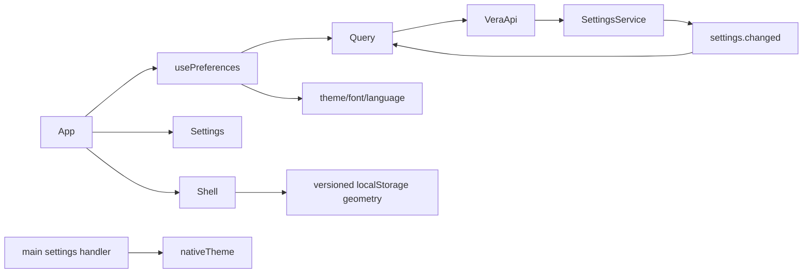

<!--
Copyright (c) 2026 DDP Engineering
This software is licensed under the PolyForm Noncommercial License 1.0.0.
Commercial use requires a separate commercial license.
See the LICENSE.txt in the .agentic folder for full license details.
SPDX-License-Identifier: LicenseRef-PolyForm-Noncommercial-1.0.0
-->

# TASK-923ab82c - WP-04 UI foundation layout themes text size languages

stage: done
type: feature
path: full
interaction: autopilot
requirements: REQ-UX-4a040001, REQ-UX-4a040002, REQ-UX-4a040003, REQ-UX-4a040004, REQ-UX-4a040005, REQ-UX-4a040007, REQ-UX-4a040008, REQ-TEST-4a040006
parent:
branch: master
base: 24d198fb6deb415fb367db4d5e67e4cc1c10c264
opened: 2026-10-10

## Done checklist (current stage)

- [x] validated candidate confirmed unchanged
- [x] validation evidence, diff, exclusions and coordinator outcome presented
- [x] local delivery authorization recorded; coordinator owns commit
- [x] journal and report included in coordinator delivery commit
- [x] authorized local commit delivered by coordinator
- [x] close-out carried in coordinator delivery commit

## Frame

Problem: OBSERVED renderer is a metadata card; existing settings preferences have no controls.
Desired outcome: STATED WP-04 shell with persisted appearance/language and accessible responsive panels.
Actors: desktop user, renderer Query/i18n, typed API, core settings, main nativeTheme.
Primary scenario: settings navigation -> preference selection -> persisted API snapshot -> immediate UI -> restart retains it.
Examples: STATED Romanian/German labels; five scales from 14px; dark theme survives restart.
Counterexamples: future settings stay read-only; right panel overlays below 1280px; future actions remain placeholders.
In scope: Welcome/Settings memory routes, layout resize/collapse/storage, theme tokens/system/native theme, text scale, catalogs/checker, keyboard/contrast/reduced motion, mock/native acceptance and current docs.
Out of scope: workbench/session/provider/update execution; new branch/worktree; cycle tracker; staging/commit/publication/Gitea mutations.
Constraints: STATED master/base 24d198fb6deb415fb367db4d5e67e4cc1c10c264, full candidate, autopilot; unchanged security origin/IPC, settings schema/migration/UUID/readOnly/no-op; Windows and native Ubuntu proof.
Success signals: all six issue criteria plus actual panel resize/collapse/overlay and dimensions persistence; prior probes retained.
Evidence: STATED delegation and issue #4; OBSERVED M0 WP-04, architecture 06 sections1/2/4/6/7/8, 01 L9, 08, referenced knowledge/current sources and full WP-03 journal/spec; visual light appearance and dark Welcome images reviewed.
Assumptions: INFERRED renderer-local layout geometry is UI data separate from strict application settings, like existing window geometry. No extension to settings.json.
Unknowns: future panel content/workbench schemas outside scope.
Decision-blocking questions: none.
Proposed behaviors: exact responsive layout, saved preferences, three catalogs and strict key audit, localized errors, accessible controls.
Path and reason: full; quick criteria no new behavior=no, no new interface=no, no dependency=yes, existing requirement coverage=no, no data/security changes=no. Coupled implementation; no children.

## Requirement coverage

| Frame outcome | Atomic behavior | Requirement | Positive case | Boundary or failure | Verification | Design decision |
|---|---|---|---|---|---|---|
| shell | Welcome/Settings | REQ-UX-4a040001 | memory navigation | future sections placeholders | e2e mock | memory routes |
| geometry | persist resize/collapse/overlay | REQ-UX-4a040002 | drag/restart | future storage retained | native e2e | separate strict UI state |
| theme | saved selected/system theme | REQ-UX-4a040003 | select/restart | OS changes | native e2e | root tokens/nativeTheme |
| text | five saved root scales | REQ-UX-4a040004 | all scales/restart | minimum viewport | native e2e | rem geometry |
| language | labels/errors from catalogs | REQ-UX-4a040005 | ro/de/system | unsupported locale and error params | mock e2e/unit | i18next resources |
| catalogs | missing/unused/extra rejection | REQ-TEST-4a040006 | codebase | negative fixtures | tooling unit | TS AST plus explicit keys |
| accessibility | keyboard/contrast/overflow | REQ-UX-4a040007 | Tab and focus | all theme/scale minimum | mock e2e | semantic controls |
| settings | Query snapshot state | REQ-UX-4a040008 | external event refresh | readonly/save error | native/mock e2e | API mutation/invalidation |

## Design

Requirements coverage: UX001 shell/memory routes, UX002 strict renderer geometry, UX003 native/root theme, UX004 rem scale, UX005 i18next/errors, TEST006 AST checker, UX007 semantic controls/CSS, UX008 Query snapshot lifecycle.
Responsibilities: App orchestrates Query and memory routes; Shell owns panel interaction; Settings renders semantic editors; hooks apply confirmed settings; main assigns nativeTheme through successful load/update. Core and shared settings remain unchanged.
Interfaces/state: existing VeraApi and detached settings snapshot. Query mutation scope serializes saves; setQueryData on success, invalidation on settings.changed. CSS variables/rendered clamp widths; localStorage strict version1 geometry in rem. Details in linked spec.
Failure: structured translated error; retry load, last confirmed state after failed save; unavailable layout storage stays transient; future layout/settings bytes preserved with editors/readOnly gate.
Trust: no renderer Node, hash URL or IPC relaxation; native theme update only after successful authorized settings update. Native assets/CSP/preload/portable initialization unchanged.
Ordering: subscribe cleanup on unmount; change events invalidate snapshot; disabled pending editors avoid competing UI intent; core retains serial persistence/no-op semantics.
Compatibility: application schema unchanged; new separately versioned UI geometry has no old format; future version retained, no invented migration. No dependencies needed.
Tests: actual native UI selection/restart, real drag/keyboard, browser theme/media/overflow/Tab/errors, AST checker negative fixtures; system language/geometry unit seams. Preserve WP01/02/03 probes; adapt selectors only where memory screen changes require it.
Alternatives: app settings extension would require a migration outside existing schema contract; renderer-local geometry matches UI ownership. Hash routing changes authorized URL; memory keeps exact origin boundary. Browser-router/dependency unnecessary for two routes.
Expected files: renderer App/i18n/catalogs/styles, components shell/settings/metadata, hooks preferences, lib layout/language and tests; main index; script checker/tooling tests/package verify; e2e shell/mock; affected knowledge/context/README/architecture language and routing docs.
Risks: high scale/minimum viewport panel crowding, event/update races, storage denial and long translations; constrained widths/wrapping, confirmed cache snapshots and native/browser acceptance cover them. Open decisions: none.
### Proposed architecture - TASK-923ab82c

## Log

- 2026-10-10 build red: REQ-TEST-4a040006 bounded key audit; focused i18n/preferences command exit=1 because arbitrary dynamic call passed when any explicit contract existed. Tighten registration per call; geometry/language boundary tests already pass.
- 2026-10-10 build green: REQ-TEST-4a040006; exact focused tooling selector exit=0, all negative catalog fixtures rejected and complete fixture accepted; CLI/codebase integration follows catalogs.
- 2026-10-10 build red: REQ-UX-4a040001/002/003/004/005/007/008 coupled shell/settings acceptance; commands=`python ../02_Tools/npmw.py npm run test:e2e -- --grep "foundation preferences"` and same with `"browser mock"` (05_Software); each exit=1; expected missing behavior=Settings navigation absent, preventing real preference/restart/panel and browser keyboard/overflow scenarios. No production edits yet for UI increment.
- 2026-10-10 build red: REQ-TEST-4a040006; command=`python ../02_Tools/npmw.py npx vitest run tests/tooling/i18n.test.ts` (05_Software); exit=1; expected missing behavior=catalog audit is implemented assertion false.
- 2026-10-10 design: constrained note/spec and directional architecture audited across eight requirements; application schema/security preserved, geometry separate and versioned; no dependency change. Check has zero errors; planned stale paths resolve during build.
- 2026-10-10 specify: eight new draft atomic requirements and behavior inventory/coverage; zero revised or retired; positive/failure/compatibility boundaries audited in linked spec.
- 2026-10-10 frame: clean master and explicit base confirmed, no WP-04 journal exists; full path accepted in user-authorized autopilot. Scope/exclusions/classified assumptions audited. Existing BMAD install lacks renderer and setup skill; explicit AEGIS workflow takes precedence over unrelated setup.

- 2026-10-10 build final focused green: checker/preferences unit selector exit=0 (3 tests), check:i18n codebase exit=0, strict typecheck exit=0. Windows native foundation+browser selector exit=0 (2 tests/33.5s), and expanded browser selector exit=0 (1 test/25.2s). Native confirms all themes/scales at each restart, main nativeTheme, both real drag resizers, collapsed geometry and external settings.changed. Browser confirms en/ro/de minimum-size matrix, real Tab rings, AA contrast, reduced motion, all future sections/tabs, overlay breakpoint, future geometry bytes and translated parameterized save errors. Native newer-schema UI probe also passed. Screenshots light/dark at150% visually inspected; matching layout structure, wrapping and vertical scrolling observed.
- 2026-10-10 build close: all eight requirements active and linked, application schema/UUID/IPC origin unchanged, no dependencies/lockfile changes. All candidate paths expected; advance to validate for comprehensive current-document reconciliation, two independent verdict axes and final full/native proof.

- 2026-10-10 validate semantic finding: exported audit negative fixtures prove diagnostics but issue requires CLI failure on a missing-key fixture. Return to build for an actual fixture/CLI exit assertion only; no verdicts issued yet. Existing product behavior/acceptance unchanged.

- 2026-10-10 build red: REQ-TEST-4a040006 CLI fixture; command=`python ../02_Tools/npmw.py npx vitest run tests/tooling/i18n.test.ts`; exit=1; missing behavior=CLI ignores fixture and exits0 rather than required1.

- 2026-10-10 build correction green: focused i18n/preferences selector exit=0, four tests; missing-key fixture now executes CLI and asserts actual exit1/message, codebase check:i18n exit0. Return to validate; no full-suite substitution and no candidate limitation.

- 2026-10-10 validate reconciliation: complete tracked/untracked/index-empty candidate reviewed against eight requirements, exact spec and design; foundation knowledge added and shell/IPC/tooling/app-data/context/software README plus current routing/theme architecture reconciled before verdicts. Proposed/current diagrams agree. CLI negative regression and source/test links finalized; all requirements active. Final focused native/browser command exit0, 2 tests/1.7m (mock33s/native54s), covering actual right rendered width after restart, Home/End limits, rem control font sizes and unchanged snapshot/no event on native no-op. No requirement weakened or manual substitute.
- 2026-10-10 validate audit: 42-path complete base-relative candidate (index empty); UTF-8, introduced mojibake, trailing whitespace and exact EOF audit covers modified and every new file, passed; git diff --check passed. Candidate non-journal41-file SHA256 aca2adafe0b90fad234ebcd58879bf289607fa895ee2fd54724dcc8492c839f6. Whole Git-visible source manifest376 files; no dependency/lockfile changes. Existing package description mojibake is unchanged baseline data.
- 2026-10-10 validate explicit review round1 specification compliance: approved. Separate evaluation checked issue4/M0/all eight active requirements/acceptance/spec/design, layout and existing settings boundaries, placeholder exclusions, real vera URL and retained WP01/02/03 behavior. All six issue criteria and extra geometry obligations have direct automated evidence. Same41-file non-journal candidate digest above; no unresolved findings. Final native/full platform proof pending.
- 2026-10-10 validate explicit review round1 implementation quality: approved in a separate agent-authored evaluation axis, not external reviewers. Complete candidate reviewed for serial confirmed snapshots/event refresh, cleanup, fail-safe localized errors, readOnly/future-layout byte preservation, strict zod geometry, actual pointer/keyboard behavior, CSS min-width/overflow/AA, native theme lifecycle and unchanged sandbox/IPC/CSP/portable initialization. Exact pins and platform seams preserved; tests include actual CLI exit, native process restarts and real DOM/Tab/contrast. Same digest; no unresolved findings. No children or unsolicited scope.

- 2026-10-11 validate final platform proof: exact unchanged candidate; command=`python .agentic/aegis.py check --task TASK-923ab82c --strict --run` on Windows and native Ubuntu mirror. Both exit0, configured full test and lint/verify commands passed. Windows test57.7s/verify80.9s, errors0/warnings0/notes0; Ubuntu test38.3s/verify61.0s, errors0/warnings0/notes1. Ubuntu advisory repo-evolution no-anchor note reflects ignored local fingerprint sidecars excluded from source mirror; recorded Windows anchor and exact source parity supply evolution evidence. No required proof weakened. Logs=`02_Tools/cache/wp04-{windows,ubuntu}-strict.log` and corresponding `.exit.txt`.
- 2026-10-11 validate final native acceptance: command=`python ../02_Tools/npmw.py npm run test:e2e` from05_Software on each platform; Windows exit0, 9/9 passed2.0m; native Ubuntu/Xvfb exit0, 9/9 passed1.2m. Native sandbox remains enabled, normal system libraries, no security switches. Includes full prior shell/network/foreign-renderer/subscription/settings/readOnly/window/HMR probes and expanded WP04 native/browser acceptance. Logs=`02_Tools/cache/wp04-{windows,ubuntu}-e2e.log` and corresponding `.exit.txt`. Build emits upstream zod Rollup annotation notices; Windows runner emits NO_COLOR/FORCE_COLOR notice; all builds/tests succeed, no pre-existing failed check accepted.
- 2026-10-11 validate close: fresh Windows light/dark150% and keyboard-focus screenshots visually inspected; readable wrapping, scroll access and visible ring confirmed. All41 non-journal hashes unchanged from both round1 verdicts; full Windows/Ubuntu source parity376 files and explicit base confirmed. Shared master HEAD still24d198fb6deb415fb367db4d5e67e4cc1c10c264, index empty. All42 candidate paths expected; no children, unresolved findings or material deviations. Advance to deliver for coordinator handback only.

- 2026-10-11 deliver handback: delivery step and full task journal reread; complete Git status/diff and exact candidate hashes confirmed. User authorization already covers coordinator local commit after independent verification; this implementation chat stops without staging, committing, publishing or updating Gitea/cycle tracker. Current outcome is a reviewable complete candidate, with journal/report only changed after proof. Scope includes shell/preferences/catalog audit/acceptance and associated current documentation, excludes later work packages and backend placeholder execution. No child tasks. Coordinator may verify/commit, return to validate for corrections, change delivery outcome or pause; no new user permission needed for the authorized local cycle. Close-out remains pending coordinator commit.

- 2026-10-11 deliver report: generated delivery report read in full; fresh advisory check errors0/warnings1/notes0, solely unticked-deliver for coordinator commit/report inclusion/close-out. Expected pending delivery, not a failed validation check. Exact inventory42 paths is recorded below; unchanged candidate remains bound to both approved verdicts and full platform proof. Final journal-only records mirrored for source parity; implementation chat yields for coordinator review.

- 2026-10-11 coordinator review: full journal, eight active requirements, spec/design, validate/deliver steps, all42 candidate paths (staged/unstaged/untracked) and component/context documents reviewed against issue4/M0 and architecture. Independent specification-compliance and implementation-quality axes both approved for unchanged round1 candidate; all41 non-journal hashes match the recorded digest. Memory navigation/nativeTheme/serial confirmed snapshots/event cleanup, versioned geometry/readOnly, catalog negative CLI, accessibility and retained platform/security boundaries have direct code/test evidence. UTF-8/whitespace/EOF and git diff --check pass. Windows/Ubuntu readiness and exact376-file source/base parity verified. No source edits, children, secrets, unrelated changes or unresolved findings; coordinator final native acceptance pending.

- 2026-10-11 coordinator final validation: unchanged41-path non-journal candidate; strict --run exit0 on Windows (test30.5s/verify35.1s) and native Ubuntu (test27.0s/verify32.1s). Configured full suite/lint/typecheck/boundary/catalog checks pass. Both report errors0/warnings1 (pending coordinator deliver checklist); Ubuntu notes1 because ignored anchor sidecars are excluded, with recorded Windows anchor and exact source parity verified. Final full native/browser acceptance exit0 on both: Windows9/9 in1.5m; Ubuntu/Xvfb9/9 in2.0m. No required checks omitted/weakened, no baseline failures accepted. Upstream Rollup annotations/color notices remain harmless. Logs and exit sidecars:02_Tools/cache/wp04-coordinator-{windows,ubuntu}-{strict,e2e}.*. Fresh Windows light/dark150% and focus-ring screenshots visually inspected; readable controls/wrapping/scroll and ring observed. All41 reviewed hashes unchanged; HEAD/base and index empty confirmed. Both coordinator review axes remain approved round1; no children/findings/deviations.
- 2026-10-11 coordinator delivery authorization: explicit user instruction and root AGENTS authorize this one local master commit after validation; presentation covers all42 paths (UI/native-theme/catalog/test and related docs plus task records), excludes ignored logs/runtime/cache and remote publication/Gitea mutations. Proceed to authorized local outcome; no further human choice required.

- 2026-10-11 coordinator close-out: complete validated candidate is approved for the preauthorized local master commit, with this journal/report/close-out carried in the same commit per deliver step7 local-only outcome. No push/PR/release/Gitea changes; no children or unresolved findings. If the local commit fails, restore deliver and record failure.

- 2026-10-11 coordinator final delivery check: exact42 staged paths; git diff --cached --check passed; AEGIS check --task TASK-923ab82c --strict exit0 with errors0/warnings0/notes0 after journal close-out. All41 non-journal proof hashes unchanged; local outcome only.

## Delivery candidate inventory

Complete base-relative candidate: 42 paths (17 modified, 25 new), index empty. Non-journal candidate41 SHA256: aca2adafe0b90fad234ebcd58879bf289607fa895ee2fd54724dcc8492c839f6. Journal-only final records are excluded from this bound review/proof digest.

| Change | Exact repository path |
|---|---|
| M | .agentic/context/environment.md |
| M | .agentic/context/project.md |
| M | .agentic/knowledge/app-data.md |
| M | .agentic/knowledge/desktop-shell.md |
| M | .agentic/knowledge/ipc-boundary.md |
| M | .agentic/knowledge/software-tooling.md |
| M | 00_Planning/architecture/06-ui.md |
| M | 00_Planning/plan/M0-foundation.md |
| M | 05_Software/README.md |
| M | 05_Software/apps/desktop/src/main/index.ts |
| M | 05_Software/apps/desktop/src/renderer/App.tsx |
| M | 05_Software/apps/desktop/src/renderer/i18n.ts |
| M | 05_Software/apps/desktop/src/renderer/locales/en.json |
| M | 05_Software/apps/desktop/src/renderer/styles.css |
| M | 05_Software/e2e/mock.spec.ts |
| M | 05_Software/e2e/shell.spec.ts |
| M | 05_Software/package.json |
| A | .agentic/knowledge/renderer-foundation.md |
| A | .agentic/requirements/test/REQ-TEST-4a040006.toml |
| A | .agentic/requirements/ux/REQ-UX-4a040001.toml |
| A | .agentic/requirements/ux/REQ-UX-4a040002.toml |
| A | .agentic/requirements/ux/REQ-UX-4a040003.toml |
| A | .agentic/requirements/ux/REQ-UX-4a040004.toml |
| A | .agentic/requirements/ux/REQ-UX-4a040005.toml |
| A | .agentic/requirements/ux/REQ-UX-4a040007.toml |
| A | .agentic/requirements/ux/REQ-UX-4a040008.toml |
| A | .agentic/specs/REQ-UX-4a040001.md |
| A | .agentic/tasks/TASK-923ab82c.md |
| A | 05_Software/apps/desktop/src/renderer/components/error-message.tsx |
| A | 05_Software/apps/desktop/src/renderer/components/metadata.tsx |
| A | 05_Software/apps/desktop/src/renderer/components/settings.tsx |
| A | 05_Software/apps/desktop/src/renderer/components/shell.tsx |
| A | 05_Software/apps/desktop/src/renderer/hooks/use-preferences.ts |
| A | 05_Software/apps/desktop/src/renderer/lib/language.ts |
| A | 05_Software/apps/desktop/src/renderer/lib/layout.ts |
| A | 05_Software/apps/desktop/src/renderer/lib/preferences.test.ts |
| A | 05_Software/apps/desktop/src/renderer/locales/de.json |
| A | 05_Software/apps/desktop/src/renderer/locales/ro.json |
| A | 05_Software/apps/desktop/src/renderer/styles/themes.css |
| A | 05_Software/fixtures/i18n/missing-key.json |
| A | 05_Software/scripts/check-i18n.mjs |
| A | 05_Software/tests/tooling/i18n.test.ts |

## Rulings

- RULING-001 | date=2026-10-10 | decision=User authorized local commits after validation; coordinator commits this complete candidate; implementation chat performs no staging/commit/publication | reason=Explicit sequential cycle delegation | source=user | supersedes=none

## Handoff

current: done
status: ready
next: coordinator records actual local commit in cycle state and starts eligible WP05
must_read: .agentic/tasks/TASK-923ab82c.md, 00_Planning/plan/M0-foundation.md
blockers: none

## Stage report

stage: deliver
result: completed
current: done
changed: WP04 UI foundation; 42 files, validated local delivery
evidence: coordinator strict and 9 E2E per OS passed; reviewed hashes unchanged
issues: none unresolved; benign notices and Ubuntu anchor note explained in Log
next: start WP05 on master in autopilot
needs_user: no
spec_compliance: approved
implementation_quality: approved
review_round: 1

## Delivery report (2026-10-11)

- stage: deliver; type: feature; path: full; branch: master
- requirements:
  - REQ-UX-4a040001 - Render the foundation shell
  - REQ-UX-4a040002 - Resize and restore panel geometry
  - REQ-UX-4a040003 - Apply and persist themes
  - REQ-UX-4a040004 - Apply and persist text size
  - REQ-UX-4a040005 - Translate UI language and errors
  - REQ-UX-4a040007 - Keep foundation controls accessible
  - REQ-UX-4a040008 - Respect settings snapshot state
  - REQ-TEST-4a040006 - Enforce source catalog completeness
- deviations: none recorded
- explicit review: enabled; spec_compliance=approved; implementation_quality=approved; review_round=1
- diff vs task base 24d198f: 42 file(s) changed, 2174 line(s) added
- checks: errors=0 warnings=1 notes=0
- checklist: 3/6 done; open: journal and report included in coordinator delivery commit; authorized local commit delivered by coordinator; close-out carried in coordinator delivery commit

## Delivery report (2026-10-11)

- stage: deliver; type: feature; path: full; branch: master
- requirements:
  - REQ-UX-4a040001 - Render the foundation shell
  - REQ-UX-4a040002 - Resize and restore panel geometry
  - REQ-UX-4a040003 - Apply and persist themes
  - REQ-UX-4a040004 - Apply and persist text size
  - REQ-UX-4a040005 - Translate UI language and errors
  - REQ-UX-4a040007 - Keep foundation controls accessible
  - REQ-UX-4a040008 - Respect settings snapshot state
  - REQ-TEST-4a040006 - Enforce source catalog completeness
- deviations: none recorded
- explicit review: enabled; spec_compliance=approved; implementation_quality=approved; review_round=1
- diff vs task base 24d198f: 42 file(s) changed, 2199 line(s) added
- checks: errors=0 warnings=1 notes=0
- checklist: 5/6 done; open: close-out carried in coordinator delivery commit
