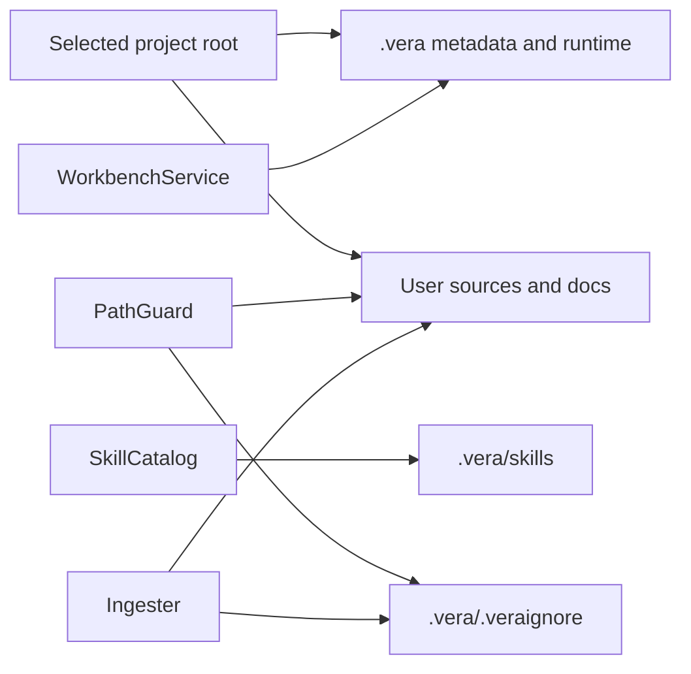

<!--
Copyright (c) 2026 DDP Engineering
This software is licensed under the PolyForm Noncommercial License 1.0.0.
Commercial use requires a separate commercial license.
See the LICENSE.txt in the .agentic folder for full license details.
SPDX-License-Identifier: LicenseRef-PolyForm-Noncommercial-1.0.0
-->

# TASK-b1a513e6 - Consolidate project configuration under .vera

stage: done
type: change
path: full
interaction: autopilot
requirements: REQ-DATA-18d4b62d, REQ-FUNC-0bc62dc3, REQ-FUNC-adf92ecb, REQ-SEC-294dcab2, REQ-FUNC-bded1702
parent:
branch: master
base: 42717ed5aab3b627631adc90eb9ee9bb319a869d
opened: 2026-10-26

## Done checklist (current stage)

- [x] validated candidate unchanged after strict proof
- [x] complete candidate reviewed; current specification and quality verdicts approved
- [x] validation, warnings, diff, exclusions and local-only outcome presented
- [x] local delivery authorized by repository AGENTS; prior changes authorized in this conversation
- [x] journal report included in local delivery commit
- [x] agreed local commit outcome delivered and task closed

## Frame

Problem: STATED - project configuration is scattered in the project root.
Desired outcome: STATED - all project-owned VERA files live under project/.vera.
Actors: project owner using desktop or CLI; confined agent tools and skill loader.
Primary scenario: create/open project -> read/write .vera configuration -> project root stays available for user sources/documents.
Examples: .vera/workbench.yaml, .vera/WORKBENCH.md, .vera/.veraignore, .vera/skills; existing .vera database/lock/artifacts remain there.
Counterexamples: source documents in docs/ and global userData credentials are not project configuration.
In scope: lifecycle, config/pinned, ignores, project skills, ingest policy watching, prompts/UI, active fixtures/tests/docs, AGENTS development policy.
Out of scope: migration, legacy detection/fallback, user project modifications, global settings/credentials relocation, historical journal edits, unrelated pending cleanup.
Constraints: master per repository; autopilot=true from config; preserve content and confinement; focused validation plus statics/strict and two review verdicts.
Success signals: new project uses .vera paths; reopening, saves, skill loading and ignored files work; root legacy-only configuration is not opened or migrated.
Evidence: OBSERVED - core workbench/service.ts writes root config/pinned/skills, path-guard.ts and knowledge/ingest.ts read root .veraignore, skills/catalog.ts reads root skills; database and lock already under .vera. INFERRED - docs remain project content. STATED - user explicitly excludes compatibility/migration and requests AGENTS rule.
Assumptions: preserve file basenames and project-relative document patterns; project folder identity stays the selected root.
Unknowns: none decision-blocking after user clarification.
Decision-blocking questions: resolved by user 2026-10-26: current layout only; no migration or compatibility.
Proposed behaviors: authoritative .vera project metadata; separately confined skill access; no legacy reads or moves.
Path and reason: full - observable layout and data-handling contract change.

| Quick-path criterion | Result | Evidence |
|---|---|---|
| No observable change | no | new project file locations |
| No new interface/data format | no | authoritative on-disk layout |
| No dependency | yes | existing FS ports |
| Existing requirement suffices | no | root paths change |
| No data/security change | no | ignored .vera skill boundary |

## Requirement coverage

| Frame outcome | Atomic behavior | Requirement | Positive case | Boundary or failure | Verification | Design decision or no impact |
|---|---|---|---|---|---|---|
| Project metadata | Authoritative .vera config/pinned/ignore | REQ-DATA-18d4b62d | create/save/reopen/ingest | missing/root-only/redirected metadata | lifecycle/guard/ingest and native project checks | unchanged project root; policy watcher explicitly observes metadata |
| Project skills | Bounded .vera skills access | REQ-FUNC-0bc62dc3 | create/load/shadow user skill | ignored/redirected/escaping extras | catalog/service/session and tools tests | separate skill root; logical skills ignore paths |
| Preserved create semantics | Non-destructive scaffolding at authoritative paths | REQ-FUNC-adf92ecb | existing content retained | duplicate config conflicts | lifecycle tests | metadata move; user source files untouched |
| File-tool boundary | Sequential writes exclude internal metadata | REQ-SEC-294dcab2 | ordinary sources writable | internal paths denied | write-edit and guard tests | permanent .vera exclusion |
| Permission behavior | Ask/auto-edit/read-only retain their contract | REQ-FUNC-bded1702 | ordinary approval and auto decisions | internal content denied; read-only aborts | approvals unit/native tests | dedicated APIs own metadata |

## Design

- REQ-DATA-18d4b62d: retain basenames under .vera; docs/ is content; database/lock/artifacts stay in place. Prepare .vera before exclusive config creation. Validate .vera before metadata reads/saves. Root-only projects return NOT_FOUND without writes. No migration, fallback or layout version bridge.
- REQ-DATA-18d4b62d: .vera/.gitignore ignores runtime files while allowing workbench.yaml, WORKBENCH.md, .veraignore and skills for project versioning. Preserve an existing user ignore file.
- REQ-DATA-18d4b62d: PathGuard reads the authoritative ignore file with ordinary-directory/canonical checks; ingest observes only relevant metadata files within otherwise ignored .vera, never indexes internal bytes. Config API saves still request ingest; external ignore edits refresh policy.
- REQ-FUNC-0bc62dc3: catalog uses .vera as the workbench skill root and userData as the user root. Skill read/path guards validate metadata root, SKILL.md, extra descendants and ownership. Generic tools retain permanent .vera exclusion. Skill admission evaluates logical skills/<name>/... against the project's ignore policy rather than the internal physical path.
- Interfaces: no IPC/schema/dependency change. WorkbenchSnapshot.folder remains project root; document and user paths unchanged. Missing config NOT_FOUND; conflicting creation CONFLICT; redirects DENIED. Newer unsupported formats remain protected.
- Failure/concurrency: retain lifecycle/write queues, token locks and exclusive creation; no cross-project data operations. No user project changes during implementation/verification.
- Tests: existing lifecycle, catalog, path guard, ingest, session skills, prompts, file tools and immediate desktop/CLI/native consumers. First failing acceptance: creation writes metadata only below .vera. Update current fixtures and smoke scripts.
- Expected files: core lifecycle/guard/ingest/catalog, prompt and protected-path consumers; current tests/fixtures, renderer path labels, README, relevant architecture/knowledge/requirements; AGENTS rule. Historical journals stay unchanged.
- Risks: root-vs-user skill fixtures; permanent ignore blocking internal skill loader; watcher pruning metadata; symlink parent escape. Each has focused proof.
- Alternatives: root metadata and legacy detection rejected by user; full-project relocation unnecessary. No open decisions.

### Proposed architecture - TASK-b1a513e6

## Log

- 2026-10-26 frame: full path accepted in configured autopilot; user excludes migrations/compatibility; master retained by repository instruction. Existing uncommitted reorganization and UI corrections are baseline context, not new work. Local ticket commits are authorized by AGENTS; do not sweep unrelated changes into this task.

- 2026-10-26 specify: two draft requirements cover authoritative metadata and bounded skill access; behavior inventory records create/open/save, root-only refusal, redirects, ignore refresh and skill precedence. No new dependencies or migration behavior.
- 2026-10-26 design: accepted full-path design above; stage build in autopilot.

- 2026-10-26 build: red lifecycle acceptance failed because .vera/workbench.yaml was absent; red skill discovery failed because project skills were still read from root. Focused corrections establish new metadata layout, dedicated skills, live policy watch and permanent generic metadata denial.
- 2026-10-26 build: native instrumented Electron tests/e2e/{workbench,skills,approvals}.spec.ts with grep Welcome|native: 9 passed, exit 0. Core affected checks progressing; TypeScript and i18n checks passed. Historical task files unchanged.
- 2026-10-26 DEVIATION build: initial AEGIS anchor omitted before implementation. A late intermediate anchor will track remaining edits; review uses recorded base and complete uncommitted candidate, including clearly identified pre-existing reorganization/UI changes. No claim that late anchor reconstructs initial bytes.

- 2026-10-26 build: Windows focused lifecycle/catalog/write/approval 4 files: 63 passed, 2 platform skips; guard/ingest/discovery/skill registry 4 files: 49 passed, 2 platform skips; CLI/document CLI/retrieval/fixture/boundary/smoke 6 files: 58 passed, 4 platform skips. Prompt snapshot updated only for the new pinned-path text (15 passed). Search/viewer/grep unchanged proof: 5 files passed with 66 tests before the prompt snapshot correction. No complete suite run under ticket policy.
- 2026-10-26 validate: current docs/requirements reconciled, including existing creation and general-tool metadata protections. Native Ubuntu validation uses an owned current-source copy and existing pinned Linux dependencies; no installation or prior-cache changes. Build complete; final reviews and strict proof next.

- 2026-10-26 validate: Ubuntu native core 6 files: 110 passed, 3 platform skips; native Electron same 9 acceptance tests: 9 passed. Existing pinned Node 24.21.0 and Linux dependencies reused through owned links; current-source copy isolated from previous caches. No cross-platform exception needed.

- 2026-10-26 review round 1 / specification compliance: approved. Separate scope-to-code pass covers all five current requirements, authoritative .vera metadata, no legacy lookup/move, unchanged project-relative documents and global userData, and current fixtures/docs/AGENTS rule. No unsupported migration or fallback added. Existing uncommitted restructuring and UI work identified as baseline context.
- 2026-10-26 review round 1 / implementation quality: approved. Separate implementation pass checks create exclusivity/preserved content, config/pinned ordinary parents, token/read-only admission, dedicated skill confinement and user shadowing, permanent generic metadata denial, watcher policy refresh and Windows case aliases. Windows/Ubuntu focused units and actual Electron acceptance support the same runtime candidate. Prior unrelated advisory issues stay out of scope. No subagents used.

- 2026-10-26 validate: first strict configured proof exited 0 (lint/typecheck/i18n passed), errors 0 with advisory warnings from pending reorganization, stale historical metadata and unchanged test token literals/binary fixture scan limits. Tokenizer and PDF fixtures verified byte-identical to base; token pattern matches verified pre-existing test literals. No secrets added by this implementation.
- 2026-10-26 validate: expanded the layout requirement's affected_paths to name actual prompt/UI/smoke consumers. Review round 2: specification compliance approved and implementation quality approved for this documentation-only candidate correction; executable source and focused proof unchanged. Final strict proof refreshed for accurate traceability.

- 2026-10-26 validate: final check --task TASK-b1a513e6 --strict --run --json exited 0: errors=0, warnings=665, notes=3; lint/typecheck/i18n all exit 0. Complete test suite intentionally not selected by repository ticket policy; targeted Windows/Ubuntu/native proof recorded above. Warning categories: 293 outside-layout old moved paths, 340 source traceability over earlier reorganization, 4 existing test links, 7 stale paths, 1 ticket wording, 13 historical journal formats and 7 pre-existing fixture/token scanning findings. New task/requirements have no advisory findings. Owned Ubuntu scratch removed; no test-results in repository; 39 historical journals unchanged.
- 2026-10-26 DEVIATION deliver: local commit includes previously authorized uncommitted software reorganization/UI/demo/resource/test cleanup, because the complete validated master candidate is the coherent deliverable. Complete temporary-index review: 749 paths changed, 2391 insertions and 2150 deletions after rename detection. Exclude unrelated untracked 00_Planning/optional-companions.md. No remote action. The earlier scope exclusion applies to new implementation work; this explicit delivery decision records the integrated versioning outcome.
- 2026-10-26 deliver: local commits already authorized in repository AGENTS; earlier conversation authorizes the integrated cleanup. No repeated permission request for local recording. Full validation and both separate review verdicts remain current. Late-anchor limitation repeated in delivery presentation; base commit plus complete candidate used for review.

- 2026-10-26 deliver: close-out belongs to the single authorized local delivery commit; validated source/tests/configuration unchanged since final strict proof. Journal-only report/closure updates require no test rerun. No push, PR, deployment or user-project migration. Unrelated optional-companions.md remains untracked.

## Rulings

- RULING-001 | date=2026-10-26 | decision=Current project layout only; no migrations or backward compatibility; record development policy in AGENTS.md | reason=User says development projects need no legacy support | source=user | supersedes=none
- RULING-002 | date=2026-10-26 | decision=Use shared master and recorded base; local ticket commits are authorized, but unrelated pending changes remain separate | reason=Repository branch and commit policy; complete pre-existing candidate remains visible for review | source=repository | supersedes=none

## Handoff

current: done
status: ready
next: none; continue iterative application review on request
must_read: .agentic/tasks/TASK-b1a513e6.md, .agentic/requirements/data/REQ-DATA-18d4b62d.toml, .agentic/requirements/functional/REQ-FUNC-0bc62dc3.toml
blockers: none

## Stage report

stage: deliver
result: completed
current: done
changed: Authoritative .vera project metadata/skills; development policy; integrated earlier authorized cleanup
evidence: Windows focused tests and 9 Electron passed; Ubuntu 110 focused and 9 Electron passed; strict lint/typecheck/i18n exit 0
issues: Late intermediate anchor; 665 advisory baseline/catalog warnings; integrated prior cleanup in local commit
next: None; local-only delivery, no remote publication
needs_user: no
spec_compliance: approved
implementation_quality: approved
review_round: 2

## Delivery report (2026-10-26)

- stage: deliver; type: change; path: full; branch: master
- requirements:
  - REQ-DATA-18d4b62d - Store project configuration in .vera
  - REQ-FUNC-0bc62dc3 - Load project skills from .vera
  - REQ-FUNC-adf92ecb - Create workbench without overwriting content
  - REQ-SEC-294dcab2 - Classify and mark prepared file writes
  - REQ-FUNC-bded1702 - Select automatic or explicit approval
- deviations: 2 recorded
  - build: initial AEGIS anchor omitted before implementation. A late intermediate anchor will track remaining edits; review uses recorded base and complete uncommitted candidate, including clearly identified pre-existing reorganization/UI changes. No claim that late anchor reconstructs initial bytes.
  - deliver: local commit includes previously authorized uncommitted software reorganization/UI/demo/resource/test cleanup, because the complete validated master candidate is the coherent deliverable. Complete temporary-index review: 749 paths changed, 2391 insertions and 2150 deletions after rename detection. Exclude unrelated untracked 00_Planning/optional-companions.md. No remote action. The earlier scope exclusion applies to new implementation work; this explicit delivery decision records the integrated versioning outcome.
- explicit review: enabled; spec_compliance=approved; implementation_quality=approved; review_round=2
- diff vs task base 42717ed: 1134 file(s) changed, 49414 line(s) added; 5 file(s) not content-scanned
- checks: errors=0 warnings=666 notes=3
- checklist: 4/6 done; open: journal report included in local delivery commit; agreed local commit outcome delivered and task closed
