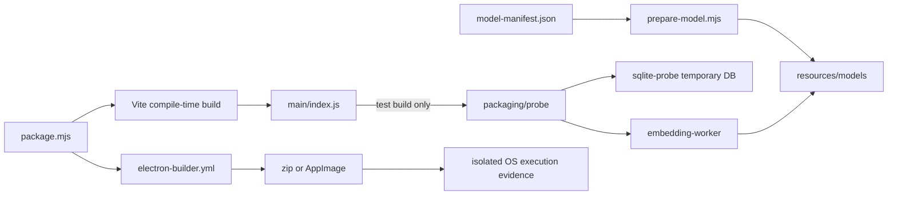

<!--
Copyright (c) 2026 DDP Engineering
This software is licensed under the PolyForm Noncommercial License 1.0.0.
Commercial use requires a separate commercial license.
See the LICENSE.txt in the .agentic folder for full license details.
SPDX-License-Identifier: LicenseRef-PolyForm-Noncommercial-1.0.0
-->

# TASK-b862091d - WP-05 native modules and bundled embedding packaging spike

stage: done
type: feature
path: full
interaction: autopilot
requirements: REQ-TEST-2308561a, REQ-PLAT-e5a51348, REQ-PLAT-96cd589b, REQ-TEST-d05765be, REQ-TEST-ec62ad71, REQ-TEST-7fea1dd0
parent:
branch: master
base: 3e0c5a0b8dfbb14bf7ab7636e7858fa4b3cc0681
opened: 2026-10-11

## Done checklist (current stage)

- [x] Validated candidate confirmed unchanged
- [x] Validation evidence, diff, exclusions and delegated outcome presented
- [x] Human-authorized coordinator local commit recorded in RULING-001; implementation chat must not commit
- [x] Journal and report included in delivery commit by coordinator
- [x] Agreed local commit delivered by coordinator
- [x] Close-out carried by that delivery commit

## Frame

Problem: STATED: establish native SQLite and local ONNX packaging feasibility before database/model integration.
Desired outcome: STATED: validated Windows x64 zip and Linux x64 AppImage with actual packaged offline measurements, build-time model delivery, ADR and release exclusion.
Actors: STATED: implementation chat prepares the candidate; coordinator verifies and commits; packaged test app executes probes.
Primary scenario: STATED: build VERA_TEST=1 package -> run on isolated host -> open temporary WAL database, query unicode61/trigram, load bundled quantized model in worker and embed three sentences -> record observed results against artifact SHA256.
Examples: STATED: trigram fragment C1_C finds I2C1_CR1; node:sqlite availability and tokenizer outcomes are observed separately.
Counterexamples: STATED: an internal network guard or unpackaged run cannot prove machine isolation; runtime environment overrides cannot enable release probe code.
In scope: STATED: minimal packaging, probes, exact dependency pins, model delivery, per-OS measurements and isolation evidence, new ADR/index, release exclusion and required AEGIS validation.
Out of scope: STATED: WP-24 final model/recall selection, WP-30 full targets, WP-33 actual release smoke, other tickets, Gitea mutations/publication and optional-companions documentation.
Constraints: STATED: shared master, explicit base, autopilot, implementation chat leaves index untouched and makes no commit; preserve WP-01..04 security and tests. Coordinator owns the authorized local commit.
Success signals: STATED: all WP-05 Done when assertions demonstrated by real artifacts/results, final unchanged candidate with two independent reviews and strict configured verification.
Evidence: OBSERVED: architecture/01-system.md L5 and security baseline, architecture/05-knowledge-rag.md sections 4/5, architecture/07-packaging-updates.md sections 1/2, architecture/08-quality.md, ADR-0005/0006/0012 and decisions index read; BenchPilot package.mjs and sandbox/BenchPilot.wsb exist and are read-only references. OBSERVED: git branch master and HEAD equal base; git status initially only ?? 00_Planning/optional-companions.md. aegis status found zero open tasks, four done. OBSERVED: plan/M0-foundation.md WP-05 and tea issue 5 agree; issue open without comments. OBSERVED: .agentic/context/{project,environment}.md and knowledge/{software-tooling,desktop-shell}.md describe baseline tooling/security. OBSERVED: required bmad-build renderer script absent and fallback bmad skill absent from installed plugin.
Assumptions: INFERRED: WP-01 dependency satisfied by supplied validated WP-04 base; deeper architecture/ADR and host readiness verification still required after resolving workflow blocker.
Unknowns: UNKNOWN: actual Windows Sandbox execution, Ubuntu VM adapter isolation and per-OS native/model outcomes, packaging size and release exclusion. OBSERVED: Windows Sandbox executable exists; WSL2 Ubuntu is available, with its separate Node/deps ready; its mirror carries WP04 uncommitted atop WP03. OBSERVED: registry and upstream releases confirm better-sqlite3 13.0.3, transformers 4.3.1, onnxruntime-node 1.30.0; builder 26.17.0 preserves required asarUnpack configuration. OBSERVED: model upstream revision ea104dacec62c0de699686887e3f920caeb4f3e3 exposes quantized ONNX SHA256 metadata.
Decision-blocking questions: none at frame. Coordinator explicitly instructed AEGIS-only continuation; remaining technical outcomes are measured during build.
Proposed behaviors: STATED: compile-time test-only packaged database/model probes, reproducible verified build-time assets and measurement report; current release security contracts remain prerequisites.
Path and reason: full, because new dependencies, packaging and test interfaces require specify/design before build. All quick-path criteria below fail or remain unknown.

| Quick-path criterion | yes | no | evidence |
|---|---|---|---|
| No new observable behavior | | x | packaged test probes |
| No new interface/data format | | x | proposed probe measurement output |
| No new dependency | | x | better-sqlite3, ONNX runtime, transformers, builder |
| Existing requirement covers behavior | | x | mapping not yet established |
| No security/data-handling changes | | x | native temporary database/model loading needs analysis |

No child implementation task: shared checkout permits one implementation chat; reviews will use independent reviewers as required after a complete candidate exists.

## Requirement coverage

Behavior inventory and requirement map (actor: build/probe harness):

| Frame outcome | Atomic behavior / trigger | Requirement | Positive case | Boundary / failure | Verification | Design decision |
|---|---|---|---|---|---|---|
| Native packaging | package OS shell | REQ-PLAT-e5a51348 | zip/AppImage native CPU assets | wrong OS binaries or oversize fail | packaged offline runs, size report | builder config and reporting |
| Model delivery | prepare model | REQ-PLAT-96cd589b | verified immutable assets | corrupt cache/download fails | fixture hashes and actual assets | manifest/materializer |
| Native feasibility | packaged test request | REQ-TEST-d05765be | WAL and both tokenizer queries | fallback reports failure, temp cleaned | actual per-OS probe | temporary SQLite probe |
| Embedding feasibility | packaged test request | REQ-TEST-ec62ad71 | three embeddings in worker | no remote fallback; worker deadline | real timings and vectors | worker and host |
| Test identity | compile build mode | REQ-TEST-2308561a | true/false fixed at build | runtime overrides ineffective | emitted flag executed in Node | existing identity contract |
| Release boundary | compile release | REQ-TEST-7fea1dd0 | no probe code/switch | runtime override has no effect | both output modes, packaged ASAR | compile-time elimination |

Offline and size observations belong to the inseparable packaged-feasibility verification. ADR/index are documentation of the same observed decision, not an additional runtime behavior. Existing REQ-TEST-2308561a and security requirements remain regression constraints; the new release-exclusion requirement refines only the added probe boundary.

## Design

- REQ-PLAT-e5a51348: scripts/package.mjs owns build and target selection, electron-builder.yml supplies minimal shell targets, all native real-file exclusions and resource copying. Build uses only host-native dependencies; no cross-platform artifact claims. Reporting measures artifact hashes, unpacked bytes, ONNX/model shares and budget contributors. Preserve existing Electron version.
- REQ-PLAT-96cd589b: resources/model-manifest.json pins immutable upstream revision, exact lengths/digests and license/card provenance. prepare-model.mjs downloads only during explicit preparation/build, uses temporary promotion and verifies existing cache; packaging calls verification before builder. Materialized models reside in ignored resources/models (reproducible asset cache); source manifest remains tracked.
- REQ-TEST-d05765be: main/packaging/sqlite-probe.ts loads real better-sqlite3 13.0.3 and tests temporary WAL DB/FTS queries and reopen; node:sqlite adapter repeats the SQL and catches observed fallback failures. No workbench or production storage changed. Cleanup is finally-bound.
- REQ-TEST-ec62ad71: embedding-worker.ts uses transformers 4.3.1 on ORT 1.30.0 Node/CPU, strict local assets, q8, three sequential real chunks and finite normalized 384-vector validation. Host owns five-minute timer, errors, disposal and structured JSON report. Worker URL resolves emitted file beside probe, and model path resolves real process.resourcesPath/models.
- REQ-TEST-7fea1dd0: main index accesses probe only inside __VERA_TEST__ compile-time branch; worker entry is included only by test-build Vite config. Build-mode test inspects all emitted app code in both modes; package script checks ASAR app code before artifact reporting. No probe IPC or renderer UI is added. Existing window sandbox, CSP, exact origin and router authorization are preserved.
- Tests: compile both emitted modes first (red instrumented entry missing), then asset fixture/hash and budget tests; real SQLite temp DB regression after native installation; actual packaged worker/runtime validations settle native/model requirements. No stubs are accepted as feasibility results. Existing full suite/e2e remains final required proof.
- Failure: downloads/hash mismatch and oversized Windows package fail closed; partial files cleaned, existing corrupt assets preserved for inspection. Worker error/timeout returns failed report and process exit 1. Missing node:sqlite is reported separately and does not erase successful primary-driver proof.
- Compatibility: CPU N-API runtimes are kept as exact pins; isolate platform dependencies. Builder v26.17.0 chosen to preserve requested asarUnpack contract; v27 changes config schema. CPU-only binary filtering must be verified against installed loader paths before packaging.
- Alternatives: checked-in 34MB ONNX versus manifest download; choose immutable verified build delivery to keep source lean. extraResources puts models outside ASAR directly. System ONNX/remote models and connected-host guards cannot satisfy the contract.
- Expected files: software manifests/lockfile, desktop builder/Vite/main index; main/packaging/{sqlite-probe,embedding-worker,probe}.ts; scripts/{prepare-model,package}.mjs plus focused tooling tests; resources/model-manifest.json; offline harness under scripts/; README, ADR-0013 and decisions index; AEGIS requirements/spec/journal/context/knowledge. Local logs/packages/caches are ignored outputs. optional-companions remains excluded.
- Risks/open outcomes: Windows Sandbox may require unavailable virtualization; Ubuntu WSL VM's external adapters must actually be disabled and recorded for offline proof; package size and native compatibility measured. Protect mirror changes by snapshot and content parity before nondestructive reconciliation.

### Authorized verification addendum

REQ-PLAT-e5a51348 and REQ-TEST-ec62ad71 retain the built packaging/probe interfaces and runtime code. RULING-004 changes only the Windows host acceptance environment: extract the final instrumented ZIP to a new temporary directory, verify its expected SHA256 before/after, run its real process and record connected-host state, exit code, both SQLite drivers and three worker embeddings. Linux isolated evidence remains unchanged. Current-host execution cannot establish clean-host CRT independence; WP-30/WP-33 must settle it before final release. No architecture or new production behavior impact; remaining requirements and security boundaries are unchanged. Reuse existing anchor/red/green proof because no executable behavior is changed by this reconciliation.

### Proposed architecture - TASK-b862091d

## Log

- 2026-10-11 design completed: constrained design and proposed architecture recorded; five requirements mapped to test seams; unresolved host/runtime outcomes retained. Autopilot advances to build.

- 2026-10-11 specify completed: Five new atomic draft requirements and one shared exact-contract spec cover package feasibility, verified delivery, SQLite, worker embeddings and release exclusion. Existing contracts preserved. check errors=0; nine expected stale-path warnings for planned files, one missing-anchor note before build.

- 2026-10-11 frame: Delegated WP-05 scope accepted in autopilot; full path selected. Baseline and existing-task checks establish a fresh task on the recorded master base. Frame source analysis remains incomplete because required bmad-build workflow is unavailable.
- 2026-10-11 blocker: Required renderer command `uv run --no-cache "D:/ProjectsDDP/2026_Virtual_Embedded_Rig_Assistant/_bmad/scripts/render_skill.py" --project-root "D:/ProjectsDDP/2026_Virtual_Embedded_Rig_Assistant" --skill "C:/Users/pasar/.codex/plugins/cache/bmad/bmad-method/6.13.0-next/skills/bmad-build"` exited 1: `error: Failed to spawn ... Caused by: The system cannot find the path specified. (os error 3)`. The referenced setup skill `skills/bmad/SKILL.md` is also missing after discovery. Skill instructions require HALT for other failure and forbid running workflow sources directly. Product implementation/tests have not started; only this journal was created.

- 2026-10-11 blocker resolved: Coordinator explicitly directed exclusive AEGIS continuation under existing user authorization; BMAD is not a VERA implementation dependency and must not be installed. Original failure log preserved.
- 2026-10-11 frame completed: Source analysis confirms supplied WP05 scope; shared master remains at WP04 base. Windows readiness passed; Linux mirror must be reconciled nondestructively. Autopilot advances to specify.

- 2026-10-11 build red: command=`python ../02_Tools/npmw.py npx vitest run tests/tooling/build-mode.test.ts tests/tooling/packaging.test.ts` from 05_Software; exit=1; three expected failures: instrumented compiled code lacks packaging-probe marker (SQLite/worker/release seam REQ-TEST-d05765be/ec62ad71/7fea1dd0), verified materializer absent (REQ-PLAT-96cd589b), packaging measurements absent (REQ-PLAT-e5a51348). No implementation changed before red.

- 2026-10-11 build integration finding: Connected packaged Windows diagnostic (cache/wp05/windows-connected-diagnostic.json) produced three real finite normalized 384-vectors through ORT CPU (load 2484.7454 ms), but SQLite failed because Vite had bundled its dynamic CJS native loader. Main Rollup now explicitly externalizes all native/model packages; emitted-build regression asserts intact import and absence of dynamic-require shim. Diagnostic is explicitly not offline evidence and does not mark native/packaged acceptance complete.
- 2026-10-11 build setup: Linux npm ci initially attempted an unnecessary native compile; explicit allowScripts=false for the N-API packages preserves upstream prebuilds and avoids optional CUDA downloads. Retried canonical setup succeeded. Mirror changes archived under /home/dpasare/.cache/vera-wp05-backup-TASK-b862091d, transferred base via local git bundle, overlaid sources with 392-file SHA256 parity and advanced mirror HEAD/index to WP04 without resetting its working files.
- 2026-10-11 build decision: stageRuntime copies the installed locked runtime closure into generated platform/mode staging before builder collection, avoiding workspace symlink traversal. Resources are verified then copied into that same generated stage. Native/runtime acceptance and release boundary remain unchanged; generated staging and packages remain ignored.

- 2026-10-11 DEVIATION build: electron-builder 26.17.0 introduces eight moderate development dependency audit findings, all tracing to sprintf-js <=1.1.3 (GHSA-hp3w-g68c-fv3c); registry latest is 1.1.3, so a patch release is unavailable. Retained v26 for required asarUnpack contract. Packaging input is repository-controlled; these formatting paths receive trusted build descriptors, not renderer/document input. npm audit --omit=dev reports zero runtime vulnerabilities. Full audit JSON saved in 02_Tools/cache/wp05/{audit,runtime-audit}.json. This does not waive code/security validation.
- 2026-10-11 build green: focused command `python ../02_Tools/npmw.py npx vitest run tests/tooling/build-mode.test.ts tests/tooling/packaging.test.ts apps/desktop/src/main/packaging/sqlite-probe.test.ts` exit=0, 5 tests passed; typecheck exit=0. Covers both actual emitted modes, local manifest integrity/failure tests, budget accounting and real Node-native SQLite. Packaged offline acceptance remains outstanding.

- 2026-10-11 build integration finding: Actual offline Ubuntu WSL2 VM run disabled all non-loopback adapters and bound results to the completed AppImage hash (immutable before/after). Both better-sqlite3 and node:sqlite passed WAL/FTS5/trigram/reopen; embedding import failed because sharp libvips shared library stayed inside ASAR. Added explicit @img native-package unpacking, then rebuilding/repeating offline proof; failed artifact is not accepted. Connected Windows final-code diagnostic passed both native drivers and three embeddings, but remains diagnostic only.

- 2026-10-11 specify reconciliation: Existing REQ-TEST-2308561a identity contract is clarified to forbid runtime identity overrides. Its previous blanket no-switches-in-either-shell clause is amended only for the explicitly requested instrumented WP05 CLI hook; the new REQ-TEST-7fea1dd0 preserves complete release exclusion. Identity tests and all WP01..04 security regressions remain intact. No requirements retired.
- 2026-10-11 build integration finding: Windows archive inspection exposed native separator differences in ASAR APIs. Paths now normalize for comparisons and convert back to OS-native separators for extract/stat; direct @electron/asar 4.3.1 is pinned. A real small-ASAR regression checks both build modes and repeated archive replacement, clearing cached metadata before inspection. Focused tests (packaging and SQLite) passed 5/5 after the correction.
- 2026-10-11 build package: Windows test artifact built successfully, 228551334 bytes, SHA256 9b48bb7463b77af901253ff839195ca9a8c32420b0d57bbad72aa3e21b5b6793. Packaged ASAR code boundary and native architecture assertions passed; actual Windows Sandbox execution launched with networking disabled. Release artifact and Linux rerun still outstanding.

- 2026-10-11 build offline results: Completed Ubuntu artifact 179384351 bytes, SHA256 71a3101be50c34c89a644a2a4b7d0d120bd20d5a3f15ee2038379dc5c9a448ae; all non-loopback adapters disabled, artifact hashes identical before/after and adapters/routes restored. Both SQLite drivers passed WAL, unicode61, C1_C trigram and reopen; real CPU worker model load 572.6493 ms and three finite normalized 384-vectors (18.6277/10.9978/10.4994 ms). Evidence under /home/dpasare/.cache/vera-wp05-offline-accepted-TASK-b862091d.
- 2026-10-11 build blocker: Windows Sandbox guest on build 26100 confirms no adapters and only loopback routes, matching instrumented artifact SHA256. Start-Process of VERA.exe fails before Electron with Application Control policy block. CodeIntegrity events 3033/3077 and Smart App Control 3118 identify policy {0283ac0f-fff1-49ae-ada1-8a933130cad6} VerifiedAndReputableDesktop; Authenticode says NotSigned. No policy bypass attempted, connected-host diagnostic is not substituted. Coordinator notified with real evidence cache/wp05/windows-offline. Windows offline acceptance remains pending; other independent validation/documentation continues.

- 2026-10-11 build independent preflight round 1: separate spec reviewer wp05_spec_review and quality reviewer wp05_quality_review inspected identical 62-file candidate manifest SHA256 36c018bf2f8dd5017cb66be893a012bd72fe4f85079a3e862ef1d2624deedc47 at base/master; both changes_required, not delivery approvals. Spec findings: stale Handoff/Stage report; inaccurate CPU-only package prose because Windows upstream DirectML/dxcompiler/dxil companions remain; Windows offline proof still missing. Read-only PE analysis also flags unresolved VC++ runtime dependencies (MSVCP140*/VCRUNTIME140*) absent from ZIP, to settle in a clean Windows offline environment. Quality findings: Windows Get-NetAdapter omitted hidden adapters, and Linux route replay lost metric/protocol attributes. Reviews invalidated while correcting; full final review/proof remains pending.
- 2026-10-11 DEVIATION design: Retain upstream Windows ORT DirectML/dxcompiler/dxil companion DLLs because safe removal is unproved; worker explicitly selects CPU and Windows size budget passes. Reconcile inaccurate CPU-only distribution prose; Linux CUDA/TensorRT filtering remains. No GPU execution feature or model selection change.
- 2026-10-11 build corrections: Windows offline helper now enumerates hidden adapters/all IP compartments and checks connected interfaces and non-loopback routes; Linux helper rejects unsupported route attributes before isolation, replays supported IPv4/IPv6 routes including metrics/protocols, and compares restored snapshots. Unique Windows extraction and before/after SHA256 distinguish policy failure from prior extraction retry. Native reruns pending.

- 2026-10-11 build corrected harness proof: Linux offline rerun of the same AppImage hash passed all SQLite/embedding probes, with both IPv4/IPv6 route snapshots restored equal. Temporarily added metric-50/protocol-openr default route verifies distinct route attributes; removed after execution. New durable raw run supersedes the prior measurement table (primary/fallback load 16.3114/0.4321 ms; import/model load 181.9435/339.4831 ms; chunks 9.7800/5.7889/5.2345 ms). Windows enhanced enumeration finds four hidden adapters Not Present and only loopback IP interfaces/routes; unchanged ZIP hash before/after, extraction success and application-launch blocked again by Application Control. Retry extraction error remains separately preserved. No policies or host adapters changed.

- 2026-10-11 build independent preflight round 2: same 64-file non-journal candidate manifest SHA256 8c6300275b56a74bd3fa84090c84d1d5d75878a595b1f5813c02b0eaf17fd11d reviewed separately by wp05_spec_review and wp05_quality_review. Specification compliance=changes_required exclusively for missing actual Windows offline/native/model/self-containment observation, with previous source/document findings addressed. Implementation quality=approved with no further source findings, explicitly not delivery approval. Both reviewers verified every candidate hash. Final delivery reviews remain contingent on completed Windows proof and unchanged/revalidated candidate.

- 2026-10-11 build consolidated independent verification: After round-2 corrections/reviews on unchanged 64-file non-journal candidate, exact `python .agentic/aegis.py check --task TASK-b862091d --strict --run` passed exit 0 on Windows (configured test 42.9s, lint/verify 42.2s) and Ubuntu native mirror (test 25.4s, verify 52.5s). Both commands configured unchanged; Linux user-local python->/usr/bin/python3 alias supplies the command name through PATH. Each catalog errors=0, warning=1 outside-layout for resources/model-manifest.json: canonical globs omit resources, while the manifest is explicitly requirement-linked and its real asset digests/materializer regression are verified. Ubuntu additionally notes absent ignored local anchor sidecar; recorded Windows anchor id 3d2c37d4345456ae at 2026-10-10T21:27:03.522193Z and exact native source parity retain evolution evidence. No failure accepted or required command weakened. Logs/exit sidecars: 02_Tools/cache/wp05/{windows,linux}-strict-final.*. This is independent code/regression proof while build stays blocked; missing Windows offline acceptance prevents final validate/deliver.
- 2026-10-11 build native regression: Fresh `npm run test:e2e` through repository wrapper exit 0, 9/9 passed in 1.6m on Windows and 9/9 in 1.6m on native Ubuntu. Runs sequential, shared port not concurrent; Linux uses normal system Xvfb, empty LD_LIBRARY_PATH and enabled Chromium sandbox. Retained shell/IPC/egress/settings/geometry/foundation/mock/HMR security contracts pass. Logs/exit sidecars: 02_Tools/cache/wp05/{windows,linux}-e2e.*. Ordinary upstream zod annotation and Windows color-variable notices are harmless. Windows helper on connected host independently rejects at isolation-verification before extraction (expected exit 1), without changing adapters. Actual isolated Sandbox again fails before Electron at application-launch; not substituted by any suite/diagnostic.
- 2026-10-11 build inspections: Both Windows ZIPs' contained ASAR, SQLite prebuild and quantized model bytes match their measured unpacked trees and artifact reports. Current helper inspects both actual ASARs: test main includes build-mode/index/probe/embedding-worker, release only build-mode/index. Both OS builder reports already assert all app-code markers and target native architecture; no spike-only code shipped. Final evolution reviewed (all added/modified paths, no removal); optional-companions remains explicitly excluded despite global evolution showing other-chat changes. UTF-8/new-file EOF audit and git diff --check pass.
- 2026-10-11 build blocked handback: 65 intended WP05 paths (14 tracked changes, 51 new) comprising the reviewed 64-file non-journal candidate plus task journal. Exact inventory/cache manifest: 02_Tools/cache/wp05/handback-paths.txt, candidate-round2.json and handback-identity.json; hashes still identical, manifest SHA256 8c6300275b56a74bd3fa84090c84d1d5d75878a595b1f5813c02b0eaf17fd11d. Shared master/HEAD remains base 3e0c5a0b8dfbb14bf7ab7636e7858fa4b3cc0681, index untouched. No staging/commit/publication/Gitea/cycle-tracker changes. Temporary Linux test route removed and VM adapters/routes restored; created Windows Sandbox stopped after durable evidence capture. New requirements remain draft and ADR0013 Proposed because Windows offline/native/clean-host VC++ self-containment proof is missing. Coordinator obtains environment/authority; resume the same task, then activate requirements, obtain both final reviews and repeat final proof if candidate changes. No WP05 completion claim.

- 2026-10-11 specify resumed: RULING-004 records explicit human authorization to substitute a fresh final-ZIP execution on current connected Windows for WP-05 clean/offline Windows acceptance. REQ-PLAT-e5a51348 and REQ-TEST-ec62ad71 verification and shared spec reconciled; bundled assets and local-only runtime contracts retained. Old reviews invalidated; round remains 2 until round 3 on the corrected candidate.
- 2026-10-11 DEVIATION specify: Current connected Windows fresh-ZIP execution is the authorized WP-05 acceptance oracle. Clean/offline Windows and VC++ runtime independence remain unproven and mandatory before final release WP-30/WP-33; Linux offline and all strict/e2e/security/review proof retained.

- 2026-10-11 design reconciliation completed: verification-only addendum maps authorized Windows scope to REQ-PLAT-e5a51348/REQ-TEST-ec62ad71; no runtime, interface, architecture or security-policy changes. Autopilot advances to build for fresh manual packaged observation.

- 2026-10-11 build manual observation: final Windows test ZIP freshly extracted to C:/Users/pasar/AppData/Local/Temp/VERA current host ZIP e929c503e49f4781a5150c4a576b0449; expected SHA256 9b48bb7463b77af901253ff839195ca9a8c32420b0d57bbad72aa3e21b5b6793 and 228551334 bytes identical before/after. Actual child process exit=0; packaged=true; Electron 44.7.0/Node 24.21.0/N-API 10. Both real SQLite 3.53.4 drivers passed WAL, WAL file, unicode61/trigram and reopen count 1 (87.1062/0.7944 ms load); real CPU/q8 worker import/load 876.0007/610.8634 ms, chunks 18.4178/11.1257/8.9676 ms, three finite normalized 384-vectors with Linux-identical digests. Evidence: 06_SoftwareDocu/evidence/wp05/windows/current-host; explicitly connected, not clean/offline or CRT proof. Existing real Linux offline proof preserved.
- 2026-10-11 build reconciliation complete: five new requirements active; spec, ADR0013/index, measurements, README, component/project/environment context agree with RULING-004 and observed results. No executable source/test/config changed during resumption. Evolution covers new evidence/documents; unrelated optional-companions remains excluded. Advisory errors=0, outside-layout manifest warning retained because linked/tested despite canonical globs; empty stderr.log scan warning verified as exactly zero bytes with no content to scan. Stage-zone warnings during design return were cumulative old build diff, not new design source edits. Autopilot advances to validate with both old verdicts cleared.

- 2026-10-11 validate semantic review: complete uncommitted candidate at recorded base inspected against scope/requirements/design, release boundaries, native paths, asset integrity, worker/SQLite error cleanup, Windows/Linux portability and security. Resumption changes only requirements/prose and current-host evidence; executable source and tests byte-identical to round-2 candidate. New evidence independently checked against real process result, exact ZIP and compiled worker oracles. Component diagrams match built responsibilities; historical proposal preserved. Optional-companions excluded. Both independent verdicts pending on round-3 manifest; counter incremented without reset.

- 2026-10-11 validate explicit review round 3: independent wp05_spec_review specification compliance=approved and wp05_quality_review implementation quality=approved on the identical 72-file non-journal candidate manifest SHA256 5047f1d110e03e9f848e0ceef0d4ffc0c1b94bee3f545c6ba21e2316b2b5add6. Both verified every hash with zero mismatches and read the full journal/RULING-004; no findings requiring edits. Fresh Windows ZIP, real exit/SQLite/worker and retained Linux offline proof conform to the authorized scope; clean/offline Windows and VC++ proof remain a final-release obligation. No candidate-changing edits after approval; final strict/e2e proof follows.

- 2026-10-11 validate final proof: after both round-3 approvals and every candidate-changing edit, exact `python .agentic/aegis.py check --task TASK-b862091d --strict --run` exit=0 on Windows (configured test 25.5s, lint/verify 36.2s) and native Ubuntu (test 22.4s, lint/verify 33.6s). Both configured commands unchanged and executed in full. Fresh actual subprocess returncodes, argv, UTC times and candidate SHA before/after are in 02_Tools/cache/wp05/{windows,linux}-strict-round3.execution.json with original logs and raw exit files; Ubuntu uses structured wsl -d Ubuntu --exec /bin/bash -lc argv, with no reconstructed exit evidence. Catalog errors=0; outside-layout model manifest remains linked/tested and zero-byte stderr.log has no lines/secrets to scan. Linux local ignored anchor note retained; recorded Windows anchor/evolution and 435-file exact source parity cover candidate identity.
- 2026-10-11 validate final native regression: sequential `python ../02_Tools/npmw.py npm run test:e2e` exit=0 on Windows, 9/9 passed (57.9s), then native Ubuntu, 9/9 passed (1.2m), system Xvfb, enabled sandbox and LD_LIBRARY_PATH unset. Actual child returncode/argv/time/candidate hashes captured before any display in {windows,linux}-e2e-round3.execution.json; no recovery/reconstruction. Existing shell/IPC/egress/settings/geometry/mock/foundation/HMR contracts retained. All four artifact hashes rechecked unchanged. Final manifest SHA256 5047f1d110e03e9f848e0ceef0d4ffc0c1b94bee3f545c6ba21e2316b2b5add6 stays identical before/after all four jobs. No executable source/test/config changes during resumption; no failures or weaker commands accepted.
- 2026-10-11 validate completed: requirements active, scope/traceability/context/knowledge/architecture and full candidate reviewed; original red/anchor/evolution retained and new packaged Windows manual proof plus actual Linux offline evidence complete within RULING-004. Both independent verdicts approved at round 3. Autopilot advances to deliver for delegated handback; coordinator alone verifies and makes authorized local commit, no staging/commit/publication by implementation chat.

- 2026-10-11 deliver delegated handback: unchanged 73 intended paths (14 modified tracked, 59 new, no removals) presented with validation, exclusions and all three accepted deviations. Human local-commit authorization remains RULING-001, so no redundant permission request; implementation role expressly forbids staging/commit. Candidate manifest SHA256 5047f1d110e03e9f848e0ceef0d4ffc0c1b94bee3f545c6ba21e2316b2b5add6 verified unchanged; exact inventory/identity in 02_Tools/cache/wp05/handback-paths.txt and handback-identity.json, fresh raw proof logs/execution JSON use round3 suffix. Shared master/HEAD remains recorded base, index empty. Optional-companions, generated models/packages/caches, tracker, publication and Gitea mutations excluded. No runtime source changes during resumed proof. Coordinator verifies, closes journal and makes the authorized single local commit; this chat ends at deliver with candidate ready, not committed. Deferred clean/offline Windows and VC++ independence stay mandatory before final release WP-30/WP-33.

- 2026-10-11 deliver report audited: report-time advisory errors=0, warnings=3. The third warning is the intentionally unfinished coordinator delivery checklist; other two remain explained above. Global report diff counts 74 paths because it includes the explicitly excluded unrelated optional-companions; authorized WP-05 inventory is exactly 73 paths. One unscanned file is the verified zero-byte stderr.log. Report is a catalog snapshot and does not replace final strict/e2e evidence. No candidate correction made.

- 2026-10-11 coordinator validation: Independently reviewed the complete 73-path candidate at recorded master base, all sources/tests/configuration hunk by hunk, six requirements/spec, full journal, component/context/architecture/ADR and manual evidence against WP05 plus RULING-004. Read-only independent coordinator reviewer /root/wp05_coordinator_evidence reviewed all343 changed lockfile records (338 additions, no existing version/integrity substitutions), every raw evidence file and full report, all4actual artifact hashes and435 native Ubuntu mirror sources; approved with no findings. Distinct implementation review provenance retrieved from spec thread01a127d2-92c3-7411-85d4-6bc786b8bfa2 and quality thread01a127d2-afdd-7752-9f3e-dc35b3119eed: both approved round3 on identical72nonjournal-file manifest SHA2565047f1d110e03e9f848e0ceef0d4ffc0c1b94bee3f545c6ba21e2316b2b5add6. Empty index, sole unrelated optional-companions path excluded. No candidate-changing correction; all72hashes remained equal. Mirror journal-only delivery record synchronized before coordinator proof; platform dependencies untouched.
- 2026-10-11 coordinator final proof: Exact python .agentic/aegis.py check --task TASK-b862091d --strict --run exit0 on Windows (full configured test31.6s, lint/verify36.3s) and native Ubuntu (test27.0s, lint/verify35.0s), then serial repository-wrapper npm run test:e2e exit0 Windows9/9(1.1m) and Ubuntu9/9(48.6s), enabled sandbox and unset Linux LD_LIBRARY_PATH. Original argv, actual subprocess returncode and unchanged manifest before/after recorded in02_Tools/cache/wp05/{windows,linux}-{strict,e2e}-coordinator-final.execution.json/log/exit.txt. Catalog0errors; unticked delivery is administration resolved below; outside-layout manifest remains requirement-linked/tested; stderr.log is exactly0bytes with no content/secrets to scan. Linux ignored-anchor note covered by recorded Windows anchor/evolution and435source parity; upstream annotation/color notices do not affect outcomes. Four artifact hashes unchanged.
- 2026-10-11 coordinator manual acceptance: Fresh extraction of exact Windows instrumented ZIP9b48bb7463b77af901253ff839195ca9a8c32420b0d57bbad72aa3e21b5b6793,228551334bytes, to unique temporary directory passed actual child exit0, packaged=true, Electron44.7/Node24.21/NAPI10; both SQLite drivers WAL/FTS5/trigram/reopen and CPU/q8 worker three384finite normalized embeddings passed with Linux-identical digests. ZIP hashes identical before/after; immutable7asset SHA256/length verification passed offline and within both actual Windows ZIPs. Coordinator inspected both ZIPs actual ASAR app-code boundaries (test markers present/release absent; ORT67094331bytes each). Fresh connected-host records in02_Tools/cache/wp05/coordinator-current-windows; no clean/offline or VC++ claim. Durable original Linux isolated proof retained. Runtime remote models remain disabled; renderer security/import boundaries and vera://app retained.
- 2026-10-11 coordinator delivery authorization: Presented exact14modified/59new73path scope, all proof, independent reviewers, exclusions and all3deviations. RULING-001 and root AGENTS user authorization cover the single coordinator local commit on master without another approval stop. Commit includes only WP05 candidate/journal/report; unrelated optional-companions, generated models/packages/caches/tracker excluded. No push/PR/publication/Gitea mutations. RULING-004 deferred clean/offline Windows and MSVCP140*/VCRUNTIME140* proof remains mandatory before finalrelease WP30/WP33; recorded in cycle release obligations and passed onward.

- 2026-10-11 coordinator report audit: Appended delivery report describes74global paths including the unrelated optional-companions; actual approved inventory remains73. Advisory0errors/3warnings: pending local close-out, linked/tested model outside layout, and exactly0byte stderr.log. No executable/requirement/spec/knowledge correction. Authorized outcome is the repository-local commit itself with no subsequent publication; close-out is carried before commit per6_deliver step7, avoiding a second bookkeeping commit.

- 2026-10-11 coordinator staged audit: Exact73approved paths staged; index bytes match reviewed files with repository LF normalization only, no unintended path. Full git diff --cached --check exits2 solely for two trailing spaces emitted by Electron in unchanged raw linux/process.log lines165/167. Preserve this original evidence byte content rather than rewriting measured raw output; all other72staged paths pass whitespace check exit0. No source/test/config change and required strict/E2E checks remain passed. Final advisory after staging/close-out0errors/1warning (linked/tested model manifest outside canonical globs); staged zero-byte log now scanned as an empty blob.

## Rulings

- RULING-001 | date=2026-10-11 | decision=Use shared master and explicit base, autopilot; implementation chat prepares and validates without staging or committing; coordinator verifies and makes one local commit per ticket | reason=Explicit delegated role and root repository instructions; user has authorized autonomous implementation, corrections and coordinator local commits; remote publication retains approval | source=user | supersedes=none
- RULING-002 | date=2026-10-11 | decision=Preserve unrelated optional-companions document and exclude it from WP-05 candidate; do not modify implementation-cycle.json or publish/mutate Gitea | reason=Explicit delegation scope | source=user | supersedes=none

- RULING-003 | date=2026-10-11 | decision=Use AEGIS exclusively; no BMAD setup or workflow-source execution | reason=Explicit coordinator correction in the delegated user-authorized cycle resolves operational blocker | source=user | supersedes=none

- RULING-004 | date=2026-10-11 | decision=Accept WP-05 using a fresh execution of the exact final instrumented ZIP on the current connected Windows host; defer clean/offline Windows and VC++ runtime independence proof to before final release WP-30/WP-33; retain Linux offline and all other verification | reason=Human instruction in coordinator: «sari peste verificarea de windows pe un sistem curat - o vom face mai tarziu. Daca ruleaza verificarea pe windows actual - e ok»; coordinator explicitly relayed scope and fresh ZIP evidence conditions | source=user | supersedes=none

## Handoff

current: done
status: ready
next: Coordinator verifies actual local commit SHA in cycle state and starts WP06; no remote publication.
must_read: .agentic/tasks/TASK-b862091d.md, 00_Planning/plan/M1-read-only-agent.md, 06_SoftwareDocu/wp05-packaging-measurements.md
blockers: none for WP05; clean/offline Windows and VC++ proof remains mandatory before final release WP30/WP33.

## Stage report

stage: deliver
result: completed
current: done
changed: WP05 native packaging, verified model delivery and instrumented probes; 73 files ready for authorized local delivery.
evidence: Coordinator strict exit0 and9/9e2e perOS; exactWindowsZIP exit0; artifacts/candidate hashes unchanged; both independent reviews approved round3.
issues: Clean/offline Windows and VC++ proof deferred before release WP30/WP33; accepted8moderate dev audit findings and retained ORT companions.
next: Verify local commit SHA in cycle state, then start eligible WP06.
needs_user: no
spec_compliance: approved
implementation_quality: approved
review_round: 3

## Delivery report (2026-10-11)

- stage: deliver; type: feature; path: full; branch: master
- requirements:
  - REQ-TEST-2308561a - Compile-time test build flag
  - REQ-PLAT-e5a51348 - Build native desktop packages with bundled runtime and model assets
  - REQ-PLAT-96cd589b - Deliver verified pinned embedding model assets
  - REQ-TEST-d05765be - Measure packaged SQLite tokenizers and fallback driver
  - REQ-TEST-ec62ad71 - Measure bundled ONNX embeddings in a worker
  - REQ-TEST-7fea1dd0 - Exclude packaging probes from release output
- deviations: 3 recorded
  - build: electron-builder 26.17.0 introduces eight moderate development dependency audit findings, all tracing to sprintf-js <=1.1.3 (GHSA-hp3w-g68c-fv3c); registry latest is 1.1.3, so a patch release is unavailable. Retained v26 for required asarUnpack contract. Packaging input is repository-controlled; these formatting paths receive trusted build descriptors, not renderer/document input. npm audit --omit=dev reports zero runtime vulnerabilities. Full audit JSON saved in 02_Tools/cache/wp05/{audit,runtime-audit}.json. This does not waive code/security validation.
  - design: Retain upstream Windows ORT DirectML/dxcompiler/dxil companion DLLs because safe removal is unproved; worker explicitly selects CPU and Windows size budget passes. Reconcile inaccurate CPU-only distribution prose; Linux CUDA/TensorRT filtering remains. No GPU execution feature or model selection change.
  - specify: Current connected Windows fresh-ZIP execution is the authorized WP-05 acceptance oracle. Clean/offline Windows and VC++ runtime independence remain unproven and mandatory before final release WP-30/WP-33; Linux offline and all strict/e2e/security/review proof retained.
- explicit review: enabled; spec_compliance=approved; implementation_quality=approved; review_round=3
- diff vs task base 3e0c5a0: 74 file(s) changed, 10524 line(s) added; 1 file(s) not content-scanned
- checks: errors=0 warnings=3 notes=0
- checklist: 3/6 done; open: Journal and report included in delivery commit by coordinator; Agreed local commit delivered by coordinator; Close-out carried by that delivery commit

## Delivery report (2026-10-11)

- stage: deliver; type: feature; path: full; branch: master
- requirements:
  - REQ-TEST-2308561a - Compile-time test build flag
  - REQ-PLAT-e5a51348 - Build native desktop packages with bundled runtime and model assets
  - REQ-PLAT-96cd589b - Deliver verified pinned embedding model assets
  - REQ-TEST-d05765be - Measure packaged SQLite tokenizers and fallback driver
  - REQ-TEST-ec62ad71 - Measure bundled ONNX embeddings in a worker
  - REQ-TEST-7fea1dd0 - Exclude packaging probes from release output
- deviations: 3 recorded
  - build: electron-builder 26.17.0 introduces eight moderate development dependency audit findings, all tracing to sprintf-js <=1.1.3 (GHSA-hp3w-g68c-fv3c); registry latest is 1.1.3, so a patch release is unavailable. Retained v26 for required asarUnpack contract. Packaging input is repository-controlled; these formatting paths receive trusted build descriptors, not renderer/document input. npm audit --omit=dev reports zero runtime vulnerabilities. Full audit JSON saved in 02_Tools/cache/wp05/{audit,runtime-audit}.json. This does not waive code/security validation.
  - design: Retain upstream Windows ORT DirectML/dxcompiler/dxil companion DLLs because safe removal is unproved; worker explicitly selects CPU and Windows size budget passes. Reconcile inaccurate CPU-only distribution prose; Linux CUDA/TensorRT filtering remains. No GPU execution feature or model selection change.
  - specify: Current connected Windows fresh-ZIP execution is the authorized WP-05 acceptance oracle. Clean/offline Windows and VC++ runtime independence remain unproven and mandatory before final release WP-30/WP-33; Linux offline and all strict/e2e/security/review proof retained.
- explicit review: enabled; spec_compliance=approved; implementation_quality=approved; review_round=3
- diff vs task base 3e0c5a0: 74 file(s) changed, 10550 line(s) added; 1 file(s) not content-scanned
- checks: errors=0 warnings=3 notes=0
- checklist: 5/6 done; open: Close-out carried by that delivery commit
