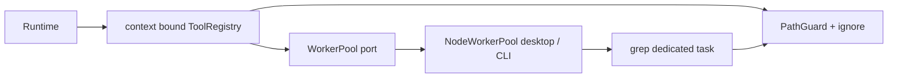

<!--
Copyright (c) 2026 DDP Engineering
This software is licensed under the PolyForm Noncommercial License 1.0.0.
Commercial use requires a separate commercial license.
See the LICENSE.txt in the .agentic folder for full license details.
SPDX-License-Identifier: LicenseRef-PolyForm-Noncommercial-1.0.0
-->

# TASK-bd3bddf6 - WP-11 Path guard, registry and read-only tools

stage: done
type: feature
path: full
interaction: autopilot
requirements: REQ-SEC-c370e45b, REQ-FUNC-f558632e, REQ-FUNC-091ba439, REQ-DATA-6e0a50db, REQ-FUNC-86bf3083, REQ-FUNC-6be2c915, REQ-FUNC-758d1aee, REQ-REL-8f53fff6, REQ-REL-df1e6461, REQ-PLAT-2b27ef1d, REQ-FUNC-0300323e, REQ-FUNC-73151724
parent:
branch: master
base: 183c225b13999916bacbb1a8f9d23df596bab4bc
opened: 2026-10-11

## Done checklist (current stage)

- [x] validated candidate confirmed unchanged
- [x] coordinator validation evidence, exact diff, exclusions and local outcome presented
- [x] standing human authority: one validated local commit per WP on master
- [x] journal and report included in selected60path delivery candidate
- [x] agreed local-only commit prepared by coordinator; no remote publication
- [x] close-out carried by the local delivery commit

## Frame

Problem: STATED file tools need confinement and bounded regex execution before sessions can integrate them.
Desired outcome: STATED WP11 read/list/glob/grep, registry, line refs and reusable desktop/CLI worker hosts meet all issue11 Done when.
Actors: model tool caller, session owner, desktop/CLI host, workbench owner.
Primary scenario: relative file call -> zod validation and path guard -> bounded result/ref; grep discovery/read/matching -> worker partial messages -> host terminal outcome.
Examples: docs/notes.md#L1-L2; catastrophic (a+)+$ on a long nonmatching line.
Counterexamples: ../outside, .vera/cache, external junction, C:\Windows, disabled read; invalid regex returns error.
In scope: guard/binary detection, per-session in-memory fingerprints, registry/adaptor, four file tools, WorkerPool port/hosts, real desktop responsiveness/abort, required tests/docs.
Out of scope: WP12 prompt, WP13 sessions, WP14 full Stop UI, WP15 CLI commands, WP16/17 writes/permissions/queue, WP27 other refs; repository/cycle administration.
Constraints: STATED shared master base183c225b13999916bacbb1a8f9d23df596bab4bc, no staging/commit/publication; protected optional-companions SHA preserved; native separate Windows/Ubuntu evidence, independent reviews, full configured gates; no real provider/nonloopback.
Success signals: all issue11 acceptance cases; source parity, raw receipts, two independent approvals, strict configured gates and serial E2E.
Evidence: OBSERVED core agent/types.ts ToolDef and tool.ts projection; workbench/ignore.ts permanent exclusions; Electron build input supports worker entries; WP06 service validated dependency; plan/M1-read-only-agent.md and architecture03/02/05 plus ADR0007/0010 are STATED source contracts.
Assumptions: INFERRED context-bound registry adapter preserves WP10 execute(args,signal) while product definitions receive ctx. Fingerprints belong to caller-created session context.
Unknowns: initial implementations absent; platform outcomes await proof. No blocking product decisions.
Decision-blocking questions: none.
Proposed behaviors: exact architecture03 sections4/5/7; host absolute10000ms default with shorter injected test deadlines, termination and replacement capacity.
Path and reason: full, new interfaces/dependency/security and observable file access. Quick criteria: observable behavior=no; interface/data format=no; dependency=no; existing requirement coverage=no; unchanged security=no. One tightly coupled task; only two read-only reviewers delegated after reconciliation.

## Requirement coverage

| Frame outcome / atomic behavior | Actor/system | Requirement | Positive case | Boundary or failure | Verification | Design decision |
|---|---|---|---|---|---|---|
| Confine tool paths | model/session/host | REQ-SEC-c370e45b | docs/Notes.md resolves canonical | external link/new tail,device/NUL,Windows case aliases | 05_Software/packages/core/src/workbench/path-guard.test.ts | PathGuard lexical/canonical checks |
| Detect binary samples | model/session/host | REQ-FUNC-f558632e | valid UTF8 sample | NUL/replacements first8KiB boundary | 05_Software/packages/core/src/tools/binary.test.ts | sample classifier |
| Read numbered bounded text | model/session/host | REQ-FUNC-091ba439 | large-log line2 after270k chars | binary/PDF,empty,escaped caps/exact refs | 05_Software/packages/core/src/tools/read.test.ts | stream metadata and bounded requested window |
| Remember session read fingerprints | model/session/host | REQ-DATA-6e0a50db | two independent contexts | changed source,failed read records nothing | 05_Software/packages/core/src/tools/read.test.ts | canonical session Map |
| List bounded ignored directories | model/session/host | REQ-FUNC-86bf3083 | root and depth3 entries | ignored/link/depth boundary | 05_Software/packages/core/src/tools/discovery.test.ts | guarded readdir |
| Glob sorted confined files | model/session/host | REQ-FUNC-6be2c915 | newest of501 matching files | base/ignore/escaping pattern | 05_Software/packages/core/src/tools/discovery.test.ts | tinyglobby + mtime cap |
| Search file content in workers | model/session/host | REQ-FUNC-758d1aee | content/files/count,case/context | binary/>5MiB,regex syntax,maxResults | 05_Software/packages/core/src/tools/grep.test.ts | worker-only task |
| Terminate timed out grep tasks | model/session/host | REQ-REL-8f53fff6 | received partial then timeout | catastrophic regex,queue deadline | 05_Software/packages/core/src/workers/node-host.test.ts | absolute host timer/termination |
| Abort and replace grep workers | model/session/host | REQ-REL-df1e6461 | active + queued abort | next task andcapacity2 concurrent success | 05_Software/packages/core/src/workers/node-host.test.ts | termination before resolve/replacement |
| Keep desktop responsive during grep | model/session/host | REQ-PLAT-2b27ef1d | real sandboxed app.info | pathological task timeout/abort,next grep | 05_Software/e2e/file-tools.spec.ts | independent compiled desktop worker |
| Validate filter and cap tool registry | model/session/host | REQ-FUNC-0300323e | all zod/schema samples | disabled,invalid,cyclic results,nested caps | 05_Software/packages/core/src/tools/registry.test.ts | runtime adapter + JSON cap/error |
| Format and parse line references | model/session/host | REQ-FUNC-73151724 | Unicode path ranged lines | invalid order/zero/unsafe bounds | 05_Software/packages/shared/src/refs.test.ts | pure shared parser/formatter |

## Design

Requirements coverage: security guard and binary; numbered bounded reads/session state; ignored discovery; dedicated grep workers; timeout/abort/replacement; desktop responsiveness; registry zod/caps; shared line refs map to coverage rows above.
Component responsibilities: core owns PathGuard, binary/read/discovery, tool definitions/context/registry and WorkerPool port. NodeWorkerPool implements reusable bounded worker-thread hosting; desktop/CLI adapters choose compiled worker entry URLs. Shared owns pure line refs.
Interfaces: product ToolDefinition execute(ctx,args,signal) returns structured JSON; registry binds context to existing runtime ToolDef execute(args,signal), converts through toolSpecs. Structured error carries isError; runtime adapter must propagate this to runtime's established error flag without changing prior ToolDef contract.
State: caller-created ToolContext holds root, WorkerPool and per-session Map canonicalPath->{sha256,mtimeMs}; no database/session-engine work. Pool owns active/queued tasks, deadline timers and termination; new task creates replacement worker after completion/termination, never reuses a busy worker.
Flow: every call validates args/disabled names; canonical guard checks lexical and real targets/deepest ancestor; ignore rules apply original/canonical relative paths. Root .veraignore is loaded via trusted metadata read rejecting redirects. Discovery tinyglobby with followSymbolicLinks false, then per-result guard; allowed explicit internal file aliases may resolve but ignored/external aliases fail.
Read cap: retain at most256KiB of requested source text and a30000-character numbered preview; scan full-file line-count/hash metadata in64KiB chunks independently of retained output. Large logs remain readable at any offset; post-read stat/path/inode checks reject changed files before fingerprint commit. Registry32k JSON cap updates numbered line refs when escaped text is shortened.
Grep task protocol: host sends root/validated options; worker constructs guard, discovers and reads files and compiles/matches regex only there; sends incremental bounded match records and final/error. Host absolute deadline starts at admission including queue, checked on every incoming event; timeout/abort terminates before settling. Partial messages enable recovery even when subsequent match stalls. Result limits end discovery/matching boundedly. Worker host defaults10000ms; test factory injects shorter deadlines.
Security: model cannot choose worker source/host execution; no shell/network tool. Reject Windows device/ADS/reserved names on all platforms, slash-normalize accepted separators, containment segment comparisons per native OS, deepest-ancestor realpath for future write seam; root canonicalized.
Concurrency: configurable fixed host capacity, one task per worker; queued signals/deadlines cleanly settle; dispose terminates active and aborts queued. Worker crash/actionable errors never trigger fallback. Deadlines not reset by progress.
Compatibility: additive modules and context-bound runtime adapter; existing WP10 ToolDef/schema semantics preserved. Exact tinyglobby dependency pin; no environment/version changes.
Observability: typed outcome reason timeout/aborted, partial/truncated, raw process receipts and source manifests; instrumented desktop export compiles away from release.
Test seams: temporary real files, native symlink/Windows aliases, real Node workers with catastrophic regex, injected shorter deadline, actual Electron IPC via sandboxed renderer, both adapters and emitted release harness absence.
Alternatives/tradeoffs: no main-thread fallback; per-task worker creation avoids state leakage and naturally restores terminated capacity; bounded pool caps concurrent memory. No child implementation task needed; independent read-only review agents run after reconciliation.
Expected files: core/workbench/path-guard.ts; core/tools/{binary,read,list,glob,grep,discovery,registry,context,grep-worker}.ts; core/workers/node-host.ts and ports/index exports; shared/refs.ts; app worker adapters/entries and desktop instrumentation; tests for each seam, dependency/lock/build config; current knowledge/context docs and requirements.
Risks: symlink swaps between guard and I/O require post-read resolution/stat checks; pathological regex stalls worker only; production bundler must retain separate worker entry; large output JSON caps must preserve valid metadata.
Open decisions: none. File tools read immutable caller context for workbench/session lifecycle; integration ownership remains WP13.

### Proposed architecture - TASK-bd3bddf6

## Log

- 2026-10-11 frame: <scope agreed, exclusions, chosen path and why>

- 2026-10-11T17:45:53.033863+00:00 frame: scope accepted in autopilot; full path; WP11 only, shared master, recorded base; local commit standing authorization belongs to coordinator. BMAD unavailable and setup outside user scope; explicit AEGIS workflow used.

- 2026-10-11T17:46:52.230909+00:00 specify: created12 atomic draft requirements; no existing requirements revised/retired; full behavior inventory and concrete verification preserved in coverage and requirement files. Architecture03/02/05 specify exact formats/options; no additional product decision needed.

- 2026-10-11T17:46:52.288717+00:00 design: context-bound registry preserves runtime seam; per-task bounded worker host controls absolute deadlines/termination and partial messages; detailed contracts and risks in Design.

- 2026-10-11T17:47:47.393189+00:00 build red: REQ-SEC-c370e45b; command=python ../02_Tools/npmw.py npx vitest run packages/core/src/workbench/path-guard.test.ts; exit=1; expected missing behavior=PathGuard API absent,27 assertions failed; raw guard-red receipt.

- 2026-10-11T17:48:26.679658+00:00 build red: REQ-FUNC-f558632e and REQ-FUNC-73151724; command=python ../02_Tools/npmw.py npx vitest run packages/core/src/tools/binary.test.ts packages/shared/src/refs.test.ts; exit=1; expected missing behavior=binary detector and line-ref formatter/parser APIs absent,3 assertions failed.

- 2026-10-11T17:49:41.293679+00:00 build red: REQ-FUNC-091ba439,REQ-DATA-6e0a50db; command=python ../02_Tools/npmw.py npx vitest run packages/core/src/tools/read.test.ts; exit=1; expected missing behavior=session tool context/read API absent,3 assertions failed.

- 2026-10-11T17:49:41.313059+00:00 design clarification before read implementation: enforce architecture03 per-call256KiB with oversized-file refusal rather than planned full-file scan; no requirement weakened; tests assert actionable refusal.

- 2026-10-11T17:50:35.302977+00:00 build red: REQ-FUNC-86bf3083,REQ-FUNC-6be2c915; command=python ../02_Tools/npmw.py npx vitest run packages/core/src/tools/discovery.test.ts; exit=1; expected missing behavior=list/glob tools absent,2 assertions failed.

- 2026-10-11T17:50:35.311829+00:00 build green: guard/binary/refs30 passed1 OS skip and read3 passed; raw focused receipts in cache/wp11. DEVIATION design: oversized read refuses above256KiB rather than whole-file scan, enforcing architecture03 per-call byte limit.

- 2026-10-11T17:52:40.795664+00:00 build red: REQ-FUNC-758d1aee,REQ-REL-8f53fff6,REQ-REL-df1e6461; command=python ../02_Tools/npmw.py npx vitest run packages/core/src/workers/node-host.test.ts packages/core/src/tools/grep.test.ts; exit=1; expected missing behavior=NodeWorkerPool and grep absent,5 assertions failed.

- 2026-10-11T17:53:58.418180+00:00 build red: REQ-FUNC-0300323e; command=python ../02_Tools/npmw.py npx vitest run packages/core/src/tools/registry.test.ts; exit=1; expected missing behavior=registry/schema/cap APIs absent,3 assertions failed.

- 2026-10-11T17:54:54.294590+00:00 build red: REQ-FUNC-091ba439,REQ-DATA-6e0a50db large-file boundary; command=python ../02_Tools/npmw.py npx vitest run packages/core/src/tools/read.test.ts; exit=1; expected missing behavior=large log single-line offset refused by whole-file size ceiling. Coordinator explicitly requested correction; original ceiling interpretation superseded.

- 2026-10-11T17:57:01.387641+00:00 build red: REQ-PLAT-2b27ef1d; command=VERA_TEST=1 python ../02_Tools/npmw.py npm run test:e2e -- file-tools.spec.ts; exit=1; expected missing behavior=desktop worker harness absent in actual Electron global; raw desktop-red receipt.

- 2026-10-11T18:00:12.131497+00:00 build red: registry failure boundaries; command=python ../02_Tools/npmw.py npx vitest run packages/core/src/tools/registry.test.ts; exit=1; expected missing behavior=cyclic tool result serialization escapes registry; corrected error containment and explicit error preservation.

- 2026-10-11T18:01:29.824197+00:00 design reconciliation: coordinator clarified large-log offset semantics; initial256KiB whole-file refusal was corrected before review. Full-file metadata streams with bounded retained source/preview; exact cited visible lines and complete fingerprint verified by read-large-green. Supersedes earlier design deviation; no retained size-ceiling behavior or weakened specification.

- 2026-10-11T18:01:29.834032+00:00 build green: discovery2, registry4, worker/grep5, compiled hosts2 and desktop native1 passed focused proofs; initial guard/binary/refs30 plus1 OS skip and read3 passed. Raw receipts under cache/wp11; no live provider/network access.

- 2026-10-11T18:04:07.121688+00:00 build red during validation reconciliation: command=python ../02_Tools/npmw.py npx vitest run packages/core/src/workers/node-host.test.ts; exit=1; expected missing behavior=result ceiling still reaches later catastrophic match. Fixed immediate ceiling termination and bounded transferred match/context text; no main-thread fallback.

- 2026-10-11T18:05:11.326009+00:00 validate reconciliation: complete recorded-base tracked/untracked candidate reviewed against issue contracts, errors, security and Windows/Linux behavior; component knowledge/project/environment and all12 active requirement links reconciled. No manual-only WP11 proof substitutes. Generated test-source coverage links included because layout source globs also match colocated tests. Prior journal warning TASK-77e6f562 and pre-existing provider manual-verification note remain outside scope.

- 2026-10-11T18:10:50.873437+00:00 review round1: independent spec changes_required (original SHA256 eb8cfb3e88b53dd046640e3f6b823cb39d60c34319d693da9d1b55294a010767) and quality changes_required (original SHA256 61d99b3fc6e9e575393a405ee9571397c17903083cf9d9acba17417c16932e7b), both semantic candidate9f21a45f2d49d3a1888b041088103b0e48e229e08f78688849a565351e71217c. SPEC-R1-001/QUALITY-WP11-R1-001: preview clipping stops later-file search and falsely truncates files/count; QUALITY-WP11-R1-002: ordinary mixed-case Windows ignore metadata rejected. Route build, fix only these findings; both old verdicts invalidated. Raw original reviewer JSON retained under cache/wp11.

- 2026-10-11T18:11:10.880507+00:00 build red: REQ-FUNC-758d1aee review findings SPEC-R1-001/QUALITY-WP11-R1-001; command=python ../02_Tools/npmw.py npx vitest run packages/core/src/tools/grep.test.ts; exit=1; expected missing behavior=seven real-worker regressions show clipped match/context suppresses later file or incorrectly truncates files/count/excluded matching context; raw review-grep-red receipt.

- 2026-10-11T18:11:42.827986+00:00 build green: review grep findings fixed by separating ceiling exhaustion from preview clipping and omitting discarded preview payloads for files/count; command=python ../02_Tools/npmw.py npx vitest run packages/core/src/tools/grep.test.ts packages/core/src/workers/node-host.test.ts; exit=0,13 tests passed including immediate ceiling before pathological regex; raw review-grep-green receipt.

- 2026-10-11T18:11:42.836851+00:00 build red: REQ-SEC-c370e45b QUALITY-WP11-R1-002; command=python ../02_Tools/npmw.py npx vitest run packages/core/src/workbench/path-guard.test.ts; exit=1; expected missing behavior=native Windows ordinary .VeRaIgNoRe rejected as redirected;27 other tests pass and1 POSIX skip; raw review-guard-red receipt.

- 2026-10-11T18:12:23.667396+00:00 build green: REQ-SEC-c370e45b review finding QUALITY-WP11-R1-002 fixed with shared native Windows path identity folding while preserving redirect refusal; command=python ../02_Tools/npmw.py npx vitest run packages/core/src/workbench/path-guard.test.ts; exit=0,28 tests passed1 POSIX-only skip; raw review-guard-green receipt. Review fixes limited to recorded findings; requirement verification and file-tool knowledge reconciled; Biome4 files exit0 no edits.

- 2026-10-11T18:14:03.308521+00:00 validate review round2: both independent original verdicts approved for unchanged semantic candidate b1670f0b749e9e7f8419177cbceaa5b5a3b969fea62494257d9453881a9f1f3c; spec original SHA256 e66f8ca0c5c8074fe02aac51d44bfd7475f941d282c44af4e29873875d068965, quality original SHA256 53feeef202ff969a42811a9343f252c940544e155421332f53cedaecb684cf65. All round1 findings resolved; full manifests/protected exclusion verified by both reviewers. Final proof follows; no candidate edits permitted.

- 2026-10-11T18:21:17.102389+00:00 validate final proof: all six captured actual processes exit0 on semantic candidate b1670f0b749e9e7f8419177cbceaa5b5a3b969fea62494257d9453881a9f1f3c. Focused Windows56 passed1 POSIX skip; native Ubuntu55 passed2 Windows skips,9 files each. Serial actual Electron E2E16 passed Windows and16 Ubuntu/Xvfb. Both platforms executed python .agentic/aegis.py check --task TASK-bd3bddf6 --strict --run (native python3), which runs configured npm test and npm run verify (Biome, TypeScript, i18n, Vitest). Exact full counts/argv/cwd/time/environment/log SHA/source manifests in cache/wp11/final-results.json and six *.execution.json/*.log receipts. Source hashes excluding administrative journal unchanged before/after every process; no live provider/nonloopback proof substitutes. Existing TASK-77e6f562 ruling warning and provider manual note REQ-FUNC-103979aa remain outside scope; pinned dependency audit/build annotation/color warnings do not fail gates.

- 2026-10-11T18:21:17.113727+00:00 validate preservation/diff: recorded-base complete candidate60 files (16 tracked modified44 untracked additions including current journal), user-owned optional-companions excluded and SHA unchanged. Both reviews independently hash all60 complete candidate/605 source files; evolution sidecar refreshed after last product edit and full base-relative manifest carries current exact hashes. Native prior-state archive596 files plus97 Git files verified;35 previous live evidence files unchanged. No child implementation tasks. No staging, commit, remote writes, cycle/automation changes. Earlier read-size interpretation deviation was corrected before review to streaming full metadata and bounded requested output; no retained deviation or weakened proof. WP14 session Stop integration and clean/offline Windows/VC++ packaging remain their later WP30/WP33/final obligations.

- 2026-10-11T18:21:17.203910+00:00 deliver handoff: validated semantic candidate unchanged; standing user authorization for local commits recorded in RULING-001, implementer explicitly leaves shared checkout/index untouched for coordinator verification/commit. Report-time advisory snapshot follows and is administrative journal evidence, not a replacement for executed final gates. No remote publication requested or performed.

- 2026-10-11T18:21:55.123056+00:00 deliver report interpretation: generated report includes all61 Git-visible changed paths, including protected optional-companions; the authorized commit candidate excludes it and contains60 paths, with exact final additions/deletions in handoff.json. Its one recorded deviation is historical and superseded by the streaming correction, not retained behavior. Report-time second warning unticked-deliver is expected because coordinator commit/close-out are pending; final executed validate gates had zero errors/one pre-existing warning/one provider note. Strict command raw stdout reports configured command success/timing, not per-test totals; full-suite test counts are not recorded or inferred. Focused/E2E observed counts remain in final-results.json. Administrative explanation only; approved semantic source candidate unchanged.

- 2026-10-11T18:33:41.047104+00:00 COORD-WP11-001: coordinator and independent audit found declared REQ-REL-df1e6461 worker failure/replacement verification absent. Previous timeout/abort and invalid-regex protocol tests do not trigger worker error/exit/startup. Earlier delivery acceptance withdrawn; return build for deterministic actual failure fixtures on compiled desktop/CLI adapters without weakening requirement or extending product functionality. Standing no staging/commit preserved; all original rounds1/2 and coordinator final logs/receipts preserved via round3-existing-evidence manifest. Current verdicts invalidated by candidate test changes; next independent review round3 within existing limit.

- 2026-10-11T18:35:50.310983+00:00 build verification correction COORD-WP11-001 / REQ-REL-df1e6461: actual compiled adapters now each test crash/error event, clean premature exit/exit event and missing entry/startup error, requiring actionable error, zero matches despite a matching file (no fallback), capacity0 and abort listener cleanup, then real grep success through same capacity-one pool. Marker proves crash/exit fixtures ran in worker threads. Separate core test covers synchronous constructor catch and same-pool recovery. First actual Windows runs exit0 (adapter8, core6); no production defect or edit occurred, so no artificial red failure is claimed. Requirement retains its original verification sentence and adds exact fixture detail; knowledge and links reconciled. Earlier declaration gap is corrected, pending fresh round3 review/full proof.

- 2026-10-11T18:36:39.528232+00:00 build/validate round3: native Ubuntu actual worker-failure focused command=python3 ../02_Tools/npmw.py npx vitest run tests/tooling/worker-hosts.test.ts packages/core/src/workers/node-host.test.ts; exit0,14 passed. Windows adapter8 and core6 first runs exit0; added7 tests and no production edits. Native source parity605 files; all existing rounds/coordinator originals and receipts unchanged. Evolution records exactly2 changed test files; requirement verification preserved/clarified and component knowledge reconciled. Project/environment responsibilities, architecture and other11 active requirements unchanged and traceability reread. No manual substitution; review round3 and fresh mandatory full proof pending.

- 2026-10-11T18:39:19.370384+00:00 validate review round3: both independent original verdicts approved for unchanged semantic candidate f0cb10fda8ed1ec49e0a92f82f26a747e62d1d34826484112ac484bf7a25af91; spec original SHA256 592bcbcc355ba0664948692afac52771e6ebeae177aa11fe1c8188e5bddbfef9, quality original SHA256 e186309a16f61c571718fd51c63b0fed65e0d132d0067a33bd16ccd894595cda. COORD-WP11-001 resolved by actual compiled-host error/exit/startup and same-pool real recovery; final mandatory proof follows. Previous approvals/originals preserved as history, no candidate edits permitted.

- 2026-10-11T18:46:58.122628+00:00 validate round3 final proof: all six new captured actual processes exit0 on candidate f0cb10fda8ed1ec49e0a92f82f26a747e62d1d34826484112ac484bf7a25af91. Focused Windows63 passed1 POSIX skip and native Ubuntu62 passed2 Windows skips,9 files each; includes all7 new failure/recovery tests. Serial actual Electron E2E16 passed each platform. Both actual python/python3 .agentic/aegis.py check --task TASK-bd3bddf6 --strict --run --json commands executed configured test=npm test and lint=npm run verify (Biome, TypeScript, i18n, Vitest); original JSON records both actual inner exits0 on each platform and zero catalog errors. Exact argv/cwd/UTC/environment/log SHA and source manifests in new *-round3-*-final.execution.json/*.log; original strict JSON and observed counts in round3-final-results.json. All source hashes except administrative journal unchanged before/after all six processes. Existing TASK-77e6f562 warning/provider manual note outside scope; no weakened proof, live provider or nonloopback traffic.

- 2026-10-11T18:46:58.132852+00:00 validate round3 resolution: COORD-WP11-001 corrected with actual compiled desktop/CLI error, exit0 and missing-entry failures and same-pool real recovery; core synchronous startup catch also covered. All production source unchanged since round2; only2 test files, reliability verification detail, component knowledge and journal changed. Both independent round3 reviews bind the complete candidate; all12 active requirements and current knowledge/architecture/context remain true. Existing rounds1/2, coordinator logs/receipts and prior native evidence preserved; complete base-relative inventory60 files (16 tracked modified44 added), protected optional-companions excluded/unchanged. Old handoff retained as withdrawn history. No staging/commit/remote/cycle/automation changes; WP14 session Stop and WP30/WP33/final packaging obligations unchanged.

- 2026-10-11T18:46:58.228070+00:00 deliver round3 handoff: semantic candidate unchanged after fresh proof, earlier handoff remains withdrawn history. Standing user local-commit authorization applies to coordinator; implementer remains idle after updated packet/report without staging/commit. Report-time advisory is administrative evidence; pending coordinator acceptance/delivery is not claimed complete.

- 2026-10-11T18:47:12.797131+00:00 deliver round3 report interpretation: latest appended report is round3 and retains historical round2 report/logs. Its61 Git-visible paths include protected optional-companions; authorized complete candidate has60. Historical oversized-read deviation was corrected, and COORD-WP11-001 declaration gap was withdrawn/corrected; neither is retained behavior or weaker proof. Expected unticked-deliver warning records pending coordinator commit/close-out. Fresh strict original JSON now directly records43 files and Windows293 passed1 POSIX skip / Ubuntu292 passed2 Windows skips in BOTH test and lint executions, each actual exit0; these observed totals are distinct from prior round2 unrecorded totals. Exact final inventory and journal-only delivery hashes in handoff-round3.json; original artifacts remain history.

- 2026-10-11T18:48:45.245789+00:00 DEVIATION deliver: expanded native cache hash inventory included11 ancillary npm debug logs;9 are now absent after the required npm gates and2 remain hash-identical. Cost is missing npm diagnostic cache history, not lost WP test stdout/receipts/reviews: all34 prior native WP files and88 Windows prior artifacts unchanged, prior archive596 files/97 Git files and35 live evidence files verified. Original45-file inventory and missing expected hashes preserved in history-round3-verified.json; no full45 preservation claim retained. Current-candidate six gate receipts remain valid and unchanged. No product/source/test/requirements/knowledge/configuration change or weaker verification follows from this administrative evidence limitation.

- 2026-10-11T19:01:33.172729+00:00 coordinator validation round3: Full current journal, AEGIS validate/deliver steps, all12 requirements, complete base diff with staged/unstaged/untracked reviewed. Prior complete semantic review retained for hash-identical files; round3 changes (two tests, reliability verification, file-tool knowledge, journal) reread. COORD-WP11-001 resolved by real uncaught crash, early exit and startup error through both compiled adapters with cleanup, zero fallback matches and subsequent actual grep on same pool; synchronous constructor failure additionally covered. All production files unchanged since round2. Original independent round3 spec/quality verdicts and identities/bindings verified against semantic SHA f0cb10fda8ed1ec49e0a92f82f26a747e62d1d34826484112ac484bf7a25af91. Read-only coordinator auditor confirmed60inventory hashes,605native source parity,191current raw artifacts,123earlier artifacts and88extended Windows historical artifacts. Prior native archive596files/97Git files and35prior live artifacts plus34durable files in expanded inventory verified intact;10ancillary npm diagnostics absent/unrecoverable, accepted disclosed limitation, not lost required acceptance evidence. Current native npm diagnostics archived separately before remaining coordinator gates. Fresh six SERIAL coordinator actual exit0 gates: Windows focused63pass1POSIXskip, Ubuntu62pass2Windowsskips; actual Electron E2E16eachOS including app.info responsiveness/pathological timeout/abort/replacement; strict --run --json executes BOTH configured test and lint commands in full on each platform, all inner exits0 and catalog errors0; expected pending-deliver warning plus historical WP09 warning, both non-promoted. Actual full counts captured in original strict JSON; resource-only VITEST_MAX_WORKERS=1, no selection/deadline/concurrency contract weakened. Full605source SHA a23805e5c93f335ff54b4e953fdcdf70de5dd47e0238d70f39f3897ec4dd056a unchanged before/after every coordinator gate; native605maps equal each Linux run. New raw receipts/logs *-coordinator-round3-final contain actual argv/cwd/UTC/environment/exits/SHA; no overwritten historical proof. Existing WP09 malformed ruling warning/provider manual reminder remain outside scope; Rollup/color notices non-failing. WP05 clean/offline Windows/CRT obligations preserved for WP30/WP33/final release. Implementer idle, no child implementation task or concurrent source edits.

- 2026-10-11T19:01:33.172781+00:00 coordinator deliver approval/presentation: User cycle and root AGENTS explicitly authorize one coordinator local validated commit per ticket, already recorded RULING-001. Selected60files (16modified44added), handback2330insertions10deletions before journal-only coordinator delivery records; exact staged stat will be recorded before commit. Excludes user00_Planning/optional-companions.md (SHA unchanged), ignored cache/runtime and cycle administration. Both current round3 approvals confirmed, semantic candidate unchanged; intended outcome one local WP11/#11/TASK-bd3bddf6 commit on master, no push/PR/Gitea mutation/publication. Historical read-size deviation superseded by streaming correction; worker verification gap corrected. Retained DEVIATION deliver:10ancillary native npm diagnostics absent, no loss of durable mandatory WP proof; report retains history and must be interpreted with latest evidence. Standing human authorization resolves local delivery boundary; no additional permission required.

- 2026-10-11T19:01:58.380247+00:00 coordinator report read/close-out: Fresh appended delivery report inspected; advisory is not runtime proof,61Git-visible paths include unrelated protected file, selected candidate remains60. Historical oversized-read deviation/report retained append-only and superseded; only current accepted limitation is missing10ancillary npm diagnostics. Local-only outcome closes before the single delivery commit per6_deliver step7. Source/tests/requirements/knowledge unchanged after fresh proof; journal-only records carry close-out. Actual commit SHA and exact staged inventory/stat recorded in cycle cache after successful Git commit; failure restores deliver. No remote publication or issue closure.

## Rulings

- RULING-001 | date=2026-10-11 | decision=autopilot on shared master; candidate only, coordinator alone commits | reason=explicit delegation and AGENTS authorization of sequential local commits | source=user | supersedes=none
- RULING-002 | date=2026-10-11 | decision=preserve optional-companions and cycle state; no remote actions | reason=explicit exclusions | source=user | supersedes=none

## Handoff

current: done
status: ready
next: Record actual local commit and start next eligible WP in coordinator cycle
must_read: .agentic/tasks/TASK-bd3bddf6.md
blockers: none

## Stage report

stage: deliver
result: completed
current: done
changed: WP11 confined read-only tools, registry, worker hosts, line refs;60paths
evidence: Coordinator focused63Windows/62Ubuntu;E2E16each;strict configured test/lint0each;round3 reviews approved
issues: Historical WP09 advisory;10ancillary native npm logs missing;clean Windows/CRT final obligation retained
next: Record actual local commit and start next eligible work package
needs_user: no
spec_compliance: approved
implementation_quality: approved
review_round: 3

## Delivery report (2026-10-11)

- stage: deliver; type: feature; path: full; branch: master
- requirements:
  - REQ-SEC-c370e45b - Confine tool paths
  - REQ-FUNC-f558632e - Detect binary samples
  - REQ-FUNC-091ba439 - Read numbered bounded text
  - REQ-DATA-6e0a50db - Remember session read fingerprints
  - REQ-FUNC-86bf3083 - List bounded ignored directories
  - REQ-FUNC-6be2c915 - Glob sorted confined files
  - REQ-FUNC-758d1aee - Search file content in workers
  - REQ-REL-8f53fff6 - Terminate timed out grep tasks
  - REQ-REL-df1e6461 - Abort and replace grep workers
  - REQ-PLAT-2b27ef1d - Keep desktop responsive during grep
  - REQ-FUNC-0300323e - Validate filter and cap tool registry
  - REQ-FUNC-73151724 - Format and parse line references
- deviations: 1 recorded
  - design: oversized read refuses above256KiB rather than whole-file scan, enforcing architecture03 per-call byte limit.
- explicit review: enabled; spec_compliance=approved; implementation_quality=approved; review_round=2
- diff vs task base 183c225: 61 file(s) changed, 2369 line(s) added
- checks: errors=0 warnings=2 notes=1
- checklist: 3/6 done; open: journal and report included in the delivery commit; agreed local commit outcome delivered by coordinator; close-out carried by coordinator delivery commit

## Delivery report (2026-10-11)

- stage: deliver; type: feature; path: full; branch: master
- requirements:
  - REQ-SEC-c370e45b - Confine tool paths
  - REQ-FUNC-f558632e - Detect binary samples
  - REQ-FUNC-091ba439 - Read numbered bounded text
  - REQ-DATA-6e0a50db - Remember session read fingerprints
  - REQ-FUNC-86bf3083 - List bounded ignored directories
  - REQ-FUNC-6be2c915 - Glob sorted confined files
  - REQ-FUNC-758d1aee - Search file content in workers
  - REQ-REL-8f53fff6 - Terminate timed out grep tasks
  - REQ-REL-df1e6461 - Abort and replace grep workers
  - REQ-PLAT-2b27ef1d - Keep desktop responsive during grep
  - REQ-FUNC-0300323e - Validate filter and cap tool registry
  - REQ-FUNC-73151724 - Format and parse line references
- deviations: 1 recorded
  - design: oversized read refuses above256KiB rather than whole-file scan, enforcing architecture03 per-call byte limit.
- explicit review: enabled; spec_compliance=approved; implementation_quality=approved; review_round=3
- diff vs task base 183c225: 61 file(s) changed, 2503 line(s) added
- checks: errors=0 warnings=2 notes=1
- checklist: 3/6 done; open: journal and report included in coordinator delivery commit; agreed local commit outcome delivered by coordinator; close-out carried by coordinator delivery commit

## Delivery report (2026-10-11)

- stage: deliver; type: feature; path: full; branch: master
- requirements:
  - REQ-SEC-c370e45b - Confine tool paths
  - REQ-FUNC-f558632e - Detect binary samples
  - REQ-FUNC-091ba439 - Read numbered bounded text
  - REQ-DATA-6e0a50db - Remember session read fingerprints
  - REQ-FUNC-86bf3083 - List bounded ignored directories
  - REQ-FUNC-6be2c915 - Glob sorted confined files
  - REQ-FUNC-758d1aee - Search file content in workers
  - REQ-REL-8f53fff6 - Terminate timed out grep tasks
  - REQ-REL-df1e6461 - Abort and replace grep workers
  - REQ-PLAT-2b27ef1d - Keep desktop responsive during grep
  - REQ-FUNC-0300323e - Validate filter and cap tool registry
  - REQ-FUNC-73151724 - Format and parse line references
- deviations: 2 recorded
  - design: oversized read refuses above256KiB rather than whole-file scan, enforcing architecture03 per-call byte limit.
  - deliver: expanded native cache hash inventory included11 ancillary npm debug logs;9 are now absent after the required npm gates and2 remain hash-identical. Cost is missing npm diagnostic cache history, not lost WP test stdout/receipts/reviews: all34 prior native WP files and88 Windows prior artifacts unchanged, prior archive596 files/97 Git files and35 live evidence files verified. Original45-file inventory and missing expected hashes preserved in history-round3-verified.json; no full45 preservation claim retained. Current-candidate six gate receipts remain valid and unchanged. No product/source/test/requirements/knowledge/configuration change or weaker verification follows from this administrative evidence limitation.
- explicit review: enabled; spec_compliance=approved; implementation_quality=approved; review_round=3
- diff vs task base 183c225: 61 file(s) changed, 2530 line(s) added
- checks: errors=0 warnings=2 notes=1
- checklist: 3/6 done; open: journal and report included in coordinator delivery commit; agreed local commit outcome delivered by coordinator; close-out carried by coordinator delivery commit

## Delivery report (2026-10-11)

- stage: deliver; type: feature; path: full; branch: master
- requirements:
  - REQ-SEC-c370e45b - Confine tool paths
  - REQ-FUNC-f558632e - Detect binary samples
  - REQ-FUNC-091ba439 - Read numbered bounded text
  - REQ-DATA-6e0a50db - Remember session read fingerprints
  - REQ-FUNC-86bf3083 - List bounded ignored directories
  - REQ-FUNC-6be2c915 - Glob sorted confined files
  - REQ-FUNC-758d1aee - Search file content in workers
  - REQ-REL-8f53fff6 - Terminate timed out grep tasks
  - REQ-REL-df1e6461 - Abort and replace grep workers
  - REQ-PLAT-2b27ef1d - Keep desktop responsive during grep
  - REQ-FUNC-0300323e - Validate filter and cap tool registry
  - REQ-FUNC-73151724 - Format and parse line references
- deviations: 3 recorded
  - design: oversized read refuses above256KiB rather than whole-file scan, enforcing architecture03 per-call byte limit.
  - deliver: expanded native cache hash inventory included11 ancillary npm debug logs;9 are now absent after the required npm gates and2 remain hash-identical. Cost is missing npm diagnostic cache history, not lost WP test stdout/receipts/reviews: all34 prior native WP files and88 Windows prior artifacts unchanged, prior archive596 files/97 Git files and35 live evidence files verified. Original45-file inventory and missing expected hashes preserved in history-round3-verified.json; no full45 preservation claim retained. Current-candidate six gate receipts remain valid and unchanged. No product/source/test/requirements/knowledge/configuration change or weaker verification follows from this administrative evidence limitation.
  - deliver:10ancillary native npm diagnostics absent, no loss of durable mandatory WP proof; report retains history and must be interpreted with latest evidence. Standing human authorization resolves local delivery boundary; no additional permission required.
- explicit review: enabled; spec_compliance=approved; implementation_quality=approved; review_round=3
- diff vs task base 183c225: 61 file(s) changed, 2558 line(s) added
- checks: errors=0 warnings=2 notes=1
- checklist: 5/6 done; open: close-out carried by the local delivery commit
