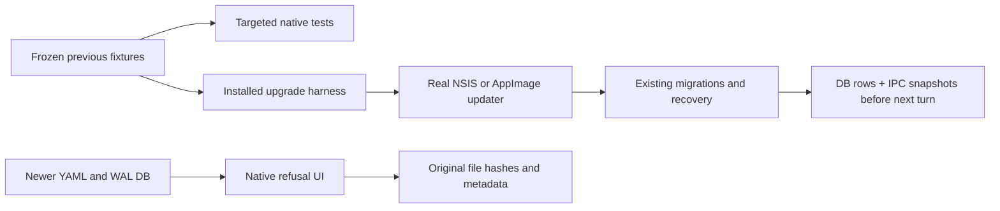

<!--
Copyright (c) 2026 DDP Engineering
This software is licensed under the PolyForm Noncommercial License 1.0.0.
Commercial use requires a separate commercial license.
See the LICENSE.txt in the .agentic folder for full license details.
SPDX-License-Identifier: LicenseRef-PolyForm-Noncommercial-1.0.0
-->

# TASK-c5c04167 - WP32 Upgrade and migration safety

stage: done
type: feature
path: full
interaction: autopilot
requirements: REQ-TEST-449732e2, REQ-TEST-becfe766, REQ-TEST-357ad9d7
parent:
branch: master
base: 01f92da87609f433cd93c9e7c0a0727974d5a173
opened: 2026-10-13

## Done checklist (current stage)

- [x] validated source/tests/spec/requirements/knowledge unchanged after round2 reviews/proof
- [x] exact manifest, original proof, warnings and real release limits presented
- [x] standing user authority for local commit exclusively by coordinator recorded
- [x] coordinator-only local delivery authorized; no remote or issue action
- [x] coordinator verified handoff and closes task for single authorized local delivery commit

## Frame

Problem: STATED WP32 needs durable upgrade safety proof for existing persisted formats.
Desired outcome: previous fixtures migrate with backups; installed upgrade retains settings/history and recovers interruption; newer data is preserved with UI explanation.
Actors: user, old/new installed VERA, migration runner, session recovery, renderer.
Primary scenario: vN creates settings/sessions -> installed update vN+1 -> supported migration and recovery -> idle state before next turn.
Examples: after hash applied; before hash removes row; other hash conflict; stale approval unusable.
Counterexamples: newer DB/YAML never acquires lock or writes backups; recovery never rewrites workbench files.
In scope: existing migration inventory, frozen previous fixtures, exhaustive focused migration/recovery checks, actual NSIS/AppImage upgrade and newer-data UI.
Out of scope: format/version inventions, WP31 unchanged checks, M4/full suites, remote/issues/staging/commit, unrelated refactoring.
Constraints: STATED master/autopilot, coordinator-exclusive local commit; explicit owned userData observed before any probe mutation/relaunch; protected human data/processes and optional-companions SHA unchanged; pinned runtimes/security/update policy.
Success signals: all existing migration fixtures/backup/noncorruption; real Windows/Ubuntu upgrade; newer UI with unchanged bytes/metadata; both reviews and native targeted/static/strict proof.
Evidence: OBSERVED settings service directly migrates 0/1/2/3 to4; credentials only schema1; SQLite migrations1/2/3; workbench only format1; recovery and newer refusal already implemented. Sources: core/settings/service.ts, storage/migrate.ts, sessions/service.ts, workbench/service.ts, main/credentials.ts.
Assumptions: INFERRED coverage/harness is primary gap; only demonstrated production gaps will be fixed.
Unknowns: real signed upgrade credentials unavailable; clean/offline Windows/CRT and separate Linux kernel remain final release criteria. Native Ubuntu here uses WSL kernel; no separate-kernel claim.
Decision-blocking questions: none.
Proposed behaviors: test existing contracts through frozen fixtures and actual installed updater.
Path and reason: full due multi-format data/recovery verification. Quick criteria: new behavior yes (test harness); new interface/data no; dependency no; existing requirements yes; data-handling verification changes yes. Single coupled implementation, only two read-only review agents authorized.

## Requirement coverage

| Frame outcome | Atomic behavior | Requirement | Positive case | Boundary/failure | Verification | Design |
|---|---|---|---|---|---|---|
| existing migration safety | frozen previous fixtures and recovery | REQ-TEST-449732e2 | backed-up supported migration | interrupted/hash/conflict/newer | focused native fixtures | immutable SQL+JSON |
| actual installed persistence | installed updater upgrade | REQ-TEST-becfe766 | settings/session persistence | unfinished approval/change | real NSIS/AppImage receipts | WP31 harness safety mode |
| future preservation UI | refusal/read-only display | REQ-TEST-357ad9d7 | visible explanation | WAL/locks/backups unchanged | native UI+metadata | private compatibility snapshot |

## Design

Frozen settings0/1 existing JSON plus2/3 fixture files exercise direct to4 paths through the injected FileAccess port; exclusive prior backup and failure cases preserve originals. Credentials schema1 encrypted synthetic API/OAuth fixture loads read-only; future schema rejects before crypto/writes; no existing migration. Workbench format1 opens unchanged; future format refused, no existing migration.
Freeze exact SQL for SQLite1/2 separately from live migration imports and metadata checksums. Initial migration1 has empty-v0 fixture; test each step to current catalogue with backup integrity, verbatim user/session/message/event/approval/change/document/chunk rows. Pending interruptions fixture reused in focused tests and external installed harness.
Reuse WP31 harness with explicit --migration-safety mode and distinct WP32 identity/version; omit unrelated WP31 integrity/portable/deferral rechecks. Build actual vN/vN+1 candidate artifacts from same compiled product where no format changed; retain source input hashes. vN creates preferences/session/history using IPC then external fixture seeds crash rows in closed SQLite. Upgrade through real updater while bench closed, reopen on actual isolated relaunch, observe idle and all hash branches before new turn; inspect underlying rows without renderer secret exposure.
Native newer UI suite uses private owned roots, compares recursive file metadata excluding access time; retain a foreign SQLite writer with WAL version99 to prove no original SHM/locks/backups change during refusal. No source code changes unless a focused test demonstrates a gap.
Risks: test-build instrumentation observes installed updater relaunch but cannot prove signed/release upgrade; remaining release obligations stay explicit. Native Ubuntu WSL runtime is valid platform proof with separate Linux kernel still open.
Expected files: fixture JSON/SQL, focused core/settings/credentials tests, probe-upgrade safety branch/helper, native upgrade-safety E2E, acceptance knowledge/environment and AEGIS records.
### Proposed architecture - TASK-c5c04167

## Log

- 2026-10-13 frame: full scope accepted in autopilot; HEAD/base master verified; only optional-companions pre-existing untracked; Windows pinned readiness passes; native Ubuntu24.04/Node pinned available, separate-kernel release criterion remains open.
- 2026-10-13 specify: three acceptance requirements, existing product contracts retained; exact inventory/oracles in shared spec; no persisted format changes.
- 2026-10-13 design: acceptance extends existing recovery and actual installed harness; one coupled task, no implementation delegation; no new product formats/contracts.

- 2026-10-13 build inspection: existing migrations/recovery/newer refusal retained; acceptance-only scope adds fixture/test coverage, not product behavior. Initial focused fixture checks pass (5 migration/recovery tests); corrected path/import authoring errors were operational and expose no missing behavior. No production red failure is claimed. Anchor668 recorded before acceptance changes. Frozen prior SQL, settings2/3, schema1 synthetic credentials and format1 fixtures now supplement existing fixtures.

- 2026-10-13 build focused: Windows78 fixture/tests (4files) and39 immediate-consumer tests (5files) pass, receipts fixtures-corrected/consumers; native Ubuntu first selection114pass/3timeouts across117tests, then only failed3 rerun serial with unchanged5s timeout pass (timed-out-retry.execution.json). Windows newer-ui3pass with exact original metadata/bytes incl WAL/SHM/locks/backups. Installed diagnostics preserved; original Windows artifacts reused after renderer endpoint wait and valid next-turn replay selection; native build environment wrapper corrects copied npm symlink invocation without altering pinned runtime. No product code gap demonstrated.
- 2026-10-13 build owned cleanup: automatic approval review rejected removal of WP32 profiles and bench é as blocked by policy; rejected command did not run. No retry/bypass. Existing task-generated data retained; harness uses unique new session/call/approval IDs and reopens the same owned workbench for corrected probes. Other task/default profiles remain untouched.

- 2026-10-13 build acceptance complete: windows/upgrade-final.execution.json exit0 and native linux/upgrade-native-wrapper3.execution.json exit0, both upgrade-report.json PASS with source17 SHA686165fb6eb89a677c5f200fb3af9259093df7a8b3c4c375d5cc043d9fa2f072. Actual installed0.32.0->0.32.1 binds two NSIS/two AppImage SHA256/SHA512; vN IPC-created settings/sessions/history, interrupted fixture seeded only with workbench closed, real updater relaunch explicit userData, recovered idle/aborted old approval/interrupted calls and all three pending hash branches observed before next turn; completed history and original content hashes/metadata retained. Next turn with valid replay model completes. Windows attempt2 recovered correctly but invalid external next-turn replay model timed out; corrected driver proof passes with identical original artifact bytes. Native current newer-ui3pass. All four WP32 Done criteria fulfilled within connected instrumented scope; real signed/release/clean/offline/CRT/kernel final criteria remain explicit. proof-binding.json independently verifies all17 current source hashes, four artifact SHA256/SHA512 and installed newer asar equal exact packaged candidate.
- 2026-10-13 validate entry: entire journal/requirements/spec and complete candidate reread; no production contract gaps or new formats, architecture matches design. Catalog strict advisory exit0 with0errors/12 inherited unrelated warnings/3notes, evolution17; coordinator exclusively owns M4 gate. Prepare independent read-only reviews before final configured strict proof.

- 2026-10-13 validate round1: two independent read-only agents approved with no findings. Complete27 SHA1d666bdcb2b78fc110e7b412492e3ddda863445521fc7c0a1786727ae8fa62dd and source17 SHA686165fb6eb89a677c5f200fb3af9259093df7a8b3c4c375d5cc043d9fa2f072 verified unchanged before/after both reviews. Both independently verified original platform receipts/log hashes, all416 product inputs/platform, four artifact SHA256/SHA512, installed/payload asar equality and protected hash. reports reviews/{spec,quality}-round1.json. Only journal verdict/evidence metadata changes after bound review; final configured strict follows, full M4 gate remains coordinator.

- 2026-10-13 validate final strict exposed TS2322 in new e2e launch env typed string|undefined while Playwright requires string. Both platforms strict-final exit1; lint and i18n pass on both;0other errors/12inherited warnings. Clear both verdicts, return build for this sole test-host typing/filter correction, rerun affected3UI/platform and typecheck; preserve actual installed and fixture/consumer proof for unchanged code/test/config seams. Same reviewers round2; no generic settings or required-check bypass.

- 2026-10-13 build fixed: sole e2e environment construction filters entries with string values and supplies Record<string,string>, matching established test launcher pattern. Current newer-ui-final3pass/platform, typecheck-final exit0/platform and affected-lint exit0/platform, original receipts. All other16 software paths and compiled product/configuration unchanged; original fixture/consumer and actual installed-upgrade proof reused, original whole lint/i18n passes retained plus affected lint refreshed. No test timeout or generic configuration changed. Return validate round2 for same independent reviewers; final strict catalog after approvals per project reuse policy.

- 2026-10-13 validate round2: same independent agents both approved with no findings, reviews/{spec,quality}-round2.json. Complete27 SHAdd05532606455ba72c76063b189fa240159419b7e978431c9be0a614a2f08d2f/source17 SHA4947d279fa30042eafc688c7d71983b3aec74b868a588d46de961498140e68a2 unchanged before/after. Sole test env correction reverses exactly to round1; original logs/current affected inputs verified; both explicitly approve unchanged actual upgrade/fixture/consumer/unaffected lint+i18n proof reuse. Fresh final strict catalog follows on both; journal metadata only evolves.

- 2026-10-13 validate final: current source17 SHA4947d279fa30042eafc688c7d71983b3aec74b868a588d46de961498140e68a2 unchanged after both approved round2 reviews. Windows/native Ubuntu strict-catalog-final exit0,0errors/12inherited unrelated warnings/3notes; original whole lint+i18n pass plus final changed-file lint/typecheck0 and affected UI3/platform pass; targeted117/platform and actual NSIS/AppImage original proof reused only on unchanged seams with both reviewers explicit approval. Configured strict-final --run nonzero typecheck is preserved; corrected typecheck+catalog proof is the final success per project only-affected rerun policy. No full suite/M4 gate; no verification weakened. Base/master/index/protected file unchanged. Enter deliver for coordinator-only local commit.
- 2026-10-13 deliver owned cleanup: Windows identity verified as vera-wp32-taskc5c04167-test0.32.1 before attempted uninstall/generated-app removal; automatic approval review rejected command before execution, blocked by policy, no retry/bypass. Windows installation/generated apps/profiles/bench retained; rejection receipt windows/cleanup-rejected.json. Native own AppImage SHA256 and exited-process ownership verified, then8 generated trees removed (staged/unpacked/installed duplicate/feed/mirror node_modules/out/task temp) in linux/cleanup.json; original two AppImages, all logs/receipts/failure diagnostics, sources/pinned runtime and profiles/bench retained. No user process terminated and other task/default data untouched.
- 2026-10-13 deliver: hand back all27 candidate paths without staging/commit/publication. Both bound round2 verdicts approved; only journal delivery/report fields evolve. Coordinator next verifies current complete manifest/original receipts and makes already-authorized local commit. Final real signed/release upgrade, clean/offline Windows/CRT, separate Linux kernel and M4/WP33 remain open; no human deferral re-request.

- 2026-10-13 deliver report read: generated raw28-path count includes protected pre-existing optional-companions (excluded from authorized27-path manifest/staging). Report0errors/13warnings consists of12inherited unrelated plus expected unticked-deliver coordinator commit/closeout. No task source/test/spec/requirement/knowledge changes after approved proof; report/journal metadata only.

- 2026-10-13 coordinator proof correction: original Windows fixtures-corrected receipt hashes differed on8 actually tested files: credentials/settings/storage test TS plus settings2/3 and credentials-newer/v1/interrupted JSON. Before JSON bytes reconstructed from original authoring serialization with CRLF authenticate exactly to all5 original receipt SHA256; saved bytes/full diffs/canonical JSON equality in windows/receipt-delta/mapping.json. No complete before TS source retained: no exact text/AST or formatting-only equivalence claimed for3 TS files. Only those3 affected Windows files rerun against current inputs: fixtures-current-gap exit1 with settings34+storage5 PASS and credentials hook import timeout10s/12skipped; only failed credentials file rerun serial at unchanged timeout in credentials-current-gap exit0/12PASS. Thus51 affected current cases passed, all17 receipt input hashes/log hashes verified; unaffected workbench27/consumer39/native/UI/installed/statics proof retained. Original117 Windows claim is now bound by current51+unchanged27+39 rather than assumed formatting equivalence. No source/test/config edits, build/relaunch/full suite/staging/commit or rejected-data mutation. Both existing approved R2 verdicts preserved, no reconfirmation needed: reviewed candidate/code/oracles and passing outcomes unchanged, new evidence solely closes Windows input binding. Exact supplemental proof proof-binding-gap.json; coordinator re-inspects before authorized local commit.

- 2026-10-13 coordinator delivery: complete27-path candidate and full journal inspected, original Windows/native receipts and4artifact bytes verified, both independent R2approvals bound to unchanged17 software; supplemental5JSON authenticated bytes/tree equality and fresh51current Windows cases/log/input hashes verified. Accepted local commit under standing user authorization, excluding protected optional-companions. No coordinator runtime retest/source change. Closeout carried before the single local delivery commit per deliver step7; actual commit result recorded separately in coordinator receipt/cycle state. M4owner coordinator atWP33 and final real release/signing/clean-offlineWindows/CRT/kernel criteria remain open; Windows cleanup automatic review rejection retained, no bypass.

## Rulings

- RULING-001 | date=2026-10-13 | decision=master/autopilot; standing local commit authorized EXCLUSIVELY for coordinator after verification; implementer hands back unstaged/uncommitted | reason=delegation and AGENTS | source=user | supersedes=none
- RULING-002 | date=2026-10-13 | decision=two independent read-only reviewers, no implementation delegation | reason=explicit human authorization call_317e1ea62eda4ae6bb9bde5f11bdbf6f question0 | source=user | supersedes=none
- RULING-003 | date=2026-10-13 | decision=targeted tests plus native static/strict only; M4 owner coordinator/WP33; reuse unchanged proof | reason=verification-policy | source=repository | supersedes=none
- RULING-004 | date=2026-10-13 | decision=preserve default VERA Test, protected profiles/optional-companions/user processes/rejected WP30 cleanup; no real secrets inspected | reason=delegation data constraints | source=user | supersedes=none

## Handoff

current: done
status: completed
next: coordinator creates single authorized local commit then starts eligible WP33; actual commit recorded in cycle
must_read: .agentic/tasks/TASK-c5c04167.md, 02_Tools/cache/wp32-TASK-c5c04167/coordinator-acceptance.json
blockers: none for local delivery; final release criteria and M4 remain open; rejected Windows cleanup retained

## Stage report

stage: deliver
result: completed
current: done
changed: 27 candidate paths;17 software acceptance fixtures/tests/upgrade harness, no production format changes
evidence: Windows117 bound current51+unchanged27+39;Ubuntu117;3UI/platform;actual NSIS/AppImage upgrade PASS;statics/strict0;bothR2approved;coordinator complete inspection
issues: 12 inherited warnings; final release/signing/clean-offline/CRT/kernel/M4 open; Windows cleanup policy-rejected and retained
next: single local delivery commit by coordinator, then WP33
needs_user: no
spec_compliance: approved
implementation_quality: approved
review_round: 2

## Delivery report (2026-10-13)

- stage: deliver; type: feature; path: full; branch: master
- requirements:
  - REQ-TEST-449732e2 - Previous-version migration and recovery fixtures
  - REQ-TEST-becfe766 - Installed upgrade preserves settings and interrupted sessions
  - REQ-TEST-357ad9d7 - Newer data refusal UI preserves original files
- deviations: none recorded
- explicit review: enabled; spec_compliance=approved; implementation_quality=approved; review_round=2
- diff vs task base 01f92da: 28 file(s) changed, 1837 line(s) added
- checks: errors=0 warnings=13 notes=3
- checklist: 4/5 done; open: coordinator verifies handoff, commits this ticket locally and closes task

## Delivery report (2026-10-13)

- stage: done; type: feature; path: full; branch: master
- requirements:
  - REQ-TEST-449732e2 - Previous-version migration and recovery fixtures
  - REQ-TEST-becfe766 - Installed upgrade preserves settings and interrupted sessions
  - REQ-TEST-357ad9d7 - Newer data refusal UI preserves original files
- deviations: none recorded
- explicit review: enabled; spec_compliance=approved; implementation_quality=approved; review_round=2
- diff vs task base 01f92da: 28 file(s) changed, 1855 line(s) added
- checks: errors=0 warnings=13 notes=3
- checklist: 5/5 done
