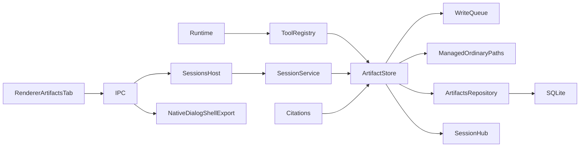

<!--
Copyright (c) 2026 DDP Engineering
This software is licensed under the PolyForm Noncommercial License 1.0.0.
Commercial use requires a separate commercial license.
See the LICENSE.txt in the .agentic folder for full license details.
SPDX-License-Identifier: LicenseRef-PolyForm-Noncommercial-1.0.0
-->

# TASK-c8957b24 - WP-19 Session artifacts

stage: done
type: feature
path: full
interaction: autopilot
requirements: REQ-FUNC-bf809842, REQ-DATA-e3d4d5ba, REQ-FUNC-997412a4, REQ-FUNC-b3d37df6, REQ-SEC-86010eb5, REQ-FUNC-5ece91b7, REQ-FUNC-8c00fdea, REQ-UX-76d958ce, REQ-REL-da260a86
parent:
branch: master
base: b83a45bcd58d1c93a8afa8dd94ca15caf01c28e0
opened: 2026-10-12

## Done checklist (current stage)

- [x] validated candidate confirmed unchanged
- [x] validation results, exact55path diff, exclusions and local outcome presented
- [x] standing human authority confirms coordinator local master commit
- [x] journal/report included in selected delivery candidate
- [x] local delivery commit prepared by coordinator
- [x] close-out carried by the single local delivery commit

## Frame

Problem: STATED agent outputs need durable session artifacts that users can open, reveal and export.
Desired outcome: STATED implement Gitea #19 and every WP-19 Done criterion.
Actors: agent, session user, core session host, desktop main and renderer, headless CLI.
Primary scenario: save-artifact replay -> sequential artifact_save -> UTF8 file and metadata/event -> validated citation and Artifacts viewer/export.
Examples: summary.md with [[artifact:summary.md]] resolves; missing.md remains invalid.
Counterexamples: traversal/reserved names, existing name without overwrite, >5MiB UTF8, symlinked storage, foreign session, closed/read-only workbench.
In scope: tool, confined managed storage/repository/event, artifact refs/citations, strict IPC list/open/reveal/export, panel, fixture and relevant docs/tests.
Out of scope: WP20..38, epics39..44, cycle/automation/Gitea mutations, visual retouches, staging/commit/publication, user optional-companions and preview.
Constraints: master/base b83a45bcd58d1c93a8afa8dd94ca15caf01c28e0; autopilot; coordinator exclusively commits. Electron baseline/vera://app/import/security/secret/ownership contracts preserved. Targeted policy02_Tools/verification-policy.md plus strict static and both independent reviews; full gates remain due after21/29/33/38/final.
Success signals: explicit unit/integration/native Electron/browser/CLI evidence on Windows and fresh native Ubuntu; final complete-candidate reviews and byte manifests.
Evidence: STATED delegation and AGENTS authority; OBSERVED clean master/HEAD/history, 18 done journals/no WP19, human SHA256 verified; schema1 artifacts already exists in core storage/migrations/0001_initial.ts; artifact.saved already in shared events/reducer; registry filters session class in SessionService.send; existing deletion confined ancestor checks. Architecture03§4,02§8–10,05§7,06§3 and reference reporting.ts read.
Assumptions: INFERRED 5MB follows existing grep byte convention5*1024*1024; storage is application-managed namespace exception to general file tool .vera prohibition, session permission class stays available in read-only session mode while read-only workbench cannot mutate.
Unknowns: no decision-blocking product unknowns; filesystem/SQL cannot form a cross-resource transaction, recovery constraints recorded at design.
Decision-blocking questions: none.
Proposed behaviors: bounded name/content save/overwrite, metadata and artifact.saved; session-only issued refs; validated IPC with confined native actions; live list/open/export/reveal, session cleanup.
Path and reason: full; observable behavior=no quick; new interface=yes; data format=no new schema; dependency=no new; existing requirement alone=no; security/data handling changes=yes. Tightly coupled parent, independent reviewers only.

## Requirement coverage

Behavior inventory and one-to-one atomic coverage (trigger/response/positive/failure/oracle):

| Frame outcome | Atomic behavior | Requirement | Positive case | Boundary or failure | Verification | Design decision or no impact |
|---|---|---|---|---|---|---|
| Save bounded session artifacts | save the content sequentially and return its artifact reference and byte count, refusing invalid names, oversize content and an existing name unless overwrite is true. | REQ-FUNC-bf809842 | Real SessionService/registry replay saves empty/Unicode/exact-limit content | Real SessionService/registry replay saves empty/Unicode/exact-limit content; invalid/traversal/device names, UTF8 overlimit and duplicate calls produce actionable isError; ask/read-only session mode needs no approval. | packages/core/src/sessions/artifacts.test.ts | see Design/REQ-FUNC-bf809842 |
| Persist artifact metadata and saved events | persist its art_ULID metadata with session/name/MIME/UTF8 byte count/SHA256/description/UTC time and emit a durable artifact.saved event after the metadata commit. | REQ-DATA-e3d4d5ba | Real SQLite repository rows and replay events survive service restart | Real SQLite repository rows and replay events survive service restart; overwrite preserves identity and replaces bytes/hash/description/time, session isolation and cascade checked. | packages/core/src/sessions/artifacts.test.ts | see Design/REQ-DATA-e3d4d5ba |
| Resolve session artifact citations | mark it valid only when the same session issued that reference from a successful tool result and its current confined stored artifact exists. | REQ-FUNC-997412a4 | Replay save-artifact.jsonl saves summary.md: summary citation true, missing false | Replay save-artifact.jsonl saves summary.md: summary citation true, missing false; fabricated, foreign-session, removed and symlink artifact refs false; parser roundtrip and invalid names. | packages/shared/src/refs.test.ts, packages/core/src/sessions/artifacts.test.ts | see Design/REQ-FUNC-997412a4 |
| Expose validated artifact reads | return strict session-scoped metadata or bounded verified UTF8 content through shared IPC schemas. | REQ-FUNC-b3d37df6 | Strict schemas reject extra keys and malformed IDs | Strict schemas reject extra keys and malformed IDs; service lists ordered own rows, opens matching files, missing/closed lifetime fail and secret responses scrub. | packages/shared/src/artifacts-ipc.test.ts, packages/core/src/sessions/artifacts.test.ts | see Design/REQ-FUNC-b3d37df6 |
| Confine managed artifact storage and lifecycle | confine ordinary files to the current workbench .vera/artifacts/session namespace with ownership/lifetime checks and remove that session folder when the session is deleted. | REQ-SEC-86010eb5 | Real FS/SQLite tests reject redirected ancestors/files and aliases, forged paths and ownership loss | Real FS/SQLite tests reject redirected ancestors/files and aliases, forged paths and ownership loss; deletion cascades only own metadata and removes folder; read-only workbench preserves bytes. | packages/core/src/sessions/artifacts.test.ts, e2e/artifacts.spec.ts | see Design/REQ-SEC-86010eb5 |
| Reveal session artifacts | pass its freshly verified confined ordinary-file path to the native shell. | REQ-FUNC-5ece91b7 | Injected shell receives only verified path | Injected shell receives only verified path; missing/symlink/closed storage fails; native IPC succeeds for saved summary. | apps/desktop/src/main/artifacts.test.ts, e2e/artifacts.spec.ts | see Design/REQ-FUNC-5ece91b7 |
| Export session artifacts | write the verified artifact UTF8 bytes to that destination, leaving files unchanged when the dialog is cancelled. | REQ-FUNC-8c00fdea | Injected dialog/write tests cover cancellation, UTF8 bytes, absent/redirected source and lifecycle held | Injected dialog/write tests cover cancellation, UTF8 bytes, absent/redirected source and lifecycle held; native export uses compiled VERA_TEST_DIALOG_PATH and production compile test omits the switch. | apps/desktop/src/main/artifacts.test.ts, e2e/artifacts.spec.ts, tests/tooling/build-mode.test.ts | see Design/REQ-FUNC-8c00fdea |
| Present session artifacts and text viewer | display its artifacts with sizes/times and a selectable Markdown or plain-text viewer with Export and Reveal actions. | REQ-UX-76d958ce | Component/native/browser tests exercise empty/multiple state, Unicode text/Markdown inert HTML, actions, minimum geometry and en/ro/de translations. | Component/native/browser tests exercise empty/multiple state, Unicode text/Markdown inert HTML, actions, minimum geometry and en/ro/de translations. | apps/desktop/src/renderer/components/session/artifacts-tab.test.ts, e2e/artifacts.spec.ts | see Design/REQ-UX-76d958ce |
| Refresh and isolate artifact views | refresh from durable state and keep late asynchronous results scoped to their originating selection. | REQ-REL-da260a86 | Component tests keep mounted list live across save/overwrite/replay, switch sessions with pending reads/actions, handle errors/retry and unsubscribe | Component tests keep mounted list live across save/overwrite/replay, switch sessions with pending reads/actions, handle errors/retry and unsubscribe; native restart retains list/content. | apps/desktop/src/renderer/components/session/artifacts-tab.test.ts, e2e/artifacts.spec.ts | see Design/REQ-REL-da260a86 |

## Design

Requirements coverage: FUNC-bf809842 -> tool schema and sequential registry; DATA-e3d4d5ba -> repository/save transaction; FUNC997412a4 -> pure refs plus store-backed citations; FUNCb3d37df6 -> shared metadata/schemas/service/main; SEC86010eb5 -> managed ordinary-path guard/ownership/queue/deletion; FUNC5ece91b7 -> core verify then synchronous native reveal; FUNC8c00fdea -> native dialog then refreshed verified export; UX76d958ce/RELda260a86 -> keyed Query/list/view/action/live state and i18n.
Responsibilities: core artifacts/store owns managed files + existing SQLite rows through repository, ToolContext optional artifact host binds session/queue/clock/assertWritable/record; SessionService binds host, retains session tools in catalog, validates citations and exposes list/open/verified-path. Shared owns pure refs/name/schema. Main owns dialog/shell/export and lifetime; renderer only shared API/Markdown.
State/execution: per-workbench WriteQueue admission; synchronous bounded5MiB FS segment prevents JavaScript await races between guard/revalidation/mutation. Save has exclusive temp0600/fsync/rename followed by SQLite metadata/event transaction. Failure restores old bytes under verified ancestors; read rejects content hash/size mismatch after crash. Reuse current schema1, immutable initial SQL unchanged, no dependency/build migration.
Security: ordinary canonical .vera/artifacts/session ancestors, ordinary single-link files, device/name portable checks; read bounded and hash-checked; injected host scrub rejects secret-bearing save input and main scrubs outputs/export. Workbench read-only/closed/token checks throughout. Session class no approval, existing host policy seam preserved without write-policy bypass. Renderer baseline unchanged. Export user picks external target, managed runtime destinations refused.
Concurrency: runtime already sequences non-read classes; artifact writes and deletion share queue, active session deletion BUSY, SessionsHost serial holds dialog/lifecycle and source rechecked after async native picker. Other sessions isolate metadata/file paths. Stop checks before admission/mutation.
Alternatives: generic PathGuard cannot write .vera (ignore contract); use narrow managed guard. New schema/pending migration unnecessary; hash-checks conservatively contain cross-resource crash mismatch, explicit overwrite repairs. Sync FS bounded segment avoids widening general tool operations; existing SQL remains sync.
Test seams: real temp FS/SQLite/replay for core; strict shared; injected main native actions; browser mock/component and native Electron restart/export/delete; CLI actual compiled process fixture. Named test selection decided against complete diff before reviews, broad/uncertain effects trigger full policy escalation.
Expected files: artifacts store/repository/tool, registry/context/service/citations/core exports; shared artifacts/refs/IPC/exports; main artifacts/index; renderer tab/Shell/App/mocks/styles/locales; save fixture; existing consumer tests/new targeted tests/e2e and relevant docs/knowledge.
Risks: bounded sync FS stall on unusually slow disk (ordinary local storage contract); FS/SQL crash mismatch refused; native OS external replacements have same inherent pathname syscall race as existing managed writes. Open decisions: none.

### Proposed architecture - TASK-c8957b24

## Log

- 2026-10-12 frame: <scope agreed, exclusions, chosen path and why>

- 2026-10-12T10:12:53.111024+00:00 frame: full scope accepted in autopilot under standing delegated user authority; master/base confirmed, no duplicate WP19. User file hash matches, untouched; preview excluded. Readiness Windows exit0. Independent reviewers only; roles/policy in Rulings.

- 2026-10-12T10:15:59.562115+00:00 specify: nine atomic draft requirements and exact artifact protocol/storage/UI spec written; one-to-one inventory covers positive/boundary/failure/restart. No existing requirement retired or weakened.

- 2026-10-12T10:15:59.631091+00:00 design: narrow managed ArtifactStore over existing schema1/event/queue, strict refs and IPC, lifetime-held native export/reveal and keyed renderer. No dependency/migration; full-path design/risks/atomic coverage audited.

- 2026-10-12T10:21:18.439038+00:00 build red: FUNCbf809842/DATAe3d4d5ba/FUNC997412a4/FUNCb3d37df6/SEC86010eb5; command=python ../02_Tools/npmw.py npx vitest run packages/core/src/sessions/artifacts.test.ts packages/shared/src/artifacts-ipc.test.ts; exit1; four expected failures: artifact_save absent, artifact channels absent, listArtifacts absent, unavailable duplicate error. Original core-red streams/receipt retained; existing symlink deletion negative passes.

- 2026-10-12T10:24:23.404313+00:00 build green: core-green-1 exit0 2files5tests proves artifact_save bounds/duplicate/modes, metadata/event/overwrite/isolation, script citations/restart/deletion and strict IPC/refs. build red FUNC5ece91b7/FUNC8c00fdea: python ../02_Tools/npmw.py npx vitest run apps/desktop/src/main/artifacts.test.ts; main-red exit1 3 expected missing reveal/export/cancel/confinement behaviors; originals retained.

- 2026-10-12T10:26:29.696401+00:00 build red UX76d958ce/RELda260a86: python ../02_Tools/npmw.py npx vitest run apps/desktop/src/renderer/components/session/artifacts-tab.test.ts; ui-red-fixture exit1 expected Artifacts placeholder/absent list/view/live behavior. Initial missing mock setup failure retained and not counted as red proof.

- 2026-10-12T10:42:37.346885+00:00 build red SEC86010eb5 ownership boundary: python ../02_Tools/npmw.py npx vitest run packages/core/src/sessions/artifacts.test.ts -t compensation\ after\ ownership; ownership-rollback-red exit1; completed rename was compensated after lost authority. Exact actual argv in receipt; correction rechecks owner before compensation, preserving mismatch refusal when authority is lost.

- 2026-10-12T10:44:38.368603+00:00 build consolidated: ui-main-green exit0 3files10tests; robustness-green-2 exit0 2files10passed1POSIXskip; native artifacts E2E build3 exit0 2tests including real export/restart/delete and translated browser geometry. Expanded consumer proof pending. Original type diagnostics/fixture retries/native failures retained; no tests weakened. Windows file-symlink creation EPERM led to explicit native-POSIX case (Ubuntu), with Windows junction and both-platform hardlink proof. Fresh Ubuntu master/base checkout and new Node/npm dependencies setup0. WP11 previous ten auxiliary losses stay acknowledged; WP05 connected Windows proof does not discharge clean/offline/VC++ obligations dueWP30/WP33/final.

- 2026-10-12T10:50:13.633066+00:00 build completed: expanded focused-build-expanded exit0 9files70passed5namedPOSIXskips; latest build-final-focused exit0 5files21passed1POSIXskip includes ownership compensation correction, build-typecheck-final and boundary-typecheck exit0; public-boundary-green exit0 4tests. Correct ownership red selector is -t "compensation after ownership" (original argv receipt authoritative). Nine requirements activated/path/test-linked and component/context/README reconciled. Evolution reviewed 34 product/docs paths; advisory errors0 with eight inherited journal-header warnings and preexisting WP09 manual live-smoke note. Full unit/CLI plus explicit seven E2E selection saved before both independent reviews; no milestone gate claimed.

- 2026-10-12T10:50:13.684667+00:00 validate round1: semantic scope/security/lifecycle/portability/diff and current diagrams/requirements reviewed; no pending candidate-changing reconciliation. Two independent same-candidate reviews requested before serial final Windows/native Ubuntu proof; max5 fix cycles. Journal reporting metadata excluded from semantic review fingerprint but complete/raw hashes retained.

- 2026-10-12T10:54:45.002690+00:00 validate round1: specification /root/wp19_spec_review approved; implementation quality /root/wp19_quality_review changes_required QUALITY-1 P2. Same frozen af1fcc49 candidate and selection assessed. Export confinement incorrectly treats ..export.md / ..folder children as parent paths; return build for only this finding, invalidate both verdicts, fix cycle1/5 then round2. Reports retained unchanged.

- 2026-10-12T10:55:01.505697+00:00 build red QUALITY-1 / REQ-FUNC-8c00fdea: python ../02_Tools/npmw.py npx vitest run apps/desktop/src/main/artifacts.test.ts -t "refuses managed runtime"; review-export-red exit1 expected rejection instead resolved exported:true for .vera/..export.md; before implementation. Initial anchor archived intact before correction anchor; original stdout/stderr/receipt retained.

- 2026-10-12T10:55:59.124269+00:00 build fix cycle1/5 completed: QUALITY-1 parent detection now requires exact .. or .. plus platform separator. review-export-green exit0 4main tests covers six direct/alias ordinary/dot-prefixed managed targets denied and legitimate outside ..export.md allowed; format exit0. Existing requirements/affected paths/test links/current knowledge already state managed runtime exclusion and remain accurate; no scope/design change.

- 2026-10-12T10:57:57.734753+00:00 validate round2: independent /root/wp19_spec_review and /root/wp19_quality_review both approved exact semantic3ff194c25af9d752e9c592268f605db0751f4720486b615e2f6b53b78bb53818 plus selection-round2. QUALITY-1 resolved; no open findings. One fix cycle used. Final unit/full CLI, strict static, seven selected Electron/browser gates run serially on Windows then fresh native Ubuntu; journal reporting metadata-only update frozen before both-platform source parity. No candidate edits during proof. Original historical17267 files baseline verified before proof; human protected hash intact; native fresh browser install/readiness and both lock pins0.

- 2026-10-12T11:08:26.612372+00:00 validate failure round2 final attempt: Windows unit0 70executions450passed7platformskips (64source files plus6emitted shared duplicates), native Ubuntu unit0 64files446passed2Windows skips; both strict static0. Windows selected7E2E exit1 23passed1failed: chat-ui.spec pathological grep produced artifact_save instead of grep. Error context demonstrates new save-artifact fixture match=.* intercepted replay/auto ahead of ui-grep-bad. Full original failure/trace/processes retained; no deadline relaxation or acceptance. Return build for VALIDATION-1 fixture matching only; invalidate both reviews and all final acceptance pending fresh proof on corrected candidate. Fix cycle2/5; next review round3. Original strict observed9journal warnings includes temporary own Handoff active marker, to correct now to valid ready; eight historical warnings/1WP09note inherited.

- 2026-10-12T11:08:46.738618+00:00 build red VALIDATION-1 / REQ-FUNC-bf809842 and preserved replay consumer contract: python ../02_Tools/npmw.py npx vitest run packages/core/src/sessions/artifacts.test.ts -t "artifact fixture preserves automatic"; replay-selection-red exit1 expected ui-grep-bad, received save-artifact. Exact scripts from real fixture directory; before fixture correction. Prior correction anchor/evolution preserved before next epoch.

- 2026-10-12T11:10:05.883339+00:00 build fix cycle2/5 green: save-artifact.jsonl match narrowed to (?i)save.*(?:artifact|summary). replay-selection-green exit0 9passed1namedPOSIXskip in core artifacts tests; actual directory routes pathological/normal grep to their original scenarios and Save summary to artifact_save. Typecheck/format0; requirement verification and artifacts current knowledge reconciled. No test deadlines or runtime routing logic changed; previous failure was introduced fixture collision and is fully retained. Prior proofs invalidated for current candidate; fresh round3 reviews and all six gates required.

- 2026-10-12T11:12:18.613221+00:00 validate round3: /root/wp19_spec_review and /root/wp19_quality_review independently approved semanticefdca966a53281ab65da39519dd098c7c98987667f4a73988feb777c8a378789 and selection-round3; QUALITY-1 and VALIDATION-1 resolved, no open findings. Two fix cycles used. Final3 gates are all fresh due changed fixture/test/requirement/knowledge; earlier passes are superseded acceptance, original failures retained. Final journal metadata freeze uses valid Handoff ready. Before-proof raw parity includes current journal on Windows/native Ubuntu; source/configuration remain frozen until six gates and archive/evidence audits finish.

- 2026-10-12T11:31:55.270482+00:00 validate final3 completed: all six fresh serial authoritative gates exit0, exact semantic efdca966a53281ab65da39519dd098c7c98987667f4a73988feb777c8a378789 unchanged before/after every gate; 777 raw source files including frozen journal identical on Windows and fresh native Ubuntu. Windows python ../02_Tools/npmw.py npm test: 70 executions,451 passed,7 named platform skips; Ubuntu python3 ../02_Tools/npmw.py npm test: 70 executions,456 passed,2 named Windows skips. Each has64 source test files plus6 emitted shared-test duplicates. Windows skips: Linux PTY allow/deny/interrupt, native SIGINT, POSIX mode preservation, POSIX sibling-prefix confinement, POSIX artifact file-symlink. Ubuntu skips: Windows case alias and mixed-case ignore metadata; complementary platform cases passed. Full CLI suite included,70 actual-process receipts (33 Windows/37 Ubuntu), VERA_TEST absent/network guard true, actual executed index/grep-worker byte hashes verified; expected error cases have expected nonzero exits.

- 2026-10-12T11:31:55.281610+00:00 validate final3 strict: python[3] .agentic/aegis.py check --task TASK-c8957b24 --strict --run --json exit0 on both OS, errors0/eight inherited journal warnings/one WP09 release live-smoke note. Configured lint/typecheck/i18n all exit0; these are static checks, not test-suite results. Lint retains5 Windows/6 Ubuntu preexisting warnings and1 info; Ubuntu extra inherited suppression diagnostic. Selected7 E2E command python[3] ../02_Tools/npmw.py npm run test:e2e -- e2e/artifacts.spec.ts e2e/sessions.spec.ts e2e/approvals.spec.ts e2e/chat-ui.spec.ts e2e/changes.spec.ts e2e/shell.spec.ts e2e/file-tools.spec.ts exit0,24 passed per OS; inherited Rollup Zod annotation and FORCE_COLOR/NO_COLOR warnings only. No full E2E or milestone-gate claim. WP21/M2 and later full gates remain due.

- 2026-10-12T11:31:55.291524+00:00 validate final3 evidence audit: final3-proof-audit.json verifies original separate gate streams, complete strict-child temporary streams,70 CLI process receipts,18 loaded native executions,78 native/browser process captures,73 archives with SHA256/every member, both-platform actual Node24.21.0/Electron/Chromium executable bindings. Worker proof is emitted worker bytes and main Worker URL captured at actual app spawn plus real pathological-worker regression; no Worker-constructor event claimed. Native mirror is fresh vera-wp19-linux-TASK-c8957b24 with new runtime/npm dependencies/browser, no WP18 reuse. Windows/native screenshots artifacts-before-780264ae-f73c-48dd-b429-df433ec02034.png and artifacts-before-4b2fc561-a952-40a5-887d-759e0ff1dbad.png visually inspected: readable37-byte summary, metadata, Markdown, citations, Export/Reveal/status without clipping; browser automated geometry covers en/ro/de,2themes,5scales,minimum1024x640. Nine requirements/Done criteria/current diagrams/evolution reconciled and final round3 independent verdicts both approved. No unresolved new failure; QUALITY-1 and VALIDATION-1 corrected through two fix cycles, no deadlines/test weakening; prior failed attempts retained unchanged.

- 2026-10-12T11:31:55.301564+00:00 validate preservation: final3.preservation.json verifies17267 historical files missing[]/changed[], original WP18 evidence and previous WP19 attempts intact; WP11 ten previously acknowledged auxiliary losses remain acknowledged. Protected optional-companions SHA256=2a69f5b335a53e498b1f8e30fa5adb8096e870e7a12bbc05b0727a03cee72c6b; ui-preview excluded/untouched. WP05 clean/offline Windows and VC++ self-containment obligations remain dueWP30/WP33/final; connected native proof does not discharge them. No source/test/requirement/spec/knowledge edit after final proof; only this journal delivery/reporting metadata may change.

- 2026-10-12T11:31:55.387334+00:00 deliver handback under RULING-001 and standing user delegation:31 modified tracked paths plus24 new candidate paths (55 including journal;54 semantic) contain production artifact tool/store/repository/IPC/UI, tests/fixture,9 requirements/spec and reconciled documentation. Exact complete inventory/diff/evidence in handoff-manifest.json; protected human file and ignored preview/cache excluded from commit. Coordinator exclusively verifies and commits on master/base b83a45bcd58d1c93a8afa8dd94ca15caf01c28e0. Implementation chat leaves stage deliver ready, no staging/commit/push/Gitea/cycle/automation changes. Report-time snapshot is advisory only; no replacement for six final3 gates. Delivery-only journal metadata will be mirrored byte-for-byte and archived separately; proof3-original-journal.md retains exact frozen proof bytes.

- 2026-10-12T11:32:43.707584+00:00 deliver report read: report-time advisory errors0/warnings9/notes1 consists of eight inherited journal warnings plus expected unticked-deliver for coordinator commit/outcome/close-out still pending. Generic report counts56 paths because it includes the excluded protected human file; authoritative candidate inventory is55 paths,31 modified+24 new. No additional validation failure and no candidate edit. Final proof reports eight warnings; report-time metadata advisories are not strict test evidence.

- 2026-10-12T12:04:05.309942+00:00 DEVIATION validate: QUALITY-1 export containment and VALIDATION-1 replay fixture interception required two correction/re-review cycles; accepted after both fixes, independent round3 approvals and all six fresh implementer/coordinator gates. No outstanding defect, scope expansion, weakened assertion or deadline; original failed proof retained.

- 2026-10-12T12:04:05.319832+00:00 coordinator evidence capture incident fully resolved: a root helper destination error temporarily overwrote proof3-source.json; the complete new coordinator capture was preserved separately before recovery. Exact original bytes recovered solely on the pre-incident SHA25657d1b2b40a6d9b4f98af9e29d33db9cbfd3e84ec982c27691e29abc78b36cc69 and120903byte length, using unchanged preserved original source/candidate maps, original journal, selection and review hashes, and a bounded search of the original execution timestamp. No success result, source, receipt or hash was invented or weakened. Corrected helper destination without re-running unchanged gates; original2393indexed files reverified. Full recovery method/observations retained in coordinator-proof-recovery.json; journal-only delivery metadata is the only subsequent candidate delta.

- 2026-10-12T12:04:05.330209+00:00 coordinator semantic review approved: whole journal, all9 active requirements/spec/design, complete55path candidate (31modified24new,54semantic), actual WP19 three Done criteria, relevant architecture03 tool/sequence,02 storage/session/lifetime,05 refs,06 panel and all changed knowledge/context reviewed. Existing schema1/parameterized artifact repository, bounded UTF8 store/ordinary confinement/shared write admission/ownership and rollback, session-issued citations, strict scrubbed IPC, native dialog revalidation/managed-destination exclusion, live keyed list/viewer and late-result isolation conform. No independent implementation child tasks. Both independent round3 verdicts bind semantic efdca966a53281ab65da39519dd098c7c98987667f4a73988feb777c8a378789 and selection-round3; two bounded fix cycles resolved QUALITY-1 export parent-segment guard and VALIDATION-1 fixture routing, no unresolved finding. Baseline Electron/vera://app/sandbox/import/secret contracts preserved; no schema/dependency/policy redesign or unrelated UI retouch. Full unit/integration/CLI selected for cross-consumer runtime/storage/IPC impact; seven affected E2E specs adequate and both reviewers approved coverage; M2 full integrated gate remains due afterWP21.

- 2026-10-12T12:04:05.339240+00:00 coordinator exact acceptance approved: six fresh SERIAL gates exit0, Windows full unit451passed7named platform skips, native Ubuntu456passed2named Windows skips;70runner file executions each,64source plus6emitted shared duplicates. Selected7 Electron/browser specs24passed each. Strict --task TASK-c8957b24 --strict --run --json errors0 on both OS; configured lint/typecheck/i18n each0, nine advisory journal warnings comprise8inherited plus this task pending delivery,1WP09release note. Static proof is not suite proof. Original separate streams/strict child streams/actual CLI process bundles/native main/preload/worker-at-app-spawn/browser processes audited in coordinator-proof-audit.json; worker-constructor event not claimed. All777raw sources/current handoff journal identical before/after six gates on both OS. Actual pinned Node/Electron/Chromium binary bytes independently matched. Both original native screenshots inspected readable summary37bytes/citations/Export/Reveal/status; minimum translated geometry automated. All2393original WP19 indexed evidence and17267historical baseline bytes intact; WP11 prior10aux losses acknowledged. Inherited Biome5Win/6Ubuntu warnings1info and Rollup/colour notices remain explained; no accepted new runtime failure. No full E2E/milestone/release claim; WP05 clean/offlineWindows/VC++ dueWP30/WP33/final unchanged.

- 2026-10-12T12:04:05.348584+00:00 coordinator delivery presentation and standing authority: exact55ticketpaths comprise artifact production code/test/fixture,9requirements/spec, reconciled docs/context/knowledge and journal. Protected human optional-companions, ignored caches/evidence/runtime/generated outputs, cycle state and preview excluded. AGENTS/cycle user delegation and RULING-001 authorize one verified local master commit WP19/#19/TASK-c8957b24 by coordinator, approval persists without another question. Outcome is local commit only; no push/PR/release/Gitea mutation. Review/final-gate findings were corrected through bounded build/re-review, with original failures preserved and no weakened deadlines or test omissions.

- 2026-10-12T12:04:40.649698+00:00 coordinator fresh report read and local close-out: report-time advisory snapshot read, not test evidence; generic report counts56paths including excluded protected human file, exact55ticketpaths authoritative. Both round3 approvals and six exact acceptance gates unchanged. Only journal delivery/report/Handoff/Stage-report metadata differs after proof, original journal retained and final native byte parity archived. deliver7 permits done/close-out in the single local commit where the commit is the complete outcome. Actual commit SHA/path/blob/index/human result is saved atomically after success; failure leaves deliver open. No remote/finalrelease claim.

## Rulings

- RULING-001 | date=2026-10-12 | decision=Autopilot implementation on master, complete unstaged candidate handback; one local ticket commit exclusively by coordinator under standing user authority | reason=AGENTS automated cycle and delegated roles; no publication authority | source=user | supersedes=none
- RULING-002 | date=2026-10-12 | decision=Apply committed targeted verification policy, mandatory static/strict checks and both independent reviews on same final candidate and selected tests | reason=user policy approved2026-10-12; full suites when broad/uncertain and all milestone gates still required | source=user | supersedes=none
- RULING-003 | date=2026-10-12 | decision=Use requested AEGIS directly without BMAD setup | reason=_bmad renderer and sibling setup skill absent, as observed in predecessor; requested product AEGIS scope excludes setup | source=technical | supersedes=none

## Handoff

current: done
status: ready
next: Record actual commit and select next eligible planned ticket
must_read: .agentic/tasks/TASK-c8957b24.md, .agentic/steps/6_deliver.md, 02_Tools/cache/wp19/coordinator-proof-audit.json
blockers: none

## Stage report

stage: deliver
result: completed
current: done
changed: WP19 bounded artifact tool/storage/citations/IPC/viewer/Export/Reveal;55ticketpaths
evidence: six coordinator gates0;Win451/7skip Ubuntu456/2skip;selected E2E24each;strict3staticchecks0;round3approvals
issues:8inherited journal warnings/pending-delivery advisory;WP09note;inherited lint/build notices;WP11 prior10aux loss;clean/offlineWindows/VC++ deferred
next: Record actual commit and select next eligible planned ticket
needs_user: no
spec_compliance: approved
implementation_quality: approved
review_round: 3

## Delivery report (2026-10-12)

- stage: deliver; type: feature; path: full; branch: master
- requirements:
  - REQ-FUNC-bf809842 - Save bounded session artifacts
  - REQ-DATA-e3d4d5ba - Persist artifact metadata and saved events
  - REQ-FUNC-997412a4 - Resolve session artifact citations
  - REQ-FUNC-b3d37df6 - Expose validated artifact reads
  - REQ-SEC-86010eb5 - Confine managed artifact storage and lifecycle
  - REQ-FUNC-5ece91b7 - Reveal session artifacts
  - REQ-FUNC-8c00fdea - Export session artifacts
  - REQ-UX-76d958ce - Present session artifacts and text viewer
  - REQ-REL-da260a86 - Refresh and isolate artifact views
- deviations: none recorded
- explicit review: enabled; spec_compliance=approved; implementation_quality=approved; review_round=3
- diff vs task base b83a45b: 56 file(s) changed, 2521 line(s) added
- checks: errors=0 warnings=9 notes=1
- checklist: 3/6 done; open: journal and report included in the delivery commit (coordinator); agreed outcome delivered: one authorized local ticket commit by coordinator; close-out carried by coordinator delivery commit

## Delivery report (2026-10-12)

- stage: deliver; type: feature; path: full; branch: master
- requirements:
  - REQ-FUNC-bf809842 - Save bounded session artifacts
  - REQ-DATA-e3d4d5ba - Persist artifact metadata and saved events
  - REQ-FUNC-997412a4 - Resolve session artifact citations
  - REQ-FUNC-b3d37df6 - Expose validated artifact reads
  - REQ-SEC-86010eb5 - Confine managed artifact storage and lifecycle
  - REQ-FUNC-5ece91b7 - Reveal session artifacts
  - REQ-FUNC-8c00fdea - Export session artifacts
  - REQ-UX-76d958ce - Present session artifacts and text viewer
  - REQ-REL-da260a86 - Refresh and isolate artifact views
- deviations: 1 recorded
  - validate: QUALITY-1 export containment and VALIDATION-1 replay fixture interception required two correction/re-review cycles; accepted after both fixes, independent round3 approvals and all six fresh implementer/coordinator gates. No outstanding defect, scope expansion, weakened assertion or deadline; original failed proof retained.
- explicit review: enabled; spec_compliance=approved; implementation_quality=approved; review_round=3
- diff vs task base b83a45b: 56 file(s) changed, 2551 line(s) added
- checks: errors=0 warnings=9 notes=1
- checklist: 5/6 done; open: close-out carried by the single local delivery commit
