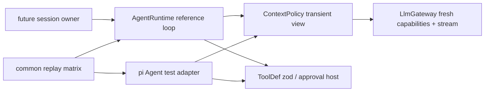

<!--
Copyright (c) 2026 DDP Engineering
This software is licensed under the PolyForm Noncommercial License 1.0.0.
Commercial use requires a separate commercial license.
See the LICENSE.txt in the .agentic folder for full license details.
SPDX-License-Identifier: LicenseRef-PolyForm-Noncommercial-1.0.0
-->

# TASK-dc070e87 - WP-10 Spike agent runtime

stage: done
type: feature
path: full
interaction: autopilot
requirements: REQ-FUNC-27cc4ac0, REQ-FUNC-fa7348bd, REQ-FUNC-1092757e, REQ-FUNC-3b48cda0, REQ-DATA-ec55014b, REQ-REL-4dd25723, REQ-NFR-8767cf78, REQ-DATA-e2eba20d, REQ-REL-20be9104, REQ-FUNC-72e17b0f, REQ-TEST-0abc4146
parent:
branch: master
base: 1b565f974a36642075c65e86f02313f2eaf885da
opened: 2026-10-11

## Done checklist (current stage)

- [x] validated candidate confirmed unchanged; otherwise returned to validate
- [x] validation evidence, exact diff, exclusions and local outcome presented by coordinator
- [x] delivery confirmed by human: standing explicit authorization for one validated local commit per WP
- [x] journal and delivery report included in the selected35path delivery candidate
- [x] agreed outcome prepared: one local WP10 commit on master; no remote publication
- [x] close-out carried by the local delivery commit

## Frame

Problem: STATED WP10 must establish the runtime before session-engine implementation.
Desired outcome: STATED seven replay behavior groups, shared mandatory request budgets, measured pi-agent-core alternative, new ADR and event mapping.
Actors: Engineer; future session engine; core runtime; injected gateway and dummy read/write tools; approval host.
Primary scenario: send user instruction -> stream model -> read batch / approval-bound ordered write -> next bounded request -> terminal event and complete verbatim transcript.
Examples: STATED three large read results in the first turn shrink only in the next request; approval denied yields an error result and continues; stop during approval ends aborted.
Counterexamples: irreducible system/current-user/schema input ends limit with zero gateway calls; transcript reduction must not mutate persisted messages or orphan tool pairs.
In scope: M1 WP10 in full; context policy, reference runtime, pi-agent-core1.1.0 experiment using same replay matrix, zod4 conversion and runtime validation, documentation/ADR/event mapping and current component knowledge.
Out of scope: WP11 real tools, WP13 session persistence/IPC/UI, WP16/17 production permission engine/write queue, WP34/35 steering/advanced compaction; staging/commit/push/publication/Gitea issue/cycle/automation changes.
Constraints: STATED master/base1b565f974a36642075c65e86f02313f2eaf885da; one implementation chat; coordinator alone makes local commit after handback; preserve unrelated optional-companions byte-identically; Node24.21.0/Electron44.7.0/vera origin/security/import boundaries.
Success signals: seven groups chosen runtime; separate approve/deny/abort; complete budget acceptance; two independent approved reviews of same complete uncommitted candidate; strict/full E2E/focused Windows and native Ubuntu with SHA parity and actual receipts.
Evidence: OBSERVED issue10 agrees with M1 WP10; architecture03 sections1/2/6/8 and ADR0003/0010; reference loop/approval/replay/guards; gateway/replay effective APIs and WP09 validated base. OBSERVED pi-agent-core1.1.0 npm tarball actual types expose beforeToolCall, per-tool executionMode and abort; optional BMAD render/setup skill absent, user-selected AEGIS governs this task.
Assumptions: INFERRED approval host seam represents exact prepared changes while production preparation/storage remains WP17. Runtime never performs real file writes in this spike.
Unknowns: UNKNOWN measured alternative behavior until execution; tokenizer absent in current dependencies, conservative UTF8-byte estimate with explicit framing will be labeled estimated.
Decision-blocking questions: none; technical runtime choice/new ADR explicitly authorized.
Proposed behaviors: atomic coverage below, same scripted inputs/oracles for both runtimes, preflight every gateway dispatch and recoverable limit.
Path and reason: full; quick criteria no new observable behavior=no, no new interface=no, no dependency=no, existing complete requirement=no, unchanged data handling=no. No implementation children; two independent review agents during validate only.

## Requirement coverage

| Atomic behavior | Requirement | Setup, trigger, observable oracle and boundary | Design/test seam |
|---|---|---|---|
| Stream runtime messages | REQ-FUNC-27cc4ac0 | Replay multi-chunk text plus calls; observe deltas, final text, call identity and complete transcript; malformed or empty terminal stream ends error. | runtime shared harness / host ports |
| Order tool execution | REQ-FUNC-fa7348bd | Deferred read barriers prove overlap; writes begin after prior reads and one another; completion order differs from persisted source order. | runtime shared harness / host ports |
| Wait for exact tool approval | REQ-FUNC-1092757e | Separate approve/deny replay turns; before decision zero writes; single-consumption gate rejects duplicate or mismatched identity/hash decisions. | runtime shared harness / host ports |
| Abort active turns | REQ-FUNC-3b48cda0 | Stop pending approval, verify no write, error result and aborted terminal event; stream/tool cancellation; next turn remains usable. | runtime shared harness / host ports |
| Resume verbatim transcripts | REQ-DATA-ec55014b | JSON round-trip messages into new instance, next request contains history and prior output, original saved bytes unchanged; interrupted call receives transient result. | runtime shared harness / host ports |
| Return tool failures to model | REQ-REL-4dd25723 | Throwing dummy read and invalid extra arguments produce isError and zero invalid execution; following scripted response completes. | runtime shared harness / host ports |
| Count whole model request | REQ-NFR-8767cf78 | Injected deterministic counter verifies each component, output reserve/safety; smaller changed limits and model selection before next call; usage retains provider actual counts and labels estimates. | context shared harness / host ports |
| Reduce transient tool results | REQ-DATA-e2eba20d | Several large results first turn reduced before next call; inspect retained refs/errors/IDs/pairs, oldest-first behavior and identical persisted content. | context shared harness / host ports |
| Recover from context limit | REQ-REL-20be9104 | Oversized mandatory context records zero gateway calls, limit events and complete history; smaller next instruction succeeds; provider context error does not retry unboundedly. | context shared harness / host ports |
| Adapt zod tool schemas | REQ-FUNC-72e17b0f | Strict dummy read/write schemas round-trip valid samples through pi and zod; extra/invalid values reject before execute. | runtime shared harness / host ports |
| Measure runtime candidates | REQ-TEST-0abc4146 | Automated common matrix executes both engines; inspection correlates observed results, actual upstream hook APIs, adapter effort, SessionEvent mapping and ADR/index. | comparison shared harness / host ports |

## Design

Requirements coverage:11coverage rows route to runtime, context, schema adapter and common experimental harness; exact protocol lives in linked spec.
Component responsibilities: core owns AgentRuntime, ContextPolicy and ToolDef; gateway owns fresh model metadata and safe streams; injected host owns time/IDs and approval. Session storage/IPC/citations and real write queue remain their planned owners.
Interfaces/state: start/send/abort/onEvent/messages per03§2; model string remains a configurable selected reference; detached transcript snapshots and one active AbortController. Approval host receives cloned validated call; it binds prepared change externally.
Flow: reference loop streams, persists assistant, executes contiguous read batches and ordered writes, appends results source-order, then mandatory context policy dispatch. All completed results capped only in transient request. Common counter tests constrain budgets.
Failure recovery: tool exceptions/zod failures become error results; aborted pending gate settles aborted; fill nonexecuted results; partial assistant text retained with no executable partial calls. Gateway context failures end recoverable limit; zero automatic retries. Observer exceptions must not strand state.
Security: no real tools/network/credentials; core Electron-free; zod original validates args; pi Type.Unsafe adapts existing JSON Schema only. Gate mock consumes exact call/request hash once. No baseline desktop changes.
Concurrency: BUSY protects send/start; reads overlap only within contiguous batch; sequential tool barriers; persistence order independent of completion order.
Compatibility: exact pi-agent-core1.1.0 as experiment-only dev dependency and typebox1.3.27 adapter; pi-ai remains1.1.0. Agent hook/stream contract inspected from actual npm tarball. Alternative implementation remains outside production exports.
Observability: runtime events include IDs and raw message completion; future session layer maps lifecycle, citations, approval metadata and seq. Ignored wp10 receipts bind full source and complete candidate hashes.
Test seams: replay temp JSONL with dummy strict-zod read/write, injected counter/capabilities and deferred barriers; same seven groups both engines, additional limit/reserve/config/context tests. Windows/native Ubuntu serial full proof after reviews.
Alternatives/tradeoffs: pi Agent supplies queues/hooks/execution modes but requires gateway event stream conversion and pi transcript baseline handling. Choose after actual measurement, new ADR authorized.
Expected files: core agent/{runtime,types,tool,context}, focused tests and pi test-support; core manifest/lock/barrel; comparison/event-mapping docs,new ADR/index; requirements/spec/task,current knowledge/context.
Risks: conservative estimate rejects more input than tokenizer; opaque provider framing cannot be guaranteed; label estimated and handle context rejection. Native mirror preserve old Git/evidence before updates. No blocking decision.

### Proposed architecture - TASK-dc070e87

## Log

- 2026-10-11 frame: <scope agreed, exclusions, chosen path and why>

- 2026-10-11T16:55:26.237282+00:00 frame: Full path scope accepted under explicit autopilot; master/HEAD/history/status/task inventory match base; no existing WP10. Frame audited, no blocking decisions. Missing optional BMAD auxiliary renderer does not add setup scope; AEGIS user instruction governs.

- 2026-10-11T16:56:19.206954+00:00 specify: Created11atomic requirements, no revisions/reuse/retirements; coverage and shared exact M1 spec audited against all scope/Done when and existing gateway contracts. No blocking behavior unknown.

- 2026-10-11T16:56:45.985406+00:00 design: Full runtime/context protocol and state/concurrency/error ownership audited; actual pi1.1.0 types inspected. All coverage rows have constrained seams; no independent implementation children. Final decision remains measured, not assumed.

- 2026-10-11T16:57:55.604918+00:00 build red REQ-NFR-8767cf78/DATA-e2eba20d/REL-20be9104: python ../02_Tools/npmw.py npx vitest run packages/core/src/agent/context.test.ts exit1; explicit M1 context policy existence assertion fails before import; windows-context-red raw receipt retained.

- 2026-10-11T17:00:20.967899+00:00 build green context4tests exit0 windows-context-green; build red runtime/schema REQ-FUNC-27cc4ac0/fa7348bd/1092757e/3b48cda0/72e17b0f,DATA-ec55014b,REL-4dd25723: python ../02_Tools/npmw.py npx vitest run packages/core/src/agent/runtime.test.ts exit1 explicit AgentRuntime existence assertion before import, windows-runtime-red retained.

- 2026-10-11T17:04:04.265307+00:00 build red comparison REQ-TEST-0abc4146: python ../02_Tools/npmw.py npx vitest run packages/core/src/agent/pi-spike.test.ts exit1 explicit measured adapter existence assertion windows-pi-red. Consolidated green common replay/context/schema suite27tests4files exit0 windows-matrix-green2; reference all7groups pass, pi mixed reads peak1 and sequential-abort trailing unanswered call measured explicitly. Zod JSON Schema carries hidden StandardSchema functions copied by Type.Unsafe; serialize to pure JSON first, preserving ADR0010 and complete strict schema. Original failed candidate run/typecheck and diagnostic retained, corrected without oracle/timeout changes. All requirement links active.

- 2026-10-11T17:05:27.777263+00:00 build red streaming/tool safety REQ-FUNC-27cc4ac0/3b48cda0/REL-4dd25723: python ../02_Tools/npmw.py npx vitest run packages/core/src/agent/runtime-edge.test.ts exit1,2failed5passed; streamed abort text lost and length-truncated tool args executed. windows-edge-red retained; fix before further validation.

- 2026-10-11T17:07:09.041629+00:00 build green edge and common matrix31tests4files exit0 windows-edge-green; partial abort retained text-only and truncated tool arguments refused without execution, signal execution cancellation/context rejection/output reserve/usage/interrupted pairs/cap covered. Typecheck exit0 windows-types-build2 prior to edge change; final candidate still requires fresh proof. Comparison and newADR0014 confirm reference from actual pi mixed-batch/abort gaps; event mapping documented. Knowledge/context/spec/requirement links reconciled to observed implementation.

- 2026-10-11T17:09:40.864391+00:00 validate semantic reconciliation: complete candidate including untracked reviewed against base, no unexpected paths, protected unrelated file unchanged; component/context diagrams and requirements match built code. Native previous checkout HEAD36a1a06 and535Git-visible files preserved with verified archiveSHA74c2afcd6dde61d77354d14386057221f6f63e418a791ba3541a1e218d362ef9; WP09 evidence hashes preserved. Native sources561paths aligned to base with parity, independent npm dependencies installation underway. Source TypeScript focused build proof exit0 windows-types-validation; final gates remain pending. Optional review round1 follows final documentary reconciliation.

- 2026-10-11T17:11:10.796371+00:00 validate native readiness and focused: Linux native /home mirror Node24.21.0 with independent dependencies; setup --check exit0 and same34tests5files exit0 linux-build-focused. VITEST_MAX_WORKERS=1 is the supported resource-count setting used in WP09; no test filtering/timeout/guard/internal-concurrency change. Native npm ci exit0 reports8moderate audit findings and upstream deprecation/install-script notices; no dependency auto-fix or allowScripts changes. Final complete strict/E2E proof still pending reviews.

- 2026-10-11T17:13:37.537276+00:00 validate round1: Independent spec changes_required (SPEC-1 direct request budget; SPEC-2 deterministic reverse-read/asynchronous-write barriers), original SHA4cc0fe67b0afa37e5731ae0f09f5cafa69ef6a7aca5778bc045bcc30f1e4a180; quality changes_required (QUALITY-1 incomplete stream EOF loses text, QUALITY-2 same budget oracle), original SHAbb1a814b014e98da7e058690acdd1c1bfb74eb4975e346a1439bfe66c669e8e0. Both bound candidate b4c1a1655b0054912b24146e011c4523c0f7e7c52e329badab7910e2cdac16f0 and all34 hashes; originals preserved. Return build fix cycle1 only these findings; both verdicts cleared.

- 2026-10-11T17:14:20.412400+00:00 build red review QUALITY-1 / REQ-FUNC-27cc4ac0: python ../02_Tools/npmw.py npx vitest run packages/core/src/agent/runtime-edge.test.ts exit1,1failed7passed; terminal EOF after text leaves user as last transcript entry instead of preserved assistant, windows-review1-red receipt.

- 2026-10-11T17:15:11.369664+00:00 build fix cycle1: QUALITY-1 retains partial text on terminal EOF, red then focused32tests4files exit0 windows-review1-green. SPEC-1/QUALITY-2 now measure captured raw request/output reserve and explicitly reject unreduced oversized request; SPEC-2 uses deferred reverse-read completion/source-order persistence and asynchronous write barriers in the same common matrix, pi mixed gap retained. No scope change or weakened oracle.

- 2026-10-11T17:15:27.545770+00:00 validate round2: Re-read all11 active requirements and shared spec; corrected oracles match existing contracts. Current knowledge architecture and context remain accurate; complete candidate review includes34 paths plus journal, evolution lists4 corrected paths since review fix anchor while complete base manifest covers all changes. No added scope or relevant accepted failure. Both independent reviews rerun against fresh same candidate.

- 2026-10-11T17:16:59.474687+00:00 validate independent round2: Both current original verdicts approved, same complete34-path candidateSHA30ce998eb6c4bbaa27c7a5dc2de1bc1a0f0bac5535159c3b933f2469ddaa177c. Spec original SHAd5b6d2db4b6b18657bced9c04ed6ead9c37118fbcfd403c1d9445c267510c1bf, quality original SHAc88456a50373f6508cf127d8f8067dddbcf984a78d3f31053ffa5c1ab8772913; no outstanding findings, one fix cycle used. Inspection: actual pi Agent hooks/executionMode/abort and common matrix observed, comparison/event mapping enumerates all RuntimeEvents with future SessionEvent ownership; newADR0014/index matches reference selection. Component diagrams/current contexts agree; source/security/import baseline unaffected. Native prior535files/archive and27WP09 evidence hashes verified unchanged, protected optional file hash identical.

- 2026-10-11T17:24:32.775131+00:00 validate final consolidated proof: All6 serial gates actual exit0 on same complete candidateSHA30ce998eb6c4bbaa27c7a5dc2de1bc1a0f0bac5535159c3b933f2469ddaa177c with before/after full-source SHA equality and native parity. Windows/Ubuntu focused python ../02_Tools/npmw.py npx vitest run [8 exact selectors in windows-final-focused/linux-final-focused.execution.json] both58tests8files. VERA_TEST=1 python ../02_Tools/npmw.py npm run test:e2e both15passed, native Electron via xvfb-run on Ubuntu. Final python .agentic/aegis.py check --task TASK-dc070e87 --strict --run Windows and native Ubuntu exit0, both configured full commands executed: test=python ../02_Tools/npmw.py npm test; lint=python ../02_Tools/npmw.py npm run verify (Biome,tsc,i18n,fulltest). VITEST_MAX_WORKERS=1 only resource count; no selection/timeout/guard/internal concurrency change. Raw *.log and actual *.execution.json receipts record UTC/commands/cwd/env/return codes/log SHA and complete candidate/source hashes; exact counts available in handoff.json. Remaining advisory warning is unchanged WP09 malformed RULING-004, and manual reminder belongs to previously validated WP09; no WP10 warning/error accepted. Upstream zod Rollup annotation removal and NO_COLOR/FORCE_COLOR messages are non-failing notices; baseline pins unchanged. Native npm ci8moderate audit notices retained without auto-fix. No verification skipped or weakened. Complete semantic inventory34paths plus journal, protected optional excluded; no scope additions. Final evolution describes4 review-corrected paths since fix anchor, complete base manifest covers all34. Two original independent round2 approvals still current.

- 2026-10-11T17:24:33.071817+00:00 deliver: Candidate confirmed unchanged after final proof and independent reviews. Implementation-chat handback authorized in explicit delegation; no staging/commit/push/PR/Gitea/automation/cycle mutation. Coordinator alone verifies and makes authorized local commit, then closes task. Report-time advisory snapshot follows; it does not replace final native-platform proof.

- 2026-10-11T17:25:16.912830+00:00 deliver report read: report-time advisory errors0 warnings2 notes1 (unchanged WP09 malformed ruling plus expected open delivery checklist). Report diff36 includes protected unrelated optional-companions; exact authorized WP10 inventory35 =9modified26added, no removals, protected file excluded. Final strict raw CLI reports both configured commands actual successes but does not expose complete-suite test totals; no successful full-suite counts invented. Final focused58 and E2E15 counts are observed perOS. Commit/close-out deliberately pending coordinator. Only this mutable journal record follows validated candidate; both review-bound candidate and full-source SHA remain unchanged.

- 2026-10-11T17:41:19.064315+00:00 coordinator validate: Full journal, all11active requirements/spec, complete34nonjournal base diff plus journal, touched knowledge/context and architecture reviewed; no blocking scope/semantic/import/security issue. Independent round2 original spec/quality approvals and author provenance verified; one fix cycle used. Read-only evidence auditor independently verified35inventory hashes,560source/native equality,76raw evidence hashes, preserved535entry native archive and27WP09 evidence; protected optional file byte-identical. Seven chosen-runtime replay groups, separate approve/deny/abort, bounded whole-request accounting and transient pairing, actual pi measurement, zod conversion, event mapping and ADR0014 inspected against acceptance. No visible implementation children; implementing chat idle. Fresh six serial coordinator commands actual exit0: focused8selectors58tests eachOS; VERA_TEST=1 npm run test:e2e15passed eachOS; final aegis check --task TASK-dc070e87 --strict --run executes configured test and lint in full eachOS. Repository-local runtime/native Ubuntu dependencies; VITEST_MAX_WORKERS=1 affects resource count only, guards/timeouts/selections/internal concurrency unchanged. Source fingerprint560paths aaa47eed682a0bcec8482fe64e931e66738a76df2ad3dd782c110c0b3a6de0f2 unchanged before/after all6gates (coordinator receipt candidateBefore/After names carry this fullSource fingerprint); reviewed34path candidate30ce998eb6c4bbaa27c7a5dc2de1bc1a0f0bac5535159c3b933f2469ddaa177c unchanged. Receipts/logs: ignored02_Tools/cache/wp10/*-coordinator-final.execution.json and *.log, actual argv/cwd/environment/UTC/returncode/stdoutSHA; strict captured success without invented full-test totals. Remaining advisory WP09 malformed ruling/manual reminder pre-existing; no WP10 error accepted; Rollup zod annotation/color notices non-failing. Native npm audit8moderate historical install notices retained without auto-fix. Clean/offline Windows and CRT obligations preserved for WP30/WP33/finalrelease.

- 2026-10-11T17:41:19.064377+00:00 coordinator deliver approval/presentation: Explicit user cycle and root AGENTS authorize coordinator one local validated commit per WP on master. Concrete reviewed/proved35paths=9modified26added0removed will be committed with task/issue/requirements; excludes unrelated00_Planning/optional-companions.md, ignored cache/runtime evidence and cycle administration. Both original current round2 verdicts approved, source unchanged, no independent implementation children. Standing authority resolves the local delivery boundary; push/PR/Gitea/publication excluded. No new permission question or deviation; local commit is the whole outcome. Report follows before close-out per6_deliver; candidate source/tests/requirements/spec/knowledge untouched.

- 2026-10-11T17:41:28.685928+00:00 coordinator deliver report read: Appended fresh report reviewed; diff includes unrelated protected optional file, exact selected inventory remains35paths and that path excluded. Report-time advisory is not runtime proof. Local-only outcome close-out prepared before single commit as6_deliver step7 requires; no source change after proof, no push/PR/release/Gitea action. Actual commit SHA and35path Git verification recorded in cycle state after commit succeeds; a failure returns header to deliver.

## Rulings

- RULING-001 | date=2026-10-11 | decision=Autopilot on master; user authorizes autonomous implementation and coordinator local commit; implementation chat hands back without staging/commit/publication | reason=Explicit delegation and AGENTS | source=user | supersedes=none
- RULING-002 | date=2026-10-11 | decision=Exclude optional-companions and cycle state; preserve native prior checkout/evidence before synchronization; serial native-platform gates | reason=Explicit delegation | source=user | supersedes=none
- RULING-003 | date=2026-10-11 | decision=Current Windows and native Ubuntu verification; clean/offline Windows and CRT remain WP30/WP33/finalrelease obligations | reason=Explicit user scope | source=user | supersedes=none

## Handoff

current: done
status: ready
next: Record actual local commit and select next eligible WP in coordinator cycle
must_read: .agentic/tasks/TASK-dc070e87.md
blockers: none

## Stage report

stage: deliver
result: completed
current: done
changed: WP10 runtime/context; pi comparison; ADR0014;11requirements;35paths
evidence: Coordinator focused58/E2E15 perOS and configured strict exit0 perOS; both original round2 approvals
issues: Historical WP09 advisory; clean Windows/CRT obligation retained for final release
next: Record local commit and start next eligible work package
needs_user: no
spec_compliance: approved
implementation_quality: approved
review_round: 2

## Delivery report (2026-10-11)

- stage: deliver; type: feature; path: full; branch: master
- requirements:
  - REQ-FUNC-27cc4ac0 - Stream runtime messages
  - REQ-FUNC-fa7348bd - Order tool execution
  - REQ-FUNC-1092757e - Wait for exact tool approval
  - REQ-FUNC-3b48cda0 - Abort active turns
  - REQ-DATA-ec55014b - Resume verbatim transcripts
  - REQ-REL-4dd25723 - Return tool failures to model
  - REQ-NFR-8767cf78 - Count whole model request
  - REQ-DATA-e2eba20d - Reduce transient tool results
  - REQ-REL-20be9104 - Recover from context limit
  - REQ-FUNC-72e17b0f - Adapt zod tool schemas
  - REQ-TEST-0abc4146 - Measure runtime candidates
- deviations: none recorded
- explicit review: enabled; spec_compliance=approved; implementation_quality=approved; review_round=2
- diff vs task base 1b565f9: 36 file(s) changed, 2287 line(s) added
- checks: errors=0 warnings=2 notes=1
- checklist: 4/6 done; open: journal and report included in delivery commit (coordinator pending); close-out carried by coordinator local delivery commit after verification

## Delivery report (2026-10-11)

- stage: deliver; type: feature; path: full; branch: master
- requirements:
  - REQ-FUNC-27cc4ac0 - Stream runtime messages
  - REQ-FUNC-fa7348bd - Order tool execution
  - REQ-FUNC-1092757e - Wait for exact tool approval
  - REQ-FUNC-3b48cda0 - Abort active turns
  - REQ-DATA-ec55014b - Resume verbatim transcripts
  - REQ-REL-4dd25723 - Return tool failures to model
  - REQ-NFR-8767cf78 - Count whole model request
  - REQ-DATA-e2eba20d - Reduce transient tool results
  - REQ-REL-20be9104 - Recover from context limit
  - REQ-FUNC-72e17b0f - Adapt zod tool schemas
  - REQ-TEST-0abc4146 - Measure runtime candidates
- deviations: none recorded
- explicit review: enabled; spec_compliance=approved; implementation_quality=approved; review_round=2
- diff vs task base 1b565f9: 36 file(s) changed, 2313 line(s) added
- checks: errors=0 warnings=2 notes=1
- checklist: 5/6 done; open: close-out carried by the local delivery commit
