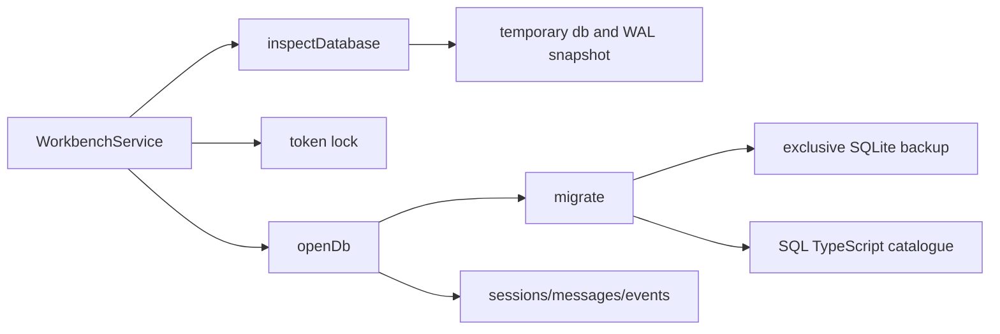

<!--
Copyright (c) 2026 DDP Engineering
This software is licensed under the PolyForm Noncommercial License 1.0.0.
Commercial use requires a separate commercial license.
See the LICENSE.txt in the .agentic folder for full license details.
SPDX-License-Identifier: LicenseRef-PolyForm-Noncommercial-1.0.0
-->

# TASK-e31aaf47 - WP-07 Workbench database and migrations

stage: done
type: feature
path: full
interaction: autopilot
requirements: REQ-PLAT-f0d13546, REQ-DATA-9dbda56e, REQ-DATA-d137ab0e, REQ-DATA-ac2dc07a, REQ-DATA-73e0309d, REQ-DATA-bc498301, REQ-DATA-40c94e08, REQ-DATA-ee009054, REQ-REL-b7f1889b
parent:
branch: master
base: cf5cdadb63ae9b17d409ae89615222e750aee5b7
opened: 2026-10-11

## Done checklist (current stage)

- [x] validated candidate confirmed unchanged; otherwise returned to validate
- [x] validation evidence, diff, exclusions, and outcome presented
- [x] delivery confirmed by the human
- [x] journal and report included in the delivery commit
- [x] agreed outcome delivered, normally a PR
- [x] close-out committed after the outcome succeeded, or carried by the
      delivery commit where nothing could fail after it

## Frame

Problem: STATED workbench sessions need durable local storage and safe upgrades.
Desired outcome: STATED checksummed SQLite migrations, backups and three first repositories.
Actors: workbench opener and core storage callers.
Primary scenario: open folder -> check compatibility -> acquire ownership -> migrate -> usable repositories.
Examples: new folder reaches schema1; schema2 file is refused unchanged; migration2 preserves schema1 backup.
Counterexamples: a live foreign lock must never cause SQLite or backup writes in its runtime directory.
In scope: db/migration modules, initial ten domain tables plus meta, sessions/messages/events repositories, lifecycle integration, real-driver tests and documentation.
Out of scope: FTS/embeddings, session engine, provider/tools, unrelated optional-companions, cycle administration, staging/commit/publication.
Constraints: STATED master/base cf5cdadb63ae9b17d409ae89615222e750aee5b7; Windows and native Ubuntu identical sources/separate dependencies; token ownership and failed switch preserved.
Success signals: five issue Done-when cases plus lifecycle regression and exact final candidate proof.
Evidence: OBSERVED issue7 matches M1 WP07; 02-workbench §9 and 07-packaging §6 mandate newer refusal/backups; ADR0013 confirms better-sqlite3 13.0.3; existing service implements token/guard ownership.
Assumptions: INFERRED migration checksum keys use migration_<four-digit-version>_sha256; backup suffix is pre-migration version.
Unknowns: no blocking product unknowns; future session engine interfaces remain out of scope.
Decision-blocking questions: none.
Proposed behaviors: compatibility check, ordered transactional migrations, complete pre-step backups, row repositories and owned lifecycle cleanup.
Path and reason: full; persisted format and data handling are new. Quick criteria: external behavior no; existing format no; dependency no; existing covering requirement no; unchanged data handling no. One tightly coupled task, no child implementation.

## Requirement coverage

| Outcome | Atomic behavior | Requirement | Positive case | Boundary | Verification | Design |
|---|---|---|---|---|---|---|
| Configure workbench SQLite | When an owned workbench database opens, core shall configure better-sqlite3 13.0.3 with WAL, foreign_keys ON, busy_timeout 5000 and synchronous NORMAL. | REQ-PLAT-f0d13546 | Open a real file; inspect all four pragmas; close and reopen. | error/invariance checks | real driver db.test.ts | storage/lifecycle design |
| Apply ordered workbench migrations | When supported workbench data opens for writing, core shall apply pending contiguous TypeScript SQL migrations transactionally and record their SHA256 and schema version in meta. | REQ-DATA-9dbda56e | Fresh/reopen, out-of-order catalogue, failed SQL rollback, initial schema/index introspection. | error/invariance checks | real driver db.test.ts | storage/lifecycle design |
| Refuse changed applied migrations | If an applied migration SQL checksum changes or is missing, core shall refuse opening the database with a checksum error. | REQ-DATA-d137ab0e | Apply initial SQL then change it or remove its meta checksum; compare database bytes after refusal. | error/invariance checks | real driver db.test.ts | storage/lifecycle design |
| Back up before each migration | Before each pending workbench database migration, core shall preserve the complete previous database in .vera/backups/vera.db.v<n>.bak, where n is its previous schema version. | REQ-DATA-ac2dc07a | Real WAL data survives backup; failing migration leaves backup and prior schema; existing backup retained and blocks migration. | error/invariance checks | real driver db.test.ts | storage/lifecycle design |
| Refuse newer workbench databases | If meta.schema_version exceeds the supported migration catalogue, core shall return WORKBENCH_TOO_NEW while preserving all workbench runtime bytes. | REQ-DATA-73e0309d | Future database including WAL is refused before writes, checkpoints or ownership changes. | error/invariance checks | real driver db.test.ts | storage/lifecycle design |
| Persist session rows | Core session repository shall create, read, deterministically list and delete session rows with their associated database rows. | REQ-DATA-bc498301 | Real driver roundtrip, missing ID, foreign keys, deletion cascades across session tables. | error/invariance checks | real driver repositories.test.ts | storage/lifecycle design |
| Persist ordered message rows | Core message repository shall create, read, list and delete verbatim JSON messages by session and ascending seq. | REQ-DATA-40c94e08 | Out-of-order inserts, two sessions, duplicates, JSON unicode, read/delete and persistence. | error/invariance checks | real driver repositories.test.ts | storage/lifecycle design |
| Persist ordered event rows | Core event repository shall create, read, list and delete JSON events by session and ascending seq. | REQ-DATA-ee009054 | Out-of-order inserts, sinceSeq, duplicate key, independent session, read/delete and persistence. | error/invariance checks | real driver repositories.test.ts | storage/lifecycle design |
| Bind database lifetime to workbench ownership | Workbench open shall provide owned writable storage or a read-only snapshot while preserving token ownership and closing replacement handles on failed switches. | REQ-REL-b7f1889b | Real lifecycle open/reopen/close, foreign-owner byte invariance, failed DB/recent switches retain prior handle and release new lock. | error/invariance checks | real driver ../workbench/service.test.ts | storage/lifecycle design |

## Design

Requirements coverage: REQ-PLAT-f0d13546 -> pinned driver/pragmas; REQ-DATA-9dbda56e/d137ab0e/ac2dc07a/73e0309d -> catalogue, SHA256, backup and compatibility preflight; REQ-DATA-bc498301/40c94e08/ee009054 -> three row repositories; REQ-REL-b7f1889b -> lifetime/ownership integration.
Responsibilities: core storage owns real SQLite and SQL modules; WorkbenchService owns handle lifetime and lock/settings ordering. Shared/renderer contracts remain unchanged.
Interface: async openDb(path, {readOnly, workbenchId, appVersion, migrations?}) -> {db,close}; inspectDatabase validates copied source metadata without writes. DB handle is internal core data and never crosses IPC.
State: source db/WAL -> temporary copy compatibility -> ownership -> writable open/check again -> per-step exclusive backup -> immediate SQL/meta transaction -> ready. readonly handle owns a temporary snapshot, not runtime writes.
Failure: finally closes driver/temp snapshot on preflight failure; migration failure rolls back current step. Existing backup fails CONFLICT (no overwrite). Failed switch closes candidate handle/releases new token and keeps old state. Same owned reopen uses existing connection after preflight; close/switch disposal is deterministic.
Security: reject managed path symlinks/nonordinary entries before opening/copying/backing up; existing identity mismatch fails CONFLICT. Snapshot copying reads WAL without source SQLite handles; source races may fail coherently and do not create runtime data.
Concurrency: service queue/token ownership excludes application competing writers; SQL immediate transactions and composite keys order caller-assigned seq. SQLite timeout5000 applies. No session engine or invented allocation policy.
Compatibility: canonical schema version checked before checksums; newer first error; contiguous catalogue starts1; each applied checksum required. Initial metadata records id/creator. Old version backup names use prior version, including0.
Observability: native checksum diagnostic plus VeraError INVALID; real SQL errors retained in core and mapped by existing IPC boundary. Evidence captures original stdout/argv/cwd/UTC/actual returncode and before/after hashes.
Tests: db tests for pragmas/catalogue/initial schema/rollback/backup/WAL/newer/links/identity; repositories tests for CRUD/order/JSON/isolation/cascade; service tests for open/reopen/live-owner/failed switches and prior WP06 suite. Full configured strict and serial E2E perOS after independent review.
Alternatives: immutable URI ignores WAL; readonly source opening may create SHM; temp snapshot avoids source mutations at cost of copy work and snapshot reads. Driver fallback/ORM not selected by ADR0013.
Expected files: core storage/{db,migrate,migrations/0001_initial,repos/{sessions,messages,events}}.ts and real-driver tests; service/index/package/lock integration; relevant workbench/storage knowledge/context/02 §9; task requirements/spec.
Risks: snapshot races with live foreign writer can fail, callers retry reopen; backup collision deliberately blocks rather than overwriting recovery data; temp copies consume disk space. No blocking open decisions.

### Proposed architecture - TASK-e31aaf47

## Log

- 2026-10-11 frame: accepted issue7 scope in autopilot; full path; shared master exception required by user. BMAD setup resources absent; requested AEGIS workflow owns this task.

- 2026-10-11 specify: nine atomic requirements and one shared storage spec audited against source scope; no revised/retired requirements. Planned-path warnings resolve in build.
- 2026-10-11 design: storage snapshot/backup/lifecycle note audited; coverage and test seams recorded, no blocking unknowns.

- 2026-10-11 build red storage: eight storage plus three repository cases, `python ../02_Tools/npmw.py npx vitest run packages/core/src/storage/db.test.ts packages/core/src/storage/repositories.test.ts` from05_Software exit1 at08:52:39Z; expected implementation/repositories absent. Covers first eight requirements. Original stdout+subprocess record:02_Tools/cache/wp07/windows-storage-red.*. Anchor captured before implementation at08:53:41Z.
- 2026-10-11 build red lifecycle: `python ../02_Tools/npmw.py npx vitest run packages/core/src/workbench/service.test.ts -t "database|WAL snapshot"` exit1 at08:54:57Z; three intended failures absent DB/getDatabase, REQ-REL-b7f1889b. Original stdout/argv/cwd/returncode:windows-lifecycle-red.*. Storage focused green11/11 before integration; backups prove committed WAL data and native transaction rollback.

- 2026-10-11 build green: focused storage/repositories/lifecycle33tests3files Windows exit0; tsc and Biome exit0. Source-backed schema/indices/foreign-key/cascade inspection completed; no FTS/embeddings or session engine. WP06 redirection fixture explicitly closes its SQLite handle to permit Windows directory rename while retaining active service/token and the unchanged DENIED oracle. Mirror backup verified at /home/dpasare/.cache/vera-wp07-backup-TASK-e31aaf47, native HEAD reconciled by fetch/update-ref/read-tree (no reset/delete), platform deps refreshed through canonical setup; source parity484files0differences. Original records in02_Tools/cache/wp07.

- 2026-10-11 validate: full journal/nine requirements/shared spec re-read; hunk and complete untracked-file semantic review covers scope/schema/cascades/error cleanup/path security/Windows-Linux boundaries. Current storage/workbench knowledge, architecture and project/environment reconciled; diagrams match. No manual-only requirement; all SQL/schema inspections are executable driver tests. Native focused33tests3files exit0 on identical source bytes, perOS real driver. Source capture checks repeated bytes for concurrent BUSY; owned DB close occurs within token guard before lock removal. Existing eight moderate dev dependency audit findings predate WP07 (ADR0013); release obligations unchanged. Final E2E adds actual vera.db/backup existence and absent live-owner DB invariance. ROUND1 independent review begins on complete candidate.

- 2026-10-11 ROUND1: independent /root/wp07_spec_review changes_required (09:03:17.955971Z->09:04:58.481805Z) and /root/wp07_quality_review changes_required (real probe09:05:47.550869Z->09:05:52.337130Z) on exact29file3999c785cda41de9af930256c57030ef96d39ce4c33def3a11472794ec5e25fb. Findings: same-folder lost-token close checkpoints foreign-owned source (P1); fractional/infinite seq violates integer contract (P2 both); previous lock unlink failure leaves retained storage closed (P2quality). Original quality probe stdout/actual subprocess metadata in02_Tools/cache/wp07/quality-review-probes.*. Return to build for these findings only; 1of5fixcycles, next round2of6. Both verdicts invalidated while editing. Native focused reviewed run timed out one existing5000ms case during heavy setup;32passed, actual exit1 retained; no weakened timeout, rerun after corrections/resources settle.

- 2026-10-11 build review regressions red: `python ../02_Tools/npmw.py npx vitest run packages/core/src/storage/repositories.test.ts packages/core/src/workbench/service.test.ts -t "nonfinite|lost token reopen|failed prior-lock"` exit1 at09:07:16.330216Z->09:07:20.987457Z, three expected failures: lost-token WAL disappears; prior handle closed on unlink failure; fractional seq accepted. REQ-REL-b7f1889b/REQ-DATA-40c94e08/ee009054; original stdout/argv/cwd/actual returncode windows-review-regression-red.*.
- 2026-10-11 DEVIATION build: simple connection disposal replaced with an auxiliary read-only source connection and explicit checkpoint/disposal order - independent review proved lost-token close checkpointed foreign-owned bytes; owned checkpoint occurs under token guard before unlink while the handle stays open, failed unlink retains usable prior storage, and writer-first/read-only-last disposal preserves source after ownership loss. A real isolated native driver experiment confirmed identical DB/WAL/SHM hashes for this close order; close-experiment.*. Historical design diagram retained; current spec/knowledge updated for ROUND2.

- 2026-10-11 build ROUND1 fixes green: Windows36tests3files at09:08:09.868154Z->09:08:24.246495Z exit0; native Ubuntu36tests3files at09:08:58.060454Z->09:09:05.823130Z exit0; unchanged native/source hashes. Token-loss byte invariance/open-close and failed unlink usable storage regressions now pass; fractional/nonfinite/unsafe seq rejected by JS and SQL, boundary0/MAX_SAFE_INTEGER strengthened. tsc/Biome exit0. No test timeout or oracle reduced. Source/requirements/spec/knowledge/context/architecture reviewed again and exact current diagram includes readonly keeper. Prepare ROUND2 on complete candidate; one fix cycle used.

- 2026-10-11 ROUND2 independent approvals: /root/wp07_spec_review approved; fingerprint confirmed09:10:10.397237Z->09:11:17.738064Z; independent real-driver focused regression09:10:59.321553Z->09:11:06.228209Z actual exit0,3passed24skipped (unchanged initial timeout rerun; no weakened oracle). /root/wp07_quality_review approved09:10:03.3572797Z->09:11:25.1921903Z; independent real-driver probes09:11:13.872940Z->09:11:15.229717Z actual exit0, original quality-round2-probes.stdout/evidence.json. Both read complete current29file candidate and updated journal/requirements/spec/knowledge; neither consulted the other's verdict. Both confirm unchanged raw manifest SHA256 d1e83f285622a07e7524aa06488d61df73161553f1f8df255aceaf07b0054790, same master/base and empty staging; no remaining actionable findings. Canonical provenance is their independent final messages in this implementation chat. Final strict and serial E2E now follow, with no candidate changes.

- 2026-10-11 final validation: both configured strict commands (npm test and npm run verify, including Biome, tsc -b, i18n and Vitest) completed successfully on Windows and native Ubuntu, followed by serial instrumented Playwright Electron/Chromium E2E,12/12 on each OS. Exact commands, original stdout hashes, actual subprocess exits and UTC are in Final proof below. No skipped required checks, cancelled-job substitution or reduced timeout/oracle. Final29file candidate identical before/after every proof and both ROUND2 approvals. Only journal delivery evidence changes after proof; no source/test/requirement/spec/knowledge edits. No outstanding task failures. Existing eight moderate development-dependency audit findings remain the already documented WP05/ADR0013 observation; clean/offline Windows and VC++ independence remain WP30/WP33 final-release obligations, not proved here.
- 2026-10-11 deliver: inspected final complete inventory/status; master/base unchanged and staging empty. User-authorized cycle hands this validated candidate back UNSTAGED/UNCOMMITTED; coordinator alone verifies and creates the authorized local commit. No push, PR, Gitea mutation, cycle tracker or automation update. Prior build deviation (auxiliary readonly keeper/close ordering after review) repeated in delivery presentation. Task deliberately remains deliver until coordinator commit/close-out.

- 2026-10-11 delivery report read: report-time advisory errors0/warnings1 is solely unticked-deliver (three commit/close-out items assigned to coordinator); it does not replace the earlier strict exit0/zero-warning proofs. Report's31file whole-checkout count includes the explicitly excluded unrelated optional-companions; exact scoped delivery is30files as inventoried. No accepted verification failure or new candidate change. Git diff --check exit0; branch/base/staging and optional-companions hash confirmed unchanged.

- 2026-10-11 coordinator validation: full30path candidate hunk-by-hunk reviewed against recorded base, full journal, all9 requirements/shared spec/current knowledge/context and five plan Done-when. Original ROUND2 approvals independently verified: specification thread01a12a33-18e9-77a2-8bfc-2a6070bbc85d turn01a12a39-be9f-7813-abbe-2d175fa597b6; quality thread01a12a33-398f-7c41-9866-446618bdb406 turn01a12a39-d35b-72c0-b910-78d5ebf7486c. Additional read-only coordinator evidence audit approved. Raw29file manifest d1e83f285622a07e7524aa06488d61df73161553f1f8df255aceaf07b0054790 unchanged on both OS before/after final proof. Fresh configured strict0 bothOS and serial E2E12/12 bothOS exit0; original subprocess metadata/log hashes below. First concurrent Ubuntu strict exited1 in lost-token lifecycle test, original linux-strict-coordinator-final retained as failed evidence; same unchanged focused test exit0 and serial full strict exit0, no source/timeout/oracle changes and no substituted failed proof. Unticked-deliver warning is pending journal close-out only; existing Rollup/color diagnostics and previously recorded development audit findings unchanged. No accepted failing test. Electron44.7.0/sandbox/vera://app preserved; optional-companions SHA256 unchanged/excluded; clean/offlineWindows and VC++ release obligations remain requiredWP30/WP33.

- 2026-10-11 coordinator deliver: exact30file inventory (10modified+20new including journal), proof/review results, prior build deviation and exclusions presented. Explicit standing user authorization/rootAGENTS/RULING001 covers the coordinator-owned local master commit; no further permission stop. No implementation children and both review-only agents completed. Outcome is one local commit including journal/report; no remote publication.

- 2026-10-11 coordinator close-out: delivery report read (advisory0errors/1expected close-out warning,5/6); raw31file report includes the excluded unrelated user path while approved scoped inventory is30. Local commit is the entire authorized outcome, so close-out is prepared before that same commit per6_deliver step7. All6checklist items closed, journal/report carried by the single commit; no second commit or publication. Raw29file hashes unchanged; actual Git result/SHA will be recorded in cycle state after Git confirms. If commit fails restore deliver and record failure.

## Rulings

- RULING-001 | date=2026-10-11 | decision=user authorizes local commit under root AGENTS; coordinator alone verifies and commits this un-staged candidate | reason=automated cycle delegation | source=user | supersedes=none
- RULING-002 | date=2026-10-11 | decision=use existing master with complete recorded-base candidate; exclude optional-companions | reason=explicit user instruction | source=user | supersedes=none

## Handoff

current: done
status: ready
next: coordinator records actual local commit SHA and selects the next eligible work package
must_read: .agentic/tasks/TASK-e31aaf47.md
blockers: none; clean/offline Windows release obligation remains tracked forWP30/WP33

## Stage report

stage: deliver
result: completed
current: done
changed: 30 scoped files; 10 modified and20new including journal; unrelated optional-companions excluded
evidence: Coordinator fresh Windows/Ubuntu configured strict exit0 and serial E2E12/12 each; original ROUND2 approvals; unchanged29filed1e83f28
issues: initial concurrent Ubuntu run failed; unchanged serial full proof passed; existing Rollup/color diagnostics; clean/offline Windows deferred to release
next: record actual local commit SHA and start the next eligible work package
needs_user: no
spec_compliance: approved
implementation_quality: approved
review_round: 2

## Final proof

Recorded base: `cf5cdadb63ae9b17d409ae89615222e750aee5b7`; branch `master`; approved raw29file manifest SHA256 `d1e83f285622a07e7524aa06488d61df73161553f1f8df255aceaf07b0054790`. Journal excluded from immutable manifest to allow append-only workflow evidence; unrelated optional-companions excluded from delivery. Both independent ROUND2 verdicts above apply to this same manifest. Native source parity includes all484Git-visible source files (journal synchronized separately after delivery), zero differences, native node_modules retained separately.

| Proof | UTC start/end | Actual exit | Original stdout SHA256 | Original evidence |
|---|---|---|---|---|
| windows-final-strict | 2026-10-11T09:13:25.226366+00:00 / 2026-10-11T09:14:38.905965+00:00 | 0 | `a3057d14bafc4dfed4999711cfbfc85cce2a0a12df6328e836a6ae41e9be9639` | `02_Tools/cache/wp07/windows-final-strict.log` and `windows-final-strict.execution.json` |
| ubuntu-final-strict | 2026-10-11T09:15:23.739322+00:00 / 2026-10-11T09:16:09.194167+00:00 | 0 | `d8cb7f6919b7b5310017259cf3ec6d02a41bf232f2ed53a6d34076164009a8ec` | `02_Tools/cache/wp07/ubuntu-final-strict.native.log` and `ubuntu-final-strict.native-execution.json` |
| windows-final-e2e | 2026-10-11T09:16:15.772660+00:00 / 2026-10-11T09:18:16.987416+00:00 | 0 | `9277738949eb41333c9262d61bb5c58fb9187e93843c4f353b340a5f471142bc` | `02_Tools/cache/wp07/windows-final-e2e.log` and `windows-final-e2e.execution.json` |
| ubuntu-final-e2e | 2026-10-11T09:18:47.522435+00:00 / 2026-10-11T09:20:14.093897+00:00 | 0 | `f5082bbfb99a9f4e20fe407e83d51c67b7987582a365eb15cd0b4e694a95874f` | `02_Tools/cache/wp07/ubuntu-final-e2e.native.log` and `ubuntu-final-e2e.native-execution.json` |

- windows-final-strict: argv `["python", ".agentic/aegis.py", "check", "--task", "TASK-e31aaf47", "--strict", "--run"]`; cwd `D:\ProjectsDDP\2026_Virtual_Embedded_Rig_Assistant`; before=after `d1e83f285622a07e7524aa06488d61df73161553f1f8df255aceaf07b0054790`.
- ubuntu-final-strict: argv `["python", ".agentic/aegis.py", "check", "--task", "TASK-e31aaf47", "--strict", "--run"]`; cwd `/home/dpasare/.cache/vera-wp01-linux-TASK-773bec2f`; before=after `d1e83f285622a07e7524aa06488d61df73161553f1f8df255aceaf07b0054790`.
- windows-final-e2e: argv `["python", "../02_Tools/npmw.py", "npm", "run", "test:e2e"]`; cwd `D:\ProjectsDDP\2026_Virtual_Embedded_Rig_Assistant\05_Software`; before=after `d1e83f285622a07e7524aa06488d61df73161553f1f8df255aceaf07b0054790`.
- ubuntu-final-e2e: argv `["xvfb-run", "-a", "python", "../02_Tools/npmw.py", "npm", "run", "test:e2e"]`; cwd `/home/dpasare/.cache/vera-wp01-linux-TASK-773bec2f/05_Software`; before=after `d1e83f285622a07e7524aa06488d61df73161553f1f8df255aceaf07b0054790`.

Issue7 Done-when mapping (all met):

1. Real SQLite fresh/reopen pragma inspection: WAL, foreign_keys1, busy_timeout5000, synchronous NORMAL; Windows/native real driver.
2. Ordered transactions/checksums: initial schema/meta/indexes, missing/changed SHA256 refusal and rollback of failing SQL; db.test.ts.
3. Backups precede each step: SQLite backup contains committed WAL data; failed migration leaves prior version and recovery file; pre-existing backup never overwritten; db.test.ts.
4. Newer meta schema: WORKBENCH_TOO_NEW and identical runtime DB/WAL/SHM/lock bytes; db/service tests.
5. Session/message/event CRUD: deterministic ordering, verbatim JSON, reopen persistence, composite keys/safe integer bounds/foreign keys and cascades; repositories.test.ts.

Lifecycle supplemental acceptance: failed switch preserves prior state/handle; lock-unlink failure releases replacement only; lost-token reopen/close preserves foreign runtime bytes; live foreign owner absent database remains absent. Existing WP06 Windows/Linux service/E2E oracles pass unchanged.

## Complete delivery inventory

Staged: none. Unstaged tracked modifications10; untracked scoped new files20. No deleted files. The manifest contains29immutable files; journal is the30th delivery file.

| State | Path |
|---|---|
| unstaged modified | `.agentic/context/environment.md` |
| unstaged modified | `.agentic/context/project.md` |
| untracked new | `.agentic/knowledge/workbench-storage.md` |
| unstaged modified | `.agentic/knowledge/workbench.md` |
| untracked new | `.agentic/requirements/data/REQ-DATA-40c94e08.toml` |
| untracked new | `.agentic/requirements/data/REQ-DATA-73e0309d.toml` |
| untracked new | `.agentic/requirements/data/REQ-DATA-9dbda56e.toml` |
| untracked new | `.agentic/requirements/data/REQ-DATA-ac2dc07a.toml` |
| untracked new | `.agentic/requirements/data/REQ-DATA-bc498301.toml` |
| untracked new | `.agentic/requirements/data/REQ-DATA-d137ab0e.toml` |
| untracked new | `.agentic/requirements/data/REQ-DATA-ee009054.toml` |
| untracked new | `.agentic/requirements/platform/REQ-PLAT-f0d13546.toml` |
| untracked new | `.agentic/requirements/reliability/REQ-REL-b7f1889b.toml` |
| untracked new | `.agentic/specs/REQ-PLAT-f0d13546.md` |
| untracked new | `.agentic/tasks/TASK-e31aaf47.md` |
| unstaged modified | `00_Planning/architecture/02-workbench.md` |
| unstaged modified | `05_Software/e2e/workbench.spec.ts` |
| unstaged modified | `05_Software/package-lock.json` |
| unstaged modified | `05_Software/packages/core/package.json` |
| unstaged modified | `05_Software/packages/core/src/index.ts` |
| untracked new | `05_Software/packages/core/src/storage/db.test.ts` |
| untracked new | `05_Software/packages/core/src/storage/db.ts` |
| untracked new | `05_Software/packages/core/src/storage/migrate.ts` |
| untracked new | `05_Software/packages/core/src/storage/migrations/0001_initial.ts` |
| untracked new | `05_Software/packages/core/src/storage/repos/events.ts` |
| untracked new | `05_Software/packages/core/src/storage/repos/messages.ts` |
| untracked new | `05_Software/packages/core/src/storage/repos/sessions.ts` |
| untracked new | `05_Software/packages/core/src/storage/repositories.test.ts` |
| unstaged modified | `05_Software/packages/core/src/workbench/service.test.ts` |
| unstaged modified | `05_Software/packages/core/src/workbench/service.ts` |

Excluded unrelated untracked: `00_Planning/optional-companions.md`, untouched SHA256 `2a69f5b335a53e498b1f8e30fa5adb8096e870e7a12bbc05b0727a03cee72c6b`. Ignored `02_Tools/cache/wp07/` contains original verification/review/mirror evidence and orchestration helpers only; ignored native mirror/backups preserve original source/Git state. No implementation child tasks; the two independent reviewers were review-only subagents and both completed. No staged or committed changes, no remote publication.

## Delivery report (2026-10-11)

- stage: deliver; type: feature; path: full; branch: master
- requirements:
  - REQ-PLAT-f0d13546 - Configure workbench SQLite
  - REQ-DATA-9dbda56e - Apply ordered workbench migrations
  - REQ-DATA-d137ab0e - Refuse changed applied migrations
  - REQ-DATA-ac2dc07a - Back up before each migration
  - REQ-DATA-73e0309d - Refuse newer workbench databases
  - REQ-DATA-bc498301 - Persist session rows
  - REQ-DATA-40c94e08 - Persist ordered message rows
  - REQ-DATA-ee009054 - Persist ordered event rows
  - REQ-REL-b7f1889b - Bind database lifetime to workbench ownership
- deviations: 1 recorded
  - build: simple connection disposal replaced with an auxiliary read-only source connection and explicit checkpoint/disposal order - independent review proved lost-token close checkpointed foreign-owned bytes; owned checkpoint occurs under token guard before unlink while the handle stays open, failed unlink retains usable prior storage, and writer-first/read-only-last disposal preserves source after ownership loss. A real isolated native driver experiment confirmed identical DB/WAL/SHM hashes for this close order; close-experiment.*. Historical design diagram retained; current spec/knowledge updated for ROUND2.
- explicit review: enabled; spec_compliance=approved; implementation_quality=approved; review_round=2
- diff vs task base cf5cdad: 31 file(s) changed, 1598 line(s) added
- checks: errors=0 warnings=1 notes=0
- checklist: 3/6 done; open: journal and report included in the delivery commit; agreed outcome delivered, normally a PR; close-out committed after the outcome succeeded, or carried by the delivery commit where nothing could fail after it

## Coordinator final proof

Canonical commands: `python .agentic/aegis.py check --task TASK-e31aaf47 --strict --run` (unchanged configured test and verify) and `VERA_TEST=1 python ../02_Tools/npmw.py npm run test:e2e`. Native Ubuntu executes in its source-identical checkout with separate dependencies and no LD_LIBRARY_PATH override; npm E2E supplies xvfb. Logs/structured argv/cwd/UTC/actual returncode and native before/after manifests are retained in ignored02_Tools/cache/wp07. Journal-only close-out follows these unchanged29file proofs.

| Proof | UTC start / end | Exit | stdout SHA256 | Evidence prefix |
|---|---|---|---|---|
| windows-strict | 2026-10-11T09:27:15.379689+00:00 / 2026-10-11T09:28:38.113841+00:00 | 0 | `8e2e6c640a3d47e6ac1260db9d41a290c19028e9cb1476feb70e32709a5784a0` | `02_Tools/cache/wp07/windows-strict-coordinator-final` |
| linux-strict | 2026-10-11T09:29:17.851981+00:00 / 2026-10-11T09:29:52.082194+00:00 | 0 | `c8007b00fcdbfcfb121852dc988921183d1396ece64c4c8fe0df2c0fce24ac70` | `02_Tools/cache/wp07/linux-strict-coordinator-repeat1` |
| windows-e2e | 2026-10-11T09:29:54.999798+00:00 / 2026-10-11T09:31:23.124965+00:00 | 0 | `b9169fb3d39ec79c1aea96da419b5353f4efd39d3c26ea45cacc000e1c205bce` | `02_Tools/cache/wp07/windows-e2e-coordinator-final` |
| linux-e2e | 2026-10-11T09:31:34.515004+00:00 / 2026-10-11T09:32:50.864420+00:00 | 0 | `4f652b9ef4fbeeba7507daca7650ca2b7bb17273281c6ee1ca4fa2ca75e433f3` | `02_Tools/cache/wp07/linux-e2e-coordinator-final` |

Each evidence prefix has original `.log` and `.execution.json`; native proofs additionally carry `.native-before.json` and `.native-after.json`. Full structured metadata is consolidated in `02_Tools/cache/wp07/coordinator-accepted-proof.json`. Initial unsuccessful Ubuntu execution remains explicitly failed in `linux-strict-coordinator-final.*`; isolated test metadata is `coordinator-linux-lost-token-focused.native-execution.json`.

## Delivery report (2026-10-11)

- stage: deliver; type: feature; path: full; branch: master
- requirements:
  - REQ-PLAT-f0d13546 - Configure workbench SQLite
  - REQ-DATA-9dbda56e - Apply ordered workbench migrations
  - REQ-DATA-d137ab0e - Refuse changed applied migrations
  - REQ-DATA-ac2dc07a - Back up before each migration
  - REQ-DATA-73e0309d - Refuse newer workbench databases
  - REQ-DATA-bc498301 - Persist session rows
  - REQ-DATA-40c94e08 - Persist ordered message rows
  - REQ-DATA-ee009054 - Persist ordered event rows
  - REQ-REL-b7f1889b - Bind database lifetime to workbench ownership
- deviations: 1 recorded
  - build: simple connection disposal replaced with an auxiliary read-only source connection and explicit checkpoint/disposal order - independent review proved lost-token close checkpointed foreign-owned bytes; owned checkpoint occurs under token guard before unlink while the handle stays open, failed unlink retains usable prior storage, and writer-first/read-only-last disposal preserves source after ownership loss. A real isolated native driver experiment confirmed identical DB/WAL/SHM hashes for this close order; close-experiment.*. Historical design diagram retained; current spec/knowledge updated for ROUND2.
- explicit review: enabled; spec_compliance=approved; implementation_quality=approved; review_round=2
- diff vs task base cf5cdad: 31 file(s) changed, 1637 line(s) added
- checks: errors=0 warnings=1 notes=0
- checklist: 5/6 done; open: close-out committed after the outcome succeeded, or carried by the delivery commit where nothing could fail after it

## Delivery report (2026-10-11)

- stage: done; type: feature; path: full; branch: master
- requirements:
  - REQ-PLAT-f0d13546 - Configure workbench SQLite
  - REQ-DATA-9dbda56e - Apply ordered workbench migrations
  - REQ-DATA-d137ab0e - Refuse changed applied migrations
  - REQ-DATA-ac2dc07a - Back up before each migration
  - REQ-DATA-73e0309d - Refuse newer workbench databases
  - REQ-DATA-bc498301 - Persist session rows
  - REQ-DATA-40c94e08 - Persist ordered message rows
  - REQ-DATA-ee009054 - Persist ordered event rows
  - REQ-REL-b7f1889b - Bind database lifetime to workbench ownership
- deviations: 1 recorded
  - build: simple connection disposal replaced with an auxiliary read-only source connection and explicit checkpoint/disposal order - independent review proved lost-token close checkpointed foreign-owned bytes; owned checkpoint occurs under token guard before unlink while the handle stays open, failed unlink retains usable prior storage, and writer-first/read-only-last disposal preserves source after ownership loss. A real isolated native driver experiment confirmed identical DB/WAL/SHM hashes for this close order; close-experiment.*. Historical design diagram retained; current spec/knowledge updated for ROUND2.
- explicit review: enabled; spec_compliance=approved; implementation_quality=approved; review_round=2
- diff vs task base cf5cdad: 31 file(s) changed, 1659 line(s) added
- checks: errors=0 warnings=0 notes=0
- checklist: 6/6 done
