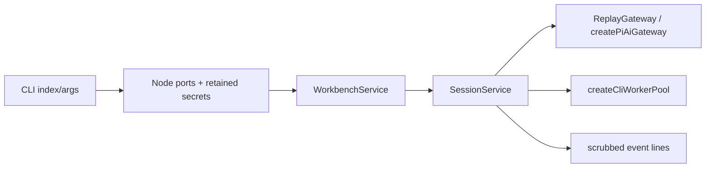

<!--
Copyright (c) 2026 DDP Engineering
This software is licensed under the PolyForm Noncommercial License 1.0.0.
Commercial use requires a separate commercial license.
See the LICENSE.txt in the .agentic folder for full license details.
SPDX-License-Identifier: LicenseRef-PolyForm-Noncommercial-1.0.0
-->

# TASK-f697479d - WP-15 Headless CLI (#15)

stage: done
type: feature
path: full
interaction: autopilot
requirements: REQ-FUNC-1ed659ec, REQ-FUNC-e0645fcd, REQ-REL-88dd69b2, REQ-SEC-25008e88, REQ-PLAT-83f14f47, REQ-NFR-3d884630
parent:
branch: master
base: 7b07c66f98e532173096f6ba46f751e949aef95c
opened: 2026-10-12

## Done checklist (current stage)

- [x] validated candidate confirmed unchanged
- [x] coordinator validation evidence, exact diff, exclusions and local outcome presented
- [x] standing human authority: one validated local coordinator commit per WP on master
- [x] journal and report included in selected27path delivery candidate
- [x] agreed local-only commit prepared by coordinator
- [x] close-out carried by the local delivery commit

## Frame

Problem: STATED: run the production core from a terminal without the GUI.
Desired outcome: STATED: WP-15 exact scope and all four acceptance criteria in00_Planning/plan/M1-read-only-agent.md.
Actors: terminal operator, CLI Node host, shared/core runtime, configured model or explicit replay script.
Primary scenario: vera run opens a workbench -> SessionService sends one prompt -> ordered scrubbed events -> terminal reason determines exit.
Examples: replay read-then-answer on a temporary copy of demo-board; unknown flag -> usage and2; pathological grep -> timeout partials, subsequent grep succeeds.
Counterexamples: irreducible input dispatches zero requests; a key reflected by provider never reaches stdout/stderr.
In scope: apps/cli bin, Node ports, command/format/session options, shared policies, real process acceptance, directly affected README/context/knowledge.
Out of scope: subsequent work packages, interactive chat, desktop replay release changes, publication, issue mutations, implementation-cycle changes, staging/commit.
Constraints: STATED: master, recorded base7b07c66f98e532173096f6ba46f751e949aef95c, autopilot; protect optional-companions SHA2562a69f5b335a53e498b1f8e30fa5adb8096e870e7a12bbc05b0727a03cee72c6b; coordinator alone commits after handoff; sequential full Windows/native Ubuntu gates after two independent reviews.
Success signals: ordered events/exit0; invalid CLI exit2; all output scrubbed; context and real worker timeout/replacement parity.
Evidence: OBSERVED: clean master at exact base; no existing WP15 journal; SessionService/core gateway/NodeWorkerPool and CLI worker adapter already exist. Architecture03 sections2/4/7/8,01 section4,08-quality section3, ADR0009/0012 and reference chat.ts/bench.ts read.08-testing is named08-quality in this checkout.
Assumptions: INFERRED: Node-only adapters compose shared core services; explicit provider options override selected session model for that invocation.
Unknowns: none decision-blocking. Existing demo lacks board.txt used by read-then-answer; add this small fictional source to the demo fixture.
Decision-blocking questions: none.
Proposed behaviors: strict CLI parsing, explicit script isolation, machine-readable JSONL or pretty lines, shared durable session, same budgets/deadlines, cleanup on signals/failure.
Path and reason: full; no-new-behavior=no,new-interface=no,new-dependency=yes(no additional dependency needed),existing-requirement-only=no,unchanged-security=no. New host boundary and external command require all stages. No implementation children; independent review agents only at validate.

## Requirement coverage

| Frame outcome / trigger | Atomic behavior | Requirement | Positive case | Boundary/failure | Verification | Design |
|---|---|---|---|---|---|---|
| Run a headless workbench turn | When vera run receives a valid workbench and prompt, the CLI shall execute one durable core SessionService turn using the selected replay/OpenAI/custom gateway, creating a session or resuming the requested session. | REQ-FUNC-1ed659ec | valid invocation | failure/abort | process acceptance and host tests | CLI composition/spec |
| Print ordered session events | When a CLI turn emits session events, the CLI shall print each event in order as a JSONL record or a single pretty line including the session ID and available persisted sequence. | REQ-FUNC-e0645fcd | valid invocation | failure/abort | process acceptance and host tests | CLI composition/spec |
| Report CLI outcomes and usage | When a CLI invocation completes, the CLI shall return0 for end,1 for error/aborted/limit or operational failure, and2 with usage for invalid arguments. | REQ-REL-88dd69b2 | valid invocation | failure/abort | process acceptance and host tests | CLI composition/spec |
| Scrub headless credentials and output | While credentials are supplied from OPENAI_API_KEY or key-file, the CLI shall retain secrets in a process-local credential store and pass every emitted stdout/stderr line through the shared scrubber, including errors and console logging. | REQ-SEC-25008e88 | valid invocation | failure/abort | process acceptance and host tests | CLI composition/spec |
| Compose Node host resources | When the headless host runs, the CLI shall provide Node PathProvider, Clock, FileAccess, in-memory CredentialStore, redacting console Logger and worker-thread WorkerPool, releasing sessions, workers, database/lock and owned temporary data on completion, failure or interruption. | REQ-PLAT-83f14f47 | valid invocation | failure/abort | process acceptance and host tests | CLI composition/spec |
| Apply shared CLI execution limits | Before each CLI gateway dispatch or grep execution, the CLI shall apply the desktop core context policy and worker deadline contract, reporting structured CONTEXT_LIMIT and exit1 for irreducible input with zero dispatch and terminating timed-out workers before subsequent matching. | REQ-NFR-3d884630 | valid invocation | failure/abort | process acceptance and host tests | CLI composition/spec |

## Design

Requirements coverage: FUNC1ed659ec hosts SessionService; FUNCe0645fcd output envelope; REL88dd69b2 strict arguments/exits; SEC25008e88 in-memory credentials and line-boundary scrub; PLAT83f14f47 lifecycle ports; NFR3d884630 reuse untouched context/worker policies.
Component responsibilities: CLI composes core/shared only; core owns runtime/gateway/storage/confinement and desktop owns Electron. Node FileAccess is a CLI adapter following existing atomic host contract.
Interfaces/contracts: exact spec; build-cli uses pinned esbuild to bundle CLI and independent grep worker, external native better-sqlite3. Package bin points to built entry, npm vera builds then launches; no new dependencies.
State: settings under selected data; credentials process-only; sessions/verbatim messages in workbench SQLite; workbench lock ownership via existing service.
Flow: register secrets -> strict parse -> owned data/script staging -> settings/workbench/gateway/workers -> session creation/resume -> subscribe -> send/waitIdle -> cleanup reverse ownership -> exit code.
Failure recovery: signals request stop, startup interruption observed between asynchronous steps; finally drains all resources even when an earlier close fails. Default temporary root removed; provided data preserved. Workbench close last after session drain.
Trust: validate before side effects; shared model/custom config schemas; registry respects disabled tools; all event and console paths scrub through retained secret registry. Known-secret inputs rejected to protect SQLite/config. Worker sources selected by host, unchanged10000ms.
Ordering: SessionService barriers persist before dispatch and emit source-order tools. Output synchronously writes complete scrubbed lines; credential operations serialize.
Compatibility/migration: existing core/storage schema, no changes to desktop/test release registration. Invocation model is explicit on resume; core handles recovery.
Observability/test seams: real child processes through compiled entry + test-only preloaded network guard; loopback gateway harness; existing core session/context and compiled worker tests.
Alternatives/tradeoffs: importing desktop ports violates CLI boundaries; runtime duplication risks parity; Node strip-types cannot resolve current .js source references, so bundle with installed exact esbuild.
Expected files: apps/cli src/{index,run,args,host-ports,output}.ts, bin/vitest wiring/tests; scripts/build-cli.mjs; root/workspace package manifests and lock; demo board.txt; README and scoped .agentic requirements/spec/knowledge/context.
Risks: streamed credentials fragmented across deltas require core gateway overlap scrubbing plus complete output boundary; signal cleanup must not race SQLite close; tests prove both. Open decisions:none.

### Proposed architecture - TASK-f697479d

## Log

- 2026-10-12 frame: exact WP15 scope accepted in autopilot; full path selected; sole implementation chat on master, coordinator-exclusive authorized local commit, no staging. BMAD renderer and sibling installer are absent; explicit user AEGIS/product-only scope governs and BMAD source is not executed.

- 2026-10-11T22:12:03.711711+00:00 specify:6 draft atomic requirements; existing context/runtime/worker contracts reused; exact CLI protocol linked in spec. Behavior inventory/coverage audited; no open product decisions.

- 2026-10-11T22:12:03.922512+00:00 design: CLI Node composition, strict argument/output/lifecycle and acceptance seams audited; details in Design/spec. No production core or desktop changes planned.

- 2026-10-11T22:13:12.140114+00:00 build red: all six CLI requirement IDs; command=python ../02_Tools/npmw.py npx vitest run tests/tooling/cli.test.ts; exit=1; expected missing behavior=empty CLI entry prints no events/usage/redaction and returns0 on invalid invocation. Original process-red.log/receipt retained. Irreducible test argument adjusted below native Windows32767 command-line ceiling before its required red rerun.

- 2026-10-11T22:20:19.792630+00:00 build green:python ../02_Tools/npmw.py npx vitest run tests/tooling/cli.test.ts apps/cli/src/host-ports.test.ts exit0,19 tests; process/core host behavior, loopback redaction/budget/no-dispatch, real10000ms grep timeout and later success, signal handlers and ports. cli-typecheck3 exit0. Additional cleanup/transparent native-signal platform selector added for final focused proof. Exact original logs/receipts under cache/wp15.

- 2026-10-11T22:20:19.851491+00:00 validate:semantic candidate review completed against recorded base/exclusions/contracts; CLI-only product composition, shared core/desktop unchanged, six active requirements and current knowledge reconciled. Two independent reviews pending; mandatory final serial Windows/native Ubuntu proof follows approvals.

- 2026-10-11T22:24:31.417978+00:00 validate round1:independent spec and quality changes_required on same complete candidate; originals review-r1-{spec,quality}-original.json. Findings:replay raw messages/deltas persisted secrets; npm banner reflects raw arguments/pollutes JSONL; strict repeated process-N receipt collisions. Route back to build for these three recorded findings only; both verdicts invalidated.

- 2026-10-11T22:26:34.197522+00:00 build red review cycle1: REQ-SEC-25008e88 and REQ-FUNC-e0645fcd; command=python ../02_Tools/npmw.py npx vitest run tests/tooling/cli.test.ts -t "scrubs explicit replay|public npm run"; exit=1; expected missing behavior=fragmented replay reconstructs raw key and npm banner breaks JSONL before CLI scrubbing. Original review-fixes-red.log/receipt retained. Evidence collision correction is an inspection fix to preserve each suite run separately.

- 2026-10-11T22:27:19.006112+00:00 build cycle1 fixes: complete replay source scrub before staging/deltas/persistence; repository .npmrc loglevel=silent prevents the public npm banner reflecting raw arguments; unique suite evidence directory and exclusive byte/hash/bundle receipts prevent strict-suite collisions. These are the three recorded review findings; no core/desktop changes.

- 2026-10-11T22:28:45.264737+00:00 build cycle1 green:python ../02_Tools/npmw.py npx vitest run tests/tooling/cli.test.ts apps/cli/src/host-ports.test.ts packages/core/src/sessions/service.test.ts packages/core/src/agent/context.test.ts packages/core/src/llm/gateway.test.ts packages/core/src/llm/replay.test.ts tests/tooling/worker-hosts.test.ts; exit0,73 passed/1 Windows-native-signal skip. cli-typecheck4 exit0. REQ-SEC-25008e88 replay SQLite/recombined delta and REQ-FUNC-e0645fcd public npm JSONL/error regressions pass. Inspection: two repeated suites retain six distinct exclusive original child receipts and matching copied bundle/stdout/stderr hashes, review-fix-evidence-inspection.json.

- 2026-10-11T22:28:48.836817+00:00 validate round2 semantic reconciliation: reviewed source/config/test/doc paths against base and six active requirements; .npmrc covered by output/security requirements. Source complete replay scrub preserves valid JSON escapes; public npm acceptance and raw SQLite regression passed. Current CLI knowledge/spec updated; architecture proposal still matches composition. Advisory administrative warnings are original malformed RULING-001 retained append-only/restated RULING-002 and pre-existing TASK-77e6f562 ruling metadata; no relevant product finding accepted. Evolution reviewed, no unexpected candidate paths.

- 2026-10-11T22:28:58.287520+00:00 validate advisory clarification: review-state warning is expected while round2 verdicts are pending; outside-layout .npmrc warning reflects its absence from configured globs, not an out-of-scope change. The recorded npm banner correction is necessary for public CLI output/security and explicitly linked in both requirements. Administrative ruling warnings remain explained; no test or scan exclusion added.

- 2026-10-11T22:31:01.313299+00:00 validate round2 independent changes_required: Unicode-escaped JSON decodes registered secrets after source-byte scrub, allowing cross-delta reconstruction/SQLite persistence. Original review-r2-{spec,quality}-original.json retained. Quality also records npm receipt provenance limitation: compiled and executed dist hashes matched observed, but receipts read compiled path rather than actual npm dist. Return to build cycle2 only for decoded replay protection and exact executable receipt binding; both verdicts cleared.

- 2026-10-11T22:31:27.901835+00:00 build red cycle2: REQ-SEC-25008e88; command=python ../02_Tools/npmw.py npx vitest run tests/tooling/cli.test.ts -t "scrubs explicit replay"; exit1; expected missing behavior=valid Unicode-escaped script decodes/reconstructs the complete fictional key across message deltas. Literal case passes; original review-cycle2-red.log/receipt retained. Regression includes tool arguments and SQLite messages/events/tool_calls, plus existing comment/blank syntax.

- 2026-10-11T22:31:51.991673+00:00 build cycle2: parse explicit replay records then scrub canonical JSON before staging, preserving blank/comments and existing core validation. All decoded text/toolargs become safe before fragmentation/persistence; no core/desktop edits. Child receipts now copy/hash actual executed entry+worker from compiled or npm dist root, with exact execution mode. Prior observed bundle equality remains stated accurately.

- 2026-10-11T22:34:29.392482+00:00 build cycle2 green:python ../02_Tools/npmw.py npx vitest run tests/tooling/cli.test.ts apps/cli/src/host-ports.test.ts packages/core/src/sessions/service.test.ts packages/core/src/agent/context.test.ts packages/core/src/llm/gateway.test.ts packages/core/src/llm/replay.test.ts tests/tooling/worker-hosts.test.ts;exit0,74 passed/1 Windows-native-signal skip. Literal/Unicode replay text+toolargs and SQLite regressions green; public npm JSONL/secret error preserved. cli-typecheck5 exit0. Inspection:two immutable suite directories/eight children, original stdout/stderr/test preloads and actual compiled/npm dist entry+worker bytes/hashes verified in review-cycle2-guarded-evidence-inspection.json. Quality round2 additionally noted npm inner CLI did not inherit outer guard: npm harness now propagates compiled loopback guard via NODE_OPTIONS to all launched Node children and records exact guard scope. Final guarded-focused result is authoritative; prior evidence is retained without overstating old guard scope.

- 2026-10-11T22:34:33.213686+00:00 validate round3 semantic reconciliation: whole recorded candidate reviewed; decoded canonical replay filtering closes encoded-key path without core/runtime duplication and preserves replay comments/blank/validation. All requirements/current knowledge/spec/context and existing architecture agree; scope unchanged. Advisory warnings remain malformed append-only ruling records/restatement, pending review-state and in-scope .npmrc outside configured globs; no product failure/verification omission accepted. Final evolution cycle2 source/test paths reviewed.

- 2026-10-11T22:36:55.619396+00:00 validate round3 spec approved/quality changes_required: ReplayGateway fill may reconstruct a credential after staged-source scrub, e.g. sk-{{ref}} from a non-secret read locator. Both bound originals retained and both verdicts invalidated. Return to build cycle3 for post-substitution gateway boundary protection and exact real-process delta/SQLite regression. No final gates launched.

- 2026-10-11T22:37:30.891343+00:00 build red cycle3:REQ-SEC-25008e88;command=python ../02_Tools/npmw.py npx vitest run tests/tooling/cli.test.ts -t "scrubs explicit replay";exit1;expected missing behavior=read/ref interpolation forms a key absent from source/tool results, and concatenated40-character deltas expose it. Literal/Unicode cases pass. Original review-cycle3-red.log/receipt retained. A CLI-only replay output adapter will aggregate each replay response before scrubbing text/tool deltas and terminal/partial objects; live provider streaming remains existing core gateway behavior.

- 2026-10-11T22:38:08.803645+00:00 build cycle3: CLI-only scrubReplayOutput aggregates each existing in-memory replay response after interpolation, scrubs complete text/tool values and canonical terminal/partial objects before runtime. Original source-delta count/order retained; live gateway untouched. Complete replay source scrubbing also retained to protect owned staging. Template regression now includes dynamically formed text/toolargs and both env/key-file, with SQLite inspection. Current spec/knowledge reconciled with this boundary; no core/desktop source change.

- 2026-10-11T22:38:50.791286+00:00 DEVIATION build: replay emits one scrubbed delta per complete text/tool value instead of the raw40-character chunks - accepted to prevent credentials assembled by replay bindings from crossing into runtime/storage; replay already holds the complete response in memory, source order/counts remain, and live OpenAI/custom streaming is unchanged. No verification skipped or relaxed.

- 2026-10-11T22:39:16.418225+00:00 build cycle3 green:python ../02_Tools/npmw.py npx vitest run tests/tooling/cli.test.ts apps/cli/src/host-ports.test.ts packages/core/src/sessions/service.test.ts packages/core/src/agent/context.test.ts packages/core/src/llm/gateway.test.ts packages/core/src/llm/replay.test.ts tests/tooling/worker-hosts.test.ts;exit0,76 passed/1 Windows-native-signal skip. Replay literal/Unicode/template/key-file-template text+dynamic toolargs/recombined deltas/SQLite3tables pass. cli-typecheck6 exit0. Credential boundary now covers post-interpolation output and terminal/partial objects; existing full live/context/deadline tests pass.

- 2026-10-11T22:39:19.960098+00:00 validate round4: complete semantic review covers CLI replay-output adapter, delegated metadata/contracts, delayed safe replay delta delivery and canonical terminal/partial objects. Proposal retained; current knowledge architecture includes scrubReplayOutput boundary; positive spec states aggregate replay contract and unchanged live streaming. All six requirements/current context links reviewed; final evolution includes only recorded new adapter/test/doc changes. Replay granularity deviation remains explicit; no verification omitted. Administrative/layout/review-pending warnings unchanged and explained.

- 2026-10-11T22:41:12.045270+00:00 validate round4: independent specification compliance and implementation quality both approved on unchanged complete candidate vs recorded base; original review-r4-spec-original.json and quality-original.json bind raw candidate/semantic/fullsource hashes and archive. Only journal verdict/progress administration follows; semantic candidate remains fixed. Final serial Windows/native Ubuntu focused, strict both full configured commands, CLI acceptance and native/browser E2E start now.

- 2026-10-11T22:57:43.294057+00:00 validate final round4 gate failure: Native Ubuntu strict attempt3 completed BOTH configured commands; npm test exit1 (53files passed/1failed,371passed/1failed/2platformskips) while npm run verify exit0 (54files372passed/2skips). Original full command1/2 stdout/receipts retained. Failure is test readiness polling: default1000ms expired with empty stdout before SIGINT delivery, followed by recorder ENOENT when undrained child outlived compiled bundle cleanup. This is a candidate test flaw, not an accepted native abort failure. Return to build cycle4 for bounded readiness wait and finally drain; both round4 verdicts invalidated and all eight final gates require fresh proof after round5 reviews. Production10s grep deadline, abort/result/lock assertions and source behavior remain unchanged.

- 2026-10-11T22:57:51.330884+00:00 build inspection cycle4: REQ-REL-88dd69b2/REQ-PLAT-83f14f47 native signal process test observed failure under exact configured npm test, exit1; expected verification gap=1s startup poll expired before signal and missing finally drain allowed source deletion before original child receipt. This is a test-harness correction without a production behavior increment. Original Linux failure and all round4 source/review artifacts retained.

- 2026-10-11T22:59:37.374277+00:00 build cycle4 green: Windows python ../02_Tools/npmw.py npx vitest run tests/tooling/cli.test.ts apps/cli/src/host-ports.test.ts exit0,24passed/1nativePOSIXskip. Native Ubuntu targeted CLI nativeSIGINT with test-only1500ms pre-entry delay (above original1000ms poll) exit0,1passed/21selector-skips; actual SIGINT, exit1, aborted record and lock removal asserted. Exact argv/preload bytes+SHA/original logs+receipt retained. Readiness timeout10000ms is test startup only; test20000ms bounds readiness+drain, production deadlines and signal assertions unchanged. Finally SIGTERM/drain before cleanup also covers readiness assertion failure by inspection. Existing requirement paths/links already cover this test; six contracts unchanged.

- 2026-10-11T22:59:50.218349+00:00 validate round5 semantic reconciliation: Entire26-path semantic/27with-journal candidate reviewed against recorded base and original scope; only cli.test.ts changes from approved round4 source. Signal readiness/drain test fix retains nativeSIGINT, exit1/aborted/lock oracles and production10s worker deadlines; controlled1500ms startup proof passes. Six active requirements/spec/current component knowledge/context re-read and still describe implementation; architecture unchanged. Final evolution shows exactly the one recorded test change. Administrative append-only ruling/restatement and in-scope npmrc layout warnings remain explained, pending reviews expected; no source/test exclusions or verification weakening. Ignored anchor/evolution state is copied to native mirror for consistent advisory context; production source parity remains690 raw files. Both bound verdicts pending round5.

- 2026-10-11T23:03:06.768898+00:00 validate native readiness: documented setup.py --check original exit1 is a hidden-lock mtime freshness check after copying root lock, not missing required packages. Read-only lock audit confirms676 installed entries exact version/resolved/integrity/link parity and127 absent entries all optional, zero missing required packages; pinnedNode/system libraries/xvfb ready and actual generated shared/core declarations exist. Original checker output and native-lock-readiness-r5.json retained. No marker timestamp/content touched, no install/delete or source correction, no false checker0 claim. Mandatory runtime gates remain unchanged and will prove native execution. Earlier missing generated declarations and failed/cancelled attempts stay separate from successful proof.

- 2026-10-11T23:03:07.451358+00:00 validate round5: independent specification compliance and implementation quality both approved on unchanged complete candidate vs recorded base; original review-r5-spec-original.json and quality-original.json bind raw candidate/semantic/fullsource hashes and archive. Only journal verdict/progress administration follows; semantic candidate remains fixed. Final serial Windows/native Ubuntu focused, strict both full configured commands, CLI acceptance and native/browser E2E start now.

- 2026-10-11T23:20:36.546574+00:00 validate native prerequisite recovery: First Linux strict attempt failed because the fresh mirror reused incremental TypeScript caches without generated workspace declarations; an attempted retry was stopped and its original open temporary child stdout recovered before termination. Original failed/cancelled receipts are preserved and explicitly excluded from successful proof. Direct pinned Node TypeScript build regenerated ignored declarations in the fresh native mirror after preserving generated state; fresh round5 strict then passed both complete configured commands on the exact approved source. No source correction or verification waiver was involved.

- 2026-10-11T23:20:36.556954+00:00 validate final proof: Eight SERIAL gates all exit0 on unchanged26-path semantic/690 full-source candidate: Windows+native Ubuntu focused7files (76+1POSIXskip/77), strict check --task TASK-f697479d --strict --run --json executes BOTH literal configured full commands npm test and npm run verify, CLI real-process acceptance, full native/browser E2E. Four original AEGIS child temporary stdout captures plus immutable per-suite CLI stdout/stderr/argv/cwd/UTC/exit/guard/actual entry+worker hashes verified. Native cwd is fresh /home/dpasare/.cache/vera-wp15-linux-TASK-f697479d, not /mnt; raw Windows/native source parity verified. final-proof.json contains actual counts and receipts. Full runtime proof has no accepted failure or omitted gate; original administrative ruling warnings and baseline WP09 manual note are catalog metadata; full verify also retains5 baseline Biome warnings/1info in unchanged test/UI paths, original output lists each, .npmrc is in-scope output/security but outside configured layout globs. All prior diagnostics archived+raw-verified,6392 immutable historical evidence files,coordinator-owned live progress state observed/snapshotted separately without writing it, original6393-entry index preserved; and3449 baseline archive entries verified unchanged. Protected optional file exact SHA retained.

- 2026-10-11T23:20:36.647667+00:00 validate record correction: Native readiness audit lists128 optional missing entries, correcting the earlier journal127 count. Original structured audit is authoritative;676 installed records match pins,zero required entries are missing. Original setup.py --check1 remains an mtime-only diagnostic, not a failed runtime gate; marker/files remain unchanged. Delivery report may count28 Git-visible changed paths including the protected user-owned optional-companions file; exact approved/validated delivery candidate is27 and excludes it.

- 2026-10-11T23:20:36.658578+00:00 deliver presentation/standing authorization:27 exact candidate paths (9 tracked modifications+18 new, including journal);CLI command/bin/Node ports/replay output adapter/build/fixture/tests and six requirements/spec/current knowledge/context. Protected optional-companions.md excluded;ignored cache/runtime and old mirrors excluded. Original round5 approvals bind unchanged26 semantic paths. DEVIATION build repeated:replay aggregates complete text/tool values before safe delta delivery to prevent post-interpolation credential leaks;source order/count retained,live streaming unchanged. Root AGENTS/delegated user instruction authorize coordinator-exclusive local commit after verification and this unstaged/uncommitted handback; no renewed approval sought. No implementation child tasks;two independent read-only review agents only. Remaining three delivery/close-out items belong to coordinator. Baseline WP09 live-smoke/manual note remains recorded; WP05 clean/offline Windows/VC++ independence remains user-deferred WP30/WP33/final-release proof; this task makes no release claim.

- 2026-10-11T23:21:43.046316+00:00 deliver advisory and handoff: report appended/read; fresh strict advisory no-run exit0/errors0/warnings10/notes1. Additional unticked-deliver warning is the3 coordinator-exclusive commit/close-out items, correctly pending; remaining9 warnings and WP09 note are the explained ruling/layout metadata. All8 final runtime gates remain the authoritative validated proof; only journal administration changed after that proof. Exact approved26 semantic paths unchanged,27 including delivery journal; optional source excluded. Final audit verifies236 immutable original CLI child receipts/streams/executable bundles,4 complete original configured command captures,7 native presync archives,6392 immutable historical files and3449 baseline archive members. Coordinator-owned implementation-cycle.json changed as live progress state; preserved initial index and current raw snapshot, never wrote/restored the live file. Ready for coordinator-only verification/local commit; implementation chat hands back and remains idle.

- 2026-10-11T23:43:20.742579+00:00 coordinator semantic/evidence acceptance: Whole journal, all six active requirements/spec, validate/deliver instructions, changed knowledge/context, WP15 four Done criteria, 01-system4/03 sections2,4,7,8/08-quality3 and ADR0009/0012 plus complete tracked hunks/new code/tests/fixture reviewed against recorded base. No blocking finding; strict provider/schema args, durable create/resume/sequence output, Node port ownership/reverse cleanup, memory credentials and ambient/key-file pre-diagnostic retention match contracts. Canonical replay-source scrub and post-interpolation full-value gateway adapter protect runtime and SQLite; live core overlap scrubbing unchanged. Existing worker/context services reused, no core/desktop product edits; Electron baseline and vera://app unchanged. Independent read-only evidence auditor approved26semantic/27ticket/690source and original two distinct R5 approvals,3024 indexed originals,236 CLI receipts with actual executed bundle/preloads,8 child gates/four strict captures,6392 historical files,3449 baseline archive members and native presync/diagnostics. Proof-native journal differed only by administrative handoff, now archived exact original before sync; no implementation edits or concurrent implementer.

- 2026-10-11T23:43:20.755195+00:00 coordinator fresh proof: Eight SERIAL gates all exit0 on unchanged26semantic/690full-source candidate: focused7files Windows76+1POSIXskip/Ubuntu77; strict --task TASK-f697479d --strict --run --json runs BOTH literal configured npm test and npm run verify,each OS each command54files372passed2platformskips; real CLI acceptance Windows21+1POSIXskip/Ubuntu22; native/browser E2E21each. Four complete original inner strict temporary stdout streams and236 exclusive fresh CLI originals bind argv/cwd/UTC/environment/exit/actual executed entry/worker/guard copies. Strict does not set VERA_TEST; only e2e instrumented. Original and fresh source maps/bindings, prior diagnostics archives and restored npm logs verified. setup check native1 remains accurately recorded as lock-mtime freshness diagnostic with676 installed exact entries128 absent optional zero required; actual runtime proof green, no marker touch/waiver. Baseline Biome5warnings1info and upstream build notices retained. Administrative ruling/layout findings (.npmrc in scope but outside configured layout) and WP09 manual note do not omit/relax checks. Historical WP11 auxiliary loss not claimed restored. WP05 clean/offline Windows/VC++ proof remains mandatory WP30/WP33/final release. See cache/wp15/coordinator-proof.json and evidence/semantic audits.

- 2026-10-11T23:43:20.770683+00:00 coordinator delivery presentation/standing approval: Exact27ticketpaths,9modified18new including journal; CLI command/bin/Node ports/output adapter/build/fixture/process+port tests, six requirements/spec/current knowledge/context/README, silent npm banner and matching bin lock metadata. Protected optional-companions.md unchanged/excluded; ignored runtime/cache/cycle state and old mirrors excluded. Both original R5 approvals bind unchanged26semantic SHA 09130ab898dca43bbc0f0ca0319f1f294a4ccbadc80f4712c260dd4ab8259b17. DEVIATION build repeated: explicit replay emits one scrubbed complete text/tool delta instead of raw40char fragments to prevent post-interpolation secrets crossing runtime/storage;source value order and text-delta counts retained,live streaming unchanged. Explicit user cycle and root AGENTS authorize coordinator-only one local master commit WP15/#15/TASK-f697479d, resolving delivery checkpoint without renewed permission. No implementation child tasks;reviewers read-only. Local commit is whole outcome;no push/PR/issue mutation/remote release.

- 2026-10-11T23:43:29.728014+00:00 coordinator report read/local close-out: Report-time advisory read; full runtime proof remains eight fresh serial gate receipts. Git-visible28paths includes protected human file; exact delivery27 excludes it. Only append-only journal/report/Handoff/Stage report administration changes after proof. Local delivery commit is the whole approved outcome under deliver7, so done/close-out is carried by that same commit; actual SHA/path/blob/index/protected verification recorded in local cycle state afterward. No remote action. A failed commit retains open delivery state.

## Rulings

### RULING-001
date: 2026-10-12
kind: authority
decision: Human authorized this implementation in autopilot on master. Recorded base7b07c66f98e532173096f6ba46f751e949aef95c. The coordinator exclusively creates the one local ticket commit after complete verification. This chat hands off without staging/commit or remote publication.
reason: Explicit delegated instructions and root AGENTS.md.
supersedes:

- RULING-002 | date=2026-10-12 | decision=Coordinator exclusively commits after validated unstaged handoff; autopilot on master at recorded base | reason=Explicit delegated instructions; restates original authority in exact machine-readable format | source=user | supersedes=RULING-001

## Handoff

current: done
status: ready
next: Record actual commit and start next eligible work package
must_read: .agentic/tasks/TASK-f697479d.md, .agentic/steps/6_deliver.md, 02_Tools/cache/wp15/coordinator-proof.json
blockers: none

## Stage report

stage: deliver
result: completed
current: done
changed: Headless CLI;27ticketpaths
evidence: Eight serial gates0;focused76Windows/77Ubuntu;strict full test+verify372eachOS;CLI21/22;E2E21each;R5approved
issues: Replay delta granularity deviation;administrative ruling/layout warnings;clean/offline Windows/CRT deferred release proof
next: Record actual commit and start next eligible work package
needs_user: no
spec_compliance: approved
implementation_quality: approved
review_round: 5

## Delivery report (2026-10-12)

- stage: deliver; type: feature; path: full; branch: master
- requirements:
  - REQ-FUNC-1ed659ec - Run a headless workbench turn
  - REQ-FUNC-e0645fcd - Print ordered session events
  - REQ-REL-88dd69b2 - Report CLI outcomes and usage
  - REQ-SEC-25008e88 - Scrub headless credentials and output
  - REQ-PLAT-83f14f47 - Compose Node host resources
  - REQ-NFR-3d884630 - Apply shared CLI execution limits
- deviations: 1 recorded
  - build: replay emits one scrubbed delta per complete text/tool value instead of the raw40-character chunks - accepted to prevent credentials assembled by replay bindings from crossing into runtime/storage; replay already holds the complete response in memory, source order/counts remain, and live OpenAI/custom streaming is unchanged. No verification skipped or relaxed.
- explicit review: enabled; spec_compliance=approved; implementation_quality=approved; review_round=5
- diff vs task base 7b07c66: 28 file(s) changed, 1881 line(s) added
- checks: errors=0 warnings=10 notes=1
- checklist: 3/6 done; open: journal and report included in the delivery commit - coordinator only; agreed local commit outcome delivered - coordinator only; close-out carried by the authorized local commit - coordinator only

## Delivery report (2026-10-12)

- stage: deliver; type: feature; path: full; branch: master
- requirements:
  - REQ-FUNC-1ed659ec - Run a headless workbench turn
  - REQ-FUNC-e0645fcd - Print ordered session events
  - REQ-REL-88dd69b2 - Report CLI outcomes and usage
  - REQ-SEC-25008e88 - Scrub headless credentials and output
  - REQ-PLAT-83f14f47 - Compose Node host resources
  - REQ-NFR-3d884630 - Apply shared CLI execution limits
- deviations: 1 recorded
  - build: replay emits one scrubbed delta per complete text/tool value instead of the raw40-character chunks - accepted to prevent credentials assembled by replay bindings from crossing into runtime/storage; replay already holds the complete response in memory, source order/counts remain, and live OpenAI/custom streaming is unchanged. No verification skipped or relaxed.
- explicit review: enabled; spec_compliance=approved; implementation_quality=approved; review_round=5
- diff vs task base 7b07c66: 28 file(s) changed, 1905 line(s) added
- checks: errors=0 warnings=10 notes=1
- checklist: 5/6 done; open: close-out carried by the local delivery commit
