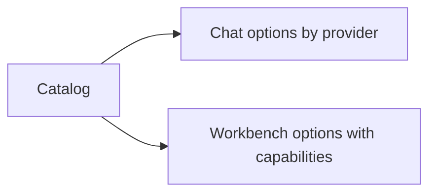
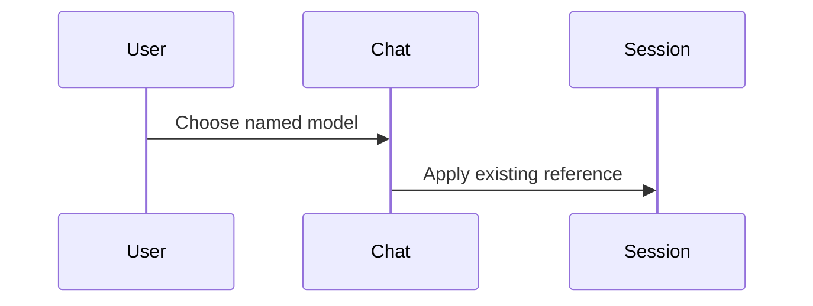
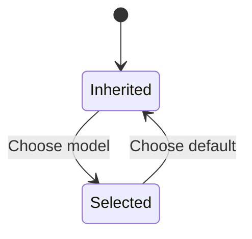

# TASK-fbc1a7ca - Simplify chat model choices and strengthen composer field visibility

stage: done
type: change
interaction: autopilot
requirements: REQ-UX-bfbeca0c, REQ-UX-161c4053, REQ-FUNC-701b5178, REQ-UX-09ed27ff
parent:
branch: master
base: e622bb278e4431e093a1e479039c797afab2aedf
opened: 2026-11-23

Edit Frame, Requirement coverage and Design directly. Write State, Log and
Rulings with `python .agentic/aegis.py` (advance, pause, log, ruling, verdict);
end each session with `advance` or `pause`.

## Done checklist (current stage)

- [x] diff reviewed against scope, requirements, design, error paths,
      portability, security and unrequested work
- [x] knowledge pages of changed components current with the reviewed code
- [x] project and environment context reconciled with the candidate
- [x] requirements re-read: status, prose, verification, paths and links true
- [x] manual or inspection verification recorded where applicable
- [x] explicit review approved, when enabled
- [x] final `check --strict --run` result logged truthfully after the last edit
- [x] remaining warnings and pre-existing failures explained
- [x] `report` appended

## Frame

Problem: STATED — the chat's model list shows too much information; the screenshot also shows low-contrast selector borders.
Desired outcome: STATED — a simpler session model list and more visible chat selection boxes.
Actors: INFERRED — users choosing a session model, reasoning level or permission mode.
Primary scenario: INFERRED — open Chat and select a model by name under its provider, with all three controls visible at normal and narrow widths.
Examples: OBSERVED — the screenshot repeats LM Studio and ChatGPT subscription names, context sizes, input formats, tools and reasoning on every row.
Counterexamples: OBSERVED — Workbench Agent and chat already provides a default model selector with detailed metadata and a default permission setting.
In scope: STATED — chat model option presentation and field affordance. INFERRED — answer the delegation question from the existing session and workbench contracts.
Out of scope: STATED — the question about Full Access asks its purpose and whether workbench placement makes sense. Changing the scope, persistence or confirmation of this permission is outside the UI implementation.
Constraints: OBSERVED — active REQ-UX-bfbeca0c currently requires capabilities in both selectors, so revise it using AEGIS. Stay on master at the recorded base and preserve changes already in the checkout. AGENTS.md authorizes a local commit for validated ticket-owned changes.
Success signals: INFERRED — concise native options group by provider, preserve references and current unticked selections, and keep complete workbench labels. All composer selectors have input borders and fit narrow chat.
Evidence: OBSERVED — model-catalog.ts, composer.tsx, styles.css, session-reasoning.spec.ts, workbench-config-form.tsx, sessions/service.ts and storage/repos/delegations.ts.
Assumptions: INFERRED — use model display names where known and retain identifiers for ambiguous or missing names.
Unknowns: UNKNOWN — the user has not requested a change to the Full Access policy or specified a new UI location for its control.
Decision-blocking questions: None.
Proposed behaviors: None pending.

## Requirement coverage

| Behavior | Requirement | Design | Verification |
| --- | --- | --- | --- |
| Compact chat options and complete workbench model metadata | REQ-UX-bfbeca0c | Native optgroups and short labels for Chat | Verify provider group, display name and unchanged reference in Chat and rich workbench labels. |
| Visible and responsive composer selectors | REQ-UX-161c4053 | Existing input borders and natural wrapping | Verify all three selectors' borders and that the actions fit a narrow viewport. |
| Ticked-model filtering and selected model retention | REQ-FUNC-701b5178 | Existing catalog and unmatched selection fallback | Reuse the catalog regression and verify unavailable selected references remain visible. |
| Reasoning remains beside the effective model | REQ-UX-09ed27ff | Existing ReasoningPicker | Reuse session reasoning fixtures and exercise the narrow picker. |

## Design

**Approach.** Use native provider option groups in the chat selector and the name of each model, falling back to its ID for duplicate names. Retain the detailed labels in the workbench selector.

**Interfaces and data.** Reuse the same catalog, ticks, group identities and selection values. The existing fallback keeps a selected reference available when the current catalog omits it. The reasoning and permission selector actions use their existing contracts.

**Files and test seams.** Factor the provider display name in model-catalog.ts and create the option groups in the composer. Use the existing input border in styles.css and a flexible controls row. Verify compact labels and the bordered controls in the existing reasoning browser fixture.

**Risks and open decisions.** Keep labels distinguishable within each provider. Preserve keyboard interaction and make controls wrap within the narrow composer. The session delegation control is independent of workbench defaults and its placement is outside this task.

**Requirement map.** Provider-grouped identity and preserved workbench metadata map to REQ-UX-bfbeca0c. Borders and wrapping map to REQ-UX-161c4053. Unchanged selected values, ticks and neighboring reasoning cover REQ-FUNC-701b5178 and REQ-UX-09ed27ff.

## Log

- 2026-11-23 frame: journal opened
- 2026-11-23 frame: completed; next specify
- 2026-11-23 specify: completed; next design
- 2026-11-23 design: completed; next build
- 2026-11-23 build: red: session-reasoning browser E2E exit 1; compact option groups absent and all three selector borders transparent (REQ-UX-bfbeca0c, REQ-UX-161c4053)
- 2026-11-23 build: green: browser-only session-reasoning Playwright exit 0 at 760px; model catalog and boundaries Vitest exit 0 with 19 passing tests; targeted Biome and release-note check exit 0
- 2026-11-23 build: Reviewed the owned evolution plus the red browser spec, which preceded the anchor. Advisory check has zero errors. Historical warnings and the broad source/docs globs remain. AGENTS.md authorizes a local commit for this task after approval.
- 2026-11-23 build: completed; next validate
- 2026-11-23 validate: Review round 1: add browser coverage for an unticked session selection retained outside provider groups.
- 2026-11-23 validate: returned to build - Cover current model retention after unticking it
- 2026-11-23 build: green: browser-only session-reasoning Playwright exit 0 including selected reference retention after enabling an empty provider model list, unique fallback option and exclusion of unrelated unticked model.
- 2026-11-23 build: completed; next validate
- 2026-11-23 validate: Strict run exit 1: lint rejected formatting of one Playwright selector; typecheck, i18n and help passed.
- 2026-11-23 validate: returned to build - Format the last browser test addition
- 2026-11-23 build: Formatted only one locator chain in the Playwright test. Biome accepted the test; the browser result and unchanged type, i18n and help evidence still apply.
- 2026-11-23 build: completed; next validate
- 2026-11-23 validate: DEVIATION validate: rerun failed full lint and strict metadata only after whitespace-only formatting. Earlier typecheck, i18n, help, release notes and focused tests remain valid by 02_Tools/verification-policy.md.
- 2026-11-23 validate: final: AEGIS check --strict exit 0 (0 errors, 54 advisory warnings). Full lint exit 0 after the formatting-only fix. TypeScript, i18n, help, release-note checks, focused Vitest (19) and browser E2E (1) evidence unchanged. Both reviewers approved round 3. Native suite omitted while the live desktop review continues; browser proof covers the changed controls.
- 2026-11-23 validate: completed; next done

## Rulings

## State

status: done
reported: validate - completed
next: implementation guidance complete; commit, push and integration belong to the developer
must_read: .agentic/tasks/TASK-fbc1a7ca.md
changed: Provider-grouped chat model names and bordered composer controls
evidence: Focused Vitest and browser E2E passed; lint, typecheck, i18n, help, release notes and strict AEGIS passed
issues: Advisory repository warnings only
spec_compliance: approved
implementation_quality: approved
review_round: 3

## Delivery report (2026-11-23)

- stage: validate; type: change; branch: master
- requirements:
  - REQ-UX-bfbeca0c - Show model identity in Chat and capabilities in workbench settings
  - REQ-UX-161c4053 - Make chat composer selectors visibly distinct
  - REQ-FUNC-701b5178 - Offer only ticked provider models in model choices
  - REQ-UX-09ed27ff - Offer model-supported session reasoning beside the model selector
- deviations: 1 recorded
  - validate: rerun failed full lint and strict metadata only after whitespace-only formatting. Earlier typecheck, i18n, help, release notes and focused tests remain valid by 02_Tools/verification-policy.md.
- explicit review: enabled; spec_compliance=approved; implementation_quality=approved; review_round=3
- diff vs task base e622bb2: 59 file(s) changed, 2037 line(s) added; 9 file(s) not content-scanned
- checks: errors=0 warnings=54 notes=43
- checklist: 0/9 done; open: diff reviewed against scope, requirements, design, error paths, portability, security and unrequested work; knowledge pages of changed components current with the reviewed code; project and environment context reconciled with the candidate; requirements re-read: status, prose, verification, paths and links true; manual or inspection verification recorded where applicable; explicit review approved, when enabled; final `check --strict --run` result logged truthfully after the last edit; remaining warnings and pre-existing failures explained; `report` appended
