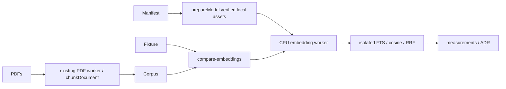

<!--
Copyright (c) 2026 DDP Engineering
This software is licensed under the PolyForm Noncommercial License 1.0.0.
Commercial use requires a separate commercial license.
See the LICENSE.txt in the .agentic folder for full license details.
SPDX-License-Identifier: LicenseRef-PolyForm-Noncommercial-1.0.0
-->

# TASK-fd4046b2 - WP-24 Spike: embedding model

stage: done
type: feature
path: full
interaction: autopilot
requirements: REQ-TEST-91b404ff, REQ-NFR-5a0d14ee
parent:
branch: master
base: 1da07ec9ef90e0c74b6e2519b52d96d02111f383
opened: 2026-10-12

## Done checklist (current stage)

- [x] validated candidate confirmed unchanged; both current bound verdicts approved
- [x] original proof, exact diff/exclusions and authorized handback outcome prepared
- [x] local ticket commit authorized exclusively to coordinator in RULING-001
- [x] journal/report included in coordinator delivery commit
- [x] coordinator performs local WP-24 commit (authorized outcome prepared)
- [x] coordinator carries close-out in delivery commit

## Frame

Problem: bundled embedding model has packaging proof but no comparative retrieval evidence.
Desired outcome: choose BGE or multilingual E5 from real native CPU measurements; establish recall gate.
Actors: spike operator, downstream WP25/26 implementers, package/model/chunk consumers.
Primary scenario: frozen demo questions and chunks -> verified local models -> three rankings/recall/timings -> ADR selection.
Examples: Romanian question over English sensor prose; I2C1_CR1 points to the actual PDF page.
Counterexamples: wrong page is a miss even in the correct PDF; corrupt assets fail before inference; no truncation accepted.
In scope: 20-30 frozen questions with page/heading; isolated reusable comparison harness, immutable candidate assets, size/CPU/recall on Windows/native Ubuntu, ADR/threshold, immediate descriptor/tokenizer alignment if selected model changes.
Out of scope: product migrations/index/search/tools/CLI/viewer/UI, staging/commit/remote publication; deferred clean offline Windows/VC++ release obligations; human optional-companions.md and other tasks' caches.
Constraints: STATED delegation, master/base, sole implementer, autopilot; verification-policy targeted native checks/statics/strict/two independent reviews. OBSERVED BGE q8 manifest/worker, extraction/tokenizer and real demo PDFs.
Success signals: same-corpus real comparison, exact source revision/license/SHA, correct prefixes/pooling/L2/CPU, RO subset; measured choice and explained threshold.
Evidence: STATED delegation/AGENTS; OBSERVED plan/M3 WP24, architecture05 sections4/8, ADR0006, core chunk/extraction/token-budget, model-manifest/prepare-model and WP05 worker. INFERRED isolated in-memory FTS suffices for spike. UNKNOWN winner/recall/timing until measured.
Assumptions: one expected locator per question; duplicate facts count only at expected locator. Existing WSL2 Ubuntu runs native Linux process/runtime.
Unknowns: quality, timing, E5 immutable revision/files and threshold; resolve from source assets and measurements.
Decision-blocking questions: none.
Proposed behaviors: strict fixtures, deterministic rank/recall accounting, local CPU worker comparison with provenance and decision.
Path and reason: full. Criteria: no new observable behavior=no (evaluation); no new interface/data format=no (fixture/report); no new dependency=yes (reuse); existing requirement coverage=no; no security/data change=yes (isolated data). One task; mandated independent reviewer agents only.

## Requirement coverage

| Frame outcome | Atomic behavior | Requirement | Positive case | Boundary/failure | Verification | Design |
|---|---|---|---|---|---|---|
| comparable metrics | frozen local comparison | REQ-TEST-91b404ff | native models and RO queries | wrong locator, corrupt asset, token overflow | ranking units and original reports | isolated harness |
| measured selection | choice/threshold and consumer alignment | REQ-NFR-5a0d14ee | selected descriptor and explained gate | truncated intake, incompatible tokenizer | ADR/report/descriptor inspection | result-driven alignment |

## Design

REQ-TEST-91b404ff: scripts/retrieval owns pure evaluation/keyword functions and a disposable local embedding worker; compare-embeddings.mjs bundles existing core extraction/chunk/PDF worker using pinned esbuild into one owned scratch directory. No production DB mutations. Read demo PDFs/notes/CSV/log with original SHA inventory, chunk once, validate strict YAML expected locators before models. Reuse prepareModel against checked-in manifests; explicit prepare mode may download, measurement defaults offline. Each model in a fresh CPU worker, correct descriptor prefixes/pooling and no silent truncation; return sample timings/vectors and bind output to exact source/fixture/manifest/corpus hashes. In-memory SQLite baseline only; top50 keyword/semantic, RRF60 and chunk top5 exact locator recall as linked spec. Serial runs prevent contention; failure terminates worker and report is written only after both finish.
REQ-NFR-5a0d14ee: retain BGE immutable descriptor as candidate, resolve E5 provenance before materialization; after measurements ADR names winner and threshold, align selected package descriptor/tokenizer if different. No initial-schema change; WP25/26 own product indexes/search. Corpus small/top5 generous, duplicates and RO/EN denominator reported honestly. OS cache uncontrolled; per-process cold and warm labels explicit. New harness tests and immediate model/chunk/boundary consumers on Windows/native Ubuntu plus statics/strict; no full gate.
Expected files: scripts/compare-embeddings.mjs and retrieval/{evaluation,embedding-worker,corpus}, fixture YAML/model manifests, tests/tooling/retrieval.test.ts, measurement evidence/report/ADR, possible selected manifest/tokenizer/budget alignment, knowledge/context. Risk: E5 asset size/package budget, SentencePiece support, truncation/prefix mismatch, few unique pages; preserve raw per-query outputs and don't overclaim. Unknown winner/threshold decided after fixed-fixture runs. No implementation delegation.

### Proposed architecture - TASK-fd4046b2

## Log

- 2026-10-12 frame: scope accepted full/autopilot/master/base; coordinator owns commit. Explicit continuation uses AEGIS exclusively without BMAD bootstrap. Windows setup --check exit0 and existing native Ubuntu pinned runtime observed.
- 2026-10-12 specify: two requirements cover independent comparison and selection outcomes; fixture/recall/prefix/timing contracts in REQ-TEST spec. Behavior inventory in coverage includes positive/failure cases; unknown winner/gate remains explicit.

- 2026-10-12 design: isolated harness/worker/FTS design audited against existing seams; no product migration/UI/search, native focus and original evidence retained. Advance build.

- 2026-10-12 build red: REQ-TEST-91b404ff command=`python ../02_Tools/npmw.py npx vitest run tests/tooling/retrieval.test.ts`; exit1; three expected failures: local comparison evaluator not implemented.

- 2026-10-12 build: fixture frozen before inference SHA2565f02d03d7f75a2b56f12ab299272ab4c27b5baab084852763fee1d2686b8c69b (28 paired EN14/RO14); evaluation tests3pass exit0. First real Windows comparison over10chunks: BGE hybrid25/28, RO11/14; E5 hybrid26/28, RO12/14. Assets verified: BGE34,961,638bytes, E5140,462,311bytes. Native final run pending; original reports retained.

- 2026-10-12 build completed: native Windows/Ubuntu comparisons exit0 with identical frozen fixture/corpus and sourceHashes; original JSON/commands/logs/checksums in06_SoftwareDocu/evidence/wp24. BGE hybrid25/28, EN14/14, RO11/14; E5 hybrid26/28, EN14/14, RO12/14. BGE warm64.19ms Windows/46.97ms Ubuntu, E579.62/52.72ms. Focused retrieval/packaging/boundaries/extraction37pass each. REQ-NFR inspection: ADR0015 chooses BGE because one E5 hit costs105,500,673 additional asset bytes and slower CPU; gates overall0.85/EN0.95/RO0.75 are explicit measured-demo floors. Selected descriptor matches candidate, BGE tokenizer/passage budget unchanged (empty passage prefix); no new package/model bytes. Native compiler/tests source identical, proof reused for README-only edits. Advance validate; knowledge reconciled.

- 2026-10-12 validate round1: independent spec_compliance=approved (/root/spec_review) and implementation_quality=approved (/root/quality_review), no actionable findings, bound candidateSHA152f49dfb1f60d2126ba6ccf14d02f5e0a6ec731846fc74e2fb7eb355d3dd3b6 excluding journal-only records. Both reconstructed real native metrics/hashes and confirmed coverage/platform obligations. Reviews:02_Tools/cache/wp24-TASK-fd4046b2/reviews.json; proceed final configured strict statics.

- 2026-10-12 validate final: Windows/native Ubuntu `python[3] .agentic/aegis.py check --task TASK-fd4046b2 --strict --run` exit0, lint/typecheck/i18n pass; tests intentionally excluded by configured verification-policy (fullM3 gate atWP29). SoftwareSHAafece5553eeb579714e94dba52f54cf83d86b70695331acbb47b7b773c146328 identical each; raw final native parity343 software files. Original focused37pass/platform and measured runtime/recall evidence reused on byte-identical relevant sources/tests/config; README-only addition needs no retest. Strict zero errors16warnings each: ten historical journal warnings, one pre-existing DEMO-01 pattern, selected manifest outside existing layout globs (explicit requested scope/requirement/manual descriptor inspection), two empty stderr logs plus two generated raw JSON reports above content-scan bound. Structured reports contain fictional corpus, public model manifests and host/timing metadata; independently reconstructed and hashed, no credentials. Windows3manual notes, Ubuntu4 including no local anchor (authoritative source checkout anchor/evolution reviewed). Original logs/commands/runtimeSHA and proof-reuse receipts in02_Tools/cache/wp24-TASK-fd4046b2; measurement proof also committed evidence paths. Both reviews unchanged. Own Linux mirror removed only after evidence collection; Windows owned recursive cleanup rejected by automatic approval review, reason blocked by policy, ignored scratch retained without bypass. No active task model processes. Advance deliver; no implementation blocker.

- 2026-10-12 deliver handback: unchanged31-file complete candidate vs recorded base (6modified25added;22product/evidence9AEGIS), index empty, master/HEAD remain1da07ec9ef90e0c74b6e2519b52d96d02111f383. Human optional-companions.md excluded with originalSHA2a69f5b335a53e498b1f8e30fa5adb8096e870e7a12bbc05b0727a03cee72c6b. Manifest02_Tools/cache/wp24-TASK-fd4046b2/candidate-manifest.json records all staged/unstaged/untracked candidate hashes; current non-journal hash still152f49dfb1f60d2126ba6ccf14d02f5e0a6ec731846fc74e2fb7eb355d3dd3b6 bound to both approved round1 reviews. Done measurements and newADR delivered; independent reviewer children finished read-only, no implementation children. No deviations or implementation blockers. Only coordinator local commit/close-out remains authorized and pending; implementer did no staging/commit/push/PR. FullM3 gate staysWP29. Original proof/cache retention and cleanup limitation above remain disclosed.

- 2026-10-12 coordinator acceptance: reviewed full journal/steps/Done, all31 candidate paths, original native comparison/focused/static proof and both actual independent round1 approvals. Current343 software hashes match final strict; focused proof differs only by README. Original reports/counts/timing, source/corpus/fixture and immutable manifest parity verified. BGE descriptor/unchanged asset closure and tokenizer align. No source edits or tests rerun. Accept targeted37pass eachOS and strict errors0/warnings16; M3 full gate remainsWP29. Exact human file excluded/intact. Standing user local-commit authority confirmed; prepare31file WP24 commit with journal/report/close-out, no remote. Acceptance detail:02_Tools/cache/wp24-TASK-fd4046b2/coordinator-acceptance.json.

- 2026-10-12 delivery close-out: coordinator accepted unchanged product candidate and both round1 approvals, reused original proof with zero runtime reruns. Local commit is the sole authorized outcome; stage done/checklist close-out is carried by this same31file delivery commit under step6 local-outcome rule. Git outcome/SHA is recorded in implementation-cycle.json and coordinator-commit.json after success; no push/PR/publication.

## Rulings

- RULING-001 | date=2026-10-12 | decision=Autopilot/master/base; local ticket commit authorized to coordinator after validated handback; implementer does no staging/commit/push/PR | reason=delegation and AGENTS | source=user | supersedes=none
- RULING-002 | date=2026-10-12 | decision=Focused native Windows/Ubuntu proof, statics/strict/two independent reviews; full M3 gate at WP29 | reason=verification-policy | source=user | supersedes=none

## Handoff

current: done
status: ready
next: start eligible WP-25 after verified local commit
must_read: .agentic/tasks/TASK-fd4046b2.md, 06_SoftwareDocu/wp24-embedding-measurements.md, 00_Planning/decisions/ADR-0015-embedding-model-selection.md
blockers: none

## Stage report

stage: deliver
result: completed
current: done
changed: real comparison, BGE descriptor, measured ADR and recall floors
evidence: real native comparison + focused37pass each; lint/typecheck/i18n/strict exit0 each; round1 both approved
issues: tiny benchmark; advisory16warnings; automatic review blocked owned Windows cleanup, ignored cache retained
next: start eligible WP-25 after verified local commit
needs_user: no
spec_compliance: approved
implementation_quality: approved
review_round: 1

## Delivery report (2026-10-12)

- stage: deliver; type: feature; path: full; branch: master
- requirements:
  - REQ-TEST-91b404ff - Reproducible local embedding comparison
  - REQ-NFR-5a0d14ee - Measured bundled embedding selection
- deviations: none recorded
- explicit review: enabled; spec_compliance=approved; implementation_quality=approved; review_round=1
- diff vs task base 1da07ec: 32 file(s) changed, 1655 line(s) added; 4 file(s) not content-scanned
- checks: errors=0 warnings=17 notes=3
- checklist: 3/6 done; open: journal/report included in coordinator delivery commit; coordinator performs local WP-24 commit; coordinator carries close-out in delivery commit

## Delivery evidence

- Exact candidate: 02_Tools/cache/wp24-TASK-fd4046b2/candidate-manifest.json (31 paths; protected human file excluded).
- Bound independent verdicts: 02_Tools/cache/wp24-TASK-fd4046b2/reviews.json; review-round1-manifest.json.
- Original focused37pass each and strict/statics exit0: cache task/windows and task/linux execution JSON/stdout/stderr.
- Measured raw corpus/rankings/timings/assets: 06_SoftwareDocu/evidence/wp24; evidence/sha256.json.
- Final byte-identical measured-source/asset reuse: cache task/proof-reuse.json; runtime-proof.json per platform.
- Cleanup: cache task/linux-cleanup.json (removed own mirror,343software files byte-equal); windows-cleanup.json (automatic review rejected; retained ignored scratch).
- Generated Delivery report's32 paths include the protected untracked human file; commit candidate is the31 manifest paths. Its17th warning is unticked-deliver for the three coordinator-owned commit/close-out items; these are expected pending handback, not failed validation. Report is advisory, original tests/statics remain authoritative.

## Delivery report (2026-10-12)

- stage: deliver; type: feature; path: full; branch: master
- requirements:
  - REQ-TEST-91b404ff - Reproducible local embedding comparison
  - REQ-NFR-5a0d14ee - Measured bundled embedding selection
- deviations: none recorded
- explicit review: enabled; spec_compliance=approved; implementation_quality=approved; review_round=1
- diff vs task base 1da07ec: 32 file(s) changed, 1681 line(s) added; 4 file(s) not content-scanned
- checks: errors=0 warnings=17 notes=3
- checklist: 5/6 done; open: coordinator carries close-out in delivery commit
