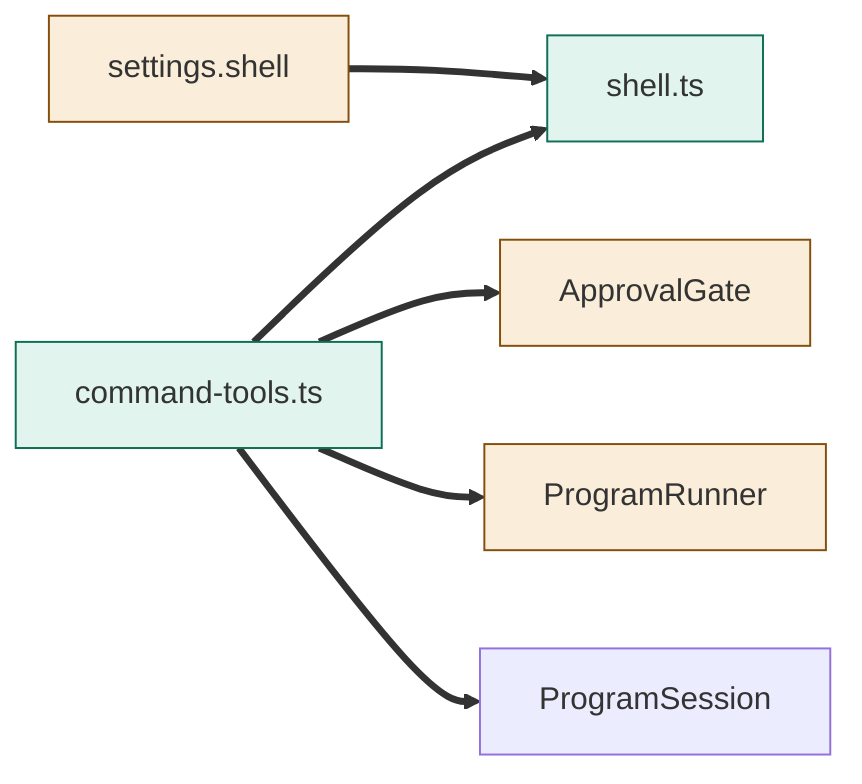
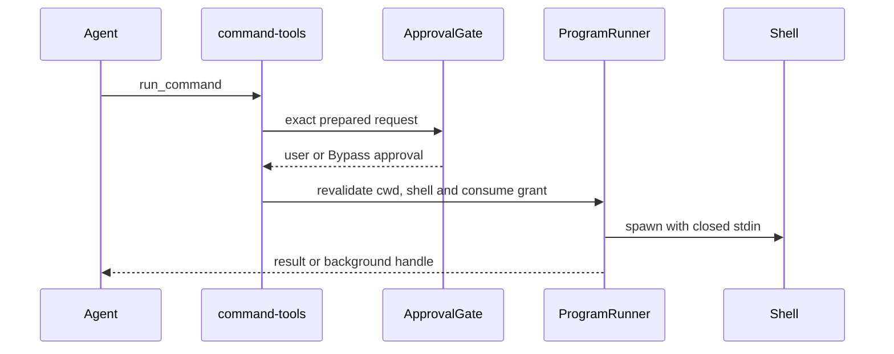

# TASK-002d804f diagrams

Illustrates Design in TASK-002d804f.md. The Design text is authoritative.

## Structure

Map: command-tools/shell added; ApprovalGate, ProgramRunner and settings changed; ProgramSession reused.

## Sequence

## State

Not drawn: commands reuse the existing run lifecycle without new states.
