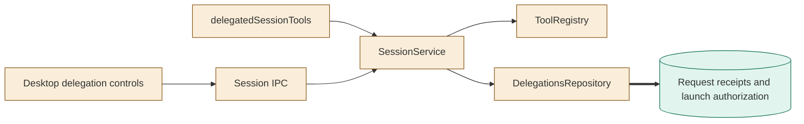
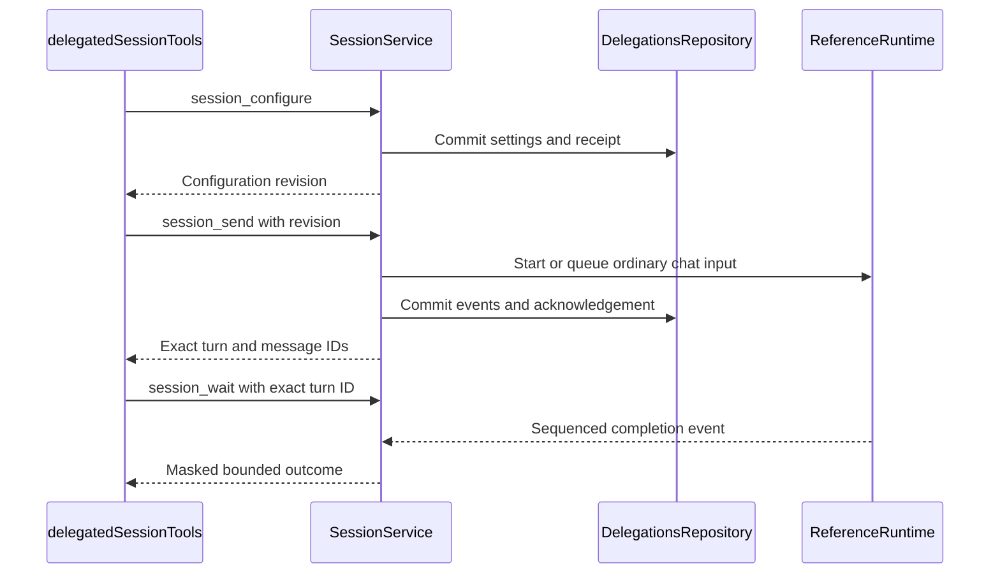
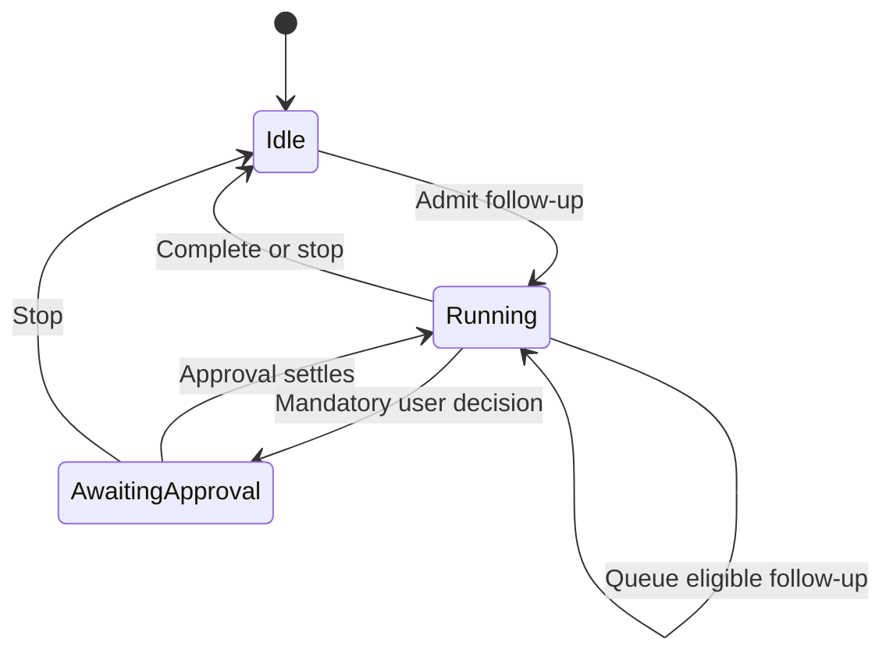

# TASK-00ed678f diagrams

Illustrates the task's Design section.

## Structure

Changed: delegatedSessionTools, SessionService, DelegationsRepository, ToolRegistry, session IPC, Desktop delegation controls. Added: receipts and launch authorization storage.

## Sequence

## State

