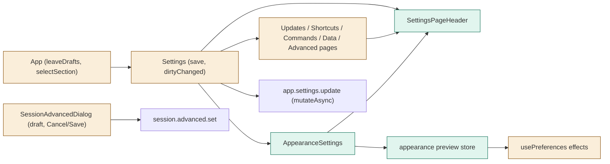
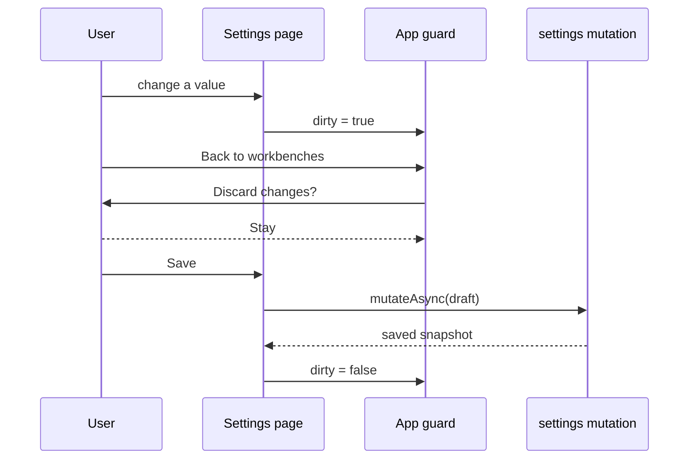
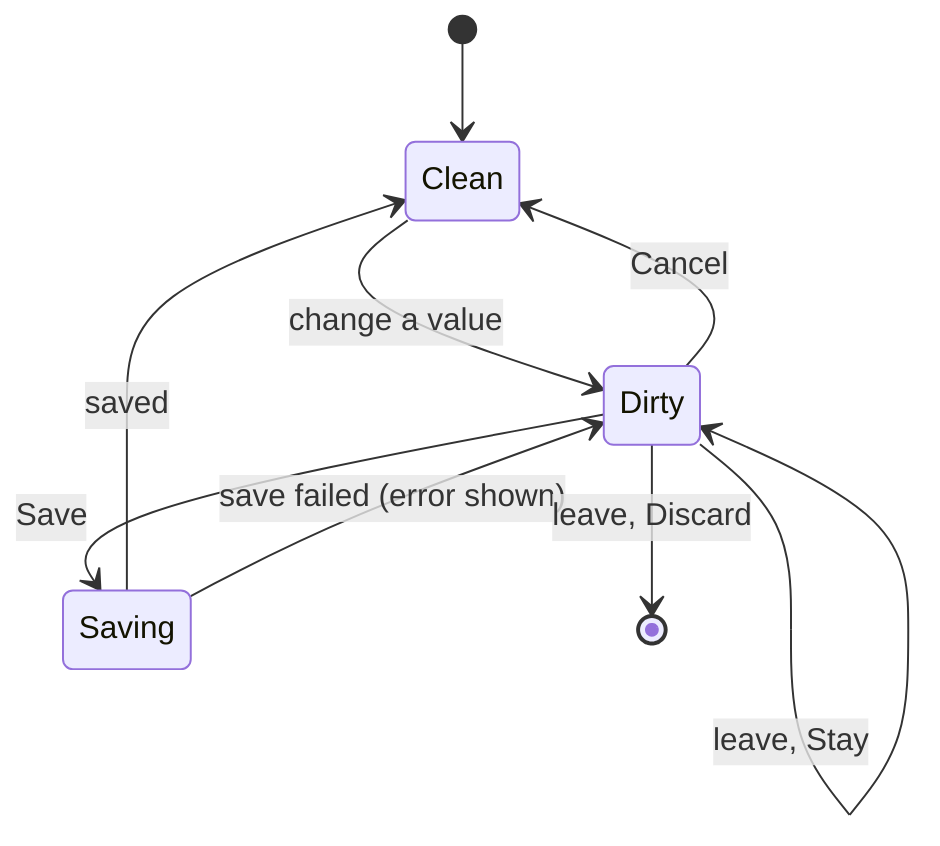

# TASK-046849f5 diagrams

Illustrates `## Design` in `TASK-046849f5.md`. The Design text is authoritative.

Node classes: added = SettingsPageHeader, AppearanceSettings, appearance preview store; changed = Settings, App guard, UpdatesPanel, CommandSettings, PrivacySettings, AdvancedSettingsPanel, AdvancedField, SessionAdvancedDialog, usePreferences.

## Structure

## Sequence

## State

