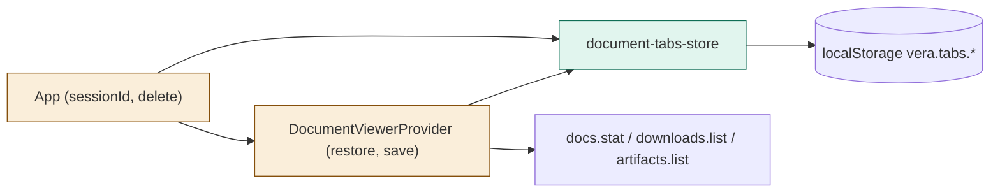
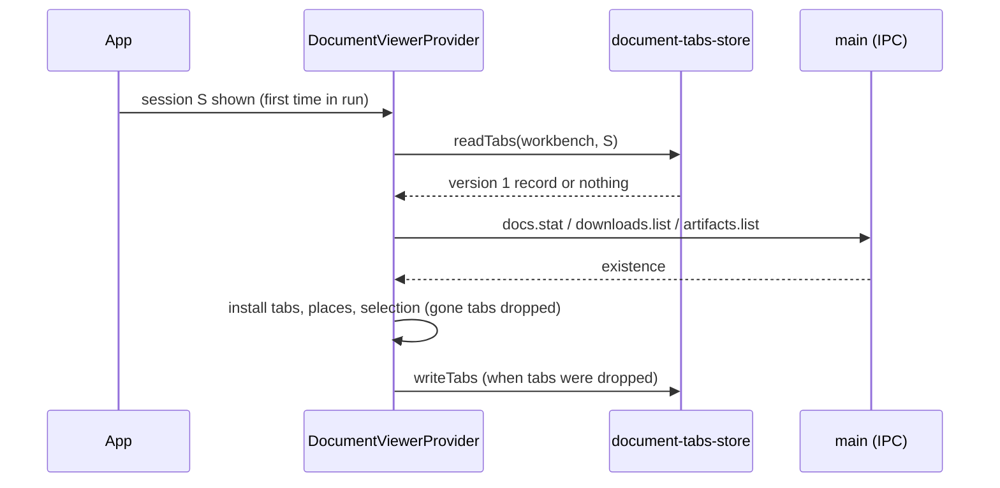

# TASK-061fe00e diagrams

Illustrates `## Design` in `TASK-061fe00e.md`. The Design text is authoritative.

| Node | Class |
|---|---|
| document-tabs-store (read/write/remove) | added |
| DocumentViewerProvider (sessionId, restore, save), App (sessionId, delete hook) | changed |
| docs.stat, downloads.list, artifacts.list, localStorage | unchanged (reused) |

## Structure

## Sequence

## State

Not drawn: the tab lifecycle of TASK-79f6ffd3 is unchanged; restore only seeds a session's first tab set.
