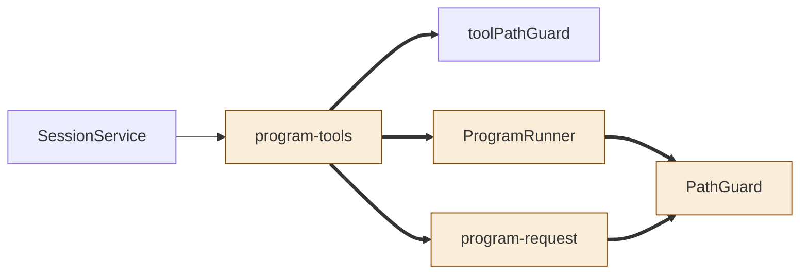
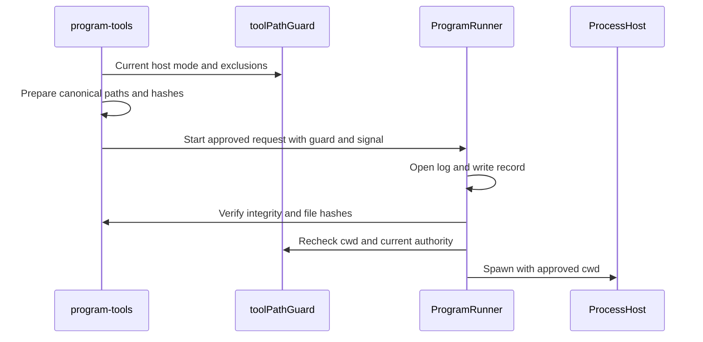
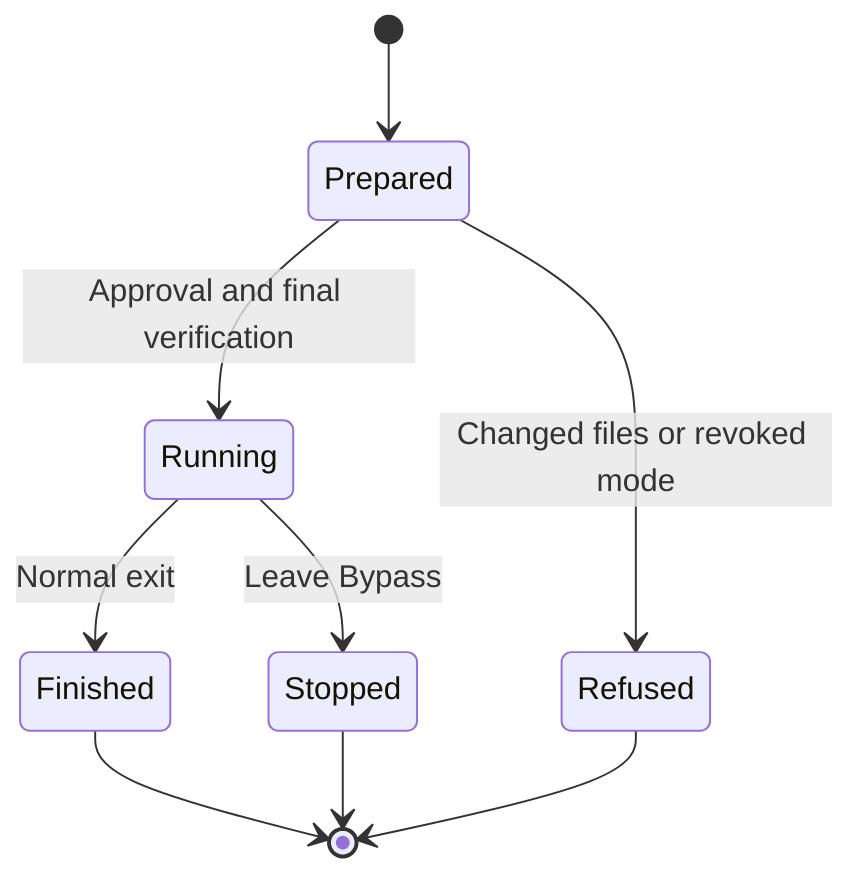

# TASK-0698a3c3 diagrams

Illustrates Design in TASK-0698a3c3.md. Design is authoritative.

## Structure

Map: program-tools, program-request, runner and PathGuard change implementation; toolPathGuard and SessionService are reused unchanged.

## Sequence

## State

