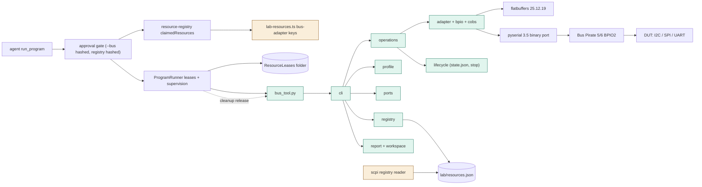
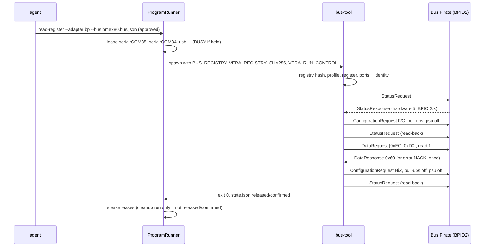
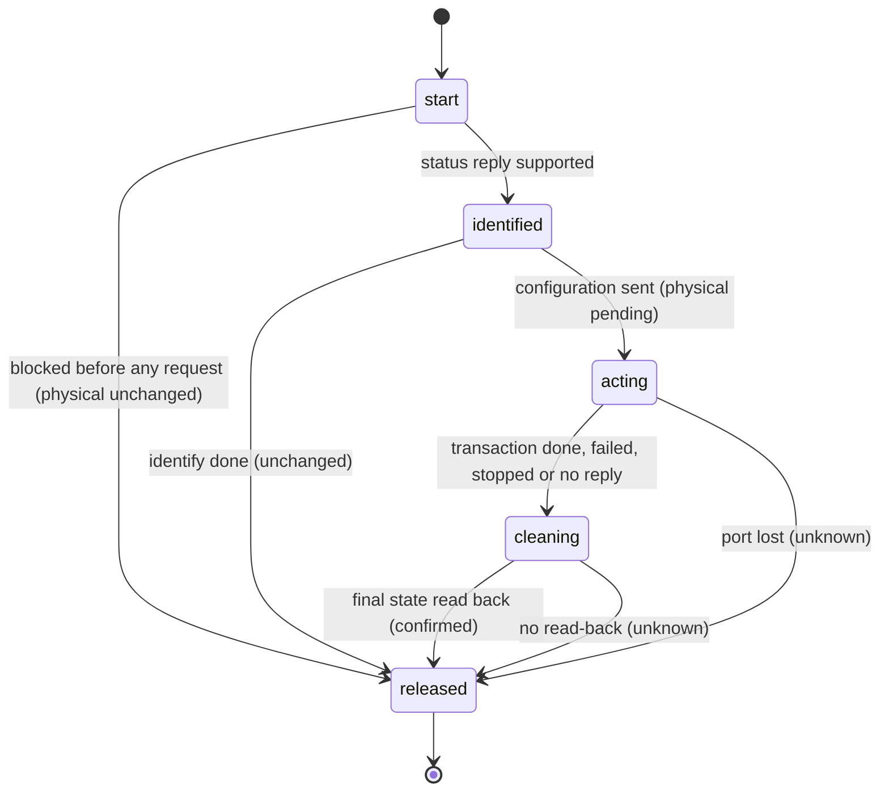

# TASK-06f52fc5 diagrams

Illustrates `## Design` in `TASK-06f52fc5.md`. The Design text is authoritative.

Node map: added - bus-tools plugin.yaml, bus_tool.py, cli, profile, registry, ports, adapter + bpio + cobs,
operations, lifecycle, report + workspace, skills, fake-serial Bus Pirate; changed - lab-resources.ts (kind
bus-adapter), scpi registry reader; unchanged - approval gate, resource-registry.ts, ProgramRunner, ResourceLeases,
provisioner/uv, flatbuffers 25.12.19, pyserial 3.5.

## Structure

## Sequence

## State

