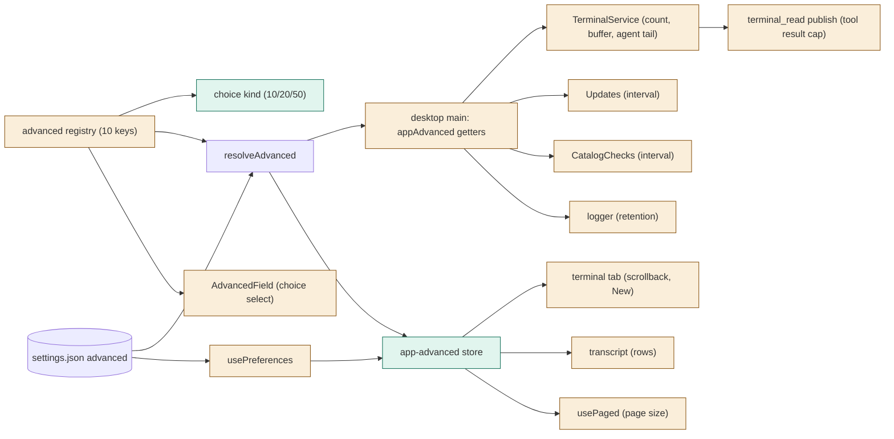
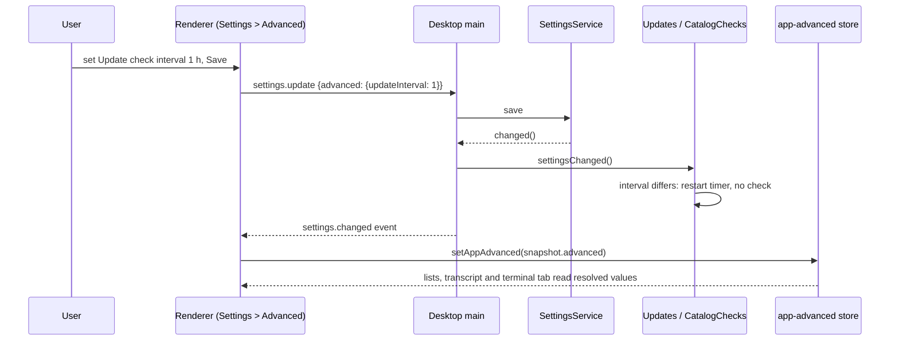
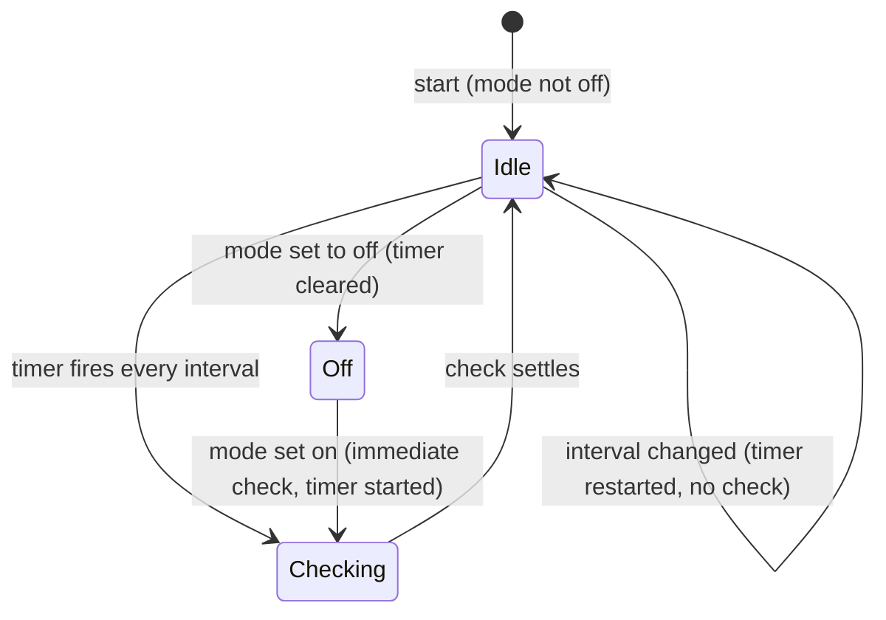

# TASK-07b74bbb diagrams

Illustrates `## Design` in `TASK-07b74bbb.md`. The Design text is authoritative.

Node classes from the Design: added = renderer `app-advanced` store, `choice` setting kind; changed =
advanced registry, TerminalService, terminal_read publish, Updates, CatalogChecks, logger, desktop main
wiring, usePreferences, terminal tab, transcript, pager (usePaged), AdvancedField; unchanged =
resolveAdvanced, settings service.

## Structure

## Sequence

## State

