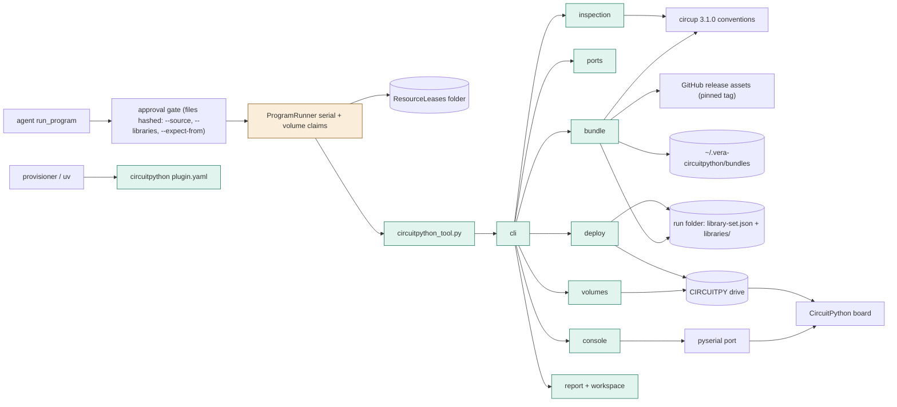
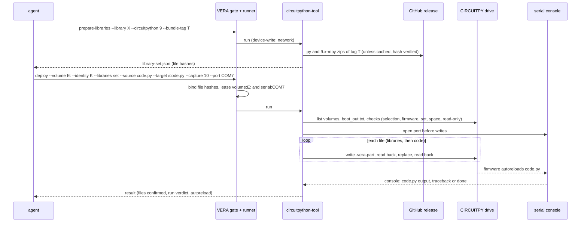
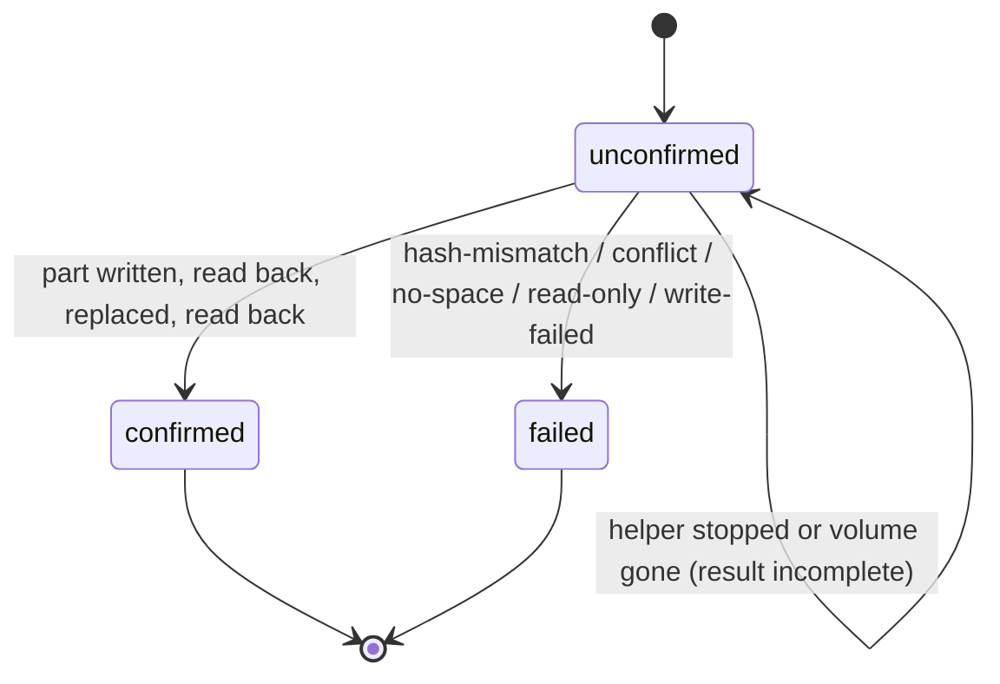

# TASK-0bc542d8 diagrams

Illustrates `## Design` in `TASK-0bc542d8.md`. The Design text is authoritative.

Node map: added - circuitpython plugin.yaml, circuitpython_tool.py, cli, volumes, ports, inspection, bundle, deploy,
console, report + workspace, skills, fake-serial console, fixture bundle builder; changed - ProgramRunner (volume
claims); unchanged - approval gate, ResourceLeases, provisioner/uv, circup 3.1.0, pyserial 3.5, GitHub releases.

## Structure

## Sequence

## State

