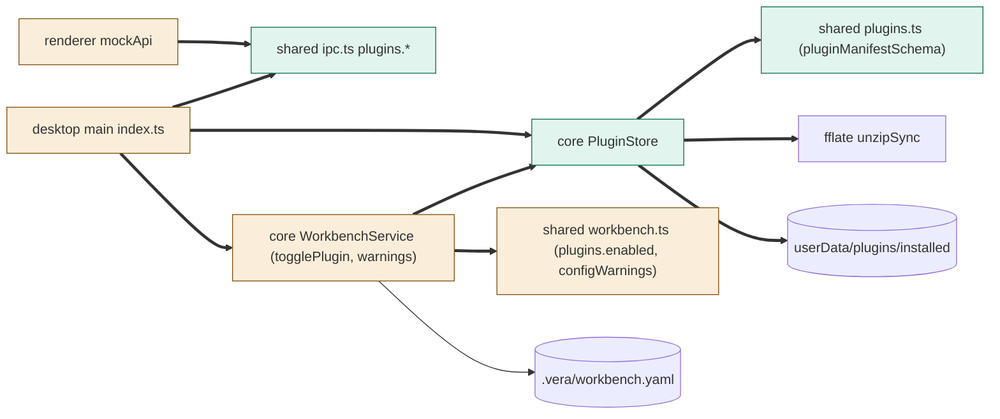
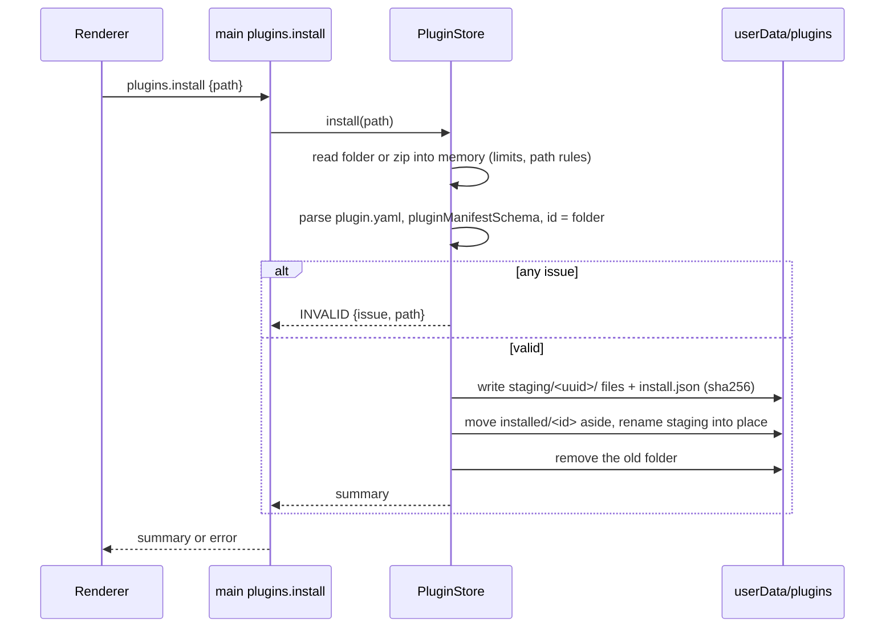
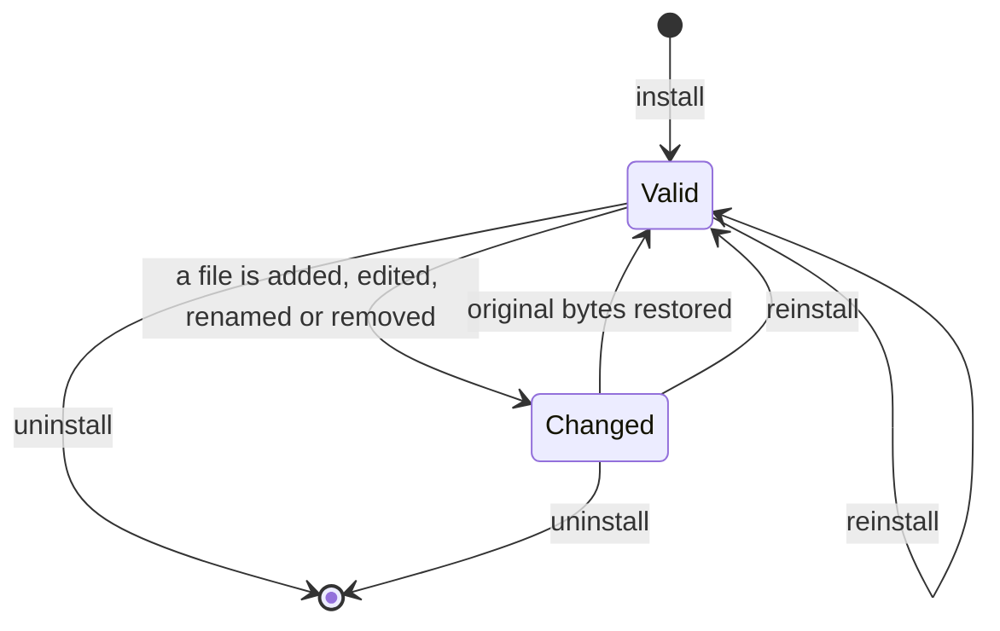

# TASK-0cb6ef0f diagrams

Illustrates `## Design` in `TASK-0cb6ef0f.md`. The Design text is authoritative.

| Node | Class |
|---|---|
| shared plugins.ts schemas, PluginStore, plugins.* channels | added |
| workbench.ts schema/warnings, WorkbenchService, main index.ts, mockApi | changed |
| fflate, yaml, userData plugins folder | unchanged (reused) |

## Structure

## Sequence

## State

