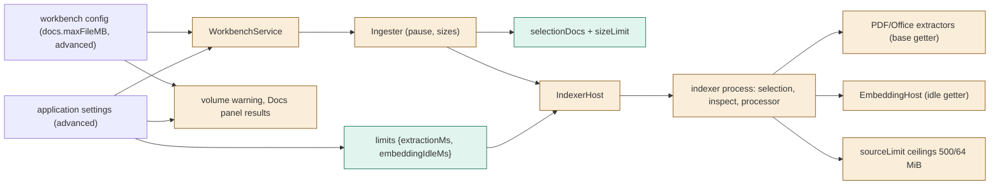

# TASK-0dff4c83 diagrams

Illustrates `## Design` in `TASK-0dff4c83.md`. The Design text is authoritative.

Node classes from the Design: added = indexer `limits` object, `selectionDocs` helper; changed = kinds
limits, selection, ingest (pause, sizes), inspect/processor ceilings, extractors, embedding host, document
services, IndexerHost/handler, workbench service (docs results, preview), search, volume warning, desktop main,
CLI; unchanged = resolveAdvanced.

## Structure



## Sequence

```mermaid
sequenceDiagram
    participant W as WorkbenchService
    participant I as Ingester
    participant H as IndexerHost
    participant P as Indexer process
    participant X as Extractor
    W->>I: request() after a config save
    I->>I: wait the Indexing pause (application value)
    I->>H: select(root, selectionDocs(config))
    H->>P: {type: select, input, limits}
    P-->>H: selection within maxFileMB / textFileMB
    I->>H: process(document)
    H->>P: {type: process, input, limits}
    P->>X: extract with base = limits.extractionMs
    X-->>P: text or timeout
    P-->>H: result; embedding host idles for limits.embeddingIdleMs
```

## State

Not drawn: the design adds no lifecycle, status field or state transition.
