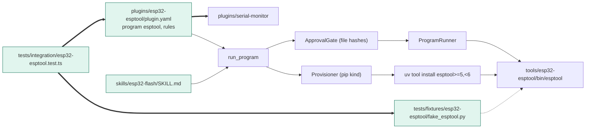
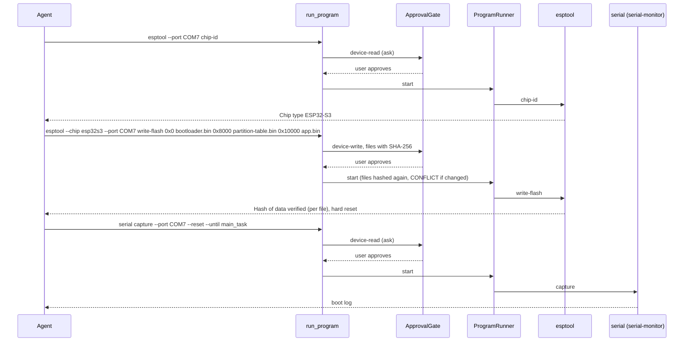

# TASK-10445e04 diagrams

Illustrates `## Design` in `TASK-10445e04.md`. The Design text is authoritative.

Node map: added = plugins/esp32-esptool/plugin.yaml, skill esp32-flash, fake_esptool.py stub, integration test;
no class = run_program, ApprovalGate, ProgramRunner, Provisioner, uv, esptool, serial-monitor (reused unchanged).

## Structure

## Sequence

## State

Not drawn: the plugin adds no lifecycle or status field; approval states belong to the unchanged platform.
