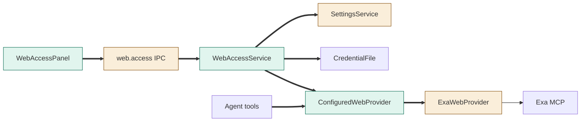
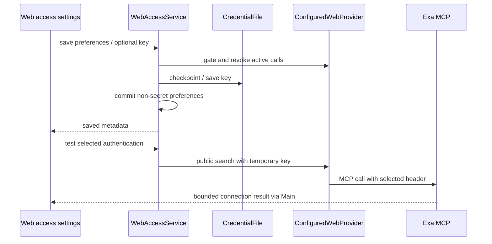
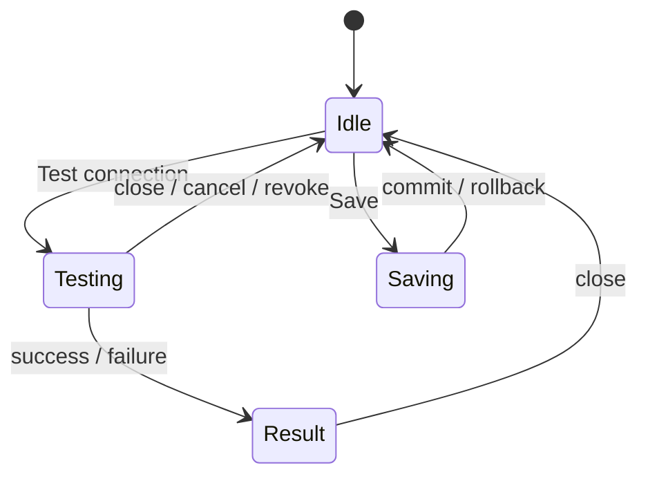

# TASK-12f24c10 diagrams

Illustrates Design in TASK-12f24c10.md; Design is authoritative.

## Structure

Map: WebAccessPanel, WebAccessService and ConfiguredWebProvider added; settings/IPC/Exa composition changed; CredentialFile reused.

## Sequence

## State

