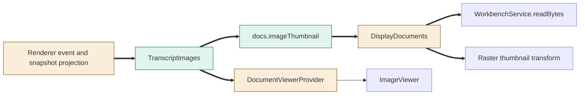
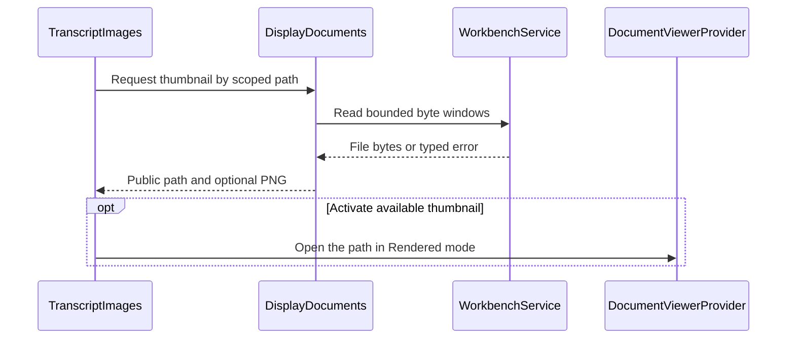
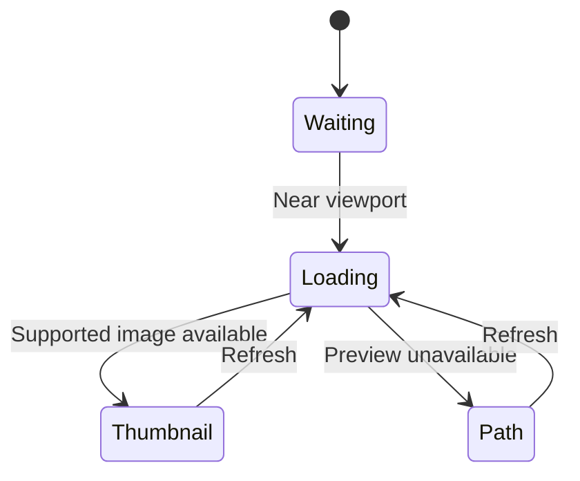

# TASK-13cdba36 diagrams

Illustrates the Design section of [TASK-13cdba36.md](TASK-13cdba36.md).

## Structure

Added: TranscriptImages and docs.imageThumbnail. Changed: renderer event/snapshot projection, DisplayDocuments and DocumentViewerProvider. Reused: WorkbenchService.readBytes, ImageViewer and the raster thumbnail transform.

## Sequence

## State

