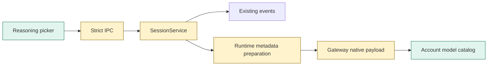
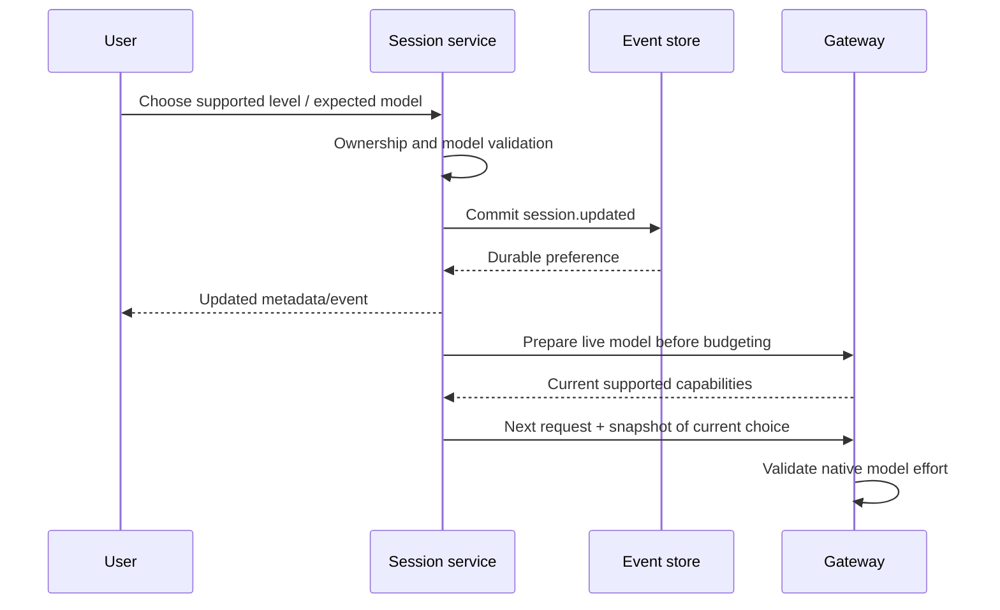

# TASK-1493cacd diagrams
Design in TASK-1493cacd.md is authoritative.

## Structure
Map: Picker added; IPC, SessionService, Gateway changed; event store reused.


## Sequence


## State
```mermaid
stateDiagram-v2
  [*] --> Default
  Default --> Override: Choose supported level
  Override --> Default: Choose Default / incompatible model
  Override --> Override: Change level / compatible model
  Default --> Default: Unsupported model
```
