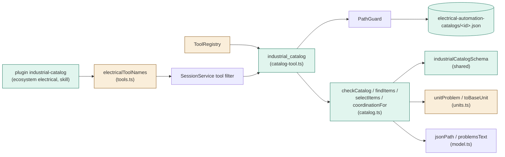
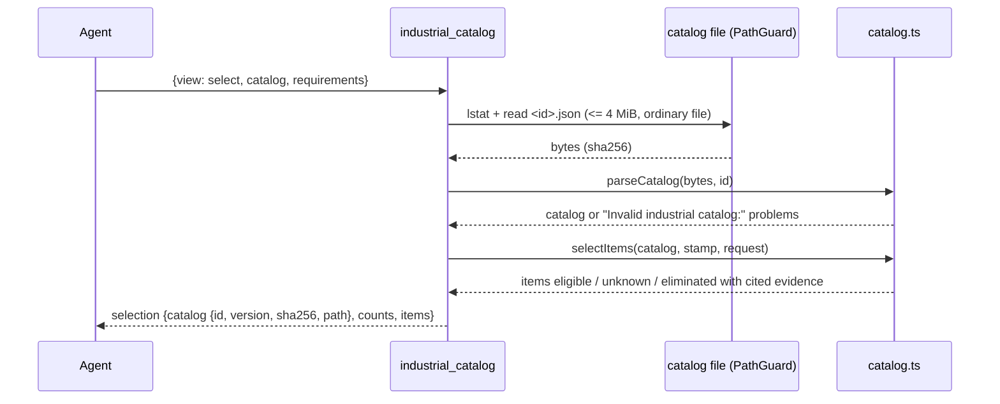

# TASK-15cb5dad diagrams

Illustrates `## Design` in `TASK-15cb5dad.md`. The Design text is authoritative.

Node classes: added = shared industrial-catalog.ts, core catalog.ts, catalog-tool.ts, plugin industrial-catalog,
catalog files; changed = units.ts (scales, known properties), tools.ts (gate list), registry.ts; unchanged =
SessionService filter, model.ts, PathGuard.

## Structure



## Sequence



## State

```mermaid
stateDiagram-v2
    [*] --> evaluated: requirement on item
    evaluated --> unknown_absent: no value of that name
    evaluated --> unknown_conditions: no value covers the conditions
    evaluated --> unknown_unconfirmed: only extracted values
    evaluated --> pass: conservative confirmed value meets limit
    evaluated --> fail: conservative confirmed value misses limit
    note right of fail: any fail -> item eliminated; else any unknown -> unknown; else eligible
```
