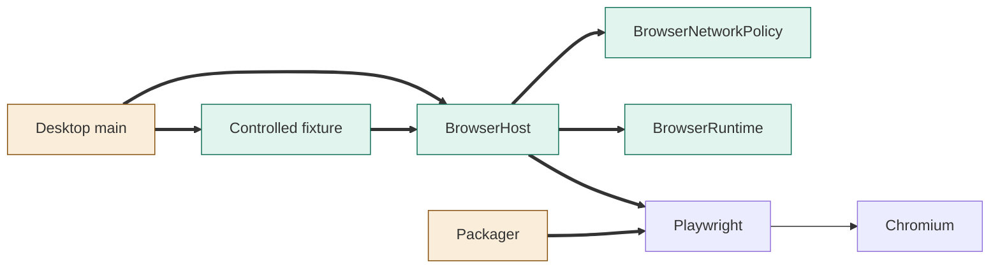
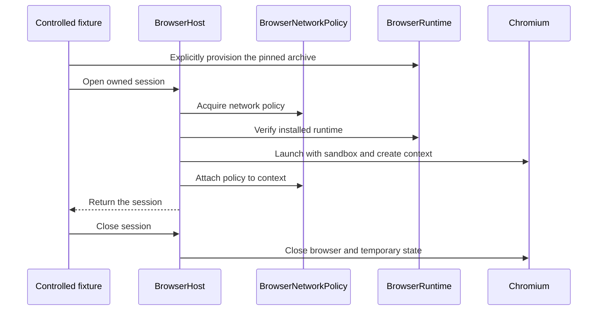
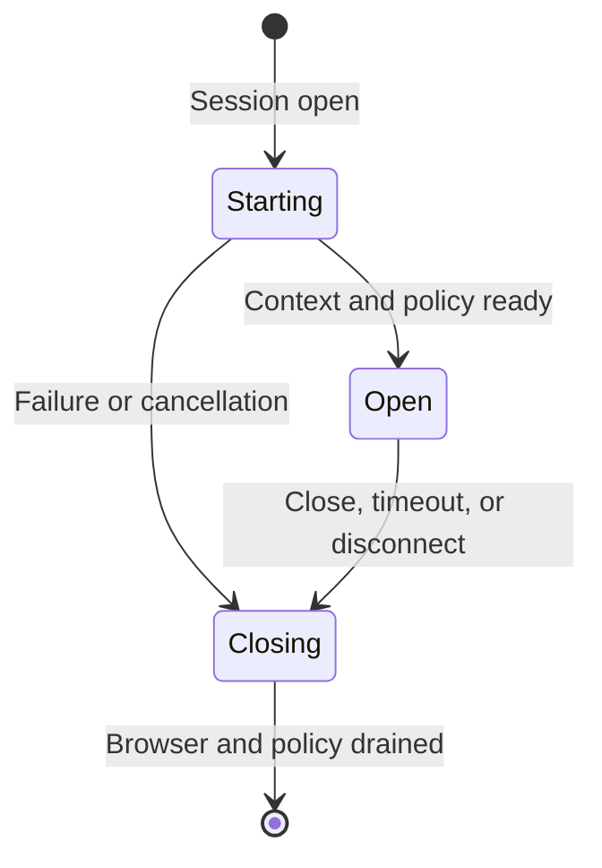

# TASK-16426506 diagrams

Illustrates [Design](TASK-16426506.md#design).

## Structure

Class map: Desktop main and packager changed. BrowserHost, BrowserRuntime, BrowserNetworkPolicy, and the fixture added. Playwright and Chromium are reused upstream components.

## Sequence

## State

