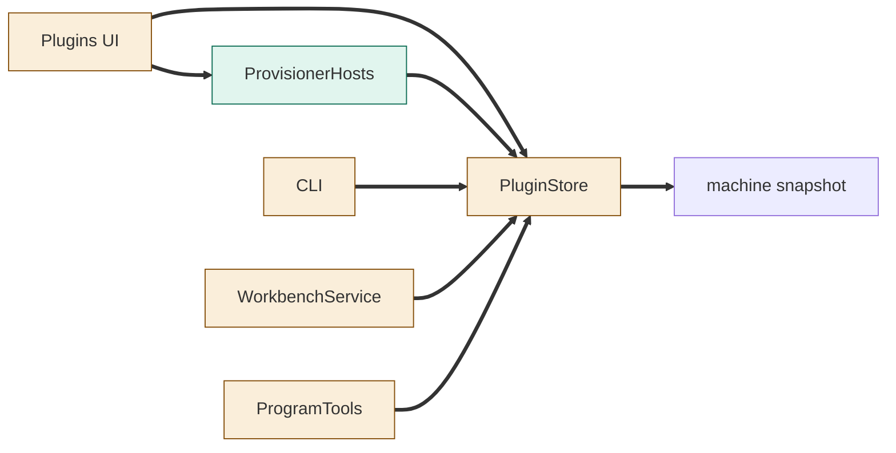
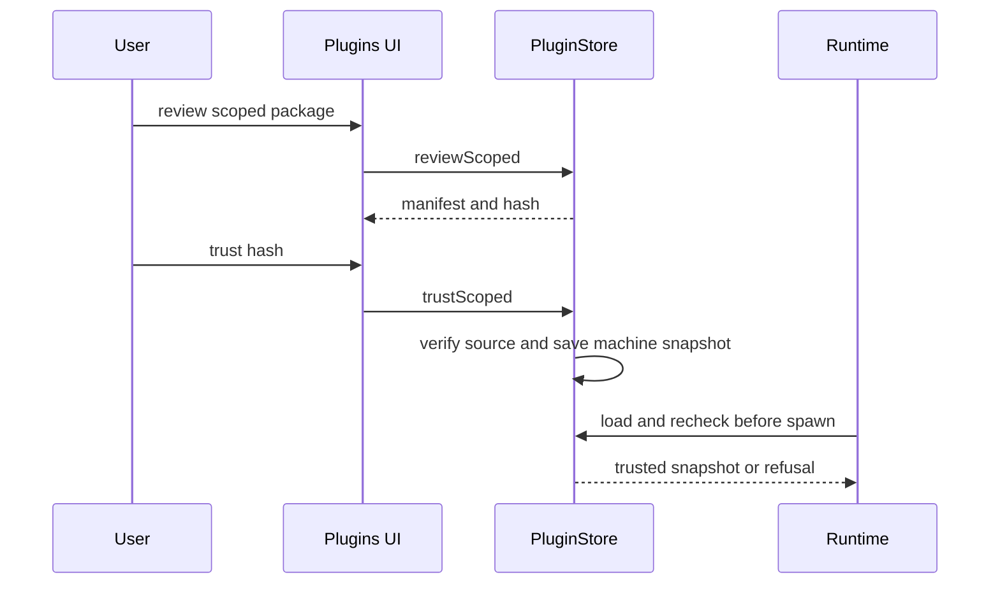
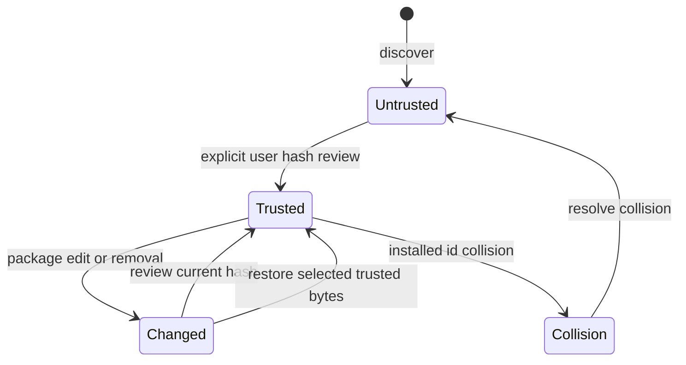

# TASK-17c397b6 diagrams
Illustrates Design; Design is authoritative.

## Structure
Node map: PluginStore, WorkbenchService, ProgramTools, Plugins UI, CLI changed; machine snapshot reused representation; ProvisionerHosts added.

## Sequence

## State

