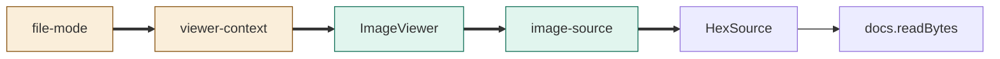
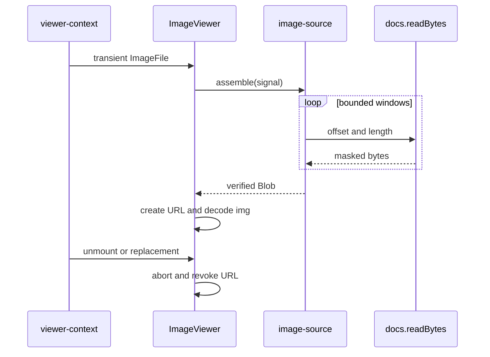
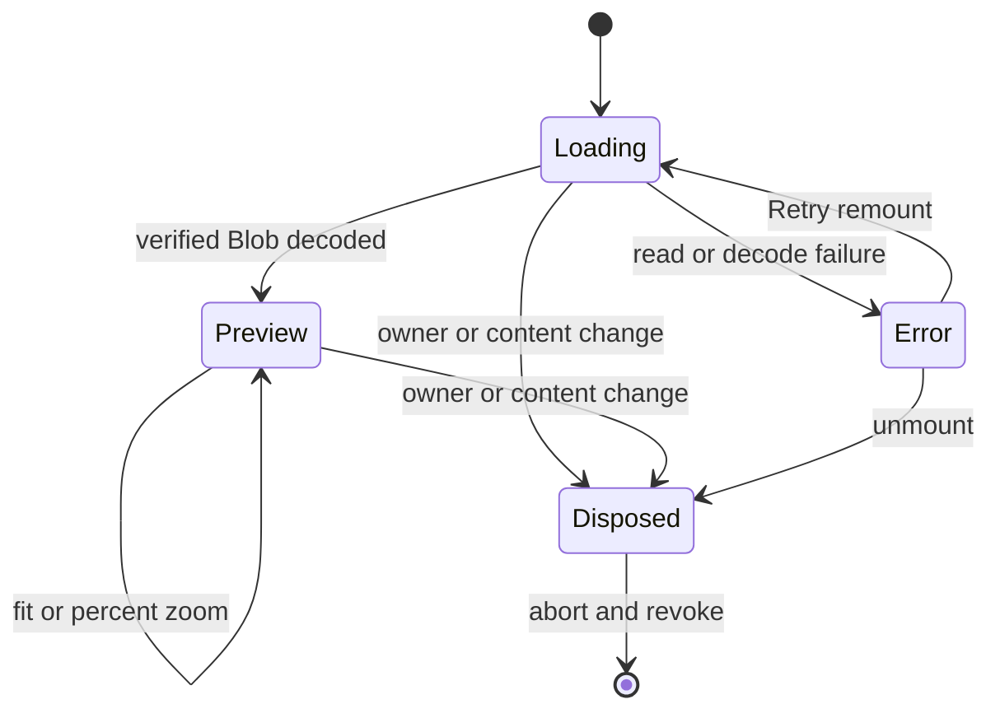

# TASK-180f3be3 diagrams

Illustrates Design in TASK-180f3be3.md. Design text is authoritative.

## Structure

Node map: file-mode and viewer-context changed; image-source and ImageViewer added; HexSource and docs.readBytes reused unchanged.

## Sequence

## State

