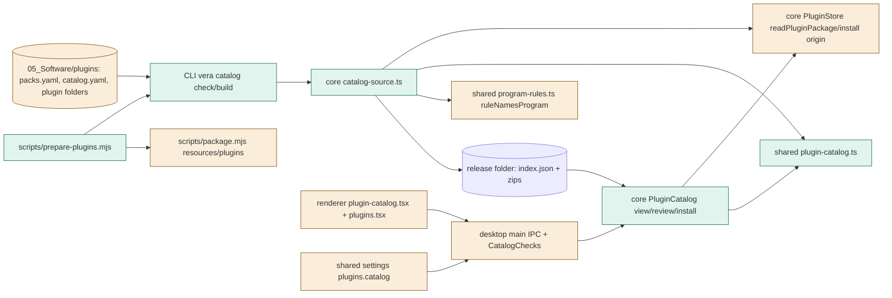
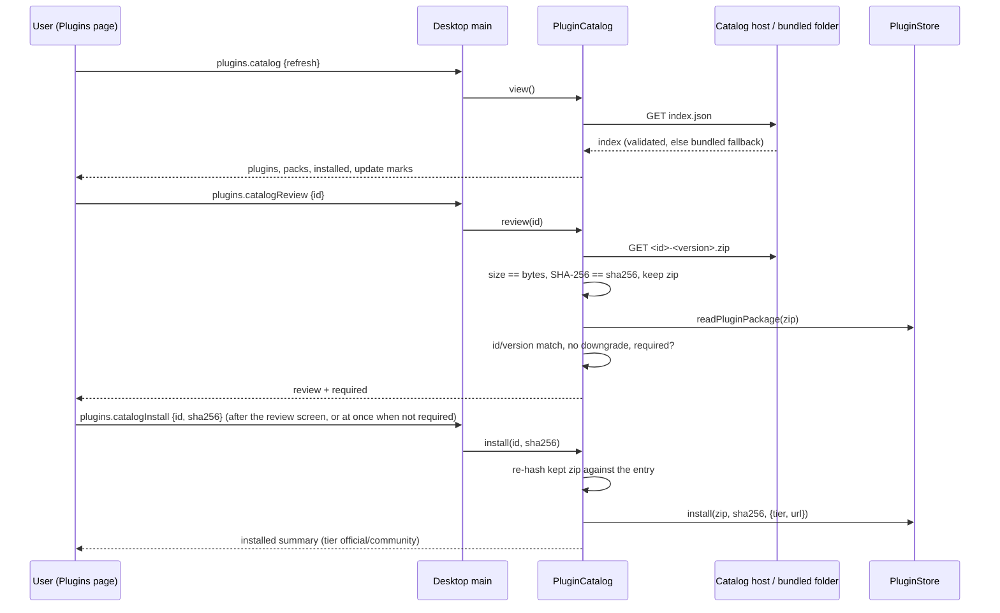
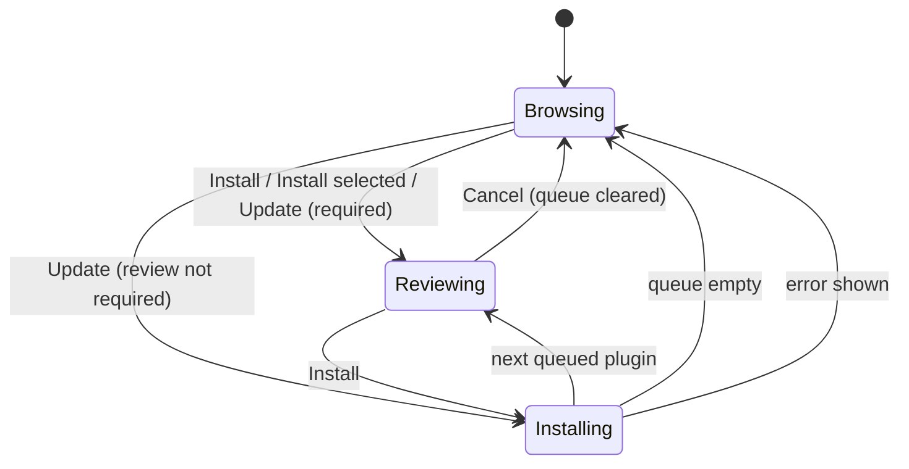

# TASK-1a519115 diagrams

Illustrates `## Design` in `TASK-1a519115.md`. The Design text is authoritative.

Node classes: added = `plugin-catalog.ts` (shared), `catalog-source.ts`, `catalog.ts`, CLI `catalog.ts`,
`catalog-checks.ts`, `plugin-catalog.tsx`, `prepare-plugins.mjs`, catalog source files; changed =
`store.ts` (exported reader, install origin), `program-rules.ts` (`ruleNamesProgram`), main `index.ts`,
`plugins.tsx`, `settings.ts`, `package.mjs`; unchanged = `net.fetch`, the Review screen's store review.

## Structure

## Sequence

## State

