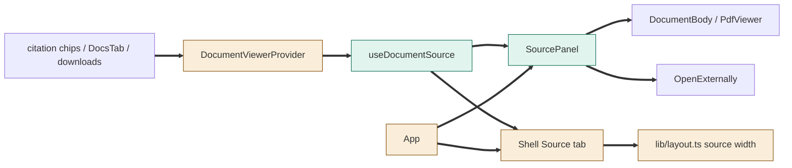
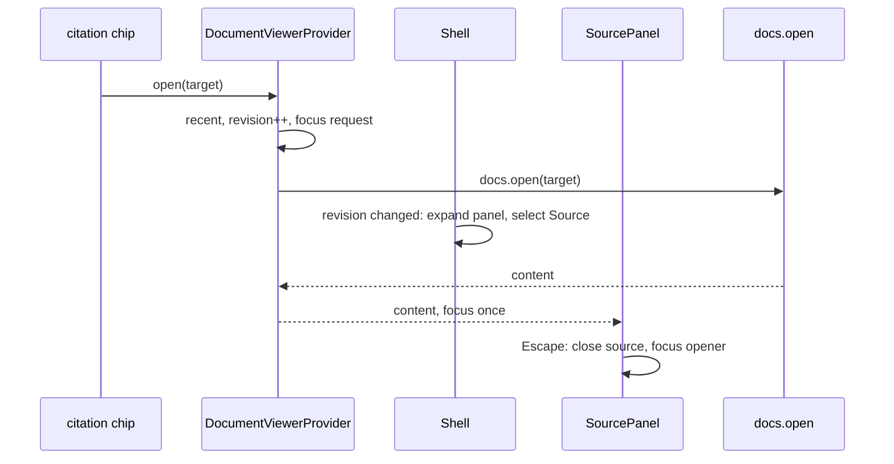

# TASK-1c2ea187 diagrams

Illustrates `## Design` in `TASK-1c2ea187.md`. The Design text is authoritative.

Node classes (from the Design):

| Node | Class |
|---|---|
| SourcePanel, useDocumentSource | added |
| DocumentViewerProvider (no dialog, recent, revision), Shell (Source tab, width), App, lib/layout.ts | changed |
| DocumentBody / PdfViewer, OpenExternally, citation chips, DocsTab, downloads | unchanged (reused) |

## Structure

## Sequence

## State

Not drawn: the source state is a single current target plus a list; no lifecycle beyond open/close.
