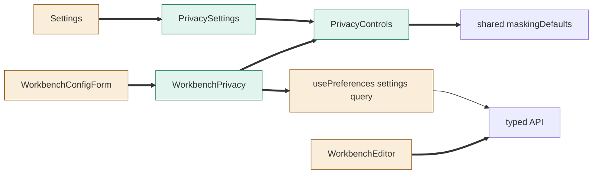
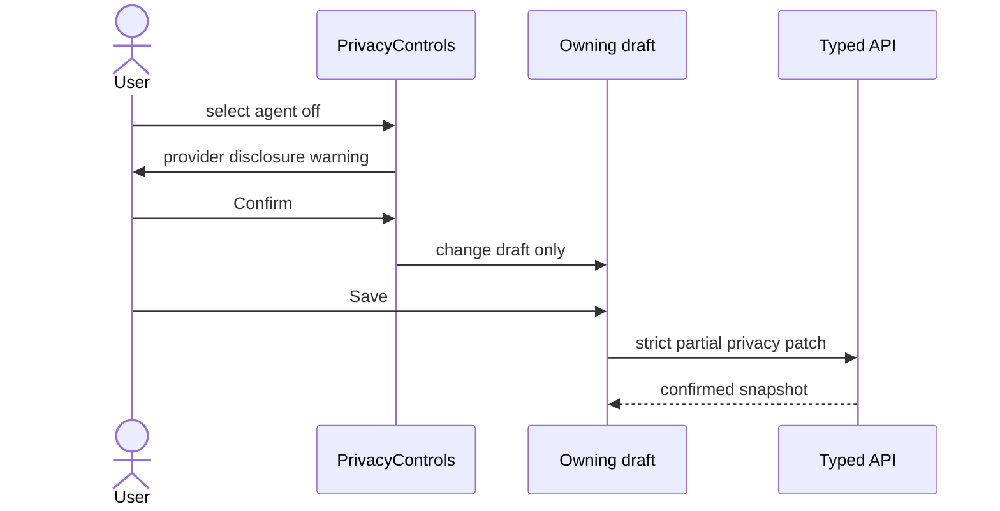
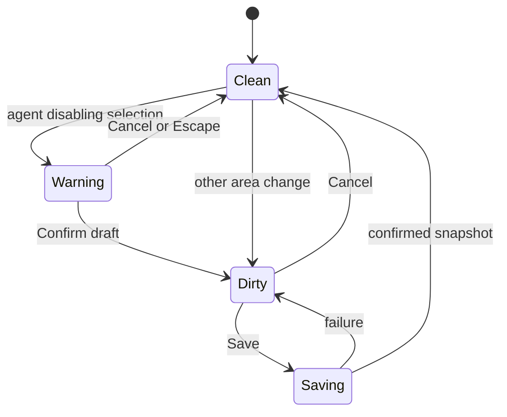

# TASK-1c503009 diagrams

Illustrates `## Design` in `TASK-1c503009.md`. The Design text is authoritative.

## Structure

Map: Settings, WorkbenchConfigForm, WorkbenchEditor and usePreferences changed; PrivacySettings, WorkbenchPrivacy and PrivacyControls added; API/shared defaults reused unchanged.

## Sequence

## State

