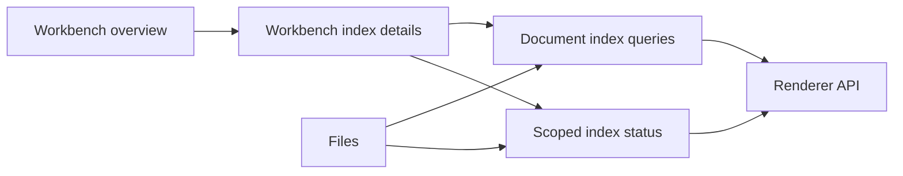
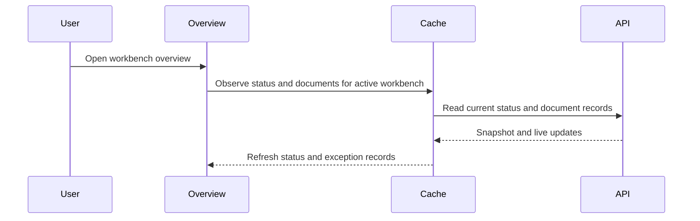

# TASK-1e495e65 diagrams

Illustrates the Design in TASK-1e495e65.md.

## Structure

Changed: Workbench overview, Files. Added: overview details and shared document index queries. Reused: status hook and renderer API.

## Sequence

## State

Not drawn: the existing indexing status states and transitions are unchanged.
