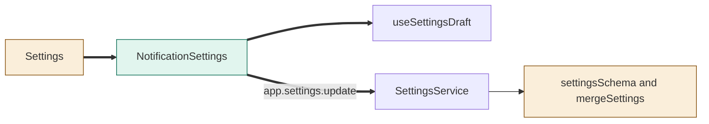
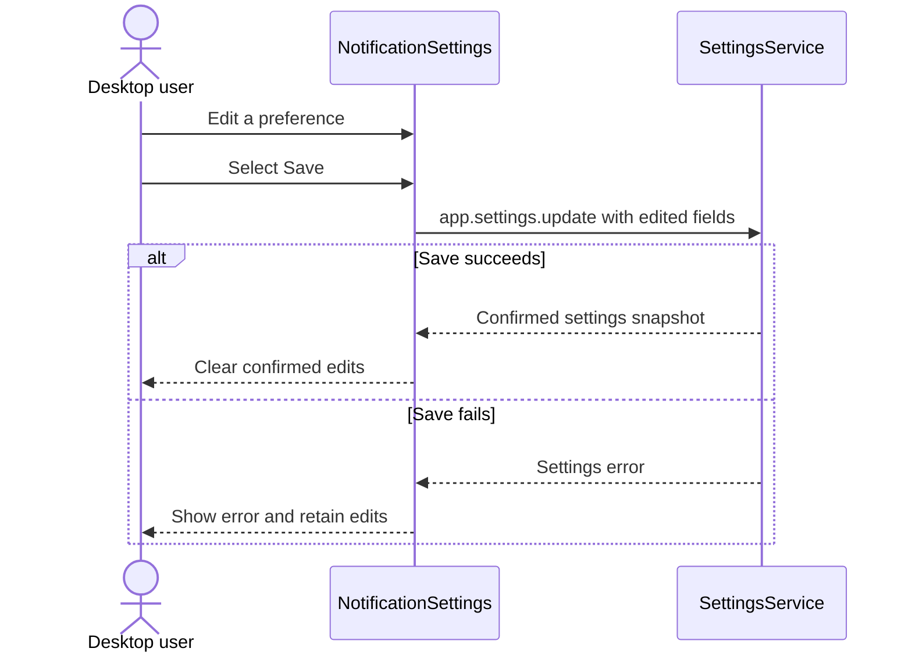

# TASK-2077e196 diagrams

Illustrates `## Design` in `TASK-2077e196.md`. The Design text is authoritative.

## Structure

Added: NotificationSettings. Changed: Settings, shared settings contract. Reused: useSettingsDraft, SettingsService.

## Sequence

## State

No lifecycle or status is added. The page uses the shared settings draft lifecycle.
