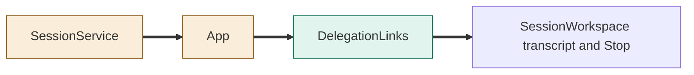
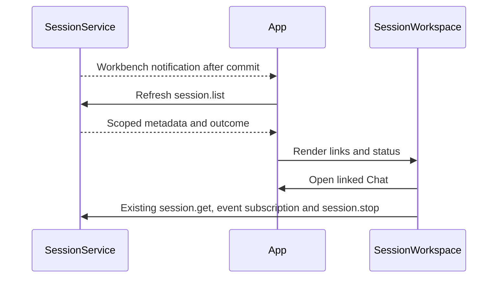
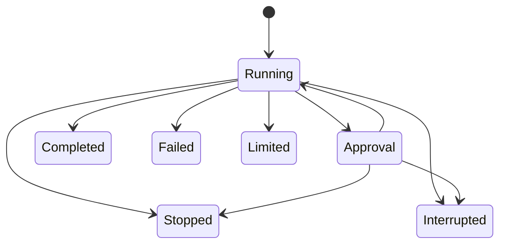

# TASK-20cc1ef8 diagrams

Illustrates Design in [TASK-20cc1ef8.md](TASK-20cc1ef8.md).

## Structure

Changed: SessionService, App. Added: DelegationLinks. Reused: session transcript and Stop.

## Sequence

## State

