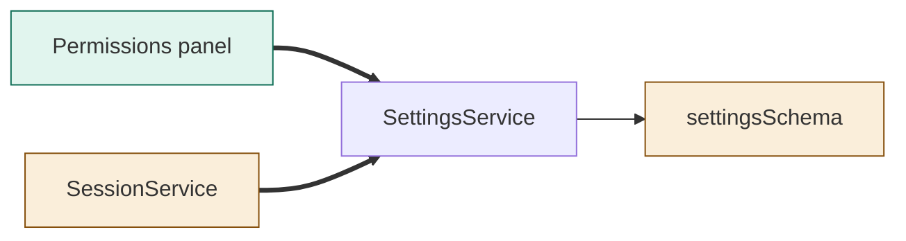
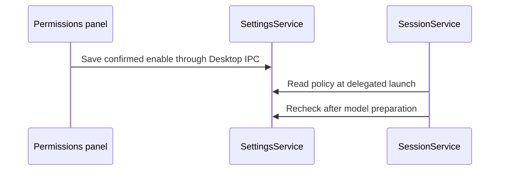
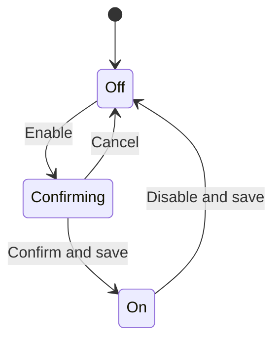

# TASK-211bfde8 diagrams

Illustrates the design in `TASK-211bfde8.md`.

## Structure

Added: Permissions panel. Changed: settings schema and SessionService. Reused: SettingsService.

## Sequence

## State

