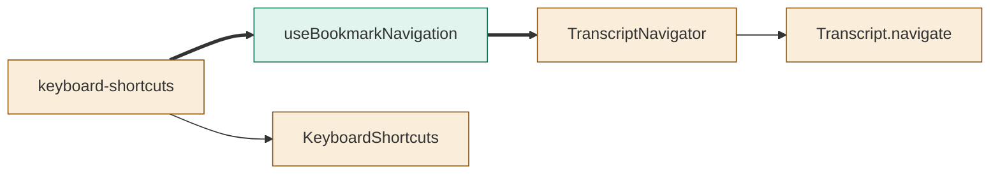
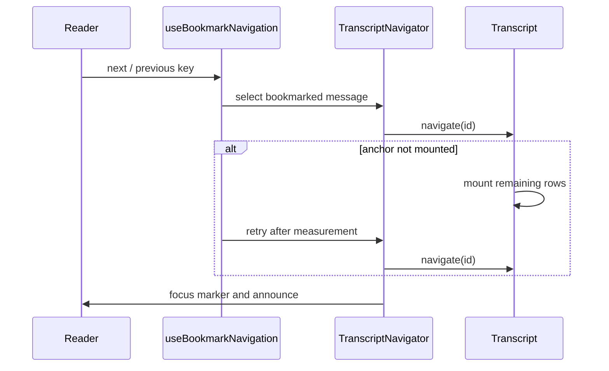

# TASK-21b9c878 diagrams

Illustrates Design in TASK-21b9c878.md. Design is authoritative.

## Structure
Node map: registry, navigator and Transcript changed; hook added; Settings editor reused unchanged except label map.

## Sequence

## State
Not drawn: no product lifecycle or persisted state changes.
