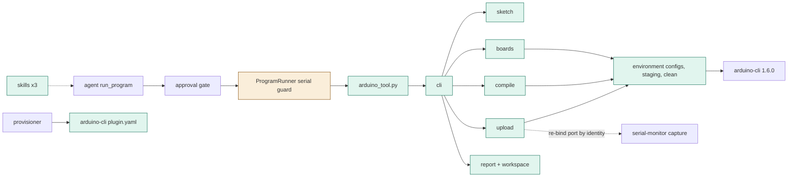
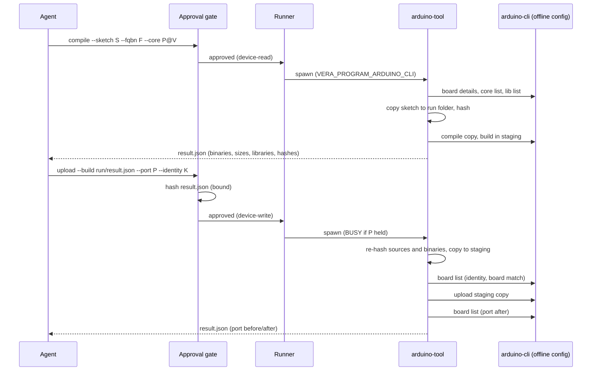
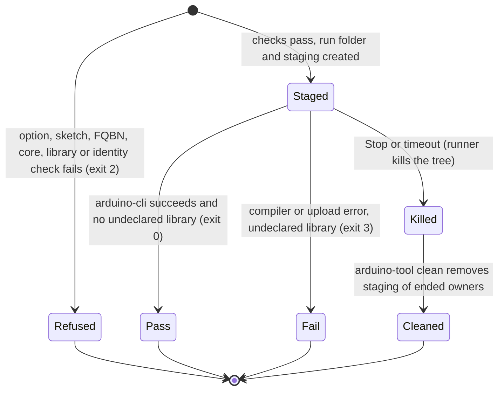

# TASK-239a7379 diagrams

Illustrates `## Design` in `TASK-239a7379.md`. The Design text is authoritative.

Node map: added - plugin.yaml, arduino_tool.py, cli, environment, sketch, boards, compile, upload, report,
skills, fake arduino-cli; changed - runner (serial guard); unchanged - approval gate, provisioner, arduino-cli,
serial-monitor.

## Structure

## Sequence

## State

