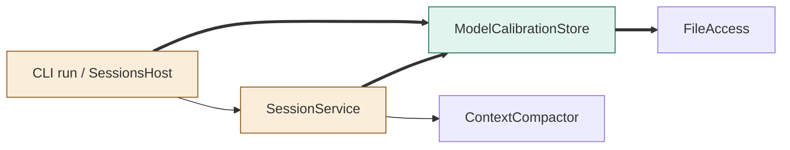
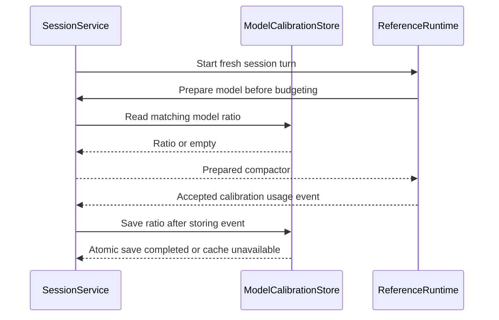

# TASK-26d89670 diagrams

Illustrates the design in [TASK-26d89670.md](TASK-26d89670.md).

## Structure

Added: ModelCalibrationStore. Changed: SessionService and the CLI and desktop composition. Reused: ContextCompactor and FileAccess.

## Sequence

## State

Not drawn: application cache records add no session lifecycle or status.
