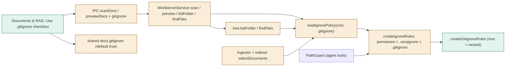
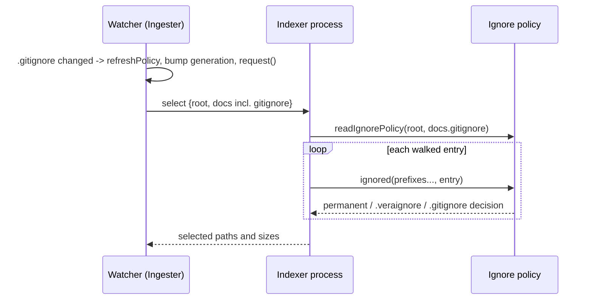

# TASK-286a3fb6 diagrams

Illustrates `## Design` in `TASK-286a3fb6.md`. The Design text is authoritative.

Node map: added = createGitignoreRules, docs.gitignore checkbox; changed = createIgnoreRules,
readIgnorePolicy, selectDocuments, Ingester, service scan/preview/tree, tree.listFolder/findFiles,
shared docs schema, IPC scanDocs/previewDocs; unchanged = PathGuard.

## Structure

## Sequence

## State

Not drawn: no lifecycle or status field changes; docs.gitignore is a plain boolean.
