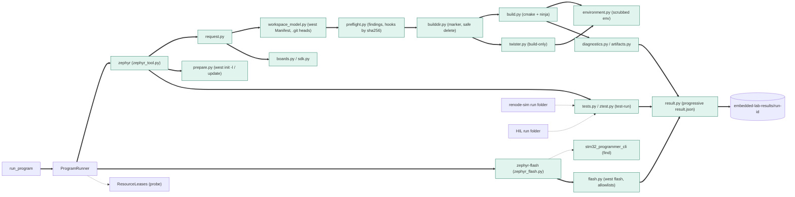
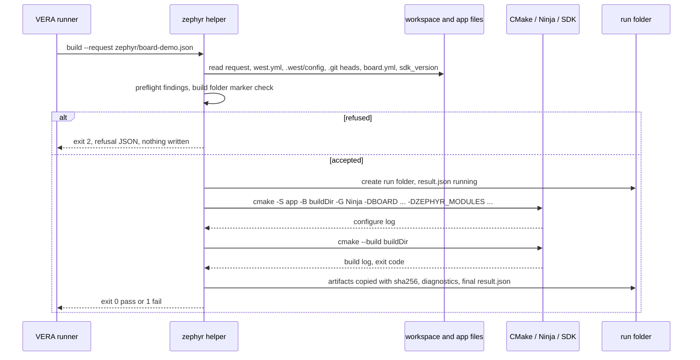
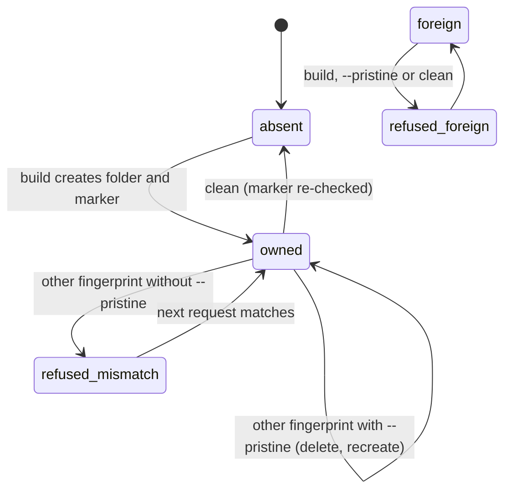

# TASK-287329c3 diagrams

Illustrates `## Design` in `TASK-287329c3.md`. The Design text is authoritative.

Node map: added - zephyr program (zephyr_tool.py), zephyr-flash program, stm32_programmer_cli find program, request,
workspace_model, boards/sdk, preflight, environment, builddir, build/diagnostics/artifacts, twister, tests/ztest,
prepare, flash, result; unchanged - VERA runner, leases, provisioner, renode-sim, HIL executor, lab/resources.json.

## Structure

## Sequence

## State

