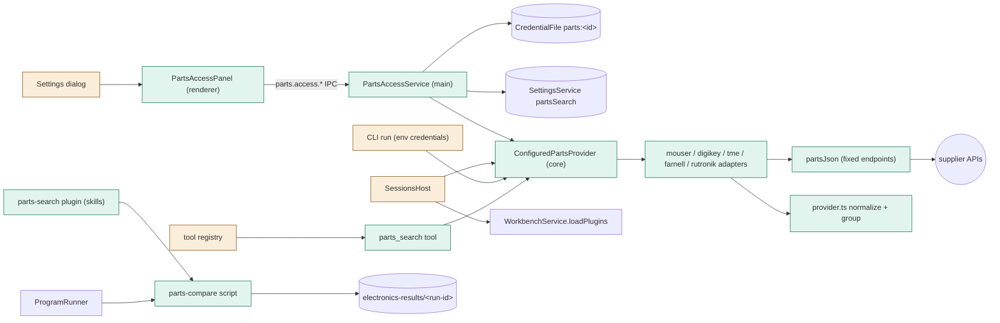
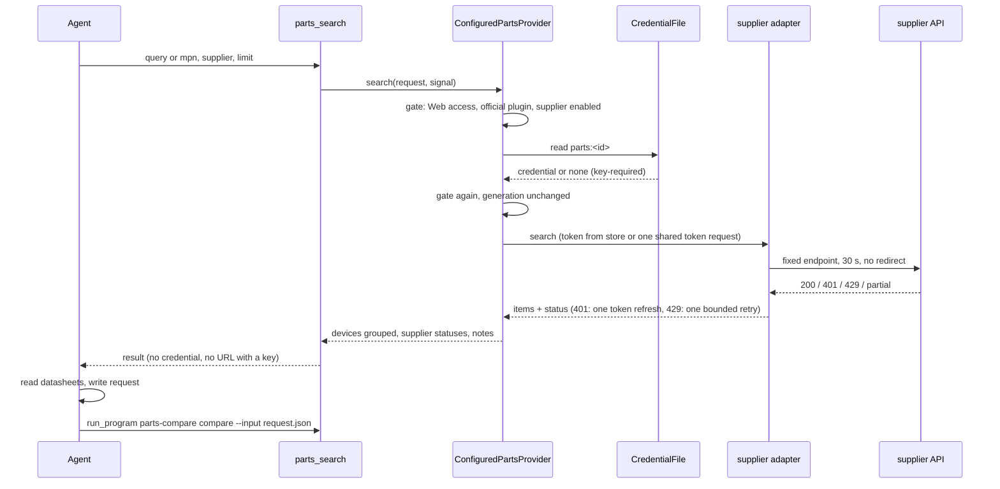
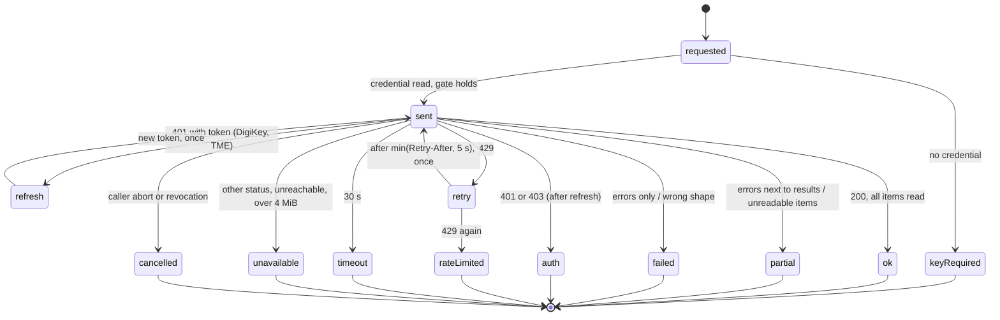

# TASK-2c5054ba diagrams

Illustrates `## Design` in `TASK-2c5054ba.md`. The Design text is authoritative.

Node classes: added - parts-search.ts, partsSearch settings, parts_search tool, ConfiguredPartsProvider,
partsJson, five adapters, provider.ts, PartsAccessService, PartsAccessPanel, parts-search plugin,
parts-compare; changed - SessionsHost (computes the plugin gate, passes `parts`), CLI run (env credentials),
Settings dialog (new section), tool registry (new builtin); unchanged - CredentialFile, SettingsService,
WorkbenchService.loadPlugins, ProgramRunner.

## Structure

## Sequence

## State

