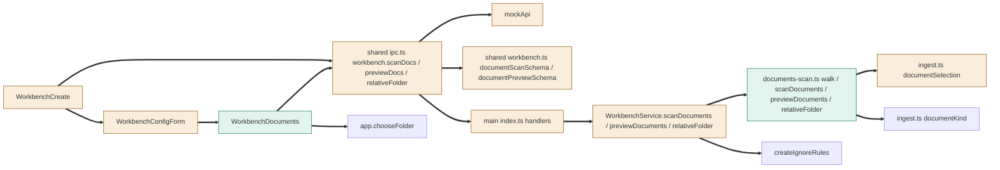

# TASK-2ec633ad diagrams

Illustrates `## Design` in `TASK-2ec633ad.md`. The Design text is authoritative.

Node classes (from the Design):

| Node | Class |
|---|---|
| documents-scan.ts scanDocuments / previewDocuments / relativeFolder | added |
| WorkbenchDocuments | added |
| WorkbenchService scan/preview/relative methods | changed |
| ingest.ts documentSelection export | changed |
| shared ipc.ts channels, shared workbench.ts schemas | changed |
| main index.ts handlers | changed |
| WorkbenchConfigForm Documents section | changed |
| WorkbenchCreate (scan after inspect) | changed |
| mockApi fixtures | changed |
| documentKind, createIgnoreRules, app.chooseFolder | unchanged |

## Structure



## Sequence

```mermaid
sequenceDiagram
    actor Engineer
    participant Create as WorkbenchCreate
    participant Docs as WorkbenchDocuments
    participant Main as main index.ts
    participant Service as WorkbenchService
    participant Scan as documents-scan.ts
    Engineer->>Create: Choose folder
    Create->>Main: workbench.inspect {folder}
    Main->>Service: inspect(folder)
    Service-->>Create: inspection
    Create->>Main: workbench.scanDocs {folder}
    Main->>Service: scanDocuments(folder)
    Service->>Scan: scanDocuments(root, ignored)
    Scan-->>Create: folders with kinds and bytes
    Create->>Create: draft docs.include = detected folder patterns
    Engineer->>Docs: open Documents section
    Docs->>Main: workbench.previewDocs {folder, include, exclude}
    Main->>Service: previewDocuments(folder, docs)
    Service->>Scan: previewDocuments(root, docs, ignored)
    Scan-->>Docs: files, bytes, officePending
    Engineer->>Docs: Add folder
    Docs->>Main: app.chooseFolder, then workbench.relativeFolder {root, folder}
    Main->>Service: relativeFolder(root, picked)
    Service-->>Docs: relative path or DENIED
```

## State

Not drawn: the Design adds no lifecycle or status field; a row's checked state is only whether its pattern is in docs.include.
