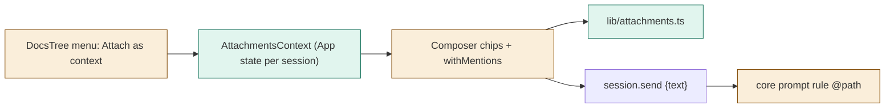
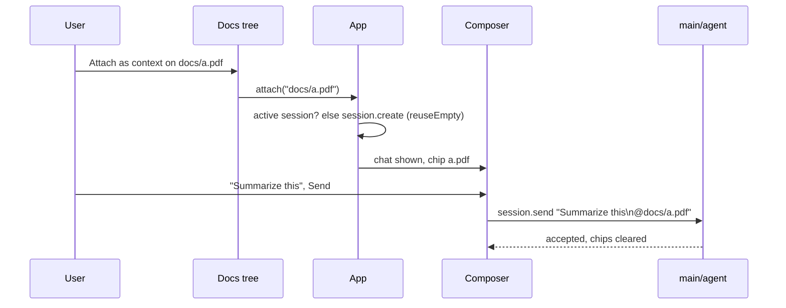

# TASK-2fef1397 diagrams

Illustrates `## Design` in `TASK-2fef1397.md`. The Design text is authoritative.

| Node | Class |
|---|---|
| lib/attachments.ts, AttachmentsContext | added |
| App (state, attach), Composer (chips, mentions), DocsTree / TreeMenu (item, disabled), prompt.ts rule | changed |
| session.send, session.create, workbench tools | unchanged (reused) |

## Structure

## Sequence

## State

Not drawn: per session, attachments are a list that grows by Attach (to 20), shrinks by remove
and empties on an accepted send.
